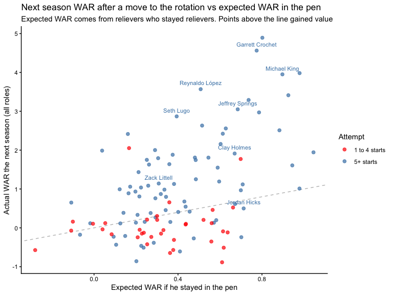
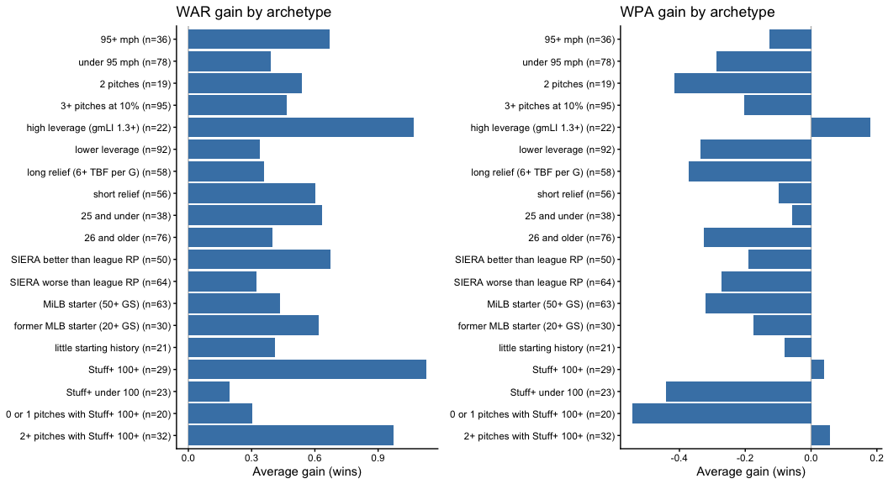

Step 2: How Conversions Went
================

``` r
library(dplyr)
library(readr)
library(ggplot2)
library(gridExtra)
library(splines)
```

## WAR and WPA compared to staying in the bullpen

The comparison is each pitcher’s next season to what a similar reliever
who stayed in the bullpen did the next season.

``` r
role_seasons <- read_csv("data/fg_role_seasons.csv", guess_max = 20000, show_col_types = FALSE) |>
  mutate(IP = floor(IP) + (IP %% 1) * 10 / 3)

# FanGraphs season totals (starter and reliever rows added together)
season_values <- role_seasons |>
  group_by(playerid, Season) |>
  summarize(xMLBAMID = first(xMLBAMID), G = sum(G), GS = sum(GS), IP = sum(IP), WAR = sum(WAR),
            .groups = "drop")
```

``` r
# Traded pitchers have TOT rows plus one row per team. Pitchers traded across leagues also get
# AL and NL subtotals labeled TOT, so the full season is the TOT row with the most innings
bref <- read_csv("data/bref_win_probability.csv", show_col_types = FALSE) |>
  group_by(bref_id, Season) |>
  filter(n() == 1 | team_ID == "TOT") |>
  filter(IP == max(IP)) |>
  ungroup()
id_map <- read_csv("data/id_map.csv", show_col_types = FALSE) |>
  distinct(bref_id, .keep_all = TRUE)
bref <- bref |>
  inner_join(id_map, by = "bref_id") |>
  select(xMLBAMID, Season, WPA = wpa_def, aLI = leverage_index_avg)

season_values <- season_values |>
  left_join(bref, by = c("xMLBAMID", "Season"))
cat("FanGraphs pitcher seasons matched to Baseball-Reference:", sum(!is.na(season_values$WPA)), "of",
    nrow(season_values), "\n")
```

    ## FanGraphs pitcher seasons matched to Baseball-Reference: 10529 of 10529

``` r
lg_rp <- role_seasons |>
  filter(role == "rel") |>
  group_by(Season) |>
  summarize(lg_rp_siera = weighted.mean(SIERA, TBF, na.rm = TRUE))
lg_sp <- role_seasons |>
  filter(role == "sta") |>
  group_by(Season) |>
  summarize(lg_sp_siera = weighted.mean(SIERA, TBF, na.rm = TRUE))

season_N <- season_values |>
  select(playerid, rp_season = Season, N_G = G, N_GS = GS, N_IP = IP, N_WAR = WAR, N_WPA = WPA,
         N_aLI = aLI)
season_next <- season_values |>
  select(playerid, next_season = Season, next_G = G, next_GS = GS, next_IP = IP, next_WAR = WAR,
         next_WPA = WPA, next_aLI = aLI)
```

``` r
# Same relief season definition as 01_data.Rmd
relief_seasons <- role_seasons |>
  filter(role == "rel", TBF >= 100) |>
  left_join(lg_rp, by = "Season") |>
  transmute(playerid, rp_season = Season, rp_age = Age, rp_SIERA = SIERA, rp_SIERA_vs_lg = SIERA - lg_rp_siera) |>
  inner_join(season_N, by = c("playerid", "rp_season")) |>
  filter(N_GS / N_G <= 0.2)

# Baseline group: relievers who stayed relievers the next season and threw 20+ IP
stayers <- relief_seasons |>
  mutate(next_season = rp_season + 1) |>
  inner_join(season_next, by = c("playerid", "next_season")) |>
  filter(next_GS / next_G <= 0.2, next_IP >= 20)
cat("Stay-in-pen baseline seasons:", nrow(stayers), "\n")
```

    ## Stay-in-pen baseline seasons: 1793

``` r
# Expected next season value if the pitcher had stayed in the pen
war_model <- lm(next_WAR ~ N_WAR + rp_SIERA_vs_lg + N_IP + rp_age, data = stayers)
wpa_model <- lm(next_WPA ~ N_WPA + rp_SIERA_vs_lg + N_IP + rp_age, data = stayers)

# All attempts: 5+ starts (the main sample) and 1 to 4 starts (short attempts)
archetype_cols <- c("playerid", "PlayerName", "rp_season", "sp_season", "sp_GS", "sp_IP",
                    "rp_FBVelo", "rp_NumPitches10", "rp_gmLI", "rp_TBFPerG", "rp_StuffPlus",
                    "rp_NumPlusPitches", "rp_KBB")
conversions <- read_csv("data/conversions.csv", show_col_types = FALSE) |>
  select(all_of(archetype_cols)) |>
  mutate(attempt = "5+ starts")
short_attempts <- read_csv("data/short_attempts.csv", show_col_types = FALSE) |>
  select(all_of(archetype_cols)) |>
  mutate(attempt = "1 to 4 starts")

attempts <- bind_rows(conversions, short_attempts) |>
  inner_join(relief_seasons, by = c("playerid", "rp_season")) |>
  inner_join(season_next, by = c("playerid", "sp_season" = "next_season")) |>
  left_join(lg_sp, by = c("sp_season" = "Season")) |>
  mutate(Cushion = lg_sp_siera - rp_SIERA)

attempts$pen_WAR <- predict(war_model, newdata = attempts)
attempts$pen_WPA <- predict(wpa_model, newdata = attempts)
attempts <- attempts |>
  mutate(WAR_gain = next_WAR - pen_WAR,
         WPA_gain = next_WPA - pen_WPA)
```

``` r
# Starting history before the relief season (MLB from 2014, minors from 2006)
minors <- read_csv("data/fg_minors.csv", show_col_types = FALSE)
attempts$prev_MLB_GS <- 0
attempts$MiLB_GS <- 0
for (i in 1:nrow(attempts)) {
  before <- season_values |> filter(playerid == attempts$playerid[i], Season < attempts$rp_season[i])
  player_minors <- minors |> filter(playerid == as.character(attempts$playerid[i]),
      Season <= attempts$rp_season[i])
  attempts$prev_MLB_GS[i] <- sum(before$GS)
  attempts$MiLB_GS[i] <- sum(player_minors$GS)
}

write_csv(attempts, "data/value_attempts.csv")

cat("Stay-in-pen models fit on", nrow(stayers), "reliever seasons followed by another relief season (20+ IP)\n")
```

    ## Stay-in-pen models fit on 1793 reliever seasons followed by another relief season (20+ IP)

``` r
cat("WAR model R^2:", round(summary(war_model)$r.squared, 3),
    " WPA model R^2:", round(summary(wpa_model)$r.squared, 3), "\n\n")
```

    ## WAR model R^2: 0.137  WPA model R^2: 0.08

``` r
cat("Stayers, average change from season N to N+1\n")
```

    ## Stayers, average change from season N to N+1

``` r
stayers |>
  summarize(n = n(), N_IP = mean(N_IP), next_IP = mean(next_IP), N_WAR = mean(N_WAR), next_WAR = mean(next_WAR),
            N_WPA = mean(N_WPA, na.rm = TRUE), next_WPA = mean(next_WPA, na.rm = TRUE)) |>
  as.data.frame() |> print(digits = 3)
```

    ##      n N_IP next_IP N_WAR next_WAR N_WPA next_WPA
    ## 1 1793 53.9      51 0.594    0.471  0.53    0.397

``` r
cat("\nAttempts, actual next season vs expected if they had stayed in the pen\n")
```

    ## 
    ## Attempts, actual next season vs expected if they had stayed in the pen

``` r
attempts |>
  group_by(attempt) |>
  summarize(n = n(), N_IP = mean(N_IP), next_IP = mean(next_IP), N_aLI = mean(N_aLI, na.rm = TRUE),
            next_aLI = mean(next_aLI, na.rm = TRUE), N_WAR = mean(N_WAR), next_WAR = mean(next_WAR),
            pen_WAR = mean(pen_WAR), share_WAR_gain = mean(WAR_gain > 0), WAR_gain_se = sd(WAR_gain) / sqrt(n()),
            WAR_gain = mean(WAR_gain), WPA_gain = mean(WPA_gain, na.rm = TRUE)) |>
  as.data.frame() |> print(digits = 3)
```

    ##         attempt  n N_IP next_IP N_aLI next_aLI N_WAR next_WAR pen_WAR
    ## 1 1 to 4 starts 35 54.4    41.8 0.766    0.782 0.067   0.0379   0.319
    ## 2     5+ starts 79 55.8   106.1 0.913    0.929 0.364   1.2409   0.426
    ##   share_WAR_gain WAR_gain_se WAR_gain WPA_gain
    ## 1          0.229       0.102   -0.281   -0.372
    ## 2          0.734       0.127    0.815   -0.177

``` r
cat("\nAll attempts together\n")
```

    ## 
    ## All attempts together

``` r
attempts |>
  summarize(n = n(), next_WAR = mean(next_WAR), pen_WAR = mean(pen_WAR),
            share_WAR_gain = mean(WAR_gain > 0), share_WPA_gain = mean(WPA_gain > 0, na.rm = TRUE),
            WAR_gain_se = sd(WAR_gain) / sqrt(n()),
            WPA_gain_se = sd(WPA_gain, na.rm = TRUE) / sqrt(sum(!is.na(WPA_gain))),
            WAR_gain = mean(WAR_gain), WPA_gain = mean(WPA_gain, na.rm = TRUE)) |>
  as.data.frame() |> print(digits = 3)
```

    ##     n next_WAR pen_WAR share_WAR_gain share_WPA_gain WAR_gain_se WPA_gain_se
    ## 1 114    0.872   0.393          0.579          0.377       0.104       0.103
    ##   WAR_gain WPA_gain
    ## 1    0.478   -0.237

``` r
# Archetypes, measured in the relief season
attempts <- attempts |>
  mutate(Velo = ifelse(rp_FBVelo >= 95, "95+ mph", "under 95 mph"),
         Arsenal = ifelse(rp_NumPitches10 >= 3, "3+ pitches at 10%", "2 pitches"),
         Leverage = ifelse(rp_gmLI >= 1.3, "high leverage (gmLI 1.3+)", "lower leverage"),
         Length = ifelse(rp_TBFPerG >= 6, "long relief (6+ TBF per G)", "short relief"),
         Age = ifelse(rp_age <= 25, "25 and under", "26 and older"),
         ReliefQuality = ifelse(rp_SIERA_vs_lg < 0, "SIERA better than league RP", "SIERA worse than league RP"),
         StartingHistory = case_when(prev_MLB_GS >= 20 ~ "former MLB starter (20+ GS)",
                                     MiLB_GS >= 50 ~ "MiLB starter (50+ GS)",
                                     TRUE ~ "little starting history"),
         StuffPlus = case_when(is.na(rp_StuffPlus) ~ NA,
                               rp_StuffPlus >= 100 ~ "Stuff+ 100+",
                               TRUE ~ "Stuff+ under 100"),
         PlusPitches = case_when(is.na(rp_NumPlusPitches) ~ NA,
                                 rp_NumPlusPitches >= 2 ~ "2+ pitches with Stuff+ 100+",
                                 TRUE ~ "0 or 1 pitches with Stuff+ 100+"))

archetypes <- c("Velo", "Arsenal", "Leverage", "Length", "Age", "ReliefQuality", "StartingHistory",
                "StuffPlus", "PlusPitches")
archetype_table <- NULL
for (archetype in archetypes) {
  group_summary <- attempts |>
    filter(!is.na(.data[[archetype]])) |>
    group_by(group = .data[[archetype]]) |>
    summarize(n = n(), share_5plus_GS = mean(attempt == "5+ starts"), next_IP = mean(next_IP),
              next_WAR = mean(next_WAR), pen_WAR = mean(pen_WAR), share_WAR_gain = mean(WAR_gain > 0),
              WAR_gain_se = sd(WAR_gain) / sqrt(n()), WPA_gain_se = sd(WPA_gain, na.rm = TRUE) / sqrt(n()),
              WAR_gain = mean(WAR_gain), WPA_gain = mean(WPA_gain, na.rm = TRUE)) |>
    mutate(archetype = archetype, .before = group)
  archetype_table <- bind_rows(archetype_table, group_summary)
}
archetype_table <- archetype_table |> mutate(across(where(is.numeric), ~ round(.x, 3)))
write_csv(archetype_table, "results/02_value_by_archetype.csv")
print(as.data.frame(archetype_table))
```

    ##          archetype                           group  n share_5plus_GS next_IP
    ## 1             Velo                         95+ mph 36          0.778  95.852
    ## 2             Velo                    under 95 mph 78          0.654  81.974
    ## 3          Arsenal                       2 pitches 19          0.632  88.614
    ## 4          Arsenal               3+ pitches at 10% 95          0.705  85.905
    ## 5         Leverage       high leverage (gmLI 1.3+) 22          0.864 115.909
    ## 6         Leverage                  lower leverage 92          0.652  79.290
    ## 7           Length      long relief (6+ TBF per G) 58          0.724  78.080
    ## 8           Length                    short relief 56          0.661  94.929
    ## 9              Age                    25 and under 38          0.711  90.202
    ## 10             Age                    26 and older 76          0.684  84.434
    ## 11   ReliefQuality     SIERA better than league RP 50          0.700  92.607
    ## 12   ReliefQuality      SIERA worse than league RP 64          0.688  81.474
    ## 13 StartingHistory           MiLB starter (50+ GS) 63          0.714  84.254
    ## 14 StartingHistory     former MLB starter (20+ GS) 30          0.733  87.656
    ## 15 StartingHistory         little starting history 21          0.571  90.810
    ## 16       StuffPlus                     Stuff+ 100+ 29          0.793 106.920
    ## 17       StuffPlus                Stuff+ under 100 23          0.652  74.188
    ## 18     PlusPitches 0 or 1 pitches with Stuff+ 100+ 20          0.600  66.617
    ## 19     PlusPitches     2+ pitches with Stuff+ 100+ 32          0.812 108.583
    ##    next_WAR pen_WAR share_WAR_gain WAR_gain_se WPA_gain_se WAR_gain WPA_gain
    ## 1     1.181   0.513          0.694       0.204       0.196    0.669   -0.127
    ## 2     0.729   0.338          0.526       0.120       0.121    0.390   -0.288
    ## 3     0.941   0.402          0.579       0.302       0.325    0.540   -0.414
    ## 4     0.858   0.392          0.579       0.111       0.106    0.466   -0.202
    ## 5     1.619   0.551          0.727       0.286       0.272    1.068    0.179
    ## 6     0.693   0.356          0.543       0.105       0.108    0.337   -0.336
    ## 7     0.683   0.326          0.552       0.128       0.137    0.357   -0.371
    ## 8     1.067   0.463          0.607       0.166       0.154    0.604   -0.099
    ## 9     1.084   0.449          0.684       0.204       0.168    0.636   -0.058
    ## 10    0.765   0.366          0.526       0.119       0.130    0.399   -0.327
    ## 11    1.290   0.616          0.560       0.199       0.168    0.674   -0.191
    ## 12    0.544   0.219          0.594       0.099       0.130    0.325   -0.273
    ## 13    0.829   0.394          0.587       0.128       0.122    0.434   -0.320
    ## 14    1.008   0.390          0.533       0.237       0.239    0.618   -0.174
    ## 15    0.805   0.395          0.619       0.253       0.257    0.410   -0.080
    ## 16    1.696   0.569          0.759       0.249       0.187    1.127    0.040
    ## 17    0.558   0.363          0.565       0.214       0.214    0.195   -0.441
    ## 18    0.658   0.356          0.550       0.256       0.227    0.303   -0.543
    ## 19    1.527   0.554          0.750       0.233       0.175    0.973    0.058

``` r
# actual next season WAR vs expected WAR in the pen
known <- c("Garrett Crochet", "Reynaldo López", "Jordan Hicks", "Michael King", "Seth Lugo",
           "Clay Holmes", "A.J. Puk", "Zack Littell", "Jeffrey Springs")
ggplot(attempts, aes(pen_WAR, next_WAR, color = attempt)) +
  geom_abline(slope = 1, intercept = 0, color = "gray", linetype = "dashed") +
  geom_point(alpha = 0.7, size = 2) +
  geom_text(data = attempts |> filter(PlayerName %in% known), aes(label = PlayerName),
            size = 3, vjust = -1, show.legend = FALSE) +
  scale_color_manual(values = c("5+ starts" = "steelblue", "1 to 4 starts" = "red")) +
  labs(title = "Next season WAR after a move to the rotation vs expected WAR in the pen",
       subtitle = "Expected WAR comes from relievers who stayed relievers. Points above the line gained value",
       x = "Expected WAR if he stayed in the pen", y = "Actual WAR the next season (all roles)",
       color = "Attempt") +
  theme_classic()
```

<!-- -->

``` r
ggsave("charts/02_war_vs_pen_baseline.png", width = 8, height = 6, dpi = 150)
```

``` r
# Average gain by archetype, WAR and WPA side by side
archetype_table <- archetype_table |>
  mutate(label = paste0(group, " (n=", n, ")"), label = factor(label, levels = rev(label)))
war_plot <- ggplot(archetype_table, aes(WAR_gain, label)) +
  geom_vline(xintercept = 0, color = "gray") +
  geom_col(fill = "steelblue") +
  labs(title = "WAR gain by archetype", x = "Average gain (wins)", y = NULL) +
  theme_classic()
wpa_plot <- ggplot(archetype_table, aes(WPA_gain, label)) +
  geom_vline(xintercept = 0, color = "gray") +
  geom_col(fill = "steelblue") +
  labs(title = "WPA gain by archetype", x = "Average gain (wins)", y = NULL) +
  theme_classic()
ggsave("charts/02_value_gain_by_archetype.png", grid.arrange(war_plot, wpa_plot, ncol = 2),
       width = 11, height = 6, dpi = 150)
```

<!-- -->

## WAA

WAR compares to replacement level, so I also checked measures that
compare to an average pitcher. `WAA_fg` is FanGraphs WAR minus the
average pace for the same role and season. `WAA_br` is from
Baseball-Reference.

``` r
role_seasons <- read_csv("data/fg_role_seasons.csv", guess_max = 20000, show_col_types = FALSE) |>
  mutate(IP = floor(IP) + (IP %% 1) * 10 / 3)

# FanGraphs WAA by role: WAR minus what an average pitcher in the same role and season earns per inning
role_pace <- role_seasons |>
  group_by(Season, role) |>
  summarize(war_per_ip = sum(WAR, na.rm = TRUE) / sum(IP, na.rm = TRUE), .groups = "drop")
league <- role_seasons |>
  filter(!is.na(SIERA)) |>
  group_by(Season) |>
  summarize(lg_SIERA = weighted.mean(SIERA, TBF), .groups = "drop") |>
  left_join(role_seasons |> group_by(Season) |> summarize(runs_per_win = sum(RAR, na.rm = TRUE) / sum(WAR,
      na.rm = TRUE)),
            by = "Season")
league_rp <- role_seasons |>
  filter(role == "rel") |>
  group_by(Season) |>
  summarize(lg_rp_siera = weighted.mean(SIERA, TBF, na.rm = TRUE))

fg_season <- role_seasons |>
  left_join(role_pace, by = c("Season", "role")) |>
  mutate(WAA_fg_row = WAR - war_per_ip * IP) |>
  group_by(playerid, Season) |>
  summarize(SIERA = weighted.mean(SIERA, TBF, na.rm = TRUE), xMLBAMID = first(xMLBAMID), Age = first(Age),
            G = sum(G), GS = sum(GS), IP = sum(IP), TBF = sum(TBF), WAR = sum(WAR), WAA_fg = sum(WAA_fg_row),
            .groups = "drop") |>
  left_join(league, by = "Season") |>
  mutate(skill_wins = (lg_SIERA - SIERA) * IP / 9 / runs_per_win)
```

``` r
# Baseball-Reference value (WAA, leverage adjustment) and win probability (WPA, aLI)
bref_value <- read_csv("data/bref_value_pitching.csv", show_col_types = FALSE) |>
  mutate(IP_br = floor(p_ip) + (p_ip %% 1) * 10 / 3) |>
  group_by(bref_id, Season) |>
  filter(n() == 1 | team_ID == "TOT" | grepl("^[0-9]TM$", team_ID)) |>
  filter(IP_br == max(IP_br)) |>
  slice(1) |>
  ungroup() |>
  transmute(bref_id, Season, br_G = p_g, br_GS = p_gs, br_IP = IP_br, WAA_br = p_waa,
      WAA_adj_br = coalesce(p_waa_adj, 0),
            RAA_br = p_raa, WAR_br = p_war, RA9role_br = p_ra9_role)
bref_wp <- read_csv("data/bref_win_probability.csv", show_col_types = FALSE) |>
  group_by(bref_id, Season) |>
  filter(n() == 1 | team_ID == "TOT") |>
  filter(IP == max(IP)) |>
  slice(1) |>
  ungroup() |>
  select(bref_id, Season, WPA = wpa_def, aLI = leverage_index_avg)
id_map <- read_csv("data/id_map.csv", show_col_types = FALSE) |> distinct(bref_id, .keep_all = TRUE)

seasons <- fg_season |>
  inner_join(id_map |> select(xMLBAMID, bref_id), by = "xMLBAMID") |>
  inner_join(bref_value, by = c("bref_id", "Season")) |>
  inner_join(bref_wp, by = c("bref_id", "Season")) |>
  mutate(WAA_br_adj = WAA_br + WAA_adj_br)

cat("FanGraphs pitcher seasons matched to Baseball-Reference value and win probability:", nrow(seasons), "of",
    nrow(fg_season), "\n\n")
```

    ## FanGraphs pitcher seasons matched to Baseball-Reference value and win probability: 10528 of 10528

``` r
cat("1. Is the Baseball-Reference WAA baseline adjusted for role? IP weighted mean WAA per 100 IP\n")
```

    ## 1. Is the Baseball-Reference WAA baseline adjusted for role? IP weighted mean WAA per 100 IP

``` r
pure <- bref_value |> filter(br_IP >= 20)
cat("Pure relievers (no starts):", round(sum(pure$WAA_br[pure$br_GS == 0]) / sum(pure$br_IP[pure$br_GS == 0]) * 100, 2),
    " pure starters (all games starts):", round(sum(pure$WAA_br[pure$br_GS == pure$br_G]) / sum(pure$br_IP[pure$br_GS == pure$br_G]) * 100, 2),
    " mean role adjustment (RA9 role) relievers:", round(mean(pure$RA9role_br[pure$br_GS == 0]), 2), " starters:",
    round(mean(pure$RA9role_br[pure$br_GS == pure$br_G]), 2), "\n")
```

    ## Pure relievers (no starts): 0.25  pure starters (all games starts): 0.54  mean role adjustment (RA9 role) relievers: -0.31  starters: 0.2

``` r
cat("FanGraphs WAR per 100 IP for comparison, relievers:",
    round(sum(seasons$WAR[seasons$GS == 0 & seasons$IP >= 20]) / sum(seasons$IP[seasons$GS == 0 & seasons$IP >= 20]) * 100, 2),
    " starters:", round(sum(seasons$WAR[seasons$GS == seasons$G & seasons$IP >= 20]) / sum(seasons$IP[seasons$GS == seasons$G & seasons$IP >= 20]) * 100, 2), "\n\n")
```

    ## FanGraphs WAR per 100 IP for comparison, relievers: 0.86  starters: 1.52

``` r
# Relievers who stayed relievers (same definition as 06)
relievers <- seasons |> filter(GS / G <= 0.2, TBF >= 100)
next_year <- seasons |>
  transmute(playerid, Season, next_G = G, next_GS = GS, next_IP = IP, next_WAR = WAR, next_WAA_fg = WAA_fg,
            next_WAA_br = WAA_br, next_WAA_br_adj = WAA_br_adj, next_WPA = WPA)
stayers <- relievers |>
  mutate(next_season = Season + 1) |>
  inner_join(next_year, by = c("playerid", "next_season" = "Season")) |>
  filter(next_GS / next_G <= 0.2, next_IP >= 20)

measures <- c("WAR", "WAA_fg", "WAA_br", "WAA_br_adj", "WPA")
cat("2. How well each measure repeats for", nrow(stayers), "relievers who stayed relievers\n")
```

    ## 2. How well each measure repeats for 1808 relievers who stayed relievers

``` r
cat("Correlation of this season with next season. Totals include innings pitched, rates are per 65 IP. Standard error is about",
    round(1 / sqrt(nrow(stayers) - 3), 3), "\n")
```

    ## Correlation of this season with next season. Totals include innings pitched, rates are per 65 IP. Standard error is about 0.024

``` r
stability <- NULL
for (m in measures) {
  this_total <- stayers[[m]]
  next_total <- stayers[[paste0("next_", m)]]
  this_rate <- this_total / stayers$IP * 65
  next_rate <- next_total / stayers$next_IP * 65
  stability <- bind_rows(stability, data.frame(
    measure = m, r_total = round(cor(this_total, next_total), 3), r_rate_per_65_IP = round(cor(this_rate,
      next_rate), 3),
    r_with_skill_wins_same_season = round(cor(this_total, stayers$skill_wins), 3)))
}
print(stability, row.names = FALSE)
```

    ##     measure r_total r_rate_per_65_IP r_with_skill_wins_same_season
    ##         WAR   0.322            0.289                         0.779
    ##      WAA_fg   0.319            0.293                         0.767
    ##      WAA_br   0.116            0.079                         0.523
    ##  WAA_br_adj   0.130            0.094                         0.539
    ##         WPA   0.166            0.120                         0.544

``` r
cat("(r_with_skill_wins_same_season shows how much of each measure is the SIERA based skill signal)\n\n")
```

    ## (r_with_skill_wins_same_season shows how much of each measure is the SIERA based skill signal)

``` r
# Conversion gains: actual next season minus the stay-in-the-pen projection, same method as 02_value.Rmd
cat("3. Conversion gain by measure (actual starter season minus the stay-in-the-pen projection), 114 attempts\n")
```

    ## 3. Conversion gain by measure (actual starter season minus the stay-in-the-pen projection), 114 attempts

``` r
lg_rp <- league_rp
relief_info <- role_seasons |>
  filter(role == "rel") |>
  left_join(lg_rp, by = "Season") |>
  transmute(playerid, Season, rp_SIERA_vs_lg = SIERA - lg_rp_siera, rp_age = Age)
stay_fit <- stayers |>
  left_join(relief_info, by = c("playerid", "Season"))
attempts <- read_csv("data/value_attempts.csv", show_col_types = FALSE) |>
  select(playerid, PlayerName, rp_season, sp_season, attempt, rp_StuffPlus, Cushion, WAR_gain_06 = WAR_gain)
N_values <- seasons |>
  left_join(relief_info, by = c("playerid", "Season")) |>
  transmute(playerid, rp_season = Season, rp_SIERA_vs_lg, rp_age, N_IP = IP, N_WAR = WAR, N_WAA_fg = WAA_fg,
      N_WAA_br = WAA_br,
            N_WAA_br_adj = WAA_br_adj, N_WPA = WPA)
sp_values <- seasons |>
  transmute(playerid, sp_season = Season, sp_WAR = WAR, sp_WAA_fg = WAA_fg, sp_WAA_br = WAA_br,
      sp_WAA_br_adj = WAA_br_adj,
            sp_WPA = WPA)
attempts <- attempts |>
  inner_join(N_values, by = c("playerid", "rp_season")) |>
  inner_join(sp_values, by = c("playerid", "sp_season"))

gain_measures <- c("WAR", "WAA_fg", "WAA_br", "WAA_br_adj", "WPA")
for (m in gain_measures) {
  fit <- lm(as.formula(paste0("next_", m, " ~ ", m, " + rp_SIERA_vs_lg + IP + rp_age")), data = stay_fit)
  newdata <- attempts
  newdata[[m]] <- attempts[[paste0("N_", m)]]
  newdata$IP <- attempts$N_IP
  attempts[[paste0("pen_", m)]] <- predict(fit, newdata = newdata)
  attempts[[paste0(m, "_gain")]] <- attempts[[paste0("sp_", m)]] - attempts[[paste0("pen_", m)]]
}
cat("Check against 02_value.Rmd: mean WAR gain here", round(mean(attempts$WAR_gain), 3), " there",
    round(mean(attempts$WAR_gain_06), 3),
    " (n =", nrow(attempts), ")\n\n")
```

    ## Check against 02_value.Rmd: mean WAR gain here 0.479  there 0.478  (n = 114 )

``` r
# Summary of gains for a group of attempts
gain_summary <- function(data, label) {
  rows <- NULL
  for (m in gain_measures) {
    gain <- data[[paste0(m, "_gain")]]
    rows <- bind_rows(rows, data.frame(group = label, measure = m, n = length(gain), mean_gain = round(mean(gain),
      3),
                                       se = round(sd(gain) / sqrt(length(gain)), 3),
                                         share_gaining = round(mean(gain > 0), 2)))
  }
  rows
}
attempts <- attempts |>
  mutate(CushionGroup = case_when(Cushion < 0.5 ~ "cushion under 0.5", Cushion < 1 ~ "cushion 0.5 to 1",
      TRUE ~ "cushion 1+"),
         StuffGroup = case_when(is.na(rp_StuffPlus) ~ NA_character_, rp_StuffPlus >= 100 ~ "Stuff+ 100+",
           TRUE ~ "Stuff+ under 100"))
gain_table <- gain_summary(attempts, "all 114 attempts")
gain_table <- bind_rows(gain_table, gain_summary(attempts |> filter(attempt == "5+ starts"), "5+ starts"))
gain_table <- bind_rows(gain_table, gain_summary(attempts |> filter(attempt == "1 to 4 starts"), "1 to 4 starts"))
for (g in c("cushion under 0.5", "cushion 0.5 to 1", "cushion 1+")) {
  gain_table <- bind_rows(gain_table, gain_summary(attempts |> filter(CushionGroup == g), g))
}
for (g in c("Stuff+ 100+", "Stuff+ under 100")) {
  gain_table <- bind_rows(gain_table, gain_summary(attempts |> filter(StuffGroup == g), g))
}
write_csv(gain_table, "results/02_waa_gains.csv")
print(as.data.frame(gain_table |> tidyr::pivot_wider(names_from = measure, values_from = c(mean_gain, se,
    share_gaining)) |>
                      select(group, n, starts_with("mean_gain"))), row.names = FALSE)
```

    ##              group   n mean_gain_WAR mean_gain_WAA_fg mean_gain_WAA_br
    ##   all 114 attempts 114         0.479           -0.200            0.074
    ##          5+ starts  79         0.816           -0.161            0.248
    ##      1 to 4 starts  35        -0.280           -0.288           -0.320
    ##  cushion under 0.5  64         0.408           -0.186            0.015
    ##   cushion 0.5 to 1  28         0.237           -0.453           -0.189
    ##         cushion 1+  22         0.996            0.081            0.581
    ##        Stuff+ 100+  29         1.129            0.119            0.611
    ##   Stuff+ under 100  23         0.197           -0.338           -0.195
    ##  mean_gain_WAA_br_adj mean_gain_WPA
    ##                 0.060        -0.234
    ##                 0.218        -0.174
    ##                -0.294        -0.370
    ##                 0.027        -0.161
    ##                -0.220        -0.654
    ##                 0.514         0.086
    ##                 0.559         0.046
    ##                -0.172        -0.437

``` r
cat("\nStandard errors and shares gaining\n")
```

    ## 
    ## Standard errors and shares gaining

``` r
print(as.data.frame(gain_table |> filter(measure %in% c("WAR", "WAA_fg", "WAA_br", "WAA_br_adj")) |>
                      select(group, n, measure, se, share_gaining) |>
                      tidyr::pivot_wider(id_cols = c(group, n), names_from = measure, values_from = c(se,
                        share_gaining))), row.names = FALSE)
```

    ##              group   n se_WAR se_WAA_fg se_WAA_br se_WAA_br_adj
    ##   all 114 attempts 114  0.104     0.072     0.103         0.100
    ##          5+ starts  79  0.127     0.095     0.131         0.127
    ##      1 to 4 starts  35  0.102     0.096     0.143         0.142
    ##  cushion under 0.5  64  0.121     0.085     0.125         0.120
    ##   cushion 0.5 to 1  28  0.213     0.146     0.207         0.197
    ##         cushion 1+  22  0.293     0.197     0.275         0.274
    ##        Stuff+ 100+  29  0.249     0.169     0.219         0.213
    ##   Stuff+ under 100  23  0.214     0.143     0.220         0.213
    ##  share_gaining_WAR share_gaining_WAA_fg share_gaining_WAA_br
    ##               0.58                 0.32                 0.43
    ##               0.73                 0.37                 0.48
    ##               0.23                 0.20                 0.31
    ##               0.58                 0.30                 0.38
    ##               0.46                 0.29                 0.39
    ##               0.73                 0.41                 0.64
    ##               0.76                 0.41                 0.66
    ##               0.57                 0.30                 0.39
    ##  share_gaining_WAA_br_adj
    ##                      0.44
    ##                      0.48
    ##                      0.34
    ##                      0.38
    ##                      0.39
    ##                      0.68
    ##                      0.66
    ##                      0.39

``` r
cat("\n4. Do the measures agree on who gained? Spearman correlation of conversion gains, 114 attempts\n")
```

    ## 
    ## 4. Do the measures agree on who gained? Spearman correlation of conversion gains, 114 attempts

``` r
gain_matrix <- attempts[, paste0(gain_measures, "_gain")]
print(round(cor(gain_matrix, method = "spearman"), 2))
```

    ##                 WAR_gain WAA_fg_gain WAA_br_gain WAA_br_adj_gain WPA_gain
    ## WAR_gain            1.00        0.74        0.71            0.69     0.61
    ## WAA_fg_gain         0.74        1.00        0.63            0.64     0.62
    ## WAA_br_gain         0.71        0.63        1.00            0.99     0.80
    ## WAA_br_adj_gain     0.69        0.64        0.99            1.00     0.80
    ## WPA_gain            0.61        0.62        0.80            0.80     1.00

## Checking the bullpen baseline

The gains depend on the baseline, so I compared the linear model to a
flexible model and to matched controls.

``` r
role_seasons <- read_csv("data/fg_role_seasons.csv", guess_max = 20000, show_col_types = FALSE) |>
  mutate(IP = floor(IP) + (IP %% 1) * 10 / 3)

role_pace <- role_seasons |> group_by(Season, role) |> summarize(war_per_ip = sum(WAR, na.rm = TRUE) / sum(IP,
    na.rm = TRUE), .groups = "drop")
league <- role_seasons |> filter(!is.na(SIERA)) |> group_by(Season) |> summarize(lg_SIERA = weighted.mean(SIERA,
    TBF), .groups = "drop") |>
  left_join(role_seasons |> group_by(Season) |> summarize(runs_per_win = sum(RAR, na.rm = TRUE) / sum(WAR,
      na.rm = TRUE)), by = "Season")
league_rp <- role_seasons |> filter(role == "rel") |> group_by(Season) |>
    summarize(lg_rp_siera = weighted.mean(SIERA, TBF, na.rm = TRUE))
league_sp <- role_seasons |> filter(role == "sta") |> group_by(Season) |>
    summarize(lg_sp_siera = weighted.mean(SIERA, TBF, na.rm = TRUE))

fg_season <- role_seasons |>
  left_join(role_pace, by = c("Season", "role")) |>
  mutate(WAA_fg_row = WAR - war_per_ip * IP) |>
  group_by(playerid, Season) |>
  summarize(SIERA = weighted.mean(SIERA, TBF, na.rm = TRUE), xMLBAMID = first(xMLBAMID), Age = first(Age),
      G = sum(G), GS = sum(GS),
            IP = sum(IP), TBF = sum(TBF), WAR = sum(WAR), WAA_fg = sum(WAA_fg_row), .groups = "drop") |>
  left_join(league, by = "Season") |>
  mutate(skill_wins = (lg_SIERA - SIERA) * IP / 9 / runs_per_win)
relief_info <- role_seasons |>
  filter(role == "rel") |>
  left_join(league_rp, by = "Season") |>
  transmute(playerid, Season, rp_SIERA_vs_lg = SIERA - lg_rp_siera, rp_gmLI = gmLI)
```

``` r
# Stayers, same definition as 02_value.Rmd
next_year <- fg_season |> transmute(playerid, Season, next_G = G, next_GS = GS, next_IP = IP, next_WAR = WAR,
    next_WAA_fg = WAA_fg)
stayers <- fg_season |>
  filter(GS / G <= 0.2, TBF >= 100) |>
  left_join(relief_info, by = c("playerid", "Season")) |>
  mutate(next_season = Season + 1) |>
  inner_join(next_year, by = c("playerid", "next_season" = "Season")) |>
  filter(next_GS / next_G <= 0.2, next_IP >= 20) |>
  left_join(league_sp, by = "Season") |>
  mutate(cushion = lg_sp_siera - SIERA, rp_age = Age) |>
  filter(!is.na(rp_SIERA_vs_lg), !is.na(rp_gmLI))

attempts <- read_csv("data/value_attempts.csv", show_col_types = FALSE) |>
  select(playerid, PlayerName, rp_season, sp_season, attempt, rp_StuffPlus, Cushion) |>
  inner_join(fg_season |> left_join(relief_info, by = c("playerid", "Season")) |>
               transmute(playerid, rp_season = Season, rp_SIERA_vs_lg, rp_gmLI, rp_age = Age, N_IP = IP,
                 N_WAR = WAR, N_WAA_fg = WAA_fg),
             by = c("playerid", "rp_season")) |>
  inner_join(fg_season |> transmute(playerid, sp_season = Season, sp_WAR = WAR, sp_WAA_fg = WAA_fg),
      by = c("playerid", "sp_season")) |>
  filter(!is.na(rp_SIERA_vs_lg), !is.na(rp_gmLI)) |>
  mutate(CushionGroup = case_when(Cushion < 0.5 ~ "cushion under 0.5", Cushion < 1 ~ "cushion 0.5 to 1",
      TRUE ~ "cushion 1+"),
         StuffGroup = case_when(is.na(rp_StuffPlus) ~ NA_character_, rp_StuffPlus >= 100 ~ "Stuff+ 100+",
           TRUE ~ "Stuff+ under 100"))

cat("Stayers:", nrow(stayers), "reliever seasons followed by another relief season of 20+ IP. Attempts:",
    nrow(attempts), "\n\n")
```

    ## Stayers: 1808 reliever seasons followed by another relief season of 20+ IP. Attempts: 114

``` r
# 1. Calibration of the pen baseline
cat("1. Calibration of the stay-in-the-pen baseline for next season WAR. Cross-fitted by pitcher (10 folds) so every stayer is predicted by a model that never saw him.\n")
```

    ## 1. Calibration of the stay-in-the-pen baseline for next season WAR. Cross-fitted by pitcher (10 folds) so every stayer is predicted by a model that never saw him.

``` r
set.seed(0)
pitcher_ids <- unique(stayers$playerid)
fold_of <- sample(rep(1:10, length.out = length(pitcher_ids)))
stayers$fold <- fold_of[match(stayers$playerid, pitcher_ids)]
stayers$pred_linear <- NA
stayers$pred_flex <- NA
for (k in 1:10) {
  train <- stayers[stayers$fold != k, ]
  test <- stayers[stayers$fold == k, ]
  fit_lin <- lm(next_WAR ~ WAR + rp_SIERA_vs_lg + IP + rp_age, data = train)
  fit_flex <- lm(next_WAR ~ ns(WAR, 3) + ns(rp_SIERA_vs_lg, 3) + ns(IP, 3) + ns(rp_age, 2) + ns(rp_gmLI, 2),
      data = train)
  stayers$pred_linear[stayers$fold == k] <- predict(fit_lin, newdata = test)
  stayers$pred_flex[stayers$fold == k] <- predict(fit_flex, newdata = test)
}
cat("Cross-fitted RMSE of next season WAR: linear", round(sqrt(mean((stayers$next_WAR - stayers$pred_linear)^2)),
    3), " flexible", round(sqrt(mean((stayers$next_WAR - stayers$pred_flex)^2)), 3),
    " no model", round(sd(stayers$next_WAR), 3), "\n")
```

    ## Cross-fitted RMSE of next season WAR: linear 0.691  flexible 0.687  no model 0.742

``` r
cat("Cross-fitted R^2: linear", round(1 - sum((stayers$next_WAR - stayers$pred_linear)^2) / sum((stayers$next_WAR - mean(stayers$next_WAR))^2), 3),
    " flexible", round(1 - sum((stayers$next_WAR - stayers$pred_flex)^2) / sum((stayers$next_WAR - mean(stayers$next_WAR))^2), 3), "\n\n")
```

    ## Cross-fitted R^2: linear 0.131  flexible 0.143

``` r
cat("Actual minus predicted next season WAR by tenth of the linear prediction (a calibrated baseline is near 0 in every tenth, and the top tenth is where the elite relievers sit)\n")
```

    ## Actual minus predicted next season WAR by tenth of the linear prediction (a calibrated baseline is near 0 in every tenth, and the top tenth is where the elite relievers sit)

``` r
calib <- stayers |> mutate(bin = ntile(pred_linear, 10)) |>
  group_by(bin) |>
  summarize(n = n(), mean_predicted = round(mean(pred_linear), 2), mean_actual = round(mean(next_WAR), 2),
            bias_linear = round(mean(next_WAR - pred_linear), 3), bias_flex = round(mean(next_WAR - pred_flex), 3),
            se_bias = round(sd(next_WAR - pred_linear) / sqrt(n()), 3), .groups = "drop")
print(as.data.frame(calib), row.names = FALSE)
```

    ##  bin   n mean_predicted mean_actual bias_linear bias_flex se_bias
    ##    1 181           0.03        0.18       0.148     0.026   0.045
    ##    2 181           0.20        0.24       0.041     0.018   0.048
    ##    3 181           0.29        0.30       0.012     0.032   0.049
    ##    4 181           0.35        0.35       0.004     0.022   0.047
    ##    5 181           0.41        0.36      -0.055    -0.012   0.047
    ##    6 181           0.48        0.40      -0.072    -0.006   0.047
    ##    7 181           0.55        0.39      -0.160    -0.111   0.049
    ##    8 181           0.63        0.55      -0.083    -0.034   0.046
    ##    9 180           0.75        0.78       0.024     0.029   0.063
    ##   10 180           1.00        1.15       0.152     0.050   0.065

``` r
cat("\nBias by cushion group among stayers (these are the groups the archetype results use)\n")
```

    ## 
    ## Bias by cushion group among stayers (these are the groups the archetype results use)

``` r
print(as.data.frame(stayers |>
                      mutate(group = case_when(cushion < 0.5 ~ "cushion under 0.5",
                        cushion < 1 ~ "cushion 0.5 to 1", TRUE ~ "cushion 1+")) |>
                      group_by(group) |>
                      summarize(n = n(), bias_linear = round(mean(next_WAR - pred_linear), 3),
                        bias_flex = round(mean(next_WAR - pred_flex), 3),
                                se = round(sd(next_WAR - pred_linear) / sqrt(n()), 3), .groups = "drop")),
                                  row.names = FALSE)
```

    ##              group   n bias_linear bias_flex    se
    ##   cushion 0.5 to 1 529      -0.077    -0.030 0.029
    ##         cushion 1+ 547       0.049     0.025 0.033
    ##  cushion under 0.5 732       0.022     0.006 0.023

``` r
# Matched control baseline: for each attempt, the average next season WAR of the 25 closest stayers (other
# pitchers) on this season WAR, SIERA, IP, age, leverage
match_gain <- function(data, outcome_next) {
  scale_cols <- c("WAR", "rp_SIERA_vs_lg", "IP", "rp_age", "rp_gmLI")
  mu <- sapply(stayers[, scale_cols], mean)
  sdv <- sapply(stayers[, scale_cols], sd)
  z_stay <- sweep(sweep(as.matrix(stayers[, scale_cols]), 2, mu), 2, sdv, "/")
  attempts_for_match <- data |> transmute(WAR = N_WAR, rp_SIERA_vs_lg, IP = N_IP, rp_age, rp_gmLI)
  z_att <- sweep(sweep(as.matrix(attempts_for_match[, scale_cols]), 2, mu), 2, sdv, "/")
  control <- rep(NA, nrow(data))
  for (i in 1:nrow(data)) {
    d <- sqrt(rowSums((z_stay - matrix(z_att[i, ], nrow(z_stay), length(scale_cols), byrow = TRUE))^2))
    d[stayers$playerid == data$playerid[i]] <- Inf
    control[i] <- mean(stayers[[outcome_next]][order(d)[1:25]])
  }
  control
}
attempts$control_WAR <- match_gain(attempts, "next_WAR")
fit_lin_all <- lm(next_WAR ~ WAR + rp_SIERA_vs_lg + IP + rp_age, data = stayers)
fit_flex_all <- lm(next_WAR ~ ns(WAR, 3) + ns(rp_SIERA_vs_lg, 3) + ns(IP, 3) + ns(rp_age, 2) + ns(rp_gmLI, 2),
    data = stayers)
new_att <- attempts |> mutate(WAR = N_WAR, IP = N_IP)
attempts$pen_linear <- predict(fit_lin_all, newdata = new_att)
attempts$pen_flex <- predict(fit_flex_all, newdata = new_att)
attempts <- attempts |> mutate(gain_linear = sp_WAR - pen_linear, gain_flex = sp_WAR - pen_flex,
    gain_matched = sp_WAR - control_WAR)

cat("\nConversion WAR gain under three baselines (mean, standard error). Linear is the one in 02_value.Rmd.\n")
```

    ## 
    ## Conversion WAR gain under three baselines (mean, standard error). Linear is the one in 02_value.Rmd.

``` r
gain_summary <- function(data, label) {
  data.frame(group = label, n = nrow(data),
             linear = sprintf("%.2f (%.2f)", mean(data$gain_linear), sd(data$gain_linear) / sqrt(nrow(data))),
             flexible = sprintf("%.2f (%.2f)", mean(data$gain_flex), sd(data$gain_flex) / sqrt(nrow(data))),
             matched_controls = sprintf("%.2f (%.2f)", mean(data$gain_matched),
               sd(data$gain_matched) / sqrt(nrow(data))))
}
gains <- bind_rows(gain_summary(attempts, "all 114 attempts"), gain_summary(attempts |>
    filter(attempt == "5+ starts"), "5+ starts"),
                   gain_summary(attempts |> filter(attempt == "1 to 4 starts"), "1 to 4 starts"),
                   gain_summary(attempts |> filter(CushionGroup == "cushion under 0.5"), "cushion under 0.5"),
                   gain_summary(attempts |> filter(CushionGroup == "cushion 0.5 to 1"), "cushion 0.5 to 1"),
                   gain_summary(attempts |> filter(CushionGroup == "cushion 1+"), "cushion 1+"),
                   gain_summary(attempts |> filter(StuffGroup == "Stuff+ 100+"), "Stuff+ 100+"),
                   gain_summary(attempts |> filter(StuffGroup == "Stuff+ under 100"), "Stuff+ under 100"))
print(gains, row.names = FALSE)
```

    ##              group   n       linear     flexible matched_controls
    ##   all 114 attempts 114  0.48 (0.10)  0.45 (0.10)      0.52 (0.11)
    ##          5+ starts  79  0.82 (0.13)  0.79 (0.12)      0.87 (0.13)
    ##      1 to 4 starts  35 -0.28 (0.10) -0.30 (0.10)     -0.27 (0.10)
    ##  cushion under 0.5  64  0.41 (0.12)  0.36 (0.12)      0.39 (0.13)
    ##   cushion 0.5 to 1  28  0.24 (0.21)  0.23 (0.19)      0.33 (0.21)
    ##         cushion 1+  22  1.00 (0.29)  1.00 (0.29)      1.13 (0.29)
    ##        Stuff+ 100+  29  1.13 (0.25)  1.12 (0.24)      1.24 (0.25)
    ##   Stuff+ under 100  23  0.20 (0.21)  0.21 (0.21)      0.26 (0.21)

``` r
cat("Correlation of the attempt level gains: linear vs flexible", round(cor(attempts$gain_linear,
    attempts$gain_flex), 3), " linear vs matched", round(cor(attempts$gain_linear, attempts$gain_matched), 3),
      "\n")
```

    ## Correlation of the attempt level gains: linear vs flexible 0.989  linear vs matched 0.99

``` r
# The matched control method should give a gain of about 0 for relievers who stayed
stayer_z <- scale(stayers[, c("WAR", "rp_SIERA_vs_lg", "IP", "rp_age", "rp_gmLI")])
placebo_gain <- rep(NA, nrow(stayers))
for (i in 1:nrow(stayers)) {
  distance <- sqrt(colSums((t(stayer_z) - stayer_z[i, ])^2))
  distance[stayers$playerid == stayers$playerid[i]] <- Inf
  placebo_gain[i] <- stayers$next_WAR[i] - mean(stayers$next_WAR[order(distance)[1:25]])
}
cat("Placebo (all", nrow(stayers), "stayers against their matched controls): mean gain",
    round(mean(placebo_gain), 3), " standard error", round(sd(placebo_gain) / sqrt(nrow(stayers)), 3), "\n")
```

    ## Placebo (all 1808 stayers against their matched controls): mean gain 0.015  standard error 0.016
