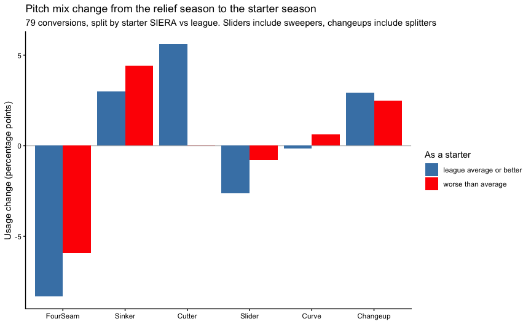
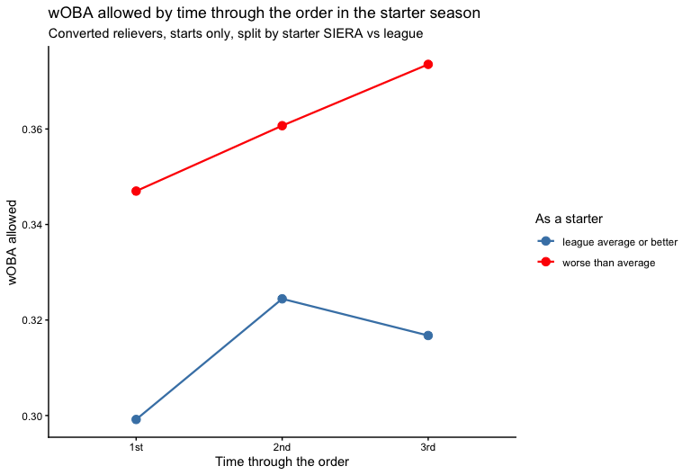

Step 3: What Changed After the Move
================

``` r
library(dplyr)
library(readr)
library(tidyr)
library(ggplot2)
```

## Results and pitch mix

The relief side is the FanGraphs reliever line and the starter side is
the starter line.

``` r
role_seasons <- read_csv("data/fg_role_seasons.csv", guess_max = 20000, show_col_types = FALSE)
conversions <- read_csv("data/conversions.csv", show_col_types = FALSE) |>
  select(playerid, PlayerName, Throws, rp_season, sp_season, sp_GS, sp_IP, rp_SIERA_vs_lg, sp_SIERA_vs_lg, stuck)
expected <- read_csv("data/value_attempts.csv", show_col_types = FALSE) |>
  select(playerid, sp_season, WAR_gain)

# Pitch groups. Sweepers go with sliders, knuckle curves with curves, splitters with changeups
role_seasons[is.na(role_seasons$`pfxST%`), "pfxST%"] <- 0
for (column in c("pfxFA%", "pfxSI%", "pfxFC%", "pfxSL%", "pfxCU%", "pfxKC%", "pfxCV%", "pfxCH%", "pfxFS%",
                 "pfxFO%", "pfxSC%")) {
  role_seasons[[column]][is.na(role_seasons[[column]])] <- 0
}
role_seasons <- role_seasons |>
  mutate(FourSeam = `pfxFA%`,
         Sinker = `pfxSI%`,
         Cutter = `pfxFC%`,
         Slider = `pfxSL%` + `pfxST%`,
         Curve = `pfxCU%` + `pfxKC%` + `pfxCV%`,
         Changeup = `pfxCH%` + `pfxFS%` + `pfxFO%` + `pfxSC%`,
         NumPitches10 = (FourSeam >= 0.1) + (Sinker >= 0.1) + (Cutter >= 0.1) + (Slider >= 0.1) +
           (Curve >= 0.1) + (Changeup >= 0.1),
         FBVelo = ifelse(Sinker > FourSeam, pfxvSI, pfxvFA),
         FB_Stuff = ifelse(Sinker > FourSeam, sp_s_SI, sp_s_FF))

pitch_groups <- c("FourSeam", "Sinker", "Cutter", "Slider", "Curve", "Changeup")
process_measures <- c(pitch_groups, "NumPitches10", "FBVelo", "pfxvSL", "pfxvCH", "sp_stuff", "FB_Stuff",
                      "sp_s_SL", "sp_s_CH", "sp_s_CU", "sp_location", "sp_pitching", "Zone%", "F-Strike%")
result_measures <- c("K%", "BB%", "K-BB%", "SwStr%", "O-Swing%", "Z-Contact%", "GB%", "HardHit%", "SIERA")
all_measures <- c(process_measures, result_measures)

relief_side <- role_seasons |>
  filter(role == "rel") |>
  select(playerid, rp_season = Season, all_of(all_measures))
starter_side <- role_seasons |>
  filter(role == "sta") |>
  select(playerid, sp_season = Season, all_of(all_measures))
```

``` r
# Long format with the relief value, the starter value, and the change for every measure
changes <- conversions |>
  left_join(expected, by = c("playerid", "sp_season")) |>
  inner_join(relief_side |> pivot_longer(-c(playerid, rp_season), names_to = "measure", values_to = "relief"),
             by = c("playerid", "rp_season"), relationship = "many-to-many") |>
  inner_join(starter_side |> pivot_longer(-c(playerid, sp_season), names_to = "measure", values_to = "starter"),
             by = c("playerid", "sp_season", "measure")) |>
  mutate(change = starter - relief,
         type = ifelse(measure %in% result_measures, "result", "process"),
         Success = ifelse(sp_SIERA_vs_lg <= 0, "league average or better", "worse than average"))
write_csv(changes, "results/03_conversion_changes.csv")
```

``` r
# Pitches added and dropped: under 5% in relief to 8%+ as a starter, and the reverse
mix <- changes |>
  filter(measure %in% pitch_groups) |>
  mutate(added = relief < 0.05 & starter >= 0.08,
         dropped = relief >= 0.08 & starter < 0.05)
per_pitcher <- mix |>
  group_by(playerid, sp_season, PlayerName, sp_SIERA_vs_lg, WAR_gain, stuck, rp_SIERA_vs_lg) |>
  summarize(added_any = any(added), dropped_any = any(dropped),
            added_pitches = paste(measure[added], collapse = " "),
            dropped_pitches = paste(measure[dropped], collapse = " "),
            biggest_gain = measure[which.max(change)], biggest_gain_pp = max(change) * 100, .groups = "drop")

cat("Relief vs starter lines for", n_distinct(paste(changes$playerid, changes$sp_season)), "conversions\n\n")
```

    ## Relief vs starter lines for 79 conversions

``` r
cat("Average change from relief to starter (usage in percentage points, velo in mph)\n")
```

    ## Average change from relief to starter (usage in percentage points, velo in mph)

``` r
change_summary <- changes |>
  group_by(type, measure) |>
  summarize(n = sum(!is.na(change)), relief = mean(relief, na.rm = TRUE), starter = mean(starter, na.rm = TRUE),
            share_up = mean(change > 0, na.rm = TRUE), median_change = median(change, na.rm = TRUE),
            change = mean(change, na.rm = TRUE), .groups = "drop")
print(as.data.frame(change_summary), digits = 3)
```

    ##       type      measure  n   relief  starter share_up median_change    change
    ## 1  process     Changeup 79   0.1132   0.1401    0.646       0.02288  0.026936
    ## 2  process        Curve 79   0.1124   0.1152    0.430       0.00000  0.002841
    ## 3  process       Cutter 79   0.0560   0.0809    0.316       0.00000  0.024852
    ## 4  process    F-Strike% 79   0.6013   0.6090    0.544       0.00472  0.007680
    ## 5  process       FBVelo 79  93.7544  92.5489    0.152      -1.20659 -1.205464
    ## 6  process     FB_Stuff 38 100.3078  94.1296    0.289      -7.54022 -5.397894
    ## 7  process     FourSeam 79   0.3555   0.2858    0.342      -0.04578 -0.069721
    ## 8  process NumPitches10 79   3.2278   3.6203    0.468       0.00000  0.392405
    ## 9  process       Sinker 79   0.1785   0.2164    0.519       0.00247  0.037891
    ## 10 process       Slider 79   0.2279   0.2118    0.380       0.00000 -0.016070
    ## 11 process        Zone% 79   0.4289   0.4296    0.532       0.00285  0.000736
    ## 12 process       pfxvCH 66  85.6739  84.8480    0.197      -1.06871 -1.050906
    ## 13 process       pfxvSL 56  85.1778  83.9954    0.196      -0.97235 -1.143890
    ## 14 process  sp_location 38 102.2385 102.6622    0.579       0.80249  1.124259
    ## 15 process  sp_pitching 38 104.9096 100.1268    0.368      -3.17002 -3.958302
    ## 16 process      sp_s_CH 30  92.4035  91.5355    0.533       1.84304 -0.299801
    ## 17 process      sp_s_CU 22 105.8945  97.6182    0.136      -7.06316 -9.663246
    ## 18 process      sp_s_SL 34 110.4173 103.9859    0.206      -6.14183 -8.419978
    ## 19 process     sp_stuff 38 103.3494  97.4676    0.263      -4.81931 -5.671269
    ## 20  result          BB% 79   0.0899   0.0793    0.367      -0.00657 -0.010611
    ## 21  result          GB% 79   0.4646   0.4342    0.304      -0.02587 -0.030445
    ## 22  result     HardHit% 73   0.3575   0.3794    0.740       0.02156  0.024768
    ## 23  result           K% 79   0.2220   0.2053    0.354      -0.01348 -0.016642
    ## 24  result        K-BB% 79   0.1320   0.1260    0.468      -0.01451 -0.006031
    ## 25  result     O-Swing% 79   0.3142   0.3091    0.443      -0.00461 -0.005069
    ## 26  result        SIERA 79   3.8744   4.4148    0.785       0.57745  0.540372
    ## 27  result       SwStr% 79   0.1093   0.0992    0.253      -0.01163 -0.010118
    ## 28  result   Z-Contact% 79   0.8589   0.8699    0.646       0.01084  0.011017

``` r
cat("\nPitches added (under 5% to 8%+) and dropped (8%+ to under 5%), number of conversions\n")
```

    ## 
    ## Pitches added (under 5% to 8%+) and dropped (8%+ to under 5%), number of conversions

``` r
print(mix |> group_by(measure) |> summarize(added = sum(added), dropped = sum(dropped)) |> as.data.frame())
```

    ##    measure added dropped
    ## 1 Changeup    10       1
    ## 2    Curve     9       1
    ## 3   Cutter    11       1
    ## 4 FourSeam     3       6
    ## 5   Sinker     9       2
    ## 6   Slider     7       3

``` r
cat("\nAdded a pitch or not\n")
```

    ## 
    ## Added a pitch or not

``` r
per_pitcher |>
  group_by(added_any) |>
  summarize(n = n(), rp_SIERA_vs_lg = mean(rp_SIERA_vs_lg), share_avg_or_better = mean(sp_SIERA_vs_lg <= 0),
            sp_SIERA_vs_lg = mean(sp_SIERA_vs_lg), WAR_gain = mean(WAR_gain, na.rm = TRUE),
            stuck = mean(stuck, na.rm = TRUE)) |>
  as.data.frame() |> print(digits = 3)
```

    ##   added_any  n rp_SIERA_vs_lg share_avg_or_better sp_SIERA_vs_lg WAR_gain stuck
    ## 1     FALSE 42         0.0246               0.405         0.2307     0.63 0.395
    ## 2      TRUE 37        -0.0266               0.486        -0.0184     1.02 0.559

``` r
cat("\nWho added a pitch\n")
```

    ## 
    ## Who added a pitch

``` r
print(as.data.frame(per_pitcher |> filter(added_any) |>
                      transmute(PlayerName, sp_season, added_pitches, dropped_pitches,
                                sp_SIERA_vs_lg = round(sp_SIERA_vs_lg, 2), WAR_gain = round(WAR_gain, 2))))
```

    ##             PlayerName sp_season          added_pitches dropped_pitches
    ## 1         Jesse Chavez      2017                 Slider                
    ## 2        Trevor Cahill      2017                 Cutter        FourSeam
    ## 3         Wily Peralta      2021                 Sinker                
    ## 4  Christian Friedrich      2016               Changeup                
    ## 5           JC Ramírez      2017                  Curve        FourSeam
    ## 6       Erasmo Ramírez      2017                 Cutter                
    ## 7          Chad Bettis      2015                  Curve                
    ## 8    Christian Bergman      2017           Sinker Curve        FourSeam
    ## 9        Drew Pomeranz      2016        Cutter Changeup                
    ## 10          Félix Peña      2018                 Sinker                
    ## 11         Clay Holmes      2025        Cutter Changeup                
    ## 12         Buck Farmer      2017          Sinker Slider           Curve
    ## 13      Glenn Sparkman      2019                  Curve                
    ## 14        Zack Littell      2023                 Sinker                
    ## 15    Brandon Finnegan      2016      FourSeam Changeup                
    ## 16      Reynaldo López      2024                  Curve                
    ## 17         Luke Weaver      2023          Cutter Slider                
    ## 18     Touki Toussaint      2020                 Slider                
    ## 19      Michael Kopech      2022                  Curve                
    ## 20       Nestor Cortes      2021                 Cutter                
    ## 21       Peter Lambert      2026          Sinker Cutter                
    ## 22      Freddy Peralta      2021        Slider Changeup                
    ## 23       Dakota Hudson      2019               FourSeam                
    ## 24          Cole Irvin      2021                 Sinker                
    ## 25       Corbin Burnes      2020 Sinker Cutter Changeup        FourSeam
    ## 26        Jordan Hicks      2024               Changeup                
    ## 27     Keegan Thompson      2022                 Slider                
    ## 28        Tanner Houck      2023        Cutter Changeup                
    ## 29      Clarke Schmidt      2023                 Cutter        FourSeam
    ## 30         Tyler Wells      2022           Slider Curve                
    ## 31       Bailey Falter      2022                  Curve                
    ## 32         Griffin Jax      2026                  Curve                
    ## 33  Matthew Liberatore      2025               Changeup                
    ## 34      Brandon Walter      2025               FourSeam                
    ## 35      Andre Pallante      2024                 Sinker                
    ## 36     Garrett Crochet      2024                 Cutter                
    ## 37        Reid Detmers      2026               Changeup                
    ##    sp_SIERA_vs_lg WAR_gain
    ## 1            0.42    -0.09
    ## 2           -0.36    -0.02
    ## 3            0.95     0.76
    ## 4            0.48     1.50
    ## 5            0.20     0.65
    ## 6           -0.12     0.81
    ## 7            0.02     1.95
    ## 8            0.68    -0.36
    ## 9           -0.48     2.19
    ## 10          -0.16     1.22
    ## 11           0.27     1.24
    ## 12           0.10     0.13
    ## 13           1.08    -0.69
    ## 14          -0.30     0.83
    ## 15           0.62     0.25
    ## 16          -0.56     3.06
    ## 17           0.28     0.01
    ## 18           0.55    -0.67
    ## 19           0.66     0.03
    ## 20          -0.18     1.28
    ## 21          -0.04     2.25
    ## 22          -0.90     3.00
    ## 23           0.50     0.74
    ## 24           0.54     1.71
    ## 25          -1.48     1.81
    ## 26           0.17    -0.21
    ## 27           0.48     0.47
    ## 28          -0.08     0.60
    ## 29          -0.10     1.51
    ## 30           0.47     0.27
    ## 31          -0.26    -0.06
    ## 32          -0.68     0.66
    ## 33           0.19     1.33
    ## 34          -1.00     0.59
    ## 35          -0.05     1.26
    ## 36          -1.64     3.79
    ## 37          -0.93     4.09

``` r
cat("\nAverage change by outcome (starter SIERA vs league at or below 0 = success)\n")
```

    ## 
    ## Average change by outcome (starter SIERA vs league at or below 0 = success)

``` r
by_success <- changes |>
  group_by(type, measure, Success) |>
  summarize(n = sum(!is.na(change)), change = mean(change, na.rm = TRUE), .groups = "drop") |>
  pivot_wider(names_from = Success, values_from = c(n, change))
print(as.data.frame(by_success), digits = 3)
```

    ##       type      measure n_league average or better n_worse than average
    ## 1  process     Changeup                         35                   44
    ## 2  process        Curve                         35                   44
    ## 3  process       Cutter                         35                   44
    ## 4  process    F-Strike%                         35                   44
    ## 5  process       FBVelo                         35                   44
    ## 6  process     FB_Stuff                         21                   17
    ## 7  process     FourSeam                         35                   44
    ## 8  process NumPitches10                         35                   44
    ## 9  process       Sinker                         35                   44
    ## 10 process       Slider                         35                   44
    ## 11 process        Zone%                         35                   44
    ## 12 process       pfxvCH                         29                   37
    ## 13 process       pfxvSL                         28                   28
    ## 14 process  sp_location                         21                   17
    ## 15 process  sp_pitching                         21                   17
    ## 16 process      sp_s_CH                         16                   14
    ## 17 process      sp_s_CU                         10                   12
    ## 18 process      sp_s_SL                         21                   13
    ## 19 process     sp_stuff                         21                   17
    ## 20  result          BB%                         35                   44
    ## 21  result          GB%                         35                   44
    ## 22  result     HardHit%                         33                   40
    ## 23  result           K%                         35                   44
    ## 24  result        K-BB%                         35                   44
    ## 25  result     O-Swing%                         35                   44
    ## 26  result        SIERA                         35                   44
    ## 27  result       SwStr%                         35                   44
    ## 28  result   Z-Contact%                         35                   44
    ##    change_league average or better change_worse than average
    ## 1                          0.02937                  2.50e-02
    ## 2                         -0.00140                  6.21e-03
    ## 3                          0.05594                  1.21e-04
    ## 4                          0.02848                 -8.87e-03
    ## 5                         -0.90884                 -1.44e+00
    ## 6                         -2.68684                 -8.75e+00
    ## 7                         -0.08307                 -5.91e-02
    ## 8                          0.40000                  3.86e-01
    ## 9                          0.03002                  4.42e-02
    ## 10                        -0.02617                 -8.03e-03
    ## 11                         0.00682                 -4.11e-03
    ## 12                        -0.96443                 -1.12e+00
    ## 13                        -0.93102                 -1.36e+00
    ## 14                         2.88358                 -1.05e+00
    ## 15                        -0.36953                 -8.39e+00
    ## 16                         1.43110                 -2.28e+00
    ## 17                       -11.36324                 -8.25e+00
    ## 18                        -6.28315                 -1.19e+01
    ## 19                        -3.06404                 -8.89e+00
    ## 20                        -0.01759                 -5.06e-03
    ## 21                        -0.02400                 -3.56e-02
    ## 22                         0.02003                  2.87e-02
    ## 23                         0.00152                 -3.11e-02
    ## 24                         0.01912                 -2.60e-02
    ## 25                         0.01132                 -1.81e-02
    ## 26                         0.23118                  7.86e-01
    ## 27                        -0.00437                 -1.47e-02
    ## 28                         0.00608                  1.49e-02

``` r
# Does each change relate to the starter result once relief SIERA is known
cat("\nChange vs starter SIERA vs league (Spearman), and the change's effect after relief SIERA (SD units)\n")
```

    ## 
    ## Change vs starter SIERA vs league (Spearman), and the change's effect after relief SIERA (SD units)

``` r
effect_table <- NULL
for (m in all_measures) {
  one <- changes |> filter(measure == m, !is.na(change))
  fit <- lm(sp_SIERA_vs_lg ~ rp_SIERA_vs_lg + scale(change), data = one)
  effect_table <- bind_rows(effect_table, data.frame(
    measure = m, type = ifelse(m %in% result_measures, "result", "process"), n = nrow(one),
    spearman_SIERA = round(cor(one$change, one$sp_SIERA_vs_lg, method = "spearman"), 3),
    spearman_WAR_gain = round(cor(one$change, one$WAR_gain, method = "spearman", use = "complete.obs"), 3),
    beta_after_rp_SIERA = round(coef(summary(fit))[3, 1], 3),
    p = round(coef(summary(fit))[3, 4], 3)))
}
print(effect_table)
```

    ##         measure    type  n spearman_SIERA spearman_WAR_gain beta_after_rp_SIERA
    ## 1      FourSeam process 79          0.086            -0.178               0.113
    ## 2        Sinker process 79          0.026             0.117              -0.009
    ## 3        Cutter process 79         -0.154             0.107              -0.182
    ## 4        Slider process 79         -0.005            -0.034               0.013
    ## 5         Curve process 79         -0.021            -0.132              -0.021
    ## 6      Changeup process 79         -0.177             0.307              -0.042
    ## 7  NumPitches10 process 79         -0.153             0.238              -0.157
    ## 8        FBVelo process 79         -0.208             0.047              -0.227
    ## 9        pfxvSL process 56         -0.062            -0.060              -0.035
    ## 10       pfxvCH process 66          0.109            -0.133              -0.010
    ## 11     sp_stuff process 38         -0.366             0.178              -0.330
    ## 12     FB_Stuff process 38         -0.154            -0.029              -0.202
    ## 13      sp_s_SL process 34         -0.246             0.182              -0.233
    ## 14      sp_s_CH process 30         -0.394             0.294              -0.229
    ## 15      sp_s_CU process 22          0.141            -0.151               0.035
    ## 16  sp_location process 38         -0.276             0.077              -0.166
    ## 17  sp_pitching process 38         -0.385             0.144              -0.347
    ## 18        Zone% process 79         -0.129             0.001              -0.059
    ## 19    F-Strike% process 79         -0.384             0.159              -0.282
    ## 20           K%  result 79         -0.278             0.202              -0.571
    ## 21          BB%  result 79          0.292            -0.278               0.326
    ## 22        K-BB%  result 79         -0.382             0.321              -0.699
    ## 23       SwStr%  result 79         -0.209             0.065              -0.417
    ## 24     O-Swing%  result 79         -0.360             0.317              -0.339
    ## 25   Z-Contact%  result 79          0.068             0.033               0.201
    ## 26          GB%  result 79         -0.148             0.217              -0.116
    ## 27     HardHit%  result 73          0.106            -0.106               0.022
    ## 28        SIERA  result 79          0.455            -0.428               0.638
    ##        p
    ## 1  0.109
    ## 2  0.901
    ## 3  0.009
    ## 4  0.855
    ## 5  0.766
    ## 6  0.564
    ## 7  0.024
    ## 8  0.001
    ## 9  0.654
    ## 10 0.908
    ## 11 0.000
    ## 12 0.034
    ## 13 0.023
    ## 14 0.047
    ## 15 0.766
    ## 16 0.090
    ## 17 0.000
    ## 18 0.403
    ## 19 0.000
    ## 20 0.000
    ## 21 0.000
    ## 22 0.000
    ## 23 0.000
    ## 24 0.000
    ## 25 0.007
    ## 26 0.100
    ## 27 0.765
    ## 28 0.000

``` r
# usage change by pitch group, successes vs the rest
usage_plot <- changes |>
  filter(measure %in% pitch_groups) |>
  group_by(measure, Success) |>
  summarize(n = n(), change = mean(change, na.rm = TRUE) * 100, .groups = "drop")
usage_plot$measure <- factor(usage_plot$measure, levels = pitch_groups)
ggplot(usage_plot, aes(measure, change, fill = Success)) +
  geom_hline(yintercept = 0, color = "gray") +
  geom_col(position = "dodge") +
  scale_fill_manual(values = c("league average or better" = "steelblue", "worse than average" = "red")) +
  labs(title = "Pitch mix change from the relief season to the starter season",
       subtitle = "79 conversions, split by starter SIERA vs league. Sliders include sweepers, changeups include splitters",
       x = NULL, y = "Usage change (percentage points)", fill = "As a starter") +
  theme_classic()
```

<!-- -->

``` r
ggsave("charts/03_usage_change.png", width = 9, height = 5.5, dpi = 150)
```

## Statcast changes

Platoon results, velocity within outings, and times through the order.

``` r
conversions <- read_csv("data/conversions.csv", show_col_types = FALSE) |>
  select(xMLBAMID, PlayerName, rp_season, sp_season, rp_SIERA_vs_lg, sp_SIERA_vs_lg, stuck)
relief_pitches <- read_csv("data/savant/relief_season_pitches.csv", guess_max = 50000, show_col_types = FALSE)
starter_pitches <- read_csv("data/savant/starter_season_pitches.csv", guess_max = 50000, show_col_types = FALSE)

swing_types <- c("swinging_strike", "swinging_strike_blocked", "foul", "foul_tip", "hit_into_play",
                 "foul_bunt", "missed_bunt")
whiff_types <- c("swinging_strike", "swinging_strike_blocked")
```

``` r
# Starter season pitches include any relief outings, so keep only games where he pitched in the 1st inning (his
# starts)
starts <- starter_pitches |>
  filter(inning == 1) |>
  distinct(pitcher, game_pk)
starter_pitches <- starter_pitches |> semi_join(starts, by = c("pitcher", "game_pk"))

relief_pitches$role <- "relief"
starter_pitches$role <- "starter"
pitches <- bind_rows(relief_pitches, starter_pitches) |>
  filter(!is.na(pitch_type)) |>
  mutate(OppHand = stand != p_throws,
         Swing = description %in% swing_types,
         Whiff = description %in% whiff_types,
         PA = !is.na(events) & events != "truncated_pa",
         K = PA & events %in% c("strikeout", "strikeout_double_play"),
         BB = PA & events %in% c("walk", "hit_by_pitch"),
         Offspeed = pitch_type %in% c("CH", "FS", "FO", "SC"),
         Breaking = pitch_type %in% c("SL", "ST", "SV", "CU", "KC", "CS"),
         Fastball = pitch_type %in% c("FF", "SI"))

pitches <- pitches |>
  arrange(pitcher, game_year, game_pk, at_bat_number, pitch_number) |>
  group_by(pitcher, game_year, game_pk) |>
  mutate(OutingPitch = row_number()) |>
  ungroup()
```

``` r
# Primary fastball each season and role
primary_fb <- pitches |>
  filter(Fastball) |>
  count(pitcher, game_year, role, pitch_type) |>
  group_by(pitcher, game_year, role) |>
  filter(n == max(n)) |>
  slice(1) |>
  select(pitcher, game_year, role, primary_fb = pitch_type)

season_measures <- pitches |>
  left_join(primary_fb, by = c("pitcher", "game_year", "role")) |>
  group_by(pitcher, game_year, role) |>
  summarize(Outings = n_distinct(game_pk),
            PitchesPerOuting = n() / n_distinct(game_pk),
            OppShare_PA = sum(PA & OppHand) / sum(PA),
            Opp_KBB = (sum(K & OppHand) - sum(BB & OppHand)) / sum(PA & OppHand),
            Same_KBB = (sum(K & !OppHand) - sum(BB & !OppHand)) / sum(PA & !OppHand),
            Opp_Whiff = sum(Whiff & OppHand) / sum(Swing & OppHand),
            Opp_Offspeed = mean(Offspeed[OppHand]),
            Opp_Breaking = mean(Breaking[OppHand]),
            Opp_Fastball = mean(Fastball[OppHand]),
            Same_Breaking = mean(Breaking[!OppHand]),
            Velo_first15 = mean(release_speed[pitch_type == primary_fb & OutingPitch <= 15], na.rm = TRUE),
            Velo_61plus = mean(release_speed[pitch_type == primary_fb & OutingPitch > 60], na.rm = TRUE),
            FB_61plus = sum(pitch_type == primary_fb & OutingPitch > 60, na.rm = TRUE),
            xwOBA_1st = sum(estimated_woba_using_speedangle[n_thruorder_pitcher == 1], na.rm = TRUE) /
              sum(woba_denom[n_thruorder_pitcher == 1], na.rm = TRUE),
            wOBA_1st = sum(woba_value[n_thruorder_pitcher == 1], na.rm = TRUE) /
              sum(woba_denom[n_thruorder_pitcher == 1], na.rm = TRUE),
            wOBA_2nd = sum(woba_value[n_thruorder_pitcher == 2], na.rm = TRUE) /
              sum(woba_denom[n_thruorder_pitcher == 2], na.rm = TRUE),
            wOBA_3rd = sum(woba_value[n_thruorder_pitcher == 3], na.rm = TRUE) /
              sum(woba_denom[n_thruorder_pitcher == 3], na.rm = TRUE),
            PA_3rd = sum(PA & n_thruorder_pitcher == 3),
            .groups = "drop") |>
  mutate(Platoon_KBB_gap = Same_KBB - Opp_KBB,
         Velo_fade_in_start = ifelse(FB_61plus >= 30, Velo_61plus - Velo_first15, NA),
         TTO_penalty = ifelse(PA_3rd >= 40, wOBA_3rd - wOBA_1st, NA))
```

``` r
# Wide: relief and starter side by side for each conversion
relief_side <- season_measures |> filter(role == "relief") |> select(-role)
starter_side <- season_measures |> filter(role == "starter") |> select(-role)
names(relief_side)[-(1:2)] <- paste0("rp_", names(relief_side)[-(1:2)])
names(starter_side)[-(1:2)] <- paste0("sp_", names(starter_side)[-(1:2)])

statcast_changes <- conversions |>
  inner_join(relief_side, by = c("xMLBAMID" = "pitcher", "rp_season" = "game_year")) |>
  inner_join(starter_side, by = c("xMLBAMID" = "pitcher", "sp_season" = "game_year")) |>
  mutate(Opp_KBB_change = sp_Opp_KBB - rp_Opp_KBB,
         Same_KBB_change = sp_Same_KBB - rp_Same_KBB,
         Opp_Whiff_change = sp_Opp_Whiff - rp_Opp_Whiff,
         Opp_Offspeed_change = sp_Opp_Offspeed - rp_Opp_Offspeed,
         Opp_Breaking_change = sp_Opp_Breaking - rp_Opp_Breaking,
         Opp_Fastball_change = sp_Opp_Fastball - rp_Opp_Fastball,
         OppShare_change = sp_OppShare_PA - rp_OppShare_PA,
         Velo_first15_change = sp_Velo_first15 - rp_Velo_first15,
         Success = ifelse(sp_SIERA_vs_lg <= 0, "league average or better", "worse than average"))
write_csv(statcast_changes, "data/statcast_changes.csv")

cat("Conversions with Statcast in both seasons:", nrow(statcast_changes), "\n\n")
```

    ## Conversions with Statcast in both seasons: 73

``` r
cat("Averages, relief season vs starter season (starts only)\n")
```

    ## Averages, relief season vs starter season (starts only)

``` r
statcast_changes |>
  summarize(n_fade = sum(!is.na(sp_Velo_fade_in_start)), n_tto = sum(!is.na(sp_TTO_penalty)),
            rp_PitchesPerOuting = mean(rp_PitchesPerOuting), sp_PitchesPerOuting = mean(sp_PitchesPerOuting),
            rp_OppShare = mean(rp_OppShare_PA), sp_OppShare = mean(sp_OppShare_PA),
            rp_Opp_KBB = mean(rp_Opp_KBB), sp_Opp_KBB = mean(sp_Opp_KBB),
            rp_Same_KBB = mean(rp_Same_KBB), sp_Same_KBB = mean(sp_Same_KBB),
            rp_Opp_Offspeed = mean(rp_Opp_Offspeed), sp_Opp_Offspeed = mean(sp_Opp_Offspeed),
            rp_Opp_Breaking = mean(rp_Opp_Breaking), sp_Opp_Breaking = mean(sp_Opp_Breaking),
            rp_Velo_first15 = mean(rp_Velo_first15, na.rm = TRUE), sp_Velo_first15 = mean(sp_Velo_first15,
              na.rm = TRUE),
            sp_Velo_fade_in_start = mean(sp_Velo_fade_in_start, na.rm = TRUE),
            sp_wOBA_1st = mean(sp_wOBA_1st, na.rm = TRUE), sp_wOBA_2nd = mean(sp_wOBA_2nd, na.rm = TRUE),
            sp_wOBA_3rd = mean(sp_wOBA_3rd, na.rm = TRUE), sp_TTO_penalty = mean(sp_TTO_penalty, na.rm = TRUE)) |>
  pivot_longer(everything()) |>
  as.data.frame() |> print(digits = 3)
```

    ##                     name   value
    ## 1                 n_fade 69.0000
    ## 2                  n_tto 59.0000
    ## 3    rp_PitchesPerOuting 27.3146
    ## 4    sp_PitchesPerOuting 83.7393
    ## 5            rp_OppShare  0.4967
    ## 6            sp_OppShare  0.5763
    ## 7             rp_Opp_KBB  0.1043
    ## 8             sp_Opp_KBB  0.1091
    ## 9            rp_Same_KBB  0.1562
    ## 10           sp_Same_KBB  0.1329
    ## 11       rp_Opp_Offspeed  0.1684
    ## 12       sp_Opp_Offspeed  0.1880
    ## 13       rp_Opp_Breaking  0.2530
    ## 14       sp_Opp_Breaking  0.2449
    ## 15       rp_Velo_first15 94.0000
    ## 16       sp_Velo_first15 92.8357
    ## 17 sp_Velo_fade_in_start -0.4847
    ## 18           sp_wOBA_1st  0.3254
    ## 19           sp_wOBA_2nd  0.3443
    ## 20           sp_wOBA_3rd  0.3479
    ## 21        sp_TTO_penalty  0.0186

``` r
change_measures <- c("Opp_KBB_change", "Same_KBB_change", "Opp_Whiff_change", "Opp_Offspeed_change",
                     "Opp_Breaking_change", "Opp_Fastball_change", "OppShare_change", "Velo_first15_change",
                     "sp_Velo_fade_in_start", "sp_TTO_penalty", "rp_Platoon_KBB_gap", "sp_Platoon_KBB_gap")

cat("\nAverage by outcome\n")
```

    ## 
    ## Average by outcome

``` r
statcast_changes |>
  group_by(Success) |>
  summarize(n = n(), across(all_of(change_measures), ~ mean(.x, na.rm = TRUE))) |>
  pivot_longer(-c(Success, n)) |>
  pivot_wider(names_from = Success, values_from = c(n, value)) |>
  as.data.frame() |> print(digits = 3)
```

    ##                     name n_league average or better n_worse than average
    ## 1         Opp_KBB_change                         33                   40
    ## 2        Same_KBB_change                         33                   40
    ## 3       Opp_Whiff_change                         33                   40
    ## 4    Opp_Offspeed_change                         33                   40
    ## 5    Opp_Breaking_change                         33                   40
    ## 6    Opp_Fastball_change                         33                   40
    ## 7        OppShare_change                         33                   40
    ## 8    Velo_first15_change                         33                   40
    ## 9  sp_Velo_fade_in_start                         33                   40
    ## 10        sp_TTO_penalty                         33                   40
    ## 11    rp_Platoon_KBB_gap                         33                   40
    ## 12    sp_Platoon_KBB_gap                         33                   40
    ##    value_league average or better value_worse than average
    ## 1                         0.03133                 -0.01707
    ## 2                        -0.00365                 -0.03953
    ## 3                        -0.00693                 -0.01792
    ## 4                         0.01427                  0.02394
    ## 5                        -0.01187                 -0.00491
    ## 6                        -0.07356                 -0.03185
    ## 7                         0.08429                  0.07570
    ## 8                        -0.83347                 -1.43719
    ## 9                        -0.44131                 -0.52214
    ## 10                        0.01347                  0.02355
    ## 11                        0.05227                  0.05173
    ## 12                        0.01729                  0.02926

``` r
cat("\nEach measure vs starter SIERA vs league (Spearman), and its effect after relief SIERA (SD units)\n")
```

    ## 
    ## Each measure vs starter SIERA vs league (Spearman), and its effect after relief SIERA (SD units)

``` r
effect_table <- NULL
for (m in change_measures) {
  one <- statcast_changes |> filter(!is.na(.data[[m]]))
  fit <- lm(sp_SIERA_vs_lg ~ rp_SIERA_vs_lg + scale(one[[m]]), data = one)
  effect_table <- bind_rows(effect_table, data.frame(
    measure = m, n = nrow(one),
    spearman_SIERA = round(cor(one[[m]], one$sp_SIERA_vs_lg, method = "spearman"), 3),
    beta_after_rp_SIERA = round(coef(summary(fit))[3, 1], 3),
    p = round(coef(summary(fit))[3, 4], 3)))
}
print(effect_table)
```

    ##                  measure  n spearman_SIERA beta_after_rp_SIERA     p
    ## 1         Opp_KBB_change 73         -0.350              -0.476 0.000
    ## 2        Same_KBB_change 73         -0.230              -0.379 0.000
    ## 3       Opp_Whiff_change 73         -0.139              -0.240 0.001
    ## 4    Opp_Offspeed_change 73         -0.094               0.039 0.602
    ## 5    Opp_Breaking_change 73         -0.020              -0.016 0.830
    ## 6    Opp_Fastball_change 73          0.218               0.148 0.039
    ## 7        OppShare_change 73         -0.115              -0.030 0.678
    ## 8    Velo_first15_change 73         -0.294              -0.248 0.000
    ## 9  sp_Velo_fade_in_start 69          0.028              -0.017 0.822
    ## 10        sp_TTO_penalty 59          0.082               0.093 0.235
    ## 11    rp_Platoon_KBB_gap 73         -0.104              -0.139 0.053
    ## 12    sp_Platoon_KBB_gap 73         -0.007              -0.044 0.542

``` r
# wOBA by time through the order as a starter, and velo fade within starts, by outcome
tto_plot <- statcast_changes |>
  select(Success, sp_wOBA_1st, sp_wOBA_2nd, sp_wOBA_3rd) |>
  pivot_longer(-Success, names_to = "time", values_to = "wOBA") |>
  mutate(time = case_when(time == "sp_wOBA_1st" ~ "1st", time == "sp_wOBA_2nd" ~ "2nd", TRUE ~ "3rd")) |>
  group_by(Success, time) |>
  summarize(wOBA = mean(wOBA, na.rm = TRUE), .groups = "drop")
ggplot(tto_plot, aes(time, wOBA, color = Success, group = Success)) +
  geom_line(linewidth = 0.8) +
  geom_point(size = 3) +
  scale_color_manual(values = c("league average or better" = "steelblue", "worse than average" = "red")) +
  labs(title = "wOBA allowed by time through the order in the starter season",
       subtitle = "Converted relievers, starts only, split by starter SIERA vs league",
       x = "Time through the order", y = "wOBA allowed", color = "As a starter") +
  theme_classic()
```

<!-- -->

``` r
ggsave("charts/03_tto_by_outcome.png", width = 8, height = 5.5, dpi = 150)
```
