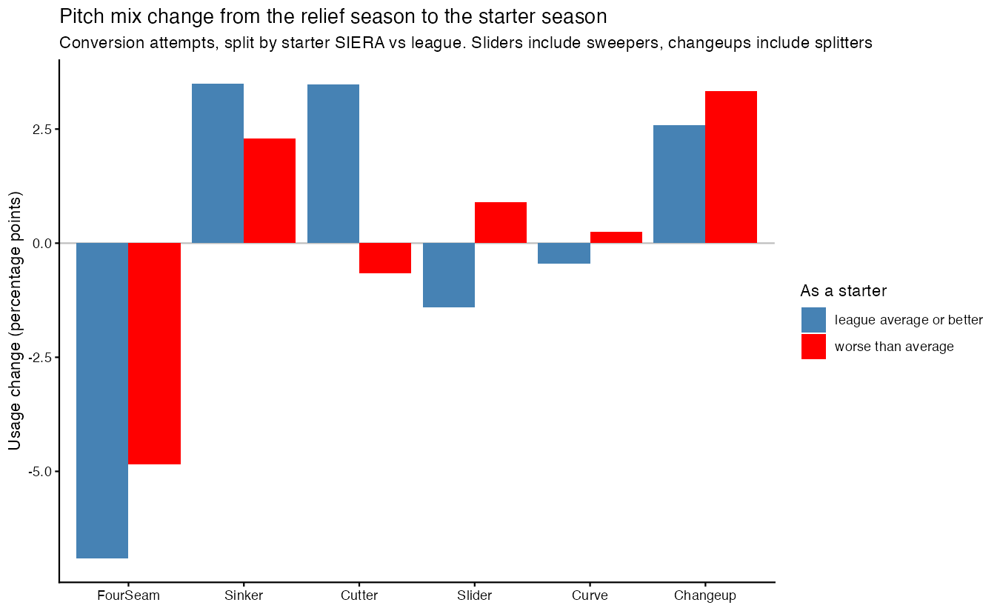
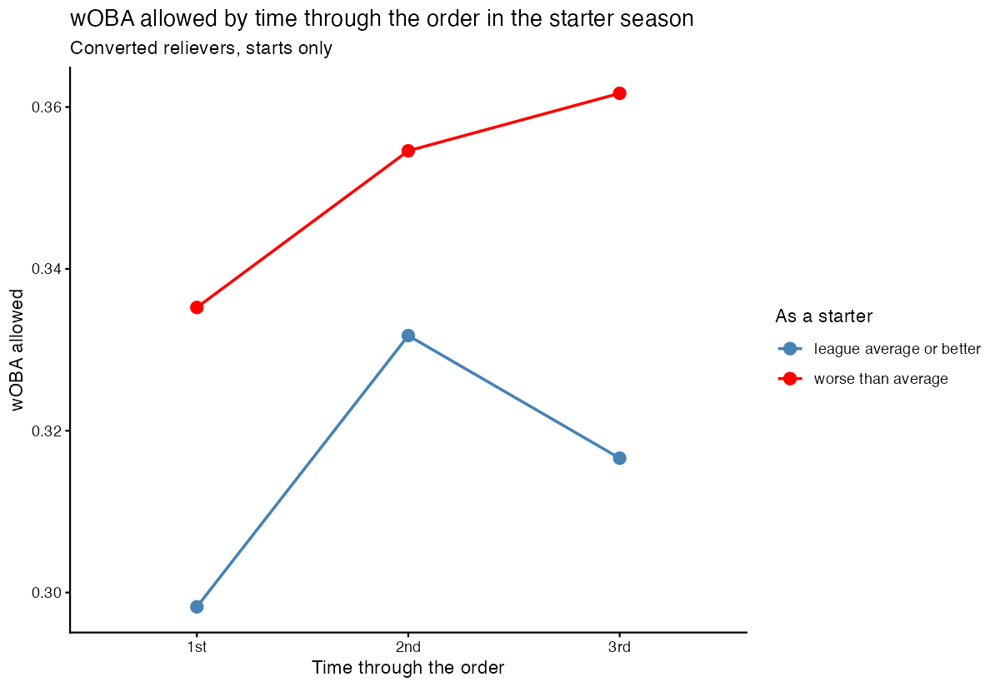

Step 3: What Changed After the Move
================

``` r
library(dplyr)
library(readr)
library(tidyr)
library(ggplot2)
```

## Changes in results and pitch mix

Each converted pitcher’s relief season is compared to his starter
season, using the FanGraphs role lines (the reliever line and the
starter line for the same pitcher), for pitch mix, velocity, Stuff+, and
results.

``` r
pitcher_seasons <- read_csv("../data/pitcher_seasons.csv", guess_max = 20000, show_col_types = FALSE)
conversions <- read_csv("../data/conversions.csv", show_col_types = FALSE) |>
  select(playerid, xMLBAMID, PlayerName, Throws, rp_season, sp_season, sp_GS, sp_IP, rp_SIERA_vs_lg, sp_SIERA_vs_lg,
         stuck) |>
  mutate(Success = ifelse(sp_SIERA_vs_lg <= 0, "league average or better", "worse than average"))
expected <- read_csv("../data/value_attempts.csv", show_col_types = FALSE) |>
  select(playerid, sp_season, WAR_gain)

# Sweepers grouped with sliders, knuckle curves with curves, splitters with changeups
pitch_groups <- c("FourSeam", "Sinker", "Cutter", "Slider", "Curve", "Changeup")
process_measures <- c(pitch_groups, "NumPitches10", "FBVelo", "pfxvSL", "pfxvCH", "sp_stuff", "FB_Stuff",
                      "sp_s_SL", "sp_s_CH", "sp_s_CU", "sp_location", "sp_pitching", "Zone%", "F-Strike%")
result_measures <- c("K%", "BB%", "K-BB%", "SwStr%", "O-Swing%", "Z-Contact%", "GB%", "HardHit%", "SIERA")
all_measures <- c(process_measures, result_measures)

relief_side <- pitcher_seasons |>
  filter(role == "rel") |>
  select(playerid, rp_season = Season, all_of(all_measures))
starter_side <- pitcher_seasons |>
  filter(role == "sta") |>
  select(playerid, sp_season = Season, all_of(all_measures))
```

``` r
# Long format with the relief value, the starter value, and the change for every measure
changes <- conversions |>
  left_join(expected, by = c("playerid", "sp_season")) |>
  inner_join(relief_side |> pivot_longer(-c(playerid, rp_season), names_to = "measure", values_to = "relief"),
             by = c("playerid", "rp_season"), relationship = "many-to-many") |>
  inner_join(starter_side |> pivot_longer(-c(playerid, sp_season), names_to = "measure", values_to = "starter"),
             by = c("playerid", "sp_season", "measure")) |>
  mutate(change = starter - relief,
         type = ifelse(measure %in% result_measures, "result", "process"))
write_csv(changes, "results/conversion_changes.csv")
```

``` r
# Added pitches were under 5% usage as a reliever and 10%+ usage as a starter
mix <- changes |>
  filter(measure %in% pitch_groups) |>
  mutate(added = relief < 0.05 & starter >= 0.10,
         dropped = relief >= 0.10 & starter < 0.05)
per_pitcher <- mix |>
  group_by(playerid, sp_season, PlayerName, sp_SIERA_vs_lg, WAR_gain, stuck, rp_SIERA_vs_lg) |>
  summarize(added_any = any(added), .groups = "drop")

cat("Relief vs. starter lines for", n_distinct(paste(changes$playerid, changes$sp_season)), "conversions\n\n")
```

    ## Relief vs. starter lines for 145 conversions

``` r
cat("Average change from relief to starter (usage in percentage points, velo in mph)\n")
```

    ## Average change from relief to starter (usage in percentage points, velo in mph)

``` r
change_summary <- changes |>
  group_by(type, measure) |>
  summarize(n = sum(!is.na(change)), relief = mean(relief, na.rm = TRUE), starter = mean(starter, na.rm = TRUE),
            share_up = mean(change > 0, na.rm = TRUE), change = mean(change, na.rm = TRUE), .groups = "drop")
print(as.data.frame(change_summary), digits = 3)
```

    ##       type      measure   n   relief  starter share_up    change
    ## 1  process     Changeup 145   0.1071   0.1373    0.669  0.030196
    ## 2  process        Curve 145   0.1126   0.1123    0.414 -0.000327
    ## 3  process       Cutter 145   0.0685   0.0791    0.317  0.010529
    ## 4  process    F-Strike% 145   0.6000   0.6148    0.566  0.014813
    ## 5  process       FBVelo 145  93.6635  92.5472    0.138 -1.116358
    ## 6  process     FB_Stuff  67  98.6234  94.1932    0.313 -4.750180
    ## 7  process     FourSeam 145   0.3506   0.2936    0.372 -0.057050
    ## 8  process NumPitches10 145   3.1793   3.6138    0.462  0.434483
    ## 9  process       Sinker 145   0.1805   0.2085    0.497  0.027919
    ## 10 process       Slider 145   0.1815   0.1713    0.386 -0.010209
    ## 11 process        Zone% 145   0.4323   0.4304    0.538 -0.001882
    ## 12 process       pfxvCH 125  85.6735  85.0176    0.280 -0.749286
    ## 13 process       pfxvSL 105  84.9065  83.8697    0.286 -0.863470
    ## 14 process  sp_location  67 100.8774 101.8423    0.612  2.085121
    ## 15 process  sp_pitching  67 102.2121  98.9661    0.388 -2.649900
    ## 16 process      sp_s_CH  53  93.7860  90.5615    0.453 -2.736727
    ## 17 process      sp_s_CU  37 103.5908  98.8722    0.297 -5.088145
    ## 18 process      sp_s_SL  54 108.0694 103.7763    0.278 -5.753687
    ## 19 process     sp_stuff  67 102.0204  97.2332    0.269 -5.128215
    ## 20  result          BB% 145   0.0883   0.0824    0.379 -0.005870
    ## 21  result          GB% 145   0.4561   0.4278    0.331 -0.028279
    ## 22  result     HardHit% 136   0.3592   0.3875    0.706  0.030789
    ## 23  result           K% 145   0.2206   0.2050    0.366 -0.015578
    ## 24  result        K-BB% 145   0.1323   0.1226    0.490 -0.009707
    ## 25  result     O-Swing% 145   0.3087   0.3048    0.428 -0.003896
    ## 26  result        SIERA 145   3.8907   4.5006    0.766  0.609879
    ## 27  result       SwStr% 145   0.1068   0.0983    0.317 -0.008452
    ## 28  result   Z-Contact% 145   0.8587   0.8685    0.634  0.009753

``` r
cat("\nPitches added (under 5% to 10%+) and dropped (10%+ to under 5%)\n")
```

    ## 
    ## Pitches added (under 5% to 10%+) and dropped (10%+ to under 5%)

``` r
print(mix |> group_by(measure) |> summarize(added = sum(added), dropped = sum(dropped)) |> as.data.frame())
```

    ##    measure added dropped
    ## 1 Changeup    16       2
    ## 2    Curve     9       4
    ## 3   Cutter    10       7
    ## 4 FourSeam     5       6
    ## 5   Sinker    16       2
    ## 6   Slider    14       4

``` r
cat("\nAdded a pitch or not\n")
```

    ## 
    ## Added a pitch or not

``` r
per_pitcher |>
  group_by(added_any) |>
  summarize(n = n(), rp_SIERA_vs_lg = mean(rp_SIERA_vs_lg), share_avg_or_better = mean(sp_SIERA_vs_lg <= 0),
            sp_SIERA_vs_lg = mean(sp_SIERA_vs_lg), WAR_gain = mean(WAR_gain, na.rm = TRUE),
            stuck = mean(stuck, na.rm = TRUE)) |>
  as.data.frame() |> print(digits = 3)
```

    ##   added_any  n rp_SIERA_vs_lg share_avg_or_better sp_SIERA_vs_lg WAR_gain stuck
    ## 1     FALSE 87        -0.0455               0.414          0.225    0.384 0.304
    ## 2      TRUE 58         0.0897               0.414          0.139    0.618 0.375

Moving to the rotation costs about 1.1 mph of fastball velocity (93.7 to
92.5 mph), and 86% of the 145 pitchers lost velocity. Converted pitchers
throw fewer four-seamers (-5.7 percentage points) and more changeups
(+3.0), and their results get worse (SIERA +0.61, 77% got worse). Stuff+
falls 5.1 points while Location+ rises 2.1, which is consistent with
starters giving up some stuff to throw more strikes. The 58 pitchers who
added a pitch did slightly better as starters (SIERA 0.14 above league
average vs. 0.23, and 38% stuck in the rotation vs. 30%).

``` r
# Does a change in pitch mix relate to starter performance once relief SIERA is known?
cat("\nPitch mix change vs. starter SIERA: Spearman correlation and effect after controlling for relief SIERA\n")
```

    ## 
    ## Pitch mix change vs. starter SIERA: Spearman correlation and effect after controlling for relief SIERA

``` r
effect_table <- NULL
for (m in c(pitch_groups, "NumPitches10")) {
  one <- changes |> filter(measure == m, !is.na(change))
  fit <- lm(sp_SIERA_vs_lg ~ rp_SIERA_vs_lg + scale(change), data = one)
  effect_table <- bind_rows(effect_table, data.frame(
    measure = m, n = nrow(one),
    spearman_SIERA = round(cor(one$change, one$sp_SIERA_vs_lg, method = "spearman"), 3),
    beta_after_rp_SIERA = round(coef(summary(fit))[3, 1], 3),
    p = round(coef(summary(fit))[3, 4], 3)))
}
print(effect_table)
```

    ##        measure   n spearman_SIERA beta_after_rp_SIERA     p
    ## 1     FourSeam 145          0.032               0.042 0.527
    ## 2       Sinker 145         -0.048               0.005 0.935
    ## 3       Cutter 145         -0.084              -0.098 0.136
    ## 4       Slider 145          0.049               0.007 0.910
    ## 5        Curve 145         -0.007              -0.002 0.970
    ## 6     Changeup 145          0.004               0.015 0.817
    ## 7 NumPitches10 145         -0.084              -0.097 0.137

None of the pitch mix changes predict how a pitcher did as a starter
once relief SIERA is known (every p is above 0.1). Changes to on-field
process metrics like velocity or stuff could explain which conversions
performed better, but they are outcomes of the move, not choices made by
the player or team.

``` r
# Usage change by pitch group, comparing successes vs. the rest
usage_plot <- changes |>
  filter(measure %in% pitch_groups) |>
  group_by(measure, Success) |>
  summarize(n = n(), change = mean(change, na.rm = TRUE) * 100, .groups = "drop")
usage_plot$measure <- factor(usage_plot$measure, levels = pitch_groups)
ggplot(usage_plot, aes(measure, change, fill = Success)) +
  geom_hline(yintercept = 0, color = "gray") +
  geom_col(position = "dodge") +
  scale_fill_manual(values = c("league average or better" = "steelblue", "worse than average" = "red")) +
  labs(title = "Pitch mix change from the relief season to the starter season",
       subtitle = "Conversion attempts, split by starter SIERA vs. league.",
       x = NULL, y = "Usage change (percentage points)", fill = "As a starter") +
  theme_classic()
```

``` r
ggsave("charts/usage_change.png", width = 9, height = 5.5, dpi = 150)
```



Both groups reduce usage of four-seams and increase sinker and changeup
usage. The one clear difference is the cutter, as the converts who did
well increased usage by 3.5 points while the others slightly dropped it
by 0.7 points. Even still, with only 60 and 85 pitchers in the groups,
that gap is not significant (p = 0.14).

## Platoon usage and times through the order

Platoon usage, pitches per outing, and wOBA allowed each time through
the order.

``` r
relief_pitches <- read_csv("../data/savant/relief_season_pitches.csv", guess_max = 50000, show_col_types = FALSE)
starter_pitches <- read_csv("../data/savant/starter_season_pitches.csv", guess_max = 50000, show_col_types = FALSE)

# Starter season pitches include any relief outings, so keep only starts
starts <- starter_pitches |>
  filter(inning == 1) |>
  distinct(pitcher, game_pk)
starter_pitches <- starter_pitches |> semi_join(starts, by = c("pitcher", "game_pk"))

relief_pitches$role <- "relief"
starter_pitches$role <- "starter"
pitches <- bind_rows(relief_pitches, starter_pitches) |>
  filter(!is.na(pitch_type)) |>
  mutate(OppHand = stand != p_throws,
         PA = !is.na(events) & events != "truncated_pa",
         Offspeed = pitch_type %in% c("CH", "FS", "FO", "SC"),
         Breaking = pitch_type %in% c("SL", "ST", "SV", "CU", "KC", "CS"))
```

``` r
season_measures <- pitches |>
  group_by(pitcher, game_year, role) |>
  summarize(PitchesPerOuting = n() / n_distinct(game_pk),
            OppShare_PA = sum(PA & OppHand) / sum(PA),
            Opp_Offspeed = mean(Offspeed[OppHand]),
            Opp_Breaking = mean(Breaking[OppHand]),
            .groups = "drop")

# Puts relief and starter side by side for each conversion
relief_statcast <- season_measures |> filter(role == "relief") |> select(-role)
starter_statcast <- season_measures |> filter(role == "starter") |> select(-role)
names(relief_statcast)[-(1:2)] <- paste0("rp_", names(relief_statcast)[-(1:2)])
names(starter_statcast)[-(1:2)] <- paste0("sp_", names(starter_statcast)[-(1:2)])

statcast_conversions <- conversions |>
  inner_join(relief_statcast, by = c("xMLBAMID" = "pitcher", "rp_season" = "game_year")) |>
  inner_join(starter_statcast, by = c("xMLBAMID" = "pitcher", "sp_season" = "game_year"))

cat("Conversions with Statcast in both seasons:", nrow(statcast_conversions), "\n\n")
```

    ## Conversions with Statcast in both seasons: 136

``` r
cat("Averages, relief season vs. starter season (starts only)\n")
```

    ## Averages, relief season vs. starter season (starts only)

``` r
statcast_conversions |>
  summarize(rp_PitchesPerOuting = mean(rp_PitchesPerOuting), sp_PitchesPerOuting = mean(sp_PitchesPerOuting),
            rp_OppShare = mean(rp_OppShare_PA), sp_OppShare = mean(sp_OppShare_PA),
            rp_Opp_Offspeed = mean(rp_Opp_Offspeed), sp_Opp_Offspeed = mean(sp_Opp_Offspeed),
            rp_Opp_Breaking = mean(rp_Opp_Breaking), sp_Opp_Breaking = mean(sp_Opp_Breaking)) |>
  pivot_longer(everything()) |>
  as.data.frame() |> print(digits = 3)
```

    ##                  name  value
    ## 1 rp_PitchesPerOuting 26.131
    ## 2 sp_PitchesPerOuting 81.441
    ## 3         rp_OppShare  0.501
    ## 4         sp_OppShare  0.585
    ## 5     rp_Opp_Offspeed  0.166
    ## 6     sp_Opp_Offspeed  0.188
    ## 7     rp_Opp_Breaking  0.244
    ## 8     sp_Opp_Breaking  0.246

``` r
# wOBA by time through the order as a starter, pooling every plate appearance
tto <- pitches |>
  filter(role == "starter", n_thruorder_pitcher %in% 1:3) |>
  inner_join(statcast_conversions |> select(xMLBAMID, sp_season, Success),
             by = c("pitcher" = "xMLBAMID", "game_year" = "sp_season")) |>
  group_by(Success, time = n_thruorder_pitcher) |>
  summarize(PA = sum(woba_denom, na.rm = TRUE), wOBA = sum(woba_value, na.rm = TRUE) / sum(woba_denom, na.rm = TRUE),
            .groups = "drop")
cat("\nwOBA allowed by time through the order\n")
```

    ## 
    ## wOBA allowed by time through the order

``` r
print(as.data.frame(tto), digits = 3)
```

    ##                    Success time   PA  wOBA
    ## 1 league average or better    1 7813 0.298
    ## 2 league average or better    2 7258 0.332
    ## 3 league average or better    3 3598 0.317
    ## 4       worse than average    1 8819 0.335
    ## 5       worse than average    2 8331 0.355
    ## 6       worse than average    3 3878 0.362

Converted starters face more opposite-handed batters (58.5% of plate
appearances vs. 50.1% in relief) and throw 81 pitches per start vs. 26
per relief outing. wOBA allowed rises from the first to the second time
through the order for both groups (.298 to .332 for the converts who did
well and .335 to .355 for the others). The third time through, the
converts who did well saw their wOBA fall to .317 while the others’ keep
rising to .362, but since the sample of PAs is smaller, that particular
change may be noise.

``` r
# wOBA by time through the order as a starter, by outcome
tto_plot <- tto |> mutate(time = c("1st", "2nd", "3rd")[time])
ggplot(tto_plot, aes(time, wOBA, color = Success, group = Success)) +
  geom_line(linewidth = 0.8) +
  geom_point(size = 3) +
  scale_color_manual(values = c("league average or better" = "steelblue", "worse than average" = "red")) +
  labs(title = "wOBA allowed by time through the order in the starter season",
       subtitle = "Converted relievers, starts only",
       x = "Time through the order", y = "wOBA allowed", color = "As a starter") +
  theme_classic()
```

``` r
ggsave("charts/tto_by_outcome.png", width = 8, height = 5.5, dpi = 150)
```


