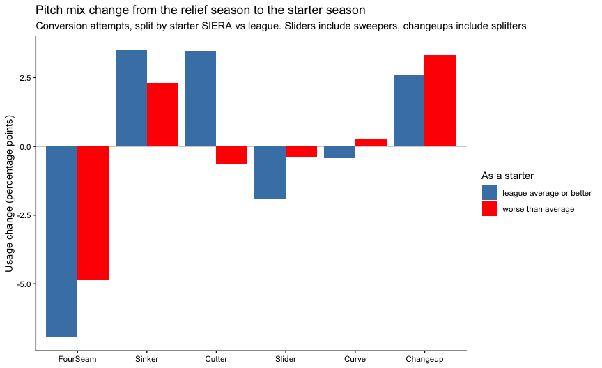
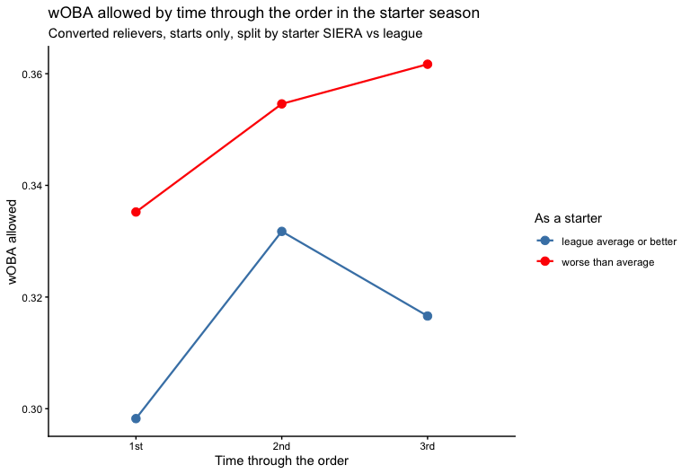

Step 3: What Changed After the Move
================

``` r
library(dplyr)
library(readr)
library(tidyr)
library(ggplot2)
```

## Results and pitch mix

The relief side is the FanGraphs reliever line and the starter side is
the starter line.

``` r
role_seasons <- read_csv("../data/fg_role_seasons.csv", guess_max = 20000, show_col_types = FALSE)
conversions <- read_csv("../data/conversions.csv", show_col_types = FALSE) |>
  select(playerid, PlayerName, Throws, rp_season, sp_season, sp_GS, sp_IP, rp_SIERA_vs_lg, sp_SIERA_vs_lg, stuck)
expected <- read_csv("../data/value_attempts.csv", show_col_types = FALSE) |>
  select(playerid, sp_season, WAR_gain)

# Pitch groups. Sweepers are already in the slider column, knuckle curves go with curves, splitters with changeups
for (column in c("pfxFA%", "pfxSI%", "pfxFC%", "pfxSL%", "pfxCU%", "pfxKC%", "pfxCV%", "pfxCH%", "pfxFS%",
                 "pfxFO%", "pfxSC%")) {
  role_seasons[[column]][is.na(role_seasons[[column]])] <- 0
}
role_seasons <- role_seasons |>
  mutate(FourSeam = `pfxFA%`,
         Sinker = `pfxSI%`,
         Cutter = `pfxFC%`,
         Slider = `pfxSL%`,
         Curve = `pfxCU%` + `pfxKC%` + `pfxCV%`,
         Changeup = `pfxCH%` + `pfxFS%` + `pfxFO%` + `pfxSC%`,
         NumPitches10 = (FourSeam >= 0.1) + (Sinker >= 0.1) + (Cutter >= 0.1) + (Slider >= 0.1) +
           (Curve >= 0.1) + (Changeup >= 0.1),
         FBVelo = ifelse(Sinker > FourSeam, pfxvSI, pfxvFA),
         FB_Stuff = ifelse(Sinker > FourSeam, sp_s_SI, sp_s_FF))

pitch_groups <- c("FourSeam", "Sinker", "Cutter", "Slider", "Curve", "Changeup")
process_measures <- c(pitch_groups, "NumPitches10", "FBVelo", "pfxvSL", "pfxvCH", "sp_stuff", "FB_Stuff",
                      "sp_s_SL", "sp_s_CH", "sp_s_CU", "sp_location", "sp_pitching", "Zone%", "F-Strike%")
result_measures <- c("K%", "BB%", "K-BB%", "SwStr%", "O-Swing%", "Z-Contact%", "GB%", "HardHit%", "SIERA")
all_measures <- c(process_measures, result_measures)

relief_side <- role_seasons |>
  filter(role == "rel") |>
  select(playerid, rp_season = Season, all_of(all_measures))
starter_side <- role_seasons |>
  filter(role == "sta") |>
  select(playerid, sp_season = Season, all_of(all_measures))
```

``` r
# Long format with the relief value, the starter value, and the change for every measure
changes <- conversions |>
  left_join(expected, by = c("playerid", "sp_season")) |>
  inner_join(relief_side |> pivot_longer(-c(playerid, rp_season), names_to = "measure", values_to = "relief"),
             by = c("playerid", "rp_season"), relationship = "many-to-many") |>
  inner_join(starter_side |> pivot_longer(-c(playerid, sp_season), names_to = "measure", values_to = "starter"),
             by = c("playerid", "sp_season", "measure")) |>
  mutate(change = starter - relief,
         type = ifelse(measure %in% result_measures, "result", "process"),
         Success = ifelse(sp_SIERA_vs_lg <= 0, "league average or better", "worse than average"))
write_csv(changes, "results/conversion_changes.csv")
```

``` r
# Pitches added and dropped: under 5% in relief to 8%+ as a starter, and the reverse
mix <- changes |>
  filter(measure %in% pitch_groups) |>
  mutate(added = relief < 0.05 & starter >= 0.08,
         dropped = relief >= 0.08 & starter < 0.05)
per_pitcher <- mix |>
  group_by(playerid, sp_season, PlayerName, sp_SIERA_vs_lg, WAR_gain, stuck, rp_SIERA_vs_lg) |>
  summarize(added_any = any(added), dropped_any = any(dropped),
            added_pitches = paste(measure[added], collapse = " "),
            dropped_pitches = paste(measure[dropped], collapse = " "),
            biggest_gain = measure[which.max(change)], biggest_gain_pp = max(change) * 100, .groups = "drop")

cat("Relief vs starter lines for", n_distinct(paste(changes$playerid, changes$sp_season)), "conversions\n\n")
```

    ## Relief vs starter lines for 145 conversions

``` r
cat("Average change from relief to starter (usage in percentage points, velo in mph)\n")
```

    ## Average change from relief to starter (usage in percentage points, velo in mph)

``` r
change_summary <- changes |>
  group_by(type, measure) |>
  summarize(n = sum(!is.na(change)), relief = mean(relief, na.rm = TRUE), starter = mean(starter, na.rm = TRUE),
            share_up = mean(change > 0, na.rm = TRUE), median_change = median(change, na.rm = TRUE),
            change = mean(change, na.rm = TRUE), .groups = "drop")
print(as.data.frame(change_summary), digits = 3)
```

    ##       type      measure   n   relief  starter share_up median_change    change
    ## 1  process     Changeup 145   0.1071   0.1373    0.669       0.02646  0.030196
    ## 2  process        Curve 145   0.1126   0.1123    0.414       0.00000 -0.000327
    ## 3  process       Cutter 145   0.0685   0.0791    0.317       0.00000  0.010529
    ## 4  process    F-Strike% 145   0.6000   0.6148    0.566       0.00962  0.014813
    ## 5  process       FBVelo 145  93.6635  92.5472    0.138      -1.10890 -1.116358
    ## 6  process     FB_Stuff  67  98.6234  93.9053    0.313      -7.09570 -4.750180
    ## 7  process     FourSeam 145   0.3506   0.2936    0.372      -0.03268 -0.057050
    ## 8  process NumPitches10 145   3.1793   3.6138    0.462       0.00000  0.434483
    ## 9  process       Sinker 145   0.1805   0.2085    0.497       0.00000  0.027919
    ## 10 process       Slider 145   0.1815   0.1713    0.386       0.00000 -0.010209
    ## 11 process        Zone% 145   0.4323   0.4304    0.538       0.00293 -0.001882
    ## 12 process       pfxvCH 125  85.6735  85.0176    0.280      -0.85643 -0.749286
    ## 13 process       pfxvSL 105  84.9065  83.8697    0.286      -0.85506 -0.863470
    ## 14 process  sp_location  67 100.8774 101.8423    0.612       2.05617  2.085121
    ## 15 process  sp_pitching  67 102.2121  98.9661    0.388      -1.98556 -2.649900
    ## 16 process      sp_s_CH  53  93.7860  90.5615    0.453      -3.00688 -2.736727
    ## 17 process      sp_s_CU  37 103.5908  98.8722    0.297      -4.86542 -5.088145
    ## 18 process      sp_s_SL  54 108.0694 103.7763    0.278      -4.41570 -5.753687
    ## 19 process     sp_stuff  67 102.0204  97.2332    0.269      -4.25694 -5.128215
    ## 20  result          BB% 145   0.0883   0.0824    0.379      -0.00633 -0.005870
    ## 21  result          GB% 145   0.4561   0.4278    0.331      -0.02020 -0.028279
    ## 22  result     HardHit% 136   0.3592   0.3875    0.706       0.03026  0.030789
    ## 23  result           K% 145   0.2206   0.2050    0.366      -0.01581 -0.015578
    ## 24  result        K-BB% 145   0.1323   0.1226    0.490      -0.00496 -0.009707
    ## 25  result     O-Swing% 145   0.3087   0.3048    0.428      -0.00461 -0.003896
    ## 26  result        SIERA 145   3.8907   4.5006    0.766       0.61931  0.609879
    ## 27  result       SwStr% 145   0.1068   0.0983    0.317      -0.01035 -0.008452
    ## 28  result   Z-Contact% 145   0.8587   0.8685    0.634       0.00978  0.009753

``` r
cat("\nPitches added (under 5% to 8%+) and dropped (8%+ to under 5%), number of conversions\n")
```

    ## 
    ## Pitches added (under 5% to 8%+) and dropped (8%+ to under 5%), number of conversions

``` r
print(mix |> group_by(measure) |> summarize(added = sum(added), dropped = sum(dropped)) |> as.data.frame())
```

    ##    measure added dropped
    ## 1 Changeup    23       3
    ## 2    Curve    11       4
    ## 3   Cutter    14       8
    ## 4 FourSeam     5       8
    ## 5   Sinker    17       2
    ## 6   Slider    15       4

``` r
cat("\nAdded a pitch or not\n")
```

    ## 
    ## Added a pitch or not

``` r
per_pitcher |>
  group_by(added_any) |>
  summarize(n = n(), rp_SIERA_vs_lg = mean(rp_SIERA_vs_lg), share_avg_or_better = mean(sp_SIERA_vs_lg <= 0),
            sp_SIERA_vs_lg = mean(sp_SIERA_vs_lg), WAR_gain = mean(WAR_gain, na.rm = TRUE),
            stuck = mean(stuck, na.rm = TRUE)) |>
  as.data.frame() |> print(digits = 3)
```

    ##   added_any  n rp_SIERA_vs_lg share_avg_or_better sp_SIERA_vs_lg WAR_gain stuck
    ## 1     FALSE 78         0.0374               0.410          0.223    0.405 0.292
    ## 2      TRUE 67        -0.0250               0.418          0.154    0.562 0.381

``` r
cat("\nWho added a pitch\n")
```

    ## 
    ## Who added a pitch

``` r
print(as.data.frame(per_pitcher |> filter(added_any) |>
                      transmute(PlayerName, sp_season, added_pitches, dropped_pitches,
                                sp_SIERA_vs_lg = round(sp_SIERA_vs_lg, 2), WAR_gain = round(WAR_gain, 2))))
```

    ##             PlayerName sp_season          added_pitches dropped_pitches
    ## 1        Ross Detwiler      2015               Changeup                
    ## 2          Cesár Ramos      2016               Changeup                
    ## 3      Clayton Richard      2016         Curve Changeup                
    ## 4      Héctor Santiago      2019                 Slider                
    ## 5        Derek Holland      2020         Curve Changeup          Slider
    ## 6         Jesse Chavez      2017                 Slider                
    ## 7        Trevor Cahill      2017                 Cutter        FourSeam
    ## 8         Jordan Lyles      2018               Changeup                
    ## 9         Wily Peralta      2021                 Sinker                
    ## 10 Christian Friedrich      2016               Changeup                
    ## 11          JC Ramírez      2017                  Curve        FourSeam
    ## 12         Adam Warren      2015                 Sinker                
    ## 13         Travis Wood      2017        Slider Changeup                
    ## 14          Ryan Weber      2019                 Slider          Cutter
    ## 15      Erasmo Ramírez      2017                 Cutter                
    ## 16         Chad Bettis      2015                  Curve                
    ## 17   Christian Bergman      2017           Sinker Curve        FourSeam
    ## 18       Drew Pomeranz      2016        Cutter Changeup                
    ## 19       Aaron Sanchez      2015               Changeup                
    ## 20         Joe Biagini      2017          Sinker Cutter          Slider
    ## 21         Steven Matz      2026                 Slider                
    ## 22          Félix Peña      2018                 Sinker                
    ## 23       Drew VerHagen      2017                 Slider                
    ## 24       Drew VerHagen      2019               FourSeam                
    ## 25         Jakob Junis      2024               FourSeam                
    ## 26         Clay Holmes      2025        Cutter Changeup                
    ## 27         Matt Strahm      2023                 Slider  Curve Changeup
    ## 28         Buck Farmer      2017          Sinker Slider           Curve
    ## 29      Glenn Sparkman      2019                  Curve                
    ## 30         Mike Mayers      2022               Changeup          Cutter
    ## 31         Mike Mayers      2023                 Sinker                
    ## 32        Zack Littell      2023                 Sinker                
    ## 33 Odrisamer Despaigne      2017                 Cutter           Curve
    ## 34    Brandon Finnegan      2016      FourSeam Changeup                
    ## 35      Reynaldo López      2024                  Curve                
    ## 36      Ryan Yarbrough      2025                 Slider           Curve
    ## 37         Luke Weaver      2023          Cutter Slider                
    ## 38     Touki Toussaint      2020                 Slider                
    ## 39        Sean Newcomb      2020               Changeup                
    ## 40        Sean Newcomb      2025        Sinker Changeup                
    ## 41      Dinelson Lamet      2023                 Sinker                
    ## 42      Michael Kopech      2022                  Curve                
    ## 43        Jeff Hoffman      2021                 Slider                
    ## 44       Nestor Cortes      2021                 Cutter                
    ## 45       Peter Lambert      2026          Sinker Cutter                
    ## 46       Carson Fulmer      2024          Sinker Slider          Cutter
    ## 47      Freddy Peralta      2021        Slider Changeup                
    ## 48       Dakota Hudson      2019               FourSeam                
    ## 49          Cole Irvin      2021                 Sinker                
    ## 50            A.J. Puk      2024               Changeup                
    ## 51       Corbin Burnes      2019                 Sinker                
    ## 52       Corbin Burnes      2020 Sinker Cutter Changeup        FourSeam
    ## 53        Jordan Hicks      2024               Changeup                
    ## 54        Tanner Houck      2023        Cutter Changeup                
    ## 55      Clarke Schmidt      2023                 Cutter        FourSeam
    ## 56          Joey Wentz      2025                 Slider Cutter Changeup
    ## 57         Tyler Wells      2022                  Curve                
    ## 58       Bailey Falter      2022                  Curve                
    ## 59         Griffin Jax      2026                  Curve                
    ## 60      Bowden Francis      2024               Changeup                
    ## 61  Matthew Liberatore      2025               Changeup                
    ## 62            Ray Kerr      2024                 Cutter                
    ## 63      Brandon Walter      2025               FourSeam                
    ## 64      Andre Pallante      2024                 Sinker                
    ## 65     Garrett Crochet      2024                 Cutter                
    ## 66        Reid Detmers      2026               Changeup                
    ## 67   Carmen Mlodzinski      2025        Sinker Changeup          Cutter
    ##    sp_SIERA_vs_lg WAR_gain
    ## 1            1.16    -1.02
    ## 2            0.94    -1.01
    ## 3            0.19     0.06
    ## 4            0.78    -0.28
    ## 5            0.28    -0.19
    ## 6            0.42    -0.09
    ## 7           -0.36    -0.03
    ## 8           -0.22     0.32
    ## 9            0.95     0.76
    ## 10           0.48     1.49
    ## 11           0.20     0.64
    ## 12           0.33     1.49
    ## 13           1.03    -0.72
    ## 14           0.60    -0.13
    ## 15          -0.12     0.80
    ## 16           0.02     1.95
    ## 17           0.68    -0.36
    ## 18          -0.48     2.18
    ## 19           0.94    -0.57
    ## 20          -0.04     0.73
    ## 21           0.42    -0.43
    ## 22          -0.16     1.22
    ## 23           1.37    -0.79
    ## 24          -0.44    -0.32
    ## 25          -0.63     0.24
    ## 26           0.27     1.25
    ## 27          -1.14     1.56
    ## 28           0.10     0.12
    ## 29           1.08    -0.69
    ## 30           0.44    -1.50
    ## 31          -0.37    -0.09
    ## 32          -0.30     0.83
    ## 33           1.35     0.76
    ## 34           0.62     0.24
    ## 35          -0.56     3.06
    ## 36           0.09     0.03
    ## 37           0.28     0.01
    ## 38           0.55    -0.68
    ## 39           1.16    -0.79
    ## 40          -0.18     1.88
    ## 41           0.52    -0.69
    ## 42           0.66     0.03
    ## 43           1.40    -0.07
    ## 44          -0.18     1.27
    ## 45          -0.04     2.25
    ## 46           0.12    -0.11
    ## 47          -0.90     3.01
    ## 48           0.50     0.73
    ## 49           0.54     1.71
    ## 50           3.05     0.90
    ## 51          -0.37    -0.91
    ## 52          -1.48     1.80
    ## 53           0.17    -0.22
    ## 54          -0.08     0.59
    ## 55          -0.10     1.50
    ## 56           0.06     0.77
    ## 57           0.47     0.27
    ## 58          -0.26    -0.06
    ## 59          -0.68     0.67
    ## 60          -0.57     0.52
    ## 61           0.19     1.32
    ## 62          -1.25    -0.44
    ## 63          -1.00     0.59
    ## 64          -0.05     1.25
    ## 65          -1.64     3.79
    ## 66          -0.93     4.09
    ## 67           0.45     1.17

``` r
cat("\nAverage change by outcome (starter SIERA vs league at or below 0 = success)\n")
```

    ## 
    ## Average change by outcome (starter SIERA vs league at or below 0 = success)

``` r
by_success <- changes |>
  group_by(type, measure, Success) |>
  summarize(n = sum(!is.na(change)), change = mean(change, na.rm = TRUE), .groups = "drop") |>
  pivot_wider(names_from = Success, values_from = c(n, change))
print(as.data.frame(by_success), digits = 3)
```

    ##       type      measure n_league average or better n_worse than average
    ## 1  process     Changeup                         60                   85
    ## 2  process        Curve                         60                   85
    ## 3  process       Cutter                         60                   85
    ## 4  process    F-Strike%                         60                   85
    ## 5  process       FBVelo                         60                   85
    ## 6  process     FB_Stuff                         32                   35
    ## 7  process     FourSeam                         60                   85
    ## 8  process NumPitches10                         60                   85
    ## 9  process       Sinker                         60                   85
    ## 10 process       Slider                         60                   85
    ## 11 process        Zone%                         60                   85
    ## 12 process       pfxvCH                         51                   74
    ## 13 process       pfxvSL                         47                   58
    ## 14 process  sp_location                         32                   35
    ## 15 process  sp_pitching                         32                   35
    ## 16 process      sp_s_CH                         25                   28
    ## 17 process      sp_s_CU                         17                   20
    ## 18 process      sp_s_SL                         29                   25
    ## 19 process     sp_stuff                         32                   35
    ## 20  result          BB%                         60                   85
    ## 21  result          GB%                         60                   85
    ## 22  result     HardHit%                         58                   78
    ## 23  result           K%                         60                   85
    ## 24  result        K-BB%                         60                   85
    ## 25  result     O-Swing%                         60                   85
    ## 26  result        SIERA                         60                   85
    ## 27  result       SwStr%                         60                   85
    ## 28  result   Z-Contact%                         60                   85
    ##    change_league average or better change_worse than average
    ## 1                          0.02583                   0.03328
    ## 2                         -0.00441                   0.00256
    ## 3                          0.03474                  -0.00656
    ## 4                          0.02939                   0.00452
    ## 5                         -1.03728                  -1.17217
    ## 6                         -4.34223                  -5.12317
    ## 7                         -0.06912                  -0.04853
    ## 8                          0.48333                   0.40000
    ## 9                          0.03490                   0.02299
    ## 10                        -0.01938                  -0.00373
    ## 11                         0.00460                  -0.00645
    ## 12                        -0.91275                  -0.63663
    ## 13                        -0.84394                  -0.87929
    ## 14                         3.43569                   0.85031
    ## 15                        -0.62962                  -4.49702
    ## 16                        -2.49692                  -2.95084
    ## 17                        -5.73119                  -4.54155
    ## 18                        -4.88993                  -6.75565
    ## 19                        -4.06952                  -6.09616
    ## 20                        -0.01753                   0.00236
    ## 21                        -0.01799                  -0.03554
    ## 22                         0.03077                   0.03080
    ## 23                         0.00316                  -0.02880
    ## 24                         0.02069                  -0.03116
    ## 25                         0.01016                  -0.01382
    ## 26                         0.23994                   0.87101
    ## 27                        -0.00352                  -0.01194
    ## 28                         0.00688                   0.01178

``` r
# Does each change relate to the starter result once relief SIERA is known
cat("\nChange vs starter SIERA vs league (Spearman), and the change's effect after relief SIERA (SD units)\n")
```

    ## 
    ## Change vs starter SIERA vs league (Spearman), and the change's effect after relief SIERA (SD units)

``` r
effect_table <- NULL
for (m in all_measures) {
  one <- changes |> filter(measure == m, !is.na(change))
  fit <- lm(sp_SIERA_vs_lg ~ rp_SIERA_vs_lg + scale(change), data = one)
  effect_table <- bind_rows(effect_table, data.frame(
    measure = m, type = ifelse(m %in% result_measures, "result", "process"), n = nrow(one),
    spearman_SIERA = round(cor(one$change, one$sp_SIERA_vs_lg, method = "spearman"), 3),
    spearman_WAR_gain = round(cor(one$change, one$WAR_gain, method = "spearman", use = "complete.obs"), 3),
    beta_after_rp_SIERA = round(coef(summary(fit))[3, 1], 3),
    p = round(coef(summary(fit))[3, 4], 3)))
}
print(effect_table)
```

    ##         measure    type   n spearman_SIERA spearman_WAR_gain
    ## 1      FourSeam process 145          0.032            -0.144
    ## 2        Sinker process 145         -0.048             0.150
    ## 3        Cutter process 145         -0.084             0.124
    ## 4        Slider process 145          0.049            -0.122
    ## 5         Curve process 145         -0.007            -0.061
    ## 6      Changeup process 145          0.004             0.046
    ## 7  NumPitches10 process 145         -0.084             0.061
    ## 8        FBVelo process 145         -0.081            -0.009
    ## 9        pfxvSL process 105          0.000            -0.103
    ## 10       pfxvCH process 125          0.101            -0.172
    ## 11     sp_stuff process  67         -0.072            -0.038
    ## 12     FB_Stuff process  67          0.019            -0.128
    ## 13      sp_s_SL process  54         -0.158            -0.111
    ## 14      sp_s_CH process  53         -0.223             0.306
    ## 15      sp_s_CU process  37          0.054            -0.133
    ## 16  sp_location process  67         -0.264             0.095
    ## 17  sp_pitching process  67         -0.198             0.044
    ## 18        Zone% process 145         -0.083             0.114
    ## 19    F-Strike% process 145         -0.264             0.107
    ## 20           K%  result 145         -0.360             0.173
    ## 21          BB%  result 145          0.325            -0.379
    ## 22        K-BB%  result 145         -0.427             0.320
    ## 23       SwStr%  result 145         -0.215            -0.045
    ## 24     O-Swing%  result 145         -0.314             0.246
    ## 25   Z-Contact%  result 145          0.054             0.105
    ## 26          GB%  result 145         -0.184             0.095
    ## 27     HardHit%  result 136          0.020            -0.146
    ## 28        SIERA  result 145          0.493            -0.393
    ##    beta_after_rp_SIERA     p
    ## 1                0.042 0.527
    ## 2                0.005 0.935
    ## 3               -0.098 0.136
    ## 4                0.007 0.910
    ## 5               -0.002 0.970
    ## 6                0.015 0.817
    ## 7               -0.097 0.137
    ## 8               -0.188 0.005
    ## 9               -0.006 0.937
    ## 10               0.034 0.628
    ## 11              -0.293 0.002
    ## 12              -0.189 0.048
    ## 13              -0.209 0.043
    ## 14              -0.124 0.135
    ## 15              -0.061 0.542
    ## 16              -0.234 0.010
    ## 17              -0.392 0.000
    ## 18              -0.176 0.007
    ## 19              -0.262 0.000
    ## 20              -0.654 0.000
    ## 21               0.589 0.000
    ## 22              -0.875 0.000
    ## 23              -0.428 0.000
    ## 24              -0.362 0.000
    ## 25               0.169 0.012
    ## 26              -0.119 0.069
    ## 27              -0.043 0.528
    ## 28               0.829 0.000

``` r
# usage change by pitch group, successes vs the rest
usage_plot <- changes |>
  filter(measure %in% pitch_groups) |>
  group_by(measure, Success) |>
  summarize(n = n(), change = mean(change, na.rm = TRUE) * 100, .groups = "drop")
usage_plot$measure <- factor(usage_plot$measure, levels = pitch_groups)
ggplot(usage_plot, aes(measure, change, fill = Success)) +
  geom_hline(yintercept = 0, color = "gray") +
  geom_col(position = "dodge") +
  scale_fill_manual(values = c("league average or better" = "steelblue", "worse than average" = "red")) +
  labs(title = "Pitch mix change from the relief season to the starter season",
       subtitle = "Conversion attempts, split by starter SIERA vs league. Sliders include sweepers, changeups include splitters",
       x = NULL, y = "Usage change (percentage points)", fill = "As a starter") +
  theme_classic()
```

<!-- -->

``` r
ggsave("charts/usage_change.png", width = 9, height = 5.5, dpi = 150)
```

## Statcast changes

Platoon results, velocity within outings, and times through the order.
The relief season platoon K-BB% and whiff rate are saved to
`statcast_changes.csv` for notebook 04.

``` r
conversions <- read_csv("../data/conversions.csv", show_col_types = FALSE) |>
  select(xMLBAMID, PlayerName, rp_season, sp_season, rp_SIERA_vs_lg, sp_SIERA_vs_lg, stuck)
relief_pitches <- read_csv("../data/savant/relief_season_pitches.csv", guess_max = 50000, show_col_types = FALSE)
starter_pitches <- read_csv("../data/savant/starter_season_pitches.csv", guess_max = 50000, show_col_types = FALSE)

swing_types <- c("swinging_strike", "swinging_strike_blocked", "foul", "foul_tip", "hit_into_play",
                 "foul_bunt", "missed_bunt")
whiff_types <- c("swinging_strike", "swinging_strike_blocked")
```

``` r
# Starter season pitches include any relief outings, so keep only games where he pitched in the 1st inning (his
# starts)
starts <- starter_pitches |>
  filter(inning == 1) |>
  distinct(pitcher, game_pk)
starter_pitches <- starter_pitches |> semi_join(starts, by = c("pitcher", "game_pk"))

relief_pitches$role <- "relief"
starter_pitches$role <- "starter"
pitches <- bind_rows(relief_pitches, starter_pitches) |>
  filter(!is.na(pitch_type)) |>
  mutate(OppHand = stand != p_throws,
         Swing = description %in% swing_types,
         Whiff = description %in% whiff_types,
         PA = !is.na(events) & events != "truncated_pa",
         K = PA & events %in% c("strikeout", "strikeout_double_play"),
         BB = PA & events %in% c("walk", "intent_walk"),
         Offspeed = pitch_type %in% c("CH", "FS", "FO", "SC"),
         Breaking = pitch_type %in% c("SL", "ST", "SV", "CU", "KC", "CS"),
         Fastball = pitch_type %in% c("FF", "SI"))

pitches <- pitches |>
  arrange(pitcher, game_year, game_pk, at_bat_number, pitch_number) |>
  group_by(pitcher, game_year, game_pk) |>
  mutate(GamePitchNum = row_number()) |>
  ungroup()
```

``` r
# Primary fastball each season and role
primary_fb <- pitches |>
  filter(Fastball) |>
  count(pitcher, game_year, role, pitch_type) |>
  group_by(pitcher, game_year, role) |>
  filter(n == max(n)) |>
  slice(1) |>
  select(pitcher, game_year, role, primary_fb = pitch_type)

season_measures <- pitches |>
  left_join(primary_fb, by = c("pitcher", "game_year", "role")) |>
  group_by(pitcher, game_year, role) |>
  summarize(PitchesPerOuting = n() / n_distinct(game_pk),
            OppShare_PA = sum(PA & OppHand) / sum(PA),
            Opp_KBB = (sum(K & OppHand) - sum(BB & OppHand)) / sum(PA & OppHand),
            Same_KBB = (sum(K & !OppHand) - sum(BB & !OppHand)) / sum(PA & !OppHand),
            Opp_Whiff = sum(Whiff & OppHand) / sum(Swing & OppHand),
            Opp_Offspeed = mean(Offspeed[OppHand]),
            Opp_Breaking = mean(Breaking[OppHand]),
            Opp_Fastball = mean(Fastball[OppHand]),
            Same_Breaking = mean(Breaking[!OppHand]),
            Velo_first15 = mean(release_speed[pitch_type == primary_fb & GamePitchNum <= 15], na.rm = TRUE),
            Velo_61plus = mean(release_speed[pitch_type == primary_fb & GamePitchNum > 60], na.rm = TRUE),
            FB_61plus = sum(pitch_type == primary_fb & GamePitchNum > 60, na.rm = TRUE),
            wOBA_1st = sum(woba_value[n_thruorder_pitcher == 1], na.rm = TRUE) /
              sum(woba_denom[n_thruorder_pitcher == 1], na.rm = TRUE),
            wOBA_2nd = sum(woba_value[n_thruorder_pitcher == 2], na.rm = TRUE) /
              sum(woba_denom[n_thruorder_pitcher == 2], na.rm = TRUE),
            wOBA_3rd = sum(woba_value[n_thruorder_pitcher == 3], na.rm = TRUE) /
              sum(woba_denom[n_thruorder_pitcher == 3], na.rm = TRUE),
            PA_3rd = sum(PA & n_thruorder_pitcher == 3),
            .groups = "drop") |>
  mutate(Platoon_KBB_gap = Same_KBB - Opp_KBB,
         Velo_fade_in_start = ifelse(FB_61plus >= 30, Velo_61plus - Velo_first15, NA),
         TTO_penalty = ifelse(PA_3rd >= 40, wOBA_3rd - wOBA_1st, NA))
```

``` r
# Wide: relief and starter side by side for each conversion
relief_side <- season_measures |> filter(role == "relief") |> select(-role)
starter_side <- season_measures |> filter(role == "starter") |> select(-role)
names(relief_side)[-(1:2)] <- paste0("rp_", names(relief_side)[-(1:2)])
names(starter_side)[-(1:2)] <- paste0("sp_", names(starter_side)[-(1:2)])

statcast_changes <- conversions |>
  inner_join(relief_side, by = c("xMLBAMID" = "pitcher", "rp_season" = "game_year")) |>
  inner_join(starter_side, by = c("xMLBAMID" = "pitcher", "sp_season" = "game_year")) |>
  mutate(Opp_KBB_change = sp_Opp_KBB - rp_Opp_KBB,
         Same_KBB_change = sp_Same_KBB - rp_Same_KBB,
         Opp_Whiff_change = sp_Opp_Whiff - rp_Opp_Whiff,
         Opp_Offspeed_change = sp_Opp_Offspeed - rp_Opp_Offspeed,
         Opp_Breaking_change = sp_Opp_Breaking - rp_Opp_Breaking,
         Opp_Fastball_change = sp_Opp_Fastball - rp_Opp_Fastball,
         OppShare_change = sp_OppShare_PA - rp_OppShare_PA,
         Velo_first15_change = sp_Velo_first15 - rp_Velo_first15,
         Success = ifelse(sp_SIERA_vs_lg <= 0, "league average or better", "worse than average"))
write_csv(statcast_changes, "../data/statcast_changes.csv")

cat("Conversions with Statcast in both seasons:", nrow(statcast_changes), "\n\n")
```

    ## Conversions with Statcast in both seasons: 136

``` r
cat("Averages, relief season vs starter season (starts only)\n")
```

    ## Averages, relief season vs starter season (starts only)

``` r
statcast_changes |>
  summarize(n_fade = sum(!is.na(sp_Velo_fade_in_start)), n_tto = sum(!is.na(sp_TTO_penalty)),
            rp_PitchesPerOuting = mean(rp_PitchesPerOuting), sp_PitchesPerOuting = mean(sp_PitchesPerOuting),
            rp_OppShare = mean(rp_OppShare_PA), sp_OppShare = mean(sp_OppShare_PA),
            rp_Opp_KBB = mean(rp_Opp_KBB), sp_Opp_KBB = mean(sp_Opp_KBB),
            rp_Same_KBB = mean(rp_Same_KBB), sp_Same_KBB = mean(sp_Same_KBB),
            rp_Opp_Offspeed = mean(rp_Opp_Offspeed), sp_Opp_Offspeed = mean(sp_Opp_Offspeed),
            rp_Opp_Breaking = mean(rp_Opp_Breaking), sp_Opp_Breaking = mean(sp_Opp_Breaking),
            rp_Velo_first15 = mean(rp_Velo_first15, na.rm = TRUE), sp_Velo_first15 = mean(sp_Velo_first15,
              na.rm = TRUE),
            sp_Velo_fade_in_start = mean(sp_Velo_fade_in_start, na.rm = TRUE),
            sp_wOBA_1st = mean(sp_wOBA_1st, na.rm = TRUE), sp_wOBA_2nd = mean(sp_wOBA_2nd, na.rm = TRUE),
            sp_wOBA_3rd = mean(sp_wOBA_3rd, na.rm = TRUE), sp_TTO_penalty = mean(sp_TTO_penalty, na.rm = TRUE)) |>
  pivot_longer(everything()) |>
  as.data.frame() |> print(digits = 3)
```

    ##                     name    value
    ## 1                 n_fade 116.0000
    ## 2                  n_tto  72.0000
    ## 3    rp_PitchesPerOuting  26.1312
    ## 4    sp_PitchesPerOuting  81.4413
    ## 5            rp_OppShare   0.5012
    ## 6            sp_OppShare   0.5852
    ## 7             rp_Opp_KBB   0.1132
    ## 8             sp_Opp_KBB   0.1112
    ## 9            rp_Same_KBB   0.1620
    ## 10           sp_Same_KBB   0.1484
    ## 11       rp_Opp_Offspeed   0.1661
    ## 12       sp_Opp_Offspeed   0.1878
    ## 13       rp_Opp_Breaking   0.2438
    ## 14       sp_Opp_Breaking   0.2455
    ## 15       rp_Velo_first15  93.8328
    ## 16       sp_Velo_first15  92.8427
    ## 17 sp_Velo_fade_in_start  -0.5487
    ## 18           sp_wOBA_1st   0.3301
    ## 19           sp_wOBA_2nd   0.3589
    ## 20           sp_wOBA_3rd   0.3581
    ## 21        sp_TTO_penalty   0.0217

``` r
change_measures <- c("Opp_KBB_change", "Same_KBB_change", "Opp_Whiff_change", "Opp_Offspeed_change",
                     "Opp_Breaking_change", "Opp_Fastball_change", "OppShare_change", "Velo_first15_change",
                     "sp_Velo_fade_in_start", "sp_TTO_penalty", "rp_Platoon_KBB_gap", "sp_Platoon_KBB_gap")

cat("\nAverage by outcome\n")
```

    ## 
    ## Average by outcome

``` r
statcast_changes |>
  group_by(Success) |>
  summarize(n = n(), across(all_of(change_measures), ~ mean(.x, na.rm = TRUE))) |>
  pivot_longer(-c(Success, n)) |>
  pivot_wider(names_from = Success, values_from = c(n, value)) |>
  as.data.frame() |> print(digits = 3)
```

    ##                     name n_league average or better n_worse than average
    ## 1         Opp_KBB_change                         58                   78
    ## 2        Same_KBB_change                         58                   78
    ## 3       Opp_Whiff_change                         58                   78
    ## 4    Opp_Offspeed_change                         58                   78
    ## 5    Opp_Breaking_change                         58                   78
    ## 6    Opp_Fastball_change                         58                   78
    ## 7        OppShare_change                         58                   78
    ## 8    Velo_first15_change                         58                   78
    ## 9  sp_Velo_fade_in_start                         58                   78
    ## 10        sp_TTO_penalty                         58                   78
    ## 11    rp_Platoon_KBB_gap                         58                   78
    ## 12    sp_Platoon_KBB_gap                         58                   78
    ##    value_league average or better value_worse than average
    ## 1                         0.03128                 -0.02678
    ## 2                         0.00272                 -0.02574
    ## 3                        -0.00925                 -0.01509
    ## 4                         0.01620                  0.02568
    ## 5                        -0.00695                  0.00814
    ## 6                        -0.05672                 -0.03485
    ## 7                         0.08424                  0.08378
    ## 8                        -0.95900                 -1.01317
    ## 9                        -0.53448                 -0.55918
    ## 10                        0.01372                  0.03023
    ## 11                        0.05165                  0.04664
    ## 12                        0.02309                  0.04768

``` r
cat("\nEach measure vs starter SIERA vs league (Spearman), and its effect after relief SIERA (SD units)\n")
```

    ## 
    ## Each measure vs starter SIERA vs league (Spearman), and its effect after relief SIERA (SD units)

``` r
effect_table <- NULL
for (m in change_measures) {
  one <- statcast_changes |> filter(!is.na(.data[[m]]))
  fit <- lm(sp_SIERA_vs_lg ~ rp_SIERA_vs_lg + scale(one[[m]]), data = one)
  effect_table <- bind_rows(effect_table, data.frame(
    measure = m, n = nrow(one),
    spearman_SIERA = round(cor(one[[m]], one$sp_SIERA_vs_lg, method = "spearman"), 3),
    beta_after_rp_SIERA = round(coef(summary(fit))[3, 1], 3),
    p = round(coef(summary(fit))[3, 4], 3)))
}
print(effect_table)
```

    ##                  measure   n spearman_SIERA beta_after_rp_SIERA     p
    ## 1         Opp_KBB_change 136         -0.383              -0.616 0.000
    ## 2        Same_KBB_change 136         -0.170              -0.405 0.000
    ## 3       Opp_Whiff_change 136         -0.152              -0.158 0.022
    ## 4    Opp_Offspeed_change 136         -0.010               0.052 0.447
    ## 5    Opp_Breaking_change 136         -0.009              -0.010 0.880
    ## 6    Opp_Fastball_change 136          0.101               0.083 0.220
    ## 7        OppShare_change 136         -0.028              -0.043 0.531
    ## 8    Velo_first15_change 136         -0.046              -0.145 0.036
    ## 9  sp_Velo_fade_in_start 116          0.043              -0.024 0.705
    ## 10        sp_TTO_penalty  72          0.142               0.093 0.162
    ## 11    rp_Platoon_KBB_gap 136         -0.098              -0.091 0.183
    ## 12    sp_Platoon_KBB_gap 136          0.108               0.079 0.246

``` r
# wOBA by time through the order as a starter, and velo fade within starts, by outcome
tto_plot <- statcast_changes |>
  select(Success, sp_wOBA_1st, sp_wOBA_2nd, sp_wOBA_3rd) |>
  pivot_longer(-Success, names_to = "time", values_to = "wOBA") |>
  mutate(time = case_when(time == "sp_wOBA_1st" ~ "1st", time == "sp_wOBA_2nd" ~ "2nd", TRUE ~ "3rd")) |>
  group_by(Success, time) |>
  summarize(wOBA = mean(wOBA, na.rm = TRUE), .groups = "drop")
ggplot(tto_plot, aes(time, wOBA, color = Success, group = Success)) +
  geom_line(linewidth = 0.8) +
  geom_point(size = 3) +
  scale_color_manual(values = c("league average or better" = "steelblue", "worse than average" = "red")) +
  labs(title = "wOBA allowed by time through the order in the starter season",
       subtitle = "Converted relievers, starts only, split by starter SIERA vs league",
       x = "Time through the order", y = "wOBA allowed", color = "As a starter") +
  theme_classic()
```

<!-- -->

``` r
ggsave("charts/tto_by_outcome.png", width = 8, height = 5.5, dpi = 150)
```
