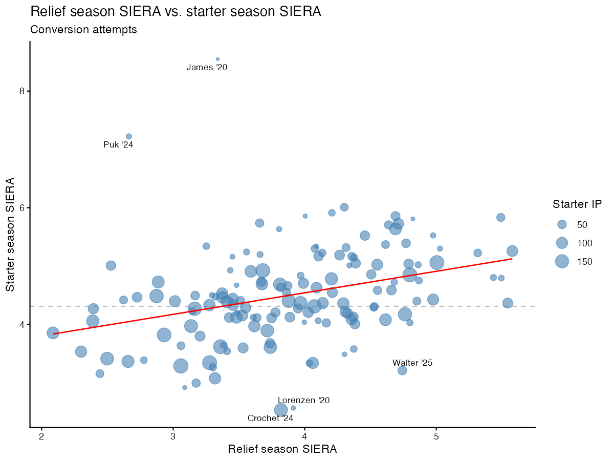
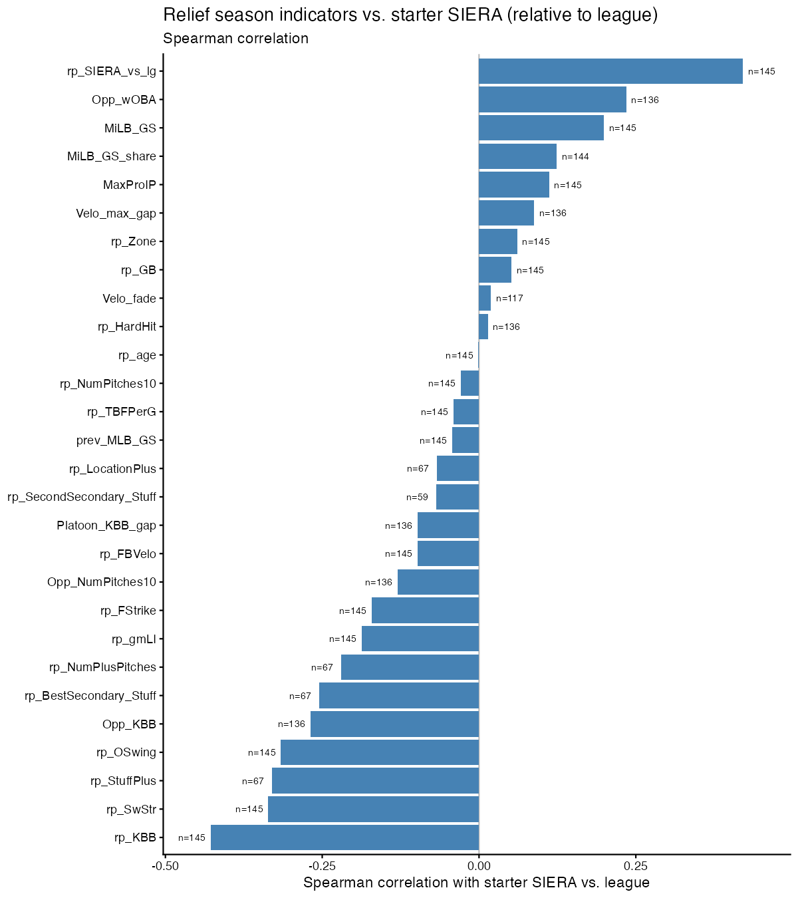
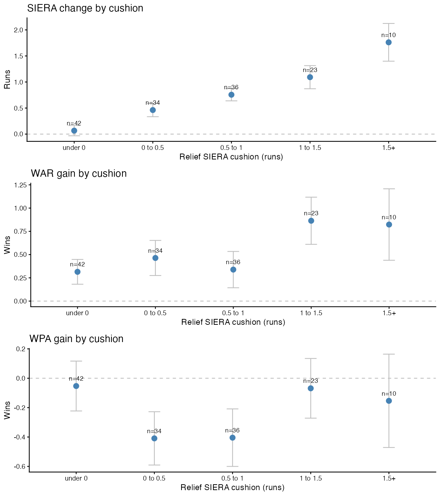

```{r, message=FALSE}
library(dplyr)
library(readr)
library(ggplot2)
library(ggrepel)
library(gridExtra)

options(width = 250)
```

I count a conversion as a success when the pitcher's SIERA in his starter season is at or below the league average starter SIERA that year, even if that season is only a few starts. This measures run prevention, not value or how long he stayed in the rotation (the share who stuck as starters is tracked separately). SIERA vs. league is a pitcher's SIERA minus the league average for his role that season, so lower is better. It should be noted that this definition includes elite relievers who regressed, so long as their starter SIERA was better than average, and excludes poor relievers who held or slightly improved their SIERA.

```{r}
savant_features <- read_csv("../data/savant_features.csv", show_col_types = FALSE)

conversions <- read_csv("../data/conversions.csv", show_col_types = FALSE) |>
  left_join(savant_features, by = c("xMLBAMID", "rp_season")) |>
  mutate(Success = as.numeric(sp_SIERA_vs_lg <= 0))
```

## Relief SIERA and starter SIERA

How well the relief season SIERA predicts the starter season.

```{r, fig.show="hide", fig.width=8, fig.height=6}
cat("Spearman correlation of relief and starter SIERA vs. league:",
    round(cor(conversions$rp_SIERA_vs_lg, conversions$sp_SIERA_vs_lg, method = "spearman"), 2), "\n")
cat("Slope of starter SIERA on relief SIERA:", round(coef(lm(sp_SIERA ~ rp_SIERA, data = conversions))[2], 2), "\n\n")

# Relievers who were better or worse than an average reliever
conversions |>
  group_by(better_than_avg_reliever = rp_SIERA_vs_lg < 0) |>
  summarize(n = n(), share_avg_or_better = mean(Success), sp_SIERA_vs_lg = mean(sp_SIERA_vs_lg),
            stuck = mean(stuck, na.rm = TRUE)) |>
  as.data.frame() |> print(digits = 3)

# Label points more than 2 standard deviations from the fitted line
outliers <- abs(rstandard(lm(sp_SIERA ~ rp_SIERA, data = conversions))) > 2

ggplot(conversions, aes(rp_SIERA, sp_SIERA)) +
  geom_hline(yintercept = mean(conversions$sp_SIERA - conversions$sp_SIERA_vs_lg), color = "gray", linetype = "dashed") +
  geom_point(aes(size = sp_IP), color = "steelblue", alpha = 0.6) +
  geom_smooth(method = "lm", se = FALSE, color = "red", linewidth = 0.6) +
  geom_text_repel(aes(label = ifelse(outliers, paste0(sub(".* ", "", PlayerName), " '", substr(sp_season, 3, 4)), "")),
                  size = 3, seed = 1) +
  labs(title = "Relief season SIERA vs. starter season SIERA",
       subtitle = "Conversion attempts",
       x = "Relief season SIERA", y = "Starter season SIERA",
       size = "Starter IP") +
  theme_classic()
ggsave("charts/relief_vs_starter_siera.png", width = 8, height = 6, dpi = 150)
```



Relief SIERA relative to the league has a Spearman correlation of 0.42 with starter SIERA, and the slope is 0.37, so a reliever's SIERA advantage shrinks to about a third in the rotation. Relievers who were better than the league average reliever went on to be league average or better starters 59% of the time vs. 25% for the rest, and 43% of them stuck as starters vs. 25%.

## Checking the SIERA relationship

### Testing different definitions of a conversion

```{r}
pitcher_seasons <- read_csv("../data/pitcher_seasons.csv", guess_max = 20000, show_col_types = FALSE)
game_logs <- read_csv("../data/game_logs.csv", show_col_types = FALSE) |>
  filter(GS == 1)

# Starts before each season
season_starts <- pitcher_seasons |>
  distinct(playerid, Season, GS_total) |>
  arrange(playerid, Season) |>
  group_by(playerid) |>
  mutate(prior_GS = cumsum(GS_total) - GS_total) |>
  ungroup()

relief_all <- pitcher_seasons |>
  filter(role == "rel") |>
  left_join(season_starts |> select(playerid, Season, prior_GS), by = c("playerid", "Season")) |>
  transmute(playerid, rp_season = Season, rp_TBF = TBF, rp_GS_share = GS_total / G_total, rp_SIERA = SIERA,
            rp_SIERA_vs_lg = SIERA_vs_lg, prior_GS)
starter_all <- pitcher_seasons |>
  filter(role == "sta") |>
  transmute(playerid, xMLBAMID, sp_season = Season, sp_GS = GS, sp_IP = IP, sp_starter_share = GS_total / G_total,
            sp_SIERA = SIERA, sp_SIERA_vs_lg = SIERA_vs_lg)

settings <- data.frame(
  version = c("2+ starts of 70+ pitches, relief TBF 100+, relief starts 20% or less, lookback 3",
              "5+ starts of 70+ pitches",
              "relief 150+ TBF, relief starts 10% or less"),
  min_pitches = c(70, 70, 70),
  min_long_starts = c(2, 5, 2),
  max_relief_gs_share = c(0.2, 0.2, 0.1),
  min_relief_tbf = c(100, 100, 150))

versions <- list()
for (v in 1:nrow(settings)) {
  long_starts <- game_logs |>
    filter(Pitches >= settings$min_pitches[v]) |>
    count(xMLBAMID, sp_season = Season, name = "sp_LongStarts")
  starters <- starter_all |>
    inner_join(long_starts, by = c("xMLBAMID", "sp_season")) |>
    filter(sp_LongStarts >= settings$min_long_starts[v], sp_season >= 2015)
  relievers <- relief_all |>
    filter(rp_TBF >= settings$min_relief_tbf[v], rp_GS_share <= settings$max_relief_gs_share[v])
  pairs <- starters |>
    inner_join(relievers, by = "playerid", relationship = "many-to-many") |>
    mutate(gap = sp_season - rp_season) |>
    filter(gap >= 1, gap <= 3) |>
    group_by(playerid, sp_season) |>
    filter(gap == min(gap)) |>
    ungroup()
  # Starts made in the years between the relief season and the starter season
  pairs$GS_between <- 0
  for (i in which(pairs$gap >= 2)) {
    between <- season_starts |>
      filter(playerid == pairs$playerid[i], Season > pairs$rp_season[i], Season < pairs$sp_season[i])
    pairs$GS_between[i] <- sum(between$GS_total)
  }
  versions[[settings$version[v]]] <- pairs |> filter(GS_between <= 3)
}
baseline <- versions[[1]]

versions[["former starters only (20+ prior MLB starts)"]] <- baseline |> filter(prior_GS >= 20)
versions[["one attempt per pitcher (first one)"]] <- baseline |> arrange(playerid, sp_season) |>
  group_by(playerid) |> slice(1) |> ungroup()

# Headline numbers for each version of the sample
results <- NULL
for (label in names(versions)) {
  pairs <- versions[[label]]
  better_reliever <- pairs$rp_SIERA_vs_lg < 0
  success <- pairs$sp_SIERA_vs_lg <= 0
  results <- bind_rows(results, data.frame(
    version = label, attempts = nrow(pairs), pitchers = n_distinct(pairs$playerid),
    mean_SIERA_change = round(mean(pairs$sp_SIERA - pairs$rp_SIERA), 2),
    spearman_relief_vs_starter = round(cor(pairs$rp_SIERA_vs_lg, pairs$sp_SIERA_vs_lg, method = "spearman"), 2),
    slope = round(coef(lm(sp_SIERA ~ rp_SIERA, data = pairs))[2], 2),
    success_better_reliever = round(mean(success[better_reliever]), 2),
    success_worse_reliever = round(mean(success[!better_reliever]), 2)))
}
write_csv(results, "results/definition_sensitivity.csv")

cat("success = starter SIERA at or below the league average starter\nbetter_reliever = relief SIERA better than the league average reliever in that version\n\n")
print(results, row.names = FALSE)
```

The main result does not depend on the cutoffs. Across the 5 versions of the sample, the Spearman correlation between relief and starter SIERA stays between 0.41 and 0.59, SIERA gets worse by 0.55 to 0.68 on average, and the relievers who were better than the league average reliever succeed 58% to 68% of the time vs. 20% to 25% for the rest.

### Year to year reliability of SIERA

While better than ERA, reliever's SIERA is noisy, so part of the slope from relief SIERA to starter SIERA is regression to the mean instead of a role effect. The year to year slope for relievers who stayed relievers shows how much.

```{r}
relief_next <- relief_all |>
  filter(rp_TBF >= 100, rp_GS_share <= 0.2) |>
  mutate(next_season = rp_season + 1) |>
  inner_join(relief_all |> filter(rp_TBF >= 100, rp_GS_share <= 0.2) |>
               select(playerid, next_season = rp_season, next_SIERA_vs_lg = rp_SIERA_vs_lg, next_SIERA = rp_SIERA),
             by = c("playerid", "next_season"))
reliever_fit <- lm(next_SIERA ~ rp_SIERA, data = relief_next)

starter_pairs <- starter_all |>
  filter(sp_GS >= 10) |>
  mutate(next_season = sp_season + 1) |>
  inner_join(starter_all |> filter(sp_GS >= 10) |>
               select(playerid, next_season = sp_season, next_SIERA = sp_SIERA, next_SIERA_vs_lg = sp_SIERA_vs_lg),
             by = c("playerid", "next_season"))
starter_fit <- lm(next_SIERA ~ sp_SIERA, data = starter_pairs)
conversion_fit <- lm(sp_SIERA ~ rp_SIERA, data = baseline)

reliability <- data.frame(
  pairs = c("Reliever to the same reliever next year (100+ TBF in both seasons)",
            "Starter to the same starter next year (10+ starts in both seasons)",
            "Reliever to starter, conversions"),
  n = c(nrow(relief_next), nrow(starter_pairs), nrow(baseline)),
  correlation = round(c(cor(relief_next$rp_SIERA_vs_lg, relief_next$next_SIERA_vs_lg),
                        cor(starter_pairs$sp_SIERA_vs_lg, starter_pairs$next_SIERA_vs_lg),
                        cor(baseline$rp_SIERA_vs_lg, baseline$sp_SIERA_vs_lg)), 2),
  slope = round(c(coef(reliever_fit)[2], coef(starter_fit)[2], coef(conversion_fit)[2]), 2))
cat("SIERA in one season and the next (correlations are relative to the league, slopes use raw SIERA)\n")
print(reliability, row.names = FALSE)
```

Relievers carry only 0.41 of their prior season's SIERA into the next (vs. 0.61 for starters), and the relief to starter slope is 0.37, so most of the shrinkage toward the mean is what a one year reliever sample would show anyway.

### Tested on later seasons

Fit on the earlier half of the conversions and tested on the later half, split at the median starter season.

```{r}
split_season <- median(conversions$sp_season)
train <- conversions |> filter(sp_season <= split_season)
test <- conversions |> filter(sp_season > split_season)
cat("Earlier conversions: starter seasons through ", split_season, " (n = ", nrow(train), ")\n", sep = "")
cat("Later conversions: starter seasons ", split_season + 1, " to 2026 (n = ", nrow(test), ")\n\n", sep = "")

# Did the relationship change over time (the slope of starter SIERA on relief SIERA by season)
interaction_model <- lm(sp_SIERA_vs_lg ~ rp_SIERA_vs_lg * sp_season, data = conversions, weights = sp_TBF)
cat("Weighted change in the slope per season: ", round(coef(interaction_model)[4], 3),
    " (p = ", round(summary(interaction_model)$coefficients[4, 4], 2), ")\n\n", sep = "")

comparison <- data.frame(
  sample = c("Earlier conversions", "Later conversions"),
  slope = round(c(coef(lm(sp_SIERA_vs_lg ~ rp_SIERA_vs_lg, data = train))[2],
                  coef(lm(sp_SIERA_vs_lg ~ rp_SIERA_vs_lg, data = test))[2]), 2),
  mean_SIERA_vs_lg = round(c(mean(train$sp_SIERA_vs_lg), mean(test$sp_SIERA_vs_lg)), 2))
print(comparison, row.names = FALSE)

# Predicting the later conversions from the earlier ones
fit_train <- lm(sp_SIERA_vs_lg ~ rp_SIERA_vs_lg, data = train)
train_p <- glm(Success ~ rp_SIERA_vs_lg, data = train, family = binomial)
test$pred_linear <- predict(fit_train, newdata = test)
test$p_out <- predict(train_p, newdata = test, type = "response")

rmse <- data.frame(
  model = c("Predict the earlier average for everyone", "Linear model on relief SIERA"),
  RMSE = round(c(sqrt(mean((test$sp_SIERA_vs_lg - mean(train$sp_SIERA_vs_lg))^2)),
                 sqrt(mean((test$sp_SIERA_vs_lg - test$pred_linear)^2))), 3))
cat("\nRMSE of starter SIERA vs. league on the later conversions\n")
print(rmse, row.names = FALSE)

# Chance that a random success is predicted higher than a random non-success
auc_out <- as.numeric(pROC::auc(test$Success, test$p_out, levels = c(0, 1), direction = "<", quiet = TRUE))
cat("\nProbability of success on the later conversions\n")
cat("AUC:", round(auc_out, 3), "\n")
cat("Brier score: ", round(mean((test$p_out - test$Success)^2), 4),
    " (", round(mean((mean(train$Success) - test$Success)^2), 4), 
    " if every later attempt is given the earlier success rate)\n", sep = "")
cat("Expected successes: ", round(sum(test$p_out), 1), " (actual: ", sum(test$Success), ")\n", sep = "")
```

The relationship looks weaker over time. The slope of starter SIERA on relief SIERA is 0.40 for the earlier conversions and 0.15 for the later ones, and the average starter SIERA relative to the league went from 0.34 above to 0.01 above, but the trend by season is not significant (a change of -0.013 per season, p = 0.50), so I would not read much into the drop.

```{r}
# Calibration of the predicted probability of success, leaving one conversion out at a time
loo_p <- rep(NA, nrow(conversions))
for (i in 1:nrow(conversions)) {
  loo_model <- glm(Success ~ rp_SIERA_vs_lg, data = conversions[-i, ], family = binomial)
  loo_p[i] <- predict(loo_model, newdata = conversions[i, ], type = "response")
}
conversions$loo_p <- loo_p
base_rate <- mean(conversions$Success)
auc_loo <- as.numeric(pROC::auc(conversions$Success, loo_p, levels = c(0, 1), direction = "<", quiet = TRUE))
cat("Leave one out success predictions for all", nrow(conversions), "attempts\n")
cat("AUC:", round(auc_loo, 3), "\n\n")

loo_scores <- data.frame(
  measure = c("Brier score", "Log loss"),
  model = round(c(mean((loo_p - conversions$Success)^2),
                  -mean(conversions$Success * log(loo_p) + (1 - conversions$Success) * log(1 - loo_p))), 4),
  everyone_at_base_rate = round(c(mean((base_rate - conversions$Success)^2),
                                  -mean(conversions$Success * log(base_rate) + (1 - conversions$Success) * log(1 - base_rate))), 4))
cat("Base rate is the overall success rate of", round(base_rate, 2), "\n")
print(loo_scores, row.names = FALSE)

# Check calibration (1 is perfect, below 1 is overconfident)
cal_fit <- glm(Success ~ I(log(loo_p / (1 - loo_p))), data = conversions, family = binomial)
cal_slope <- coef(cal_fit)[2]
cal_se <- summary(cal_fit)$coefficients[2, 2]
cat("\nCalibration slope: ", round(cal_slope, 2), " (95% interval ", round(cal_slope - 1.96 * cal_se, 2), " to ",
    round(cal_slope + 1.96 * cal_se, 2), ")\n", sep = "")

cat("\nPredicted and observed success rate by quartile\n")
conversions |>
  mutate(quartile = ntile(loo_p, 4)) |>
  group_by(quartile) |>
  summarize(n = n(), predicted_pct = round(mean(loo_p) * 100), observed_pct = round(mean(Success) * 100)) |>
  as.data.frame() |> print(row.names = FALSE)
```

Predicting the later conversions from the earlier ones beats guessing the average (RMSE of 0.756 vs. 0.792, success AUC of 0.68). The predicted probabilities are reasonably calibrated. By quartile, predicted and observed success rates are close (19% vs. 16%, 32% vs. 36%, 48% vs. 53%, and 67% vs. 61%), and the calibration slope is 0.89, though its interval is wide (0.45 to 1.33) with 145 attempts. On the later seasons, 30.1 successes are expected against 31 actual.

## Which relief season traits correlate with success

Each relief season trait compared to how the starter season went.

```{r}
indicators <- c("rp_SIERA_vs_lg", "rp_KBB", "rp_Zone", "rp_FStrike", "rp_LocationPlus", "rp_StuffPlus",
                "rp_BestSecondary_Stuff", "rp_SecondSecondary_Stuff", "rp_NumPlusPitches", "rp_FBVelo", "Velo_max_gap",
                "Velo_fade", "rp_SwStr", "rp_OSwing", "rp_GB", "rp_HardHit", "rp_NumPitches10", "Opp_NumPitches10",
                "Opp_KBB", "Opp_wOBA", "Platoon_KBB_gap", "rp_TBFPerG", "rp_gmLI", "rp_age", "prev_MLB_GS", "MiLB_GS",
                "MiLB_GS_share", "MaxProIP")

# Spearman correlation of each indicator with starter SIERA vs. league
correlations <- data.frame(indicator = indicators, n = NA, SIERA_vs_lg = NA, p = NA, beta_after_rp_SIERA = NA,
                           p_after_rp_SIERA = NA)
for (i in 1:length(indicators)) {
  x <- conversions[[indicators[i]]]
  correlations$n[i] <- sum(!is.na(x))
  correlations$SIERA_vs_lg[i] <- cor(x, conversions$sp_SIERA_vs_lg, method = "spearman", use = "complete.obs")
  correlations$p[i] <- cor.test(x, conversions$sp_SIERA_vs_lg, method = "spearman", exact = FALSE)$p.value

  # Does the indicator add anything once relief SIERA is known
  if (indicators[i] != "rp_SIERA_vs_lg") {
    fit <- lm(sp_SIERA_vs_lg ~ rp_SIERA_vs_lg + scale(x), data = conversions)
    correlations$beta_after_rp_SIERA[i] <- coef(summary(fit))[3, 1]
    correlations$p_after_rp_SIERA[i] <- coef(summary(fit))[3, 4]
  }
}

# Adjust for testing many indicators (Benjamini-Hochberg)
correlations$q <- p.adjust(correlations$p, method = "BH")
correlations <- correlations |>
  select(indicator, n, SIERA_vs_lg, p, q, beta_after_rp_SIERA, p_after_rp_SIERA) |>
  mutate(across(-c(indicator, n), ~ round(.x, 3)))
write_csv(correlations, "results/indicator_correlations.csv")
print(correlations)
```

Relief K-BB% and relief SIERA have the strongest Spearman correlations with starter SIERA relative to the league (-0.43 and 0.42). After adjusting for the 28 indicators tested, 7 are still significant (q under 0.05), so fewer than 1 of them would be expected to be a false positive. They are mostly strikeout, whiff, and swing measures that overlap with SIERA, Stuff+, and results against opposite-handed hitters. Once relief SIERA is known, none of them adds anything to the model.

```{r, fig.show="hide", fig.width=8, fig.height=9}
plot_correlations <- correlations |> arrange(SIERA_vs_lg)
plot_correlations$indicator <- factor(plot_correlations$indicator, levels = plot_correlations$indicator)
ggplot(plot_correlations, aes(SIERA_vs_lg, indicator)) +
  geom_vline(xintercept = 0, color = "gray") +
  geom_col(fill = "steelblue") +
  geom_text(aes(label = paste0("n=", n), x = ifelse(SIERA_vs_lg > 0, SIERA_vs_lg + 0.03, SIERA_vs_lg - 0.03)),
            size = 2.5) +
  labs(title = "Relief season indicators vs. starter SIERA (relative to league)",
       subtitle = "Spearman correlation",
       x = "Spearman correlation with starter SIERA vs. league", y = NULL) +
  theme_classic()
ggsave("charts/indicator_correlations.png", width = 8, height = 9, dpi = 150)
```



## SIERA cushion over the league average starter

Cushion is the league average starter SIERA minus the pitcher's relief SIERA, so positive means room to spare. It is relief SIERA in different units (the two are correlated at -0.92), so this section shows the same relationship in runs.

```{r}
attempts <- read_csv("../data/value_attempts.csv", show_col_types = FALSE)
conversions <- conversions |>
  mutate(lg_sp_siera = sp_SIERA - sp_SIERA_vs_lg, Cushion = lg_sp_siera - rp_SIERA)

cushion_groups <- data.frame(
  group = c("Cushion of 1 or more", "Cushion under 1"),
  attempts = c(sum(conversions$Cushion >= 1), sum(conversions$Cushion < 1)),
  success_rate = round(c(mean(conversions$Success[conversions$Cushion >= 1]),
                         mean(conversions$Success[conversions$Cushion < 1])), 2))
cat("Share of attempts where the starter SIERA was at or below the league average starter\n")
print(cushion_groups, row.names = FALSE)

# Quintiles of the attempts by cushion, so every group has the same number of pitchers
cushion_breaks <- quantile(conversions$Cushion, 0:5 / 5)
conversions$CushionBin <- cut(conversions$Cushion, cushion_breaks, include.lowest = TRUE, dig.lab = 2)
attempts$CushionBin <- cut(attempts$Cushion, cushion_breaks, include.lowest = TRUE, dig.lab = 2)

cat("\nCushion bins, SIERA\n")
conv_bins <- conversions |>
  group_by(CushionBin) |>
  summarize(n = n(), share_avg_or_better = mean(sp_SIERA_vs_lg <= 0), sp_SIERA_vs_lg = mean(sp_SIERA_vs_lg),
            SIERA_change_se = sd(SIERA_change) / sqrt(n()), SIERA_change = mean(SIERA_change),
            stuck = mean(stuck, na.rm = TRUE))
print(as.data.frame(conv_bins), digits = 3)

cat("\nCushion bins, value\n")
att_bins <- attempts |>
  group_by(CushionBin) |>
  summarize(n = n(), share_WAR_gain = mean(WAR_gain > 0), share_WPA_gain = mean(WPA_gain > 0, na.rm = TRUE),
            WAR_gain_se = sd(WAR_gain) / sqrt(n()), WAR_gain = mean(WAR_gain),
            WPA_gain_se = sd(WPA_gain, na.rm = TRUE) / sqrt(n()), WPA_gain = mean(WPA_gain, na.rm = TRUE))
print(as.data.frame(att_bins), digits = 3)

war_fit <- summary(lm(WAR_gain ~ Cushion, data = attempts))$coefficients
wpa_fit <- summary(lm(WPA_gain ~ Cushion, data = attempts))$coefficients
cushion_slopes <- data.frame(
  gain = c("WAR gain", "WPA gain"),
  slope_per_point_of_cushion = round(c(war_fit[2, 1], wpa_fit[2, 1]), 3),
  p_value = round(c(war_fit[2, 4], wpa_fit[2, 4]), 3))
cat("\nSlope of each gain on cushion\n")
print(cushion_slopes, row.names = FALSE)
```

```{r, fig.show="hide", fig.width=8, fig.height=9}
siera_plot <- ggplot(conv_bins, aes(CushionBin, SIERA_change)) +
  geom_hline(yintercept = 0, color = "gray", linetype = "dashed") +
  geom_errorbar(aes(ymin = SIERA_change - SIERA_change_se, ymax = SIERA_change + SIERA_change_se), width = 0.15,
                color = "gray") +
  geom_point(color = "steelblue", size = 3) +
  geom_text(aes(label = paste0("n=", n)), vjust = -1.2, size = 3) +
  labs(title = "SIERA change by cushion", x = "Relief SIERA cushion (runs)", y = "Runs") +
  theme_classic()

war_plot <- ggplot(att_bins, aes(CushionBin, WAR_gain)) +
  geom_hline(yintercept = 0, color = "gray", linetype = "dashed") +
  geom_errorbar(aes(ymin = WAR_gain - WAR_gain_se, ymax = WAR_gain + WAR_gain_se), width = 0.15, color = "gray") +
  geom_point(color = "steelblue", size = 3) +
  geom_text(aes(label = paste0("n=", n)), vjust = -1.2, size = 3) +
  labs(title = "WAR gain by cushion", x = "Relief SIERA cushion (runs)", y = "Wins") +
  theme_classic()

wpa_plot <- ggplot(att_bins, aes(CushionBin, WPA_gain)) +
  geom_hline(yintercept = 0, color = "gray", linetype = "dashed") +
  geom_errorbar(aes(ymin = WPA_gain - WPA_gain_se, ymax = WPA_gain + WPA_gain_se), width = 0.15, color = "gray") +
  geom_point(color = "steelblue", size = 3) +
  geom_text(aes(label = paste0("n=", n)), vjust = -1.2, size = 3) +
  labs(title = "WPA gain by cushion", x = "Relief SIERA cushion (runs)", y = "Wins") +
  theme_classic()

ggsave("charts/cushion_bins.png", grid.arrange(siera_plot, war_plot, wpa_plot, ncol = 1),
       width = 8, height = 9, dpi = 150)
```



Success rates rise with cushion, but not evenly. Only 17% of the pitchers in the lowest quintile of cushion (below -0.26) finished as league average or better starters, vs. 69% in the top quintile (above 1.1), with 55% and 45% in the two quintiles below the top. Pitchers with a cushion of at least 1 run succeeded 70% of the time vs. 33% for the rest, although they did see a larger increase in their SIERA on average (in part due to regression to the mean). The WAR gain is positive in every quintile (0.09 to 0.86), but cushion predicts it only weakly (slope of 0.20 per point of cushion, p = 0.11) and does not predict the WPA gain (p = 0.50).

## Whether any predictor beats relief SIERA

Models of starter SIERA vs. league compared by leave one out error and by how well they pick out the successes.

```{r}
# The indicators with data for every attempt and a q under 0.05 in the screen, besides relief SIERA
screened <- correlations |>
  filter(n == nrow(conversions), q < 0.05, indicator != "rp_SIERA_vs_lg") |>
  pull(indicator)
formulas <- c("relief SIERA" = "sp_SIERA_vs_lg ~ rp_SIERA_vs_lg",
              "relief K-BB%" = "sp_SIERA_vs_lg ~ rp_KBB",
              "relief SIERA + age" = "sp_SIERA_vs_lg ~ rp_SIERA_vs_lg + rp_age",
              "relief SIERA + screened indicators" = paste("sp_SIERA_vs_lg ~ rp_SIERA_vs_lg +",
                                                           paste(screened, collapse = " + ")))
cat("Screened indicators:", paste(screened, collapse = ", "), "\n\n")

cat("All conversion attempts (n = ", nrow(conversions), "), outcome is starter SIERA vs. league (lower is better)\n", sep = "")
table_all <- data.frame(
  model = "no model (guess the average)", R2 = 0,
  LOO_RMSE = round(sd(conversions$sp_SIERA_vs_lg) * sqrt((nrow(conversions) - 1) / nrow(conversions)), 3),
  AUC_success = 0.5)
for (name in names(formulas)) {
  fit <- lm(as.formula(formulas[[name]]), data = conversions)
  # Leave one out error, and the AUC of the (negative) prediction for picking out successes
  errors <- rep(NA, nrow(conversions))
  for (i in 1:nrow(conversions)) {
    loo_fit <- lm(as.formula(formulas[[name]]), data = conversions[-i, ])
    errors[i] <- conversions$sp_SIERA_vs_lg[i] - predict(loo_fit, newdata = conversions[i, ])
  }
  score <- -predict(fit)
  auc <- as.numeric(pROC::auc(conversions$Success, score, levels = c(0, 1), direction = "<", quiet = TRUE))
  table_all <- bind_rows(table_all, data.frame(
    model = name, R2 = round(summary(fit)$r.squared, 3), LOO_RMSE = round(sqrt(mean(errors^2)), 3),
    AUC_success = round(auc, 3)))
}
print(table_all)

# Attempts with a relief season from 2020 on, when Stuff+ exists
stuff <- conversions |> filter(!is.na(rp_StuffPlus))
formulas_stuff <- c("relief SIERA" = "sp_SIERA_vs_lg ~ rp_SIERA_vs_lg",
                    "Stuff+" = "sp_SIERA_vs_lg ~ rp_StuffPlus",
                    "relief SIERA + Stuff+" = "sp_SIERA_vs_lg ~ rp_SIERA_vs_lg + rp_StuffPlus")
cat("\nAttempts with Stuff+ (relief seasons 2020 on, n = ", nrow(stuff), ")\n", sep = "")
table_stuff <- data.frame(
  model = "no model (guess the average)", R2 = 0,
  LOO_RMSE = round(sd(stuff$sp_SIERA_vs_lg) * sqrt((nrow(stuff) - 1) / nrow(stuff)), 3),
  AUC_success = 0.5)
for (name in names(formulas_stuff)) {
  fit <- lm(as.formula(formulas_stuff[[name]]), data = stuff)
  errors <- rep(NA, nrow(stuff))
  for (i in 1:nrow(stuff)) {
    loo_fit <- lm(as.formula(formulas_stuff[[name]]), data = stuff[-i, ])
    errors[i] <- stuff$sp_SIERA_vs_lg[i] - predict(loo_fit, newdata = stuff[i, ])
  }
  score <- -predict(fit)
  auc <- as.numeric(pROC::auc(stuff$Success, score, levels = c(0, 1), direction = "<", quiet = TRUE))
  table_stuff <- bind_rows(table_stuff, data.frame(
    model = name, R2 = round(summary(fit)$r.squared, 3), LOO_RMSE = round(sqrt(mean(errors^2)), 3),
    AUC_success = round(auc, 3)))
}
print(table_stuff)
```

No model beats relief SIERA alone. Relief K-BB% does as well (leave one out error of 0.792 vs. 0.791), age adds nothing, and stacking the three indicators that passed the screen makes the out of sample error worse than relief SIERA alone (0.804 vs. 0.791) even though it fits better in sample (R^2 of 0.117 vs. 0.093). In the Stuff+ era, Stuff+ alone is a worse predictor than relief SIERA (AUC of 0.65 vs. 0.70), and adding it to relief SIERA does not lower the error (0.739 vs. 0.734). These results only cover relievers teams chose to convert, so they cannot be extended to relievers who have never started.

## Mid-season moves to the rotation

Pitchers who moved into the rotation during a season are not in the main sample. Relief is every relief appearance before the first 70+ pitch start, and starting is every start from that one on. The relief part needs 100 or more batters faced, as in the main sample. K-BB% is compared to the league average for the role.

```{r}
midseason <- read_csv("../data/midseason_attempts.csv", show_col_types = FALSE)
league_kbb <- pitcher_seasons |>
  group_by(Season, role) |>
  summarize(lg_KBB = weighted.mean(`K-BB%`, TBF, na.rm = TRUE), .groups = "drop")
league_rp <- league_kbb |> filter(role == "rel") |> select(Season, lg_rp_KBB = lg_KBB)
league_sp <- league_kbb |> filter(role == "sta") |> select(Season, lg_sp_KBB = lg_KBB)
midseason <- midseason |>
  left_join(league_rp, by = "Season") |>
  left_join(league_sp, by = "Season") |>
  mutate(before_vs_lg = (before_KBB - lg_rp_KBB) * 100, after_vs_lg = (after_KBB - lg_sp_KBB) * 100,
         Group = ifelse(GS_last_year >= 10, "10+ starts last year", "under 10 starts last year"))
cat("Mid-season moves, K-BB% vs. league in percentage points\n")
midseason |>
  group_by(Group) |>
  summarize(n = n(), starts = median(after_GS), share_avg_or_better = mean(after_vs_lg >= 0),
            spearman = cor(before_vs_lg, after_vs_lg, method = "spearman"),
            before_vs_lg = mean(before_vs_lg), after_vs_lg = mean(after_vs_lg)) |>
  as.data.frame() |> print(digits = 3)

cat("\nSpearman correlation of relief K-BB% with starter K-BB%\n")
print(data.frame(
  sample = c("All mid-season moves", "Full season conversions"),
  n = c(nrow(midseason), nrow(conversions)),
  spearman = round(c(cor(midseason$before_vs_lg, midseason$after_vs_lg, method = "spearman"),
                     cor(conversions$rp_KBB, conversions$sp_KBB, method = "spearman")), 2)), row.names = FALSE)
```

Mid-season moves look weaker than the full season conversions, though with only 51 moves the estimate is noisy. Relief and starter K-BB% have a Spearman correlation of 0.26 for the mid-season moves vs. 0.45 for the 145 conversions. Pitchers who started 10 or more games the year before did better than those who did not (53% finished at or above league average K-BB% vs. 29%), although that group has only 17 pitchers.
