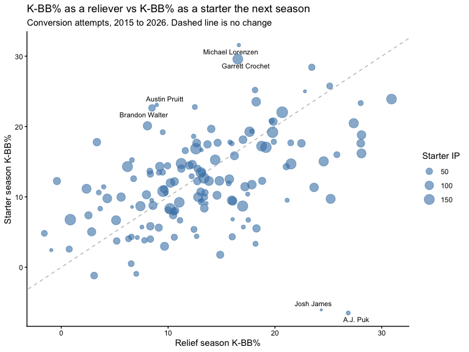
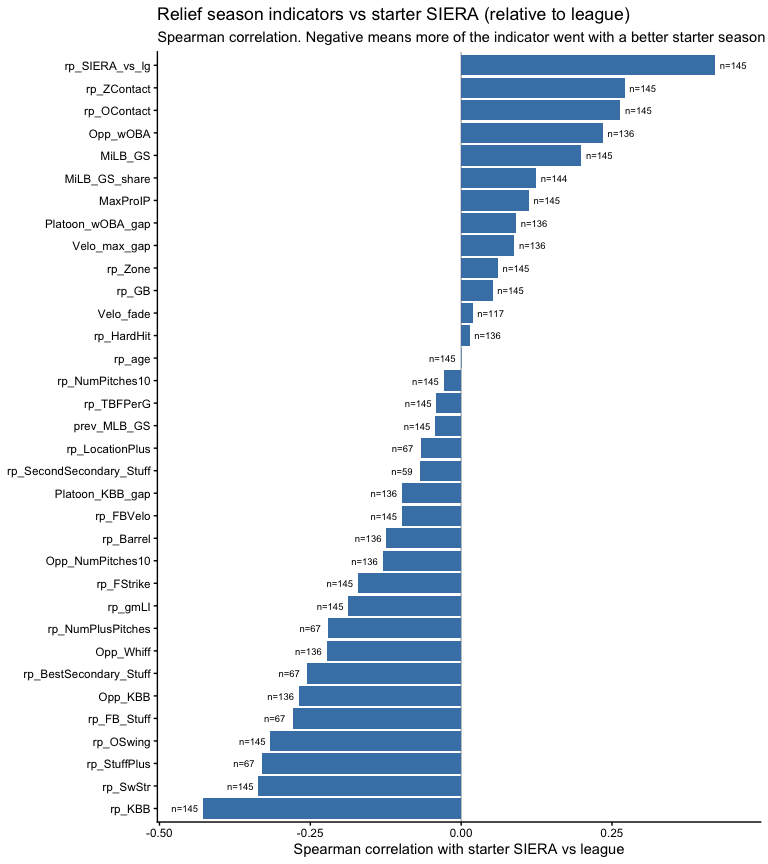
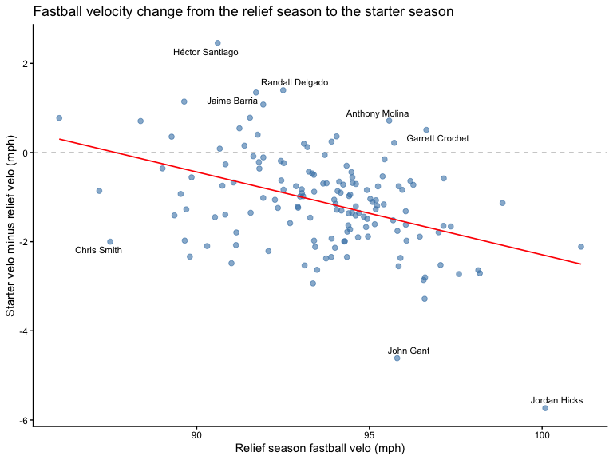
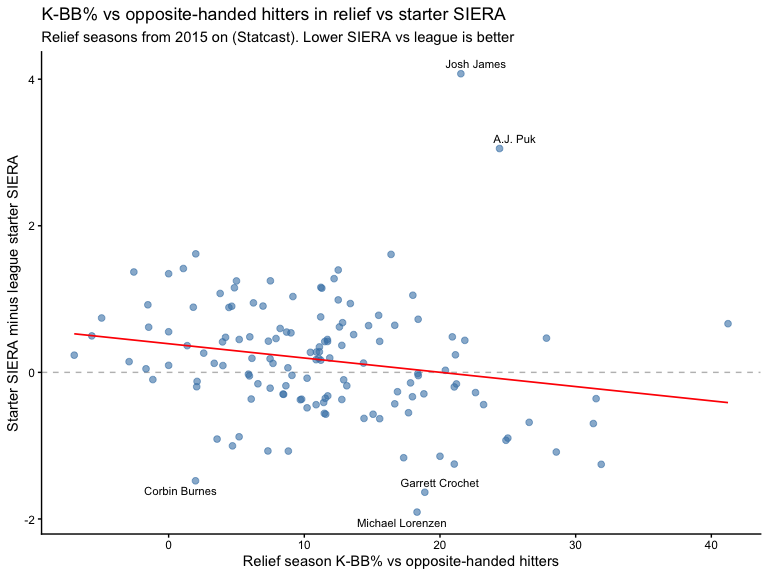
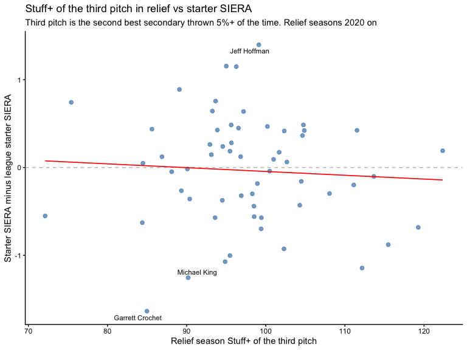
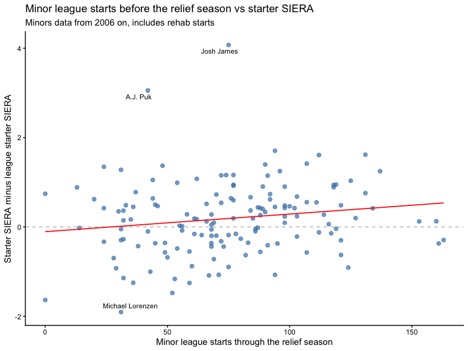
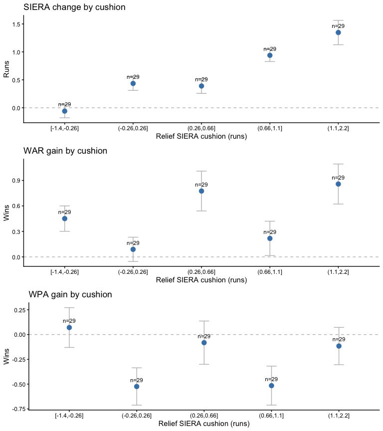
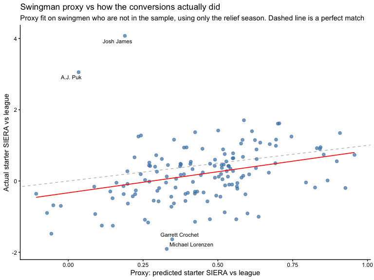

Step 4: What Predicts Success
================

``` r
library(dplyr)
library(readr)
library(ggplot2)
library(ggrepel)
library(gridExtra)

options(width = 200)
```

``` r
# Chance that a random success scores higher than a random non-success
auc_rank <- function(score, outcome) {
  keep <- !is.na(score) & !is.na(outcome)
  score <- score[keep]
  outcome <- outcome[keep]
  n1 <- sum(outcome == 1)
  n0 <- sum(outcome == 0)
  (sum(rank(score)[outcome == 1]) - n1 * (n1 + 1) / 2) / (n1 * n0)
}

# Points more than 2 standard deviations from the fitted line get labeled in the plots
add_outliers <- function(data, formula) {
  fit <- lm(formula, data = data, na.action = na.exclude)
  data$outlier <- abs(rstandard(fit)) > 2
  data$outlier[is.na(data$outlier)] <- FALSE
  data
}

savant_features <- read_csv("../data/savant_features.csv", show_col_types = FALSE)
# Platoon K-BB% and whiff rate come from notebook 03
statcast_relief <- read_csv("../data/statcast_changes.csv", show_col_types = FALSE) |>
  select(xMLBAMID, sp_season, Opp_KBB = rp_Opp_KBB, Opp_Whiff = rp_Opp_Whiff, Platoon_KBB_gap = rp_Platoon_KBB_gap)
# The WAR and WPA gains come from notebook 02
attempts <- read_csv("../data/value_attempts.csv", show_col_types = FALSE)

conversions <- read_csv("../data/conversions.csv", show_col_types = FALSE) |>
  left_join(savant_features, by = c("xMLBAMID", "rp_season")) |>
  left_join(statcast_relief, by = c("xMLBAMID", "sp_season")) |>
  left_join(attempts |> select(playerid, sp_season, WAR_gain, WPA_gain), by = c("playerid", "sp_season")) |>
  mutate(lg_sp_siera = sp_SIERA - sp_SIERA_vs_lg, Cushion = lg_sp_siera - rp_SIERA,
         Success = as.numeric(sp_SIERA_vs_lg <= 0))
```

## Relief season indicators

Each relief season trait compared to how the starter season went.

``` r
indicators <- c("rp_SIERA_vs_lg", "rp_KBB", "rp_Zone", "rp_FStrike", "rp_LocationPlus", "rp_StuffPlus", "rp_FB_Stuff",
                "rp_BestSecondary_Stuff", "rp_SecondSecondary_Stuff", "rp_NumPlusPitches", "rp_FBVelo", "Velo_max_gap",
                "Velo_fade", "rp_SwStr", "rp_ZContact", "rp_OSwing", "rp_OContact", "rp_GB", "rp_HardHit", "rp_Barrel",
                "rp_NumPitches10", "Opp_NumPitches10", "Opp_KBB", "Opp_Whiff", "Opp_wOBA", "Platoon_KBB_gap",
                "Platoon_wOBA_gap", "rp_TBFPerG", "rp_gmLI", "rp_age", "prev_MLB_GS", "MiLB_GS", "MiLB_GS_share",
                "MaxProIP")

# Spearman correlation of each indicator with the starter outcomes
# SIERA vs league is the starter SIERA minus the league starter SIERA that year, so negative is better
correlations <- data.frame(indicator = indicators, n = NA, SIERA_vs_lg = NA, p = NA, sp_IP = NA, sp_WAR_per_150 = NA,
                           beta_after_rp_SIERA = NA, p_after_rp_SIERA = NA)
for (i in 1:length(indicators)) {
  x <- conversions[[indicators[i]]]
  correlations$n[i] <- sum(!is.na(x))
  correlations$SIERA_vs_lg[i] <- cor(x, conversions$sp_SIERA_vs_lg, method = "spearman", use = "complete.obs")
  correlations$p[i] <- cor.test(x, conversions$sp_SIERA_vs_lg, method = "spearman", exact = FALSE)$p.value
  correlations$sp_IP[i] <- cor(x, conversions$sp_IP, method = "spearman", use = "complete.obs")
  correlations$sp_WAR_per_150[i] <- cor(x, conversions$sp_WAR_per_150, method = "spearman", use = "complete.obs")

  # Does the indicator add anything once relief SIERA is known (indicator in SD units)
  if (indicators[i] != "rp_SIERA_vs_lg") {
    fit <- lm(sp_SIERA_vs_lg ~ rp_SIERA_vs_lg + scale(x), data = conversions)
    correlations$beta_after_rp_SIERA[i] <- coef(summary(fit))[3, 1]
    correlations$p_after_rp_SIERA[i] <- coef(summary(fit))[3, 4]
  }
}
# Adjust for testing many indicators (Benjamini-Hochberg)
correlations$q <- p.adjust(correlations$p, method = "BH")
correlations$q_after_rp_SIERA <- p.adjust(correlations$p_after_rp_SIERA, method = "BH")
correlations <- correlations |> mutate(across(-c(indicator, n), ~ round(.x, 3)))
write_csv(correlations, "results/indicator_correlations.csv")
print(correlations)
```

    ##                   indicator   n SIERA_vs_lg     p  sp_IP sp_WAR_per_150 beta_after_rp_SIERA p_after_rp_SIERA     q q_after_rp_SIERA
    ## 1            rp_SIERA_vs_lg 145       0.421 0.000 -0.144         -0.273                  NA               NA 0.000               NA
    ## 2                    rp_KBB 145      -0.428 0.000  0.108          0.265              -0.154            0.400 0.000            0.890
    ## 3                   rp_Zone 145       0.061 0.468  0.030         -0.138               0.081            0.215 0.636            0.862
    ## 4                rp_FStrike 145      -0.171 0.040  0.145          0.099              -0.024            0.733 0.091            0.918
    ## 5           rp_LocationPlus  67      -0.067 0.588  0.129          0.028               0.021            0.834 0.704            0.918
    ## 6              rp_StuffPlus  67      -0.330 0.006  0.373          0.376              -0.074            0.483 0.024            0.918
    ## 7               rp_FB_Stuff  67      -0.279 0.022  0.370          0.265              -0.058            0.580 0.063            0.918
    ## 8    rp_BestSecondary_Stuff  67      -0.255 0.037  0.275          0.362              -0.094            0.308 0.090            0.862
    ## 9  rp_SecondSecondary_Stuff  59      -0.068 0.607  0.224          0.125              -0.023            0.769 0.704            0.918
    ## 10        rp_NumPlusPitches  67      -0.220 0.074  0.401          0.267              -0.033            0.736 0.157            0.918
    ## 11                rp_FBVelo 145      -0.098 0.239  0.143          0.163               0.036            0.606 0.387            0.918
    ## 12             Velo_max_gap 136       0.088 0.306  0.071         -0.093               0.065            0.340 0.434            0.862
    ## 13                Velo_fade 117       0.019 0.838 -0.144         -0.030               0.078            0.255 0.891            0.862
    ## 14                 rp_SwStr 145      -0.336 0.000  0.140          0.215              -0.086            0.290 0.000            0.862
    ## 15              rp_ZContact 145       0.271 0.001 -0.030         -0.184               0.011            0.886 0.007            0.926
    ## 16                rp_OSwing 145      -0.316 0.000  0.197          0.225              -0.128            0.076 0.001            0.831
    ## 17              rp_OContact 145       0.264 0.001 -0.097         -0.142               0.016            0.825 0.007            0.918
    ## 18                    rp_GB 145       0.052 0.532  0.116         -0.035               0.055            0.404 0.696            0.890
    ## 19               rp_HardHit 136       0.014 0.873 -0.060          0.021               0.020            0.772 0.900            0.918
    ## 20                rp_Barrel 136      -0.124 0.152 -0.044          0.044              -0.079            0.243 0.272            0.862
    ## 21          rp_NumPitches10 145      -0.029 0.726  0.017          0.032              -0.037            0.573 0.796            0.918
    ## 22         Opp_NumPitches10 136      -0.130 0.130 -0.030          0.081              -0.121            0.075 0.259            0.831
    ## 23                  Opp_KBB 136      -0.269 0.002  0.088          0.204               0.053            0.601 0.007            0.918
    ## 24                Opp_Whiff 136      -0.223 0.009  0.069          0.194               0.010            0.898 0.031            0.926
    ## 25                 Opp_wOBA 136       0.235 0.006 -0.248         -0.137               0.025            0.748 0.024            0.918
    ## 26          Platoon_KBB_gap 136      -0.098 0.257 -0.005         -0.035              -0.091            0.183 0.397            0.862
    ## 27         Platoon_wOBA_gap 136       0.091 0.290 -0.149         -0.068               0.033            0.632 0.428            0.918
    ## 28               rp_TBFPerG 145      -0.041 0.621 -0.060          0.009              -0.124            0.063 0.704            0.831
    ## 29                  rp_gmLI 145      -0.187 0.025  0.201          0.176              -0.016            0.820 0.064            0.918
    ## 30                   rp_age 145      -0.001 0.993 -0.064          0.014               0.032            0.631 0.993            0.918
    ## 31              prev_MLB_GS 145      -0.043 0.604 -0.047          0.043               0.001            0.983 0.704            0.983
    ## 32                  MiLB_GS 145       0.199 0.016 -0.114         -0.147               0.104            0.113 0.051            0.862
    ## 33            MiLB_GS_share 144       0.124 0.137  0.095         -0.029               0.063            0.331 0.259            0.862
    ## 34                 MaxProIP 145       0.112 0.179 -0.151         -0.127               0.088            0.179 0.304            0.862

Relief K-BB% and relief SIERA have the strongest rank correlations with
starter SIERA relative to the league (-0.43 and 0.42). After adjusting
for the 34 indicators tested, 15 are still significant (q under 0.10),
compared to about 2 expected by chance. They are mostly strikeout,
whiff, swing, and contact measures that overlap with what SIERA is built
from, plus Stuff+ and results against opposite-handed hitters. Once
relief SIERA is known, none of them adds anything (the smallest p value
is 0.06, and no q value is below 0.8).

``` r
# Relief K-BB% vs starter K-BB%
conversions |>
  add_outliers(sp_KBB ~ rp_KBB) |>
  ggplot(aes(rp_KBB * 100, sp_KBB * 100)) +
  geom_abline(slope = 1, intercept = 0, color = "gray", linetype = "dashed") +
  geom_point(aes(size = sp_IP), color = "steelblue", alpha = 0.6) +
  geom_text_repel(aes(label = ifelse(outlier, PlayerName, "")), size = 3, seed = 1) +
  labs(title = "K-BB% as a reliever vs K-BB% as a starter the next season",
       subtitle = "Conversion attempts, 2015 to 2026. Dashed line is no change",
       x = "Relief season K-BB%", y = "Starter season K-BB%", size = "Starter IP") +
  theme_classic()
```

<!-- -->

``` r
ggsave("charts/kbb_relief_vs_starter.png", width = 8, height = 6, dpi = 150)
```

``` r
# Correlation of every indicator with starter SIERA vs league
plot_correlations <- correlations |> arrange(SIERA_vs_lg)
plot_correlations$indicator <- factor(plot_correlations$indicator, levels = plot_correlations$indicator)
ggplot(plot_correlations, aes(SIERA_vs_lg, indicator)) +
  geom_vline(xintercept = 0, color = "gray") +
  geom_col(fill = "steelblue") +
  geom_text(aes(label = paste0("n=", n), x = ifelse(SIERA_vs_lg > 0, SIERA_vs_lg + 0.03, SIERA_vs_lg - 0.03)),
            size = 2.5) +
  labs(title = "Relief season indicators vs starter SIERA (relative to league)",
       subtitle = "Spearman correlation. Negative means more of the indicator went with a better starter season",
       x = "Spearman correlation with starter SIERA vs league", y = NULL) +
  theme_classic()
```

<!-- -->

``` r
ggsave("charts/indicator_correlations.png", width = 8, height = 9, dpi = 150)
```

``` r
# Velocity lost when stretched out
conversions |>
  add_outliers(Velo_change ~ rp_FBVelo) |>
  ggplot(aes(rp_FBVelo, Velo_change)) +
  geom_hline(yintercept = 0, color = "gray", linetype = "dashed") +
  geom_point(color = "steelblue", alpha = 0.6, size = 2) +
  geom_smooth(method = "lm", se = FALSE, color = "red", linewidth = 0.6) +
  geom_text_repel(aes(label = ifelse(outlier, PlayerName, "")), size = 3, seed = 1) +
  labs(title = "Fastball velocity change from the relief season to the starter season",
       x = "Relief season fastball velo (mph)", y = "Starter velo minus relief velo (mph)") +
  theme_classic()
```

    ## `geom_smooth()` using formula = 'y ~ x'

<!-- -->

``` r
ggsave("charts/velo_change.png", width = 8, height = 6, dpi = 150)
```

    ## `geom_smooth()` using formula = 'y ~ x'

``` r
# Results vs opposite-handed hitters
conversions |>
  add_outliers(sp_SIERA_vs_lg ~ Opp_KBB) |>
  ggplot(aes(Opp_KBB * 100, sp_SIERA_vs_lg)) +
  geom_hline(yintercept = 0, color = "gray", linetype = "dashed") +
  geom_point(color = "steelblue", alpha = 0.6, size = 2) +
  geom_smooth(method = "lm", se = FALSE, color = "red", linewidth = 0.6) +
  geom_text_repel(aes(label = ifelse(outlier, PlayerName, "")), size = 3, seed = 1) +
  labs(title = "K-BB% vs opposite-handed hitters in relief vs starter SIERA",
       subtitle = "Relief seasons from 2015 on (Statcast). Lower SIERA vs league is better",
       x = "Relief season K-BB% vs opposite-handed hitters", y = "Starter SIERA minus league starter SIERA") +
  theme_classic()
```

    ## `geom_smooth()` using formula = 'y ~ x'

    ## Warning: Removed 9 rows containing non-finite outside the scale range (`stat_smooth()`).

    ## Warning: Removed 9 rows containing missing values or values outside the scale range (`geom_point()`).

    ## Warning: Removed 9 rows containing missing values or values outside the scale range (`geom_text_repel()`).

<!-- -->

``` r
ggsave("charts/opposite_hand_kbb.png", width = 8, height = 6, dpi = 150)
```

    ## `geom_smooth()` using formula = 'y ~ x'

    ## Warning: Removed 9 rows containing non-finite outside the scale range (`stat_smooth()`).

    ## Warning: Removed 9 rows containing missing values or values outside the scale range (`geom_point()`).

    ## Warning: Removed 9 rows containing missing values or values outside the scale range (`geom_text_repel()`).

``` r
# Quality of the third pitch (second best secondary by Stuff+), 2020 on
conversions |>
  filter(!is.na(rp_SecondSecondary_Stuff)) |>
  add_outliers(sp_SIERA_vs_lg ~ rp_SecondSecondary_Stuff) |>
  ggplot(aes(rp_SecondSecondary_Stuff, sp_SIERA_vs_lg)) +
  geom_hline(yintercept = 0, color = "gray", linetype = "dashed") +
  geom_point(color = "steelblue", alpha = 0.7, size = 2) +
  geom_smooth(method = "lm", se = FALSE, color = "red", linewidth = 0.6) +
  geom_text_repel(aes(label = ifelse(outlier, PlayerName, "")), size = 3, seed = 1) +
  labs(title = "Stuff+ of the third pitch in relief vs starter SIERA",
       subtitle = "Third pitch is the second best secondary thrown 5%+ of the time. Relief seasons 2020 on",
       x = "Relief season Stuff+ of the third pitch", y = "Starter SIERA minus league starter SIERA") +
  theme_classic()
```

    ## `geom_smooth()` using formula = 'y ~ x'

<!-- -->

``` r
ggsave("charts/third_pitch_stuff.png", width = 8, height = 6, dpi = 150)
```

    ## `geom_smooth()` using formula = 'y ~ x'

``` r
# Minor league starts before the relief season
conversions |>
  add_outliers(sp_SIERA_vs_lg ~ MiLB_GS) |>
  ggplot(aes(MiLB_GS, sp_SIERA_vs_lg)) +
  geom_hline(yintercept = 0, color = "gray", linetype = "dashed") +
  geom_point(color = "steelblue", alpha = 0.7, size = 2) +
  geom_smooth(method = "lm", se = FALSE, color = "red", linewidth = 0.6) +
  geom_text_repel(aes(label = ifelse(outlier, PlayerName, "")), size = 3, seed = 1) +
  labs(title = "Minor league starts before the relief season vs starter SIERA",
       subtitle = "Minors data from 2006 on, includes rehab starts",
       x = "Minor league starts through the relief season", y = "Starter SIERA minus league starter SIERA") +
  theme_classic()
```

    ## `geom_smooth()` using formula = 'y ~ x'

<!-- -->

``` r
ggsave("charts/minor_league_starts.png", width = 8, height = 6, dpi = 150)
```

    ## `geom_smooth()` using formula = 'y ~ x'

## Weighting by batters faced

The new attempts include pitchers with only a few starts, so their SIERA
is noisy. I repeated the main relationship with each attempt weighted by
its batters faced as a starter.

``` r
weighted_model <- lm(sp_SIERA_vs_lg ~ rp_SIERA_vs_lg, data = conversions, weights = sp_TBF)
cat("SIERA change, mean:", round(mean(conversions$SIERA_change), 2),
    " weighted:", round(weighted.mean(conversions$SIERA_change, conversions$sp_TBF), 2),
    " share worse:", round(mean(conversions$SIERA_change > 0), 2), "\n")
```

    ## SIERA change, mean: 0.61  weighted: 0.56  share worse: 0.77

``` r
cat("Starter SIERA vs league, mean:", round(mean(conversions$sp_SIERA_vs_lg), 2),
    " weighted:", round(weighted.mean(conversions$sp_SIERA_vs_lg, conversions$sp_TBF), 2), "\n")
```

    ## Starter SIERA vs league, mean: 0.19  weighted: 0.08

``` r
cat("Spearman:", round(cor(conversions$rp_SIERA_vs_lg, conversions$sp_SIERA_vs_lg, method = "spearman"), 2),
    " weighted slope:", round(coef(weighted_model)[2], 2),
    " standard error:", round(summary(weighted_model)$coefficients[2, 2], 2), "\n")
```

    ## Spearman: 0.42  weighted slope: 0.38  standard error: 0.07

``` r
# Leave one out error, weighted by batters faced
loo_model <- rep(NA, nrow(conversions))
loo_mean <- rep(NA, nrow(conversions))
for (i in 1:nrow(conversions)) {
  others <- conversions[-i, ]
  fit <- lm(sp_SIERA_vs_lg ~ rp_SIERA_vs_lg, data = others, weights = sp_TBF)
  loo_model[i] <- predict(fit, newdata = conversions[i, ])
  loo_mean[i] <- weighted.mean(others$sp_SIERA_vs_lg, others$sp_TBF)
}
cat("Leave one out RMSE, no model:",
    round(sqrt(weighted.mean((conversions$sp_SIERA_vs_lg - loo_mean)^2, conversions$sp_TBF)), 3),
    " relief SIERA:",
    round(sqrt(weighted.mean((conversions$sp_SIERA_vs_lg - loo_model)^2, conversions$sp_TBF)), 3), "\n")
```

    ## Leave one out RMSE, no model: 0.667  relief SIERA: 0.603

``` r
# Did the relationship change over time (the slope of starter SIERA on relief SIERA, season by season)
interaction_model <- lm(sp_SIERA_vs_lg ~ rp_SIERA_vs_lg * sp_season, data = conversions, weights = sp_TBF)
cat("Weighted slope changes by", round(coef(interaction_model)[4], 3), "per season, p =",
    round(summary(interaction_model)$coefficients[4, 4], 2), "\n")
```

    ## Weighted slope changes by -0.013 per season, p = 0.5

Weighting by batters faced shrinks the average starter SIERA relative to
the league from 0.19 to 0.08, so the pitchers with only a few starts
pull the average up. The relationship between relief and starter SIERA
holds (a weighted slope of 0.38). The slope is a little lower for later
conversions, but the trend by season is not significant (a change of
-0.013 per season, p = 0.50).

## Different definitions of a conversion

Whether the main results depend on the cutoffs.

``` r
pitcher_seasons <- read_csv("../data/pitcher_seasons.csv", guess_max = 20000, show_col_types = FALSE)

season_totals <- pitcher_seasons |>
  group_by(playerid, Season) |>
  summarize(G_total = sum(G), GS_total = sum(GS), .groups = "drop") |>
  arrange(playerid, Season) |>
  group_by(playerid) |>
  mutate(prior_GS = cumsum(GS_total) - GS_total) |>
  ungroup()

relief_all <- pitcher_seasons |>
  filter(role == "rel") |>
  left_join(season_totals |> select(playerid, Season, prior_GS), by = c("playerid", "Season")) |>
  transmute(playerid, rp_season = Season, rp_TBF = TBF, rp_GS_share = GS_total / G_total, rp_SIERA = SIERA,
            rp_SIERA_vs_lg = SIERA - lg_rp_siera, prior_GS)
starter_all <- pitcher_seasons |>
  filter(role == "sta") |>
  transmute(playerid, PlayerName, sp_season = Season, sp_GS = GS, sp_IP = IP,
      sp_starter_share = GS_total / G_total,
            sp_SIERA = SIERA, sp_SIERA_vs_lg = SIERA - lg_sp_siera, lg_sp_siera, xMLBAMID)
game_logs <- read_csv("../data/game_logs.csv", show_col_types = FALSE) |>
  filter(GS == 1)
```

``` r
# Same pairing rules as 01_data_and_sample.Rmd, with the cutoffs as inputs
build_variant <- function(min_pitches, min_long_starts, max_relief_gs_share, min_relief_tbf, max_gap) {
  long_starts <- game_logs |>
    filter(Pitches >= min_pitches) |>
    count(xMLBAMID, sp_season = Season, name = "sp_LongStarts")
  starters <- starter_all |>
    inner_join(long_starts, by = c("xMLBAMID", "sp_season")) |>
    filter(sp_LongStarts >= min_long_starts, sp_season >= 2015)
  relievers <- relief_all |>
    filter(rp_TBF >= min_relief_tbf, rp_GS_share <= max_relief_gs_share)
  pairs <- starters |>
    inner_join(relievers, by = "playerid", relationship = "many-to-many") |>
    mutate(gap = sp_season - rp_season) |>
    filter(gap >= 1, gap <= max_gap) |>
    group_by(playerid, sp_season) |>
    filter(gap == min(gap)) |>
    ungroup()
  # starts made in the years between the relief season and the starter season
  pairs$GS_between <- 0
  for (i in which(pairs$gap >= 2)) {
    between <- season_totals |>
      filter(playerid == pairs$playerid[i], Season > pairs$rp_season[i], Season < pairs$sp_season[i])
    pairs$GS_between[i] <- sum(between$GS_total)
  }
  pairs |> filter(GS_between <= 3)
}
```

``` r
# Headline numbers for one version of the sample
summarize_variant <- function(label, pairs) {
  pairs <- pairs |> mutate(cushion = lg_sp_siera - rp_SIERA, success = sp_SIERA_vs_lg <= 0)
  top_third <- pairs$rp_SIERA_vs_lg <= quantile(pairs$rp_SIERA_vs_lg, 1 / 3)
  slope_fit <- lm(sp_SIERA ~ rp_SIERA, data = pairs)
  data.frame(
    version = label, attempts = nrow(pairs), pitchers = n_distinct(pairs$playerid),
    mean_starter_SIERA_vs_lg = round(mean(pairs$sp_SIERA_vs_lg), 2),
    mean_SIERA_change = round(mean(pairs$sp_SIERA - pairs$rp_SIERA), 2),
    share_SIERA_worse = round(mean(pairs$sp_SIERA > pairs$rp_SIERA), 2),
    spearman_relief_vs_starter = round(cor(pairs$rp_SIERA_vs_lg, pairs$sp_SIERA_vs_lg, method = "spearman"), 2),
    slope = round(coef(slope_fit)[2], 2),
    success_top_third = round(mean(pairs$success[top_third]), 2),
    success_rest = round(mean(pairs$success[!top_third]), 2),
    n_cushion_1plus = sum(pairs$cushion >= 1),
    success_cushion_1plus = round(mean(pairs$success[pairs$cushion >= 1]), 2),
    success_cushion_under_1 = round(mean(pairs$success[pairs$cushion < 1]), 2))
}

baseline <- build_variant(70, 2, 0.2, 100, 3)
versions <- list(
  "baseline: 2+ starts of 70+ pitches, relief TBF 100+, relief starts 20% or less, lookback 3" = baseline,
  "1+ start of 70+ pitches" = build_variant(70, 1, 0.2, 100, 3),
  "3+ starts of 70+ pitches" = build_variant(70, 3, 0.2, 100, 3),
  "5+ starts of 70+ pitches" = build_variant(70, 5, 0.2, 100, 3),
  "2+ starts of 60+ pitches" = build_variant(60, 2, 0.2, 100, 3),
  "2+ starts of 80+ pitches" = build_variant(80, 2, 0.2, 100, 3),
  "stricter relief season (150+ TBF, starts 10% or less)" = build_variant(70, 2, 0.1, 150, 3),
  "lookback 1 year only" = build_variant(70, 2, 0.2, 100, 1))
versions[["old rule (5+ starts, half of games, 3.5+ IP per start)"]] <- build_variant(1, 1, 0.2, 100, 3) |>
  filter(sp_GS >= 5, sp_starter_share >= 0.5, sp_IP / sp_GS >= 3.5)
```

``` r
# Versions that filter the baseline sample
baseline_prior <- baseline
versions[["true relievers only (under 20 prior MLB starts)"]] <- baseline_prior |> filter(prior_GS < 20)
versions[["former starters only (20+ prior MLB starts)"]] <- baseline_prior |> filter(prior_GS >= 20)
versions[["one attempt per pitcher (first one)"]] <- baseline_prior |> arrange(playerid, sp_season) |>
  group_by(playerid) |> slice(1) |> ungroup()
versions[["drop 2020 (short season) as either year"]] <- baseline_prior |> filter(sp_season != 2020,
    rp_season != 2020)
# The two halves are split at the median starter season
half <- median(baseline_prior$sp_season)
versions[[paste0("2015 to ", half, " only")]] <- baseline_prior |> filter(sp_season <= half)
versions[[paste0(half + 1, " to 2026 only")]] <- baseline_prior |> filter(sp_season > half)

results <- NULL
for (label in names(versions)) {
  results <- bind_rows(results, summarize_variant(label, versions[[label]]))
}
write_csv(results, "results/definition_sensitivity.csv")

cat("1. Headline results under different definitions of a conversion\n")
```

    ## 1. Headline results under different definitions of a conversion

``` r
cat("success = starter SIERA at or below the league average starter. top_third = best third of relievers by relief SIERA vs league in that version.\n\n")
```

    ## success = starter SIERA at or below the league average starter. top_third = best third of relievers by relief SIERA vs league in that version.

``` r
print(as.data.frame(results |> select(version, attempts, pitchers, mean_SIERA_change, spearman_relief_vs_starter,
    slope,
                                      success_top_third, success_rest, success_cushion_1plus,
                                        success_cushion_under_1)), row.names = FALSE)
```

    ##                                                                                     version attempts pitchers mean_SIERA_change spearman_relief_vs_starter slope success_top_third success_rest
    ##  baseline: 2+ starts of 70+ pitches, relief TBF 100+, relief starts 20% or less, lookback 3      145      129              0.61                       0.42  0.37              0.65         0.29
    ##                                                                     1+ start of 70+ pitches      167      142              0.65                       0.40  0.38              0.62         0.25
    ##                                                                    3+ starts of 70+ pitches      132      120              0.59                       0.44  0.37              0.64         0.30
    ##                                                                    5+ starts of 70+ pitches      110      105              0.55                       0.51  0.45              0.68         0.29
    ##                                                                    2+ starts of 60+ pitches      155      136              0.65                       0.41  0.39              0.63         0.26
    ##                                                                    2+ starts of 80+ pitches      131      120              0.59                       0.44  0.36              0.66         0.29
    ##                                       stricter relief season (150+ TBF, starts 10% or less)       85       81              0.68                       0.43  0.35              0.62         0.30
    ##                                                                        lookback 1 year only      126      113              0.65                       0.43  0.38              0.64         0.32
    ##                                      old rule (5+ starts, half of games, 3.5+ IP per start)       79       77              0.54                       0.48  0.44              0.67         0.33
    ##                                             true relievers only (under 20 prior MLB starts)       98       91              0.63                       0.34  0.30              0.58         0.32
    ##                                                 former starters only (20+ prior MLB starts)       47       42              0.57                       0.59  0.49              0.75         0.26
    ##                                                         one attempt per pitcher (first one)      129      129              0.65                       0.41  0.35              0.65         0.27
    ##                                                     drop 2020 (short season) as either year      132      122              0.58                       0.43  0.35              0.66         0.30
    ##                                                                           2015 to 2021 only       80       73              0.68                       0.46  0.39              0.59         0.25
    ##                                                                           2022 to 2026 only       65       62              0.52                       0.26  0.19              0.64         0.40
    ##  success_cushion_1plus success_cushion_under_1
    ##                   0.70                    0.33
    ##                   0.68                    0.30
    ##                   0.72                    0.32
    ##                   0.72                    0.33
    ##                   0.70                    0.30
    ##                   0.70                    0.33
    ##                   0.71                    0.31
    ##                   0.72                    0.33
    ##                   0.75                    0.37
    ##                   0.59                    0.36
    ##                   0.91                    0.28
    ##                   0.66                    0.32
    ##                   0.69                    0.34
    ##                   0.63                    0.28
    ##                   0.79                    0.39

``` r
cat("\nOther columns\n")
```

    ## 
    ## Other columns

``` r
print(as.data.frame(results |> select(version, mean_starter_SIERA_vs_lg, share_SIERA_worse, n_cushion_1plus)),
    row.names = FALSE)
```

    ##                                                                                     version mean_starter_SIERA_vs_lg share_SIERA_worse n_cushion_1plus
    ##  baseline: 2+ starts of 70+ pitches, relief TBF 100+, relief starts 20% or less, lookback 3                     0.19              0.77              33
    ##                                                                     1+ start of 70+ pitches                     0.28              0.77              34
    ##                                                                    3+ starts of 70+ pitches                     0.18              0.78              29
    ##                                                                    5+ starts of 70+ pitches                     0.15              0.78              25
    ##                                                                    2+ starts of 60+ pitches                     0.25              0.78              33
    ##                                                                    2+ starts of 80+ pitches                     0.17              0.77              30
    ##                                       stricter relief season (150+ TBF, starts 10% or less)                     0.15              0.79              21
    ##                                                                        lookback 1 year only                     0.15              0.79              32
    ##                                      old rule (5+ starts, half of games, 3.5+ IP per start)                     0.11              0.78              16
    ##                                             true relievers only (under 20 prior MLB starts)                     0.20              0.79              22
    ##                                                 former starters only (20+ prior MLB starts)                     0.16              0.72              11
    ##                                                         one attempt per pitcher (first one)                     0.22              0.79              29
    ##                                                     drop 2020 (short season) as either year                     0.18              0.77              29
    ##                                                                           2015 to 2021 only                     0.34              0.78              19
    ##                                                                           2022 to 2026 only                     0.01              0.75              14

The main result does not depend on the cutoffs. Across the 15 versions
of the sample, the rank correlation between relief and starter SIERA
stays between 0.26 and 0.59, SIERA gets worse by 0.52 to 0.68 on
average, and the top third of relievers by relief SIERA succeed 58% to
75% of the time versus 25% to 40% for the rest. The weakest version is
the 2022 to 2026 half (a correlation of 0.26).

``` r
# How noisy is a reliever's SIERA? The year to year relationship for relievers who stayed relievers shows how much
# of the slope from relief SIERA to starter SIERA is regression to the mean instead of a role effect
cat("\n2. Year to year reliability of SIERA (SIERA vs league, this season to next season)\n")
```

    ## 
    ## 2. Year to year reliability of SIERA (SIERA vs league, this season to next season)

``` r
relief_next <- relief_all |> filter(rp_TBF >= 100, rp_GS_share <= 0.2) |>
  mutate(next_season = rp_season + 1) |>
  inner_join(relief_all |> filter(rp_TBF >= 100, rp_GS_share <= 0.2) |>
               select(playerid, next_season = rp_season, next_SIERA_vs_lg = rp_SIERA_vs_lg, next_SIERA = rp_SIERA),
             by = c("playerid", "next_season"))
cat("Relievers to relievers, both seasons 100+ TBF:", nrow(relief_next), " correlation",
    round(cor(relief_next$rp_SIERA_vs_lg, relief_next$next_SIERA_vs_lg), 2),
    " slope of next SIERA on this SIERA", round(coef(lm(next_SIERA ~ rp_SIERA, data = relief_next))[2], 2), "\n")
```

    ## Relievers to relievers, both seasons 100+ TBF: 1688  correlation 0.39  slope of next SIERA on this SIERA 0.41

``` r
starter_pairs <- starter_all |> filter(sp_GS >= 10) |>
  mutate(next_season = sp_season + 1) |>
  inner_join(starter_all |> filter(sp_GS >= 10) |> select(playerid, next_season = sp_season, next_SIERA = sp_SIERA,
      next_SIERA_vs_lg = sp_SIERA_vs_lg),
             by = c("playerid", "next_season"))
cat("Starters to starters, both seasons 10+ starts:", nrow(starter_pairs), " correlation",
    round(cor(starter_pairs$sp_SIERA_vs_lg, starter_pairs$next_SIERA_vs_lg), 2),
    " slope", round(coef(lm(next_SIERA ~ sp_SIERA, data = starter_pairs))[2], 2), "\n")
```

    ## Starters to starters, both seasons 10+ starts: 1374  correlation 0.63  slope 0.61

``` r
cat("The conversion slope (relief SIERA to starter SIERA) is", round(coef(lm(sp_SIERA ~ rp_SIERA,
    data = baseline))[2], 2),
    "so most of the shrinkage toward the mean is what a one year reliever sample would show anyway\n")
```

    ## The conversion slope (relief SIERA to starter SIERA) is 0.37 so most of the shrinkage toward the mean is what a one year reliever sample would show anyway

## SIERA cushion

Cushion is the league average starter SIERA minus the pitcher’s relief
SIERA, so positive means room to spare.

``` r
cat("Average league starter SIERA in these starter seasons:", round(mean(conversions$lg_sp_siera), 2), "\n")
```

    ## Average league starter SIERA in these starter seasons: 4.31

``` r
cat("Cushion range:", round(min(conversions$Cushion), 2), "to", round(max(conversions$Cushion), 2), "\n\n")
```

    ## Cushion range: -1.37 to 2.17

``` r
# Fifths of the attempts by cushion, so every group has the same number of pitchers
cushion_breaks <- quantile(conversions$Cushion, 0:5 / 5)
conversions$CushionBin <- cut(conversions$Cushion, cushion_breaks, include.lowest = TRUE, dig.lab = 2)
attempts$CushionBin <- cut(attempts$Cushion, cushion_breaks, include.lowest = TRUE, dig.lab = 2)

cat("Cushion bins, SIERA\n")
```

    ## Cushion bins, SIERA

``` r
conv_bins <- conversions |>
  group_by(CushionBin) |>
  summarize(n = n(), rp_SIERA = mean(rp_SIERA), sp_SIERA = mean(sp_SIERA),
            SIERA_change_se = sd(SIERA_change) / sqrt(n()), SIERA_change = mean(SIERA_change),
            share_avg_or_better = mean(sp_SIERA_vs_lg <= 0), sp_SIERA_vs_lg = mean(sp_SIERA_vs_lg),
            stuck = mean(stuck, na.rm = TRUE), sp_IP = mean(sp_IP))
print(as.data.frame(conv_bins), digits = 3)
```

    ##     CushionBin  n rp_SIERA sp_SIERA SIERA_change_se SIERA_change share_avg_or_better sp_SIERA_vs_lg stuck sp_IP
    ## 1 [-1.4,-0.26] 29     4.90     4.84           0.121      -0.0598               0.172         0.5485 0.185  63.0
    ## 2 (-0.26,0.26] 29     4.32     4.76           0.124       0.4347               0.207         0.4393 0.185  58.2
    ## 3  (0.26,0.66] 29     3.87     4.26           0.132       0.3894               0.552        -0.0684 0.481  77.9
    ## 4   (0.66,1.1] 29     3.46     4.40           0.111       0.9384               0.448         0.1117 0.357  69.1
    ## 5    (1.1,2.2] 29     2.91     4.26           0.219       1.3466               0.690        -0.0771 0.462  82.2

``` r
cat("\nCushion bins, value\n")
```

    ## 
    ## Cushion bins, value

``` r
att_bins <- attempts |>
  group_by(CushionBin) |>
  summarize(n = n(), share_WAR_gain = mean(WAR_gain > 0), share_WPA_gain = mean(WPA_gain > 0, na.rm = TRUE),
            share_5plus_GS = mean(attempt == "5+ starts"), N_WAR = mean(N_WAR),
            next_WAR = mean(next_WAR), pen_WAR = mean(pen_WAR),
            WAR_gain_se = sd(WAR_gain) / sqrt(n()), WAR_gain = mean(WAR_gain),
            N_WPA = mean(N_WPA, na.rm = TRUE), next_WPA = mean(next_WPA, na.rm = TRUE),
            pen_WPA = mean(pen_WPA, na.rm = TRUE),
            WPA_gain_se = sd(WPA_gain, na.rm = TRUE) / sqrt(n()), WPA_gain = mean(WPA_gain, na.rm = TRUE))
print(as.data.frame(att_bins), digits = 3)
```

    ##     CushionBin  n share_WAR_gain share_WPA_gain share_5plus_GS   N_WAR next_WAR pen_WAR WAR_gain_se WAR_gain   N_WPA next_WPA pen_WPA WPA_gain_se WPA_gain
    ## 1 [-1.4,-0.26] 29          0.690          0.483          0.862 -0.1663    0.558   0.108       0.149   0.4503 -0.2793  -0.1138 -0.1846       0.201   0.0708
    ## 2 (-0.26,0.26] 29          0.517          0.379          0.897  0.0359    0.361   0.273       0.143   0.0887 -0.1483  -0.4345  0.0895       0.188  -0.5240
    ## 3  (0.26,0.66] 29          0.621          0.414          0.862  0.3998    1.210   0.435       0.234   0.7749  0.4276   0.2862  0.3681       0.218  -0.0819
    ## 4   (0.66,1.1] 29          0.517          0.276          0.759  0.6013    0.776   0.559       0.202   0.2174  0.0793  -0.0069  0.5083       0.197  -0.5152
    ## 5    (1.1,2.2] 29          0.724          0.483          0.828  0.8538    1.567   0.710       0.236   0.8575  0.3103   0.6345  0.7502       0.188  -0.1157

``` r
# Does the cushion still matter once you know the relief season value
cat("\nCushion as a predictor of the gain\n")
```

    ## 
    ## Cushion as a predictor of the gain

``` r
cat("WAR gain on cushion: slope", round(coef(lm(WAR_gain ~ Cushion, data = attempts))[2], 3),
    " p =", round(summary(lm(WAR_gain ~ Cushion, data = attempts))$coefficients[2, 4], 3), "\n")
```

    ## WAR gain on cushion: slope 0.198  p = 0.11

``` r
cat("WPA gain on cushion: slope", round(coef(lm(WPA_gain ~ Cushion, data = attempts))[2], 3),
    " p =", round(summary(lm(WPA_gain ~ Cushion, data = attempts))$coefficients[2, 4], 3), "\n")
```

    ## WPA gain on cushion: slope -0.084  p = 0.497

``` r
# Bars are 1 standard error
siera_plot <- ggplot(conv_bins, aes(CushionBin, SIERA_change)) +
  geom_hline(yintercept = 0, color = "gray", linetype = "dashed") +
  geom_errorbar(aes(ymin = SIERA_change - SIERA_change_se, ymax = SIERA_change + SIERA_change_se), width = 0.15,
      color = "gray") +
  geom_point(color = "steelblue", size = 3) +
  geom_text(aes(label = paste0("n=", n)), vjust = -1.2, size = 3) +
  labs(title = "SIERA change by cushion", x = "Relief SIERA cushion (runs)", y = "Runs") +
  theme_classic()
war_plot <- ggplot(att_bins, aes(CushionBin, WAR_gain)) +
  geom_hline(yintercept = 0, color = "gray", linetype = "dashed") +
  geom_errorbar(aes(ymin = WAR_gain - WAR_gain_se, ymax = WAR_gain + WAR_gain_se), width = 0.15, color = "gray") +
  geom_point(color = "steelblue", size = 3) +
  geom_text(aes(label = paste0("n=", n)), vjust = -1.2, size = 3) +
  labs(title = "WAR gain by cushion", x = "Relief SIERA cushion (runs)", y = "Wins") +
  theme_classic()
wpa_plot <- ggplot(att_bins, aes(CushionBin, WPA_gain)) +
  geom_hline(yintercept = 0, color = "gray", linetype = "dashed") +
  geom_errorbar(aes(ymin = WPA_gain - WPA_gain_se, ymax = WPA_gain + WPA_gain_se), width = 0.15, color = "gray") +
  geom_point(color = "steelblue", size = 3) +
  geom_text(aes(label = paste0("n=", n)), vjust = -1.2, size = 3) +
  labs(title = "WPA gain by cushion", x = "Relief SIERA cushion (runs)", y = "Wins") +
  theme_classic()
ggsave("charts/cushion_bins.png", grid.arrange(siera_plot, war_plot, wpa_plot, ncol = 1),
       width = 8, height = 9, dpi = 150)
```

<!-- -->

Success rates rise with cushion, but not evenly. Only 17% of the
pitchers in the lowest fifth of cushion (below -0.26) finished as league
average or better starters, versus 69% in the top fifth (above 1.1),
with 55% and 45% in the two fifths below the top. The WAR gain is
positive in every fifth (0.09 to 0.86), but cushion predicts it only
weakly (a slope of 0.20 per point of cushion, p = 0.11) and does not
predict the WPA gain (p = 0.50).

## Comparing predictors

Whether any predictor beats picking the best relievers by relief SIERA.

``` r
# Leave one out RMSE for a linear model
loo_rmse <- function(formula, data, outcome) {
  errors <- rep(NA, nrow(data))
  for (i in 1:nrow(data)) {
    fit <- lm(formula, data = data[-i, ])
    errors[i] <- data[[outcome]][i] - predict(fit, newdata = data[i, ])
  }
  sqrt(mean(errors^2))
}

cat("PART 1. All conversion attempts. Outcome: starter SIERA vs league (lower is better)\n")
```

    ## PART 1. All conversion attempts. Outcome: starter SIERA vs league (lower is better)

``` r
cat("Higher AUC is better. No model means guessing the average.\n\n")
```

    ## Higher AUC is better. No model means guessing the average.

``` r
full <- conversions |> filter(!is.na(Opp_KBB), !is.na(rp_SIERA_vs_lg))
cat("n =", nrow(full), " no model RMSE =", round(sd(full$sp_SIERA_vs_lg) * sqrt((nrow(full) - 1) / nrow(full)), 3),
    "\n")
```

    ## n = 136  no model RMSE = 0.821

``` r
formulas_full <- c("sp_SIERA_vs_lg ~ rp_SIERA_vs_lg",
                   "sp_SIERA_vs_lg ~ rp_KBB",
                   "sp_SIERA_vs_lg ~ rp_SIERA_vs_lg + rp_age",
                   "sp_SIERA_vs_lg ~ rp_SIERA_vs_lg + Opp_KBB",
                   "sp_SIERA_vs_lg ~ rp_SIERA_vs_lg + rp_SwStr + rp_age + rp_FBVelo",
                   "sp_SIERA_vs_lg ~ rp_SIERA_vs_lg + rp_age + Opp_KBB + rp_gmLI + MiLB_GS")
table_full <- NULL
for (f in formulas_full) {
  fit <- lm(as.formula(f), data = full)
  table_full <- bind_rows(table_full, data.frame(
    model = sub("sp_SIERA_vs_lg ~ ", "", f), R2 = round(summary(fit)$r.squared, 3),
    LOO_RMSE = round(loo_rmse(as.formula(f), full, "sp_SIERA_vs_lg"), 3),
    AUC_success = round(auc_rank(-predict(fit), full$Success), 3)))
}
print(table_full)
```

    ##                                                   model    R2 LOO_RMSE AUC_success
    ## 1                                        rp_SIERA_vs_lg 0.094    0.796       0.741
    ## 2                                                rp_KBB 0.097    0.796       0.731
    ## 3                               rp_SIERA_vs_lg + rp_age 0.096    0.799       0.741
    ## 4                              rp_SIERA_vs_lg + Opp_KBB 0.096    0.800       0.739
    ## 5        rp_SIERA_vs_lg + rp_SwStr + rp_age + rp_FBVelo 0.108    0.808       0.726
    ## 6 rp_SIERA_vs_lg + rp_age + Opp_KBB + rp_gmLI + MiLB_GS 0.110    0.809       0.748

``` r
cat("\nBest relievers rule (top third by relief SIERA vs league) vs the rest\n")
```

    ## 
    ## Best relievers rule (top third by relief SIERA vs league) vs the rest

``` r
cut_value <- quantile(full$rp_SIERA_vs_lg, 1 / 3)
full |>
  group_by(top_third_by_relief_SIERA = rp_SIERA_vs_lg <= cut_value) |>
  summarize(n = n(), share_avg_or_better = mean(Success), sp_SIERA_vs_lg = mean(sp_SIERA_vs_lg),
            stuck = mean(stuck, na.rm = TRUE), WAR_gain = mean(WAR_gain, na.rm = TRUE),
            WPA_gain = mean(WPA_gain, na.rm = TRUE)) |>
  as.data.frame() |> print(digits = 3)
```

    ##   top_third_by_relief_SIERA  n share_avg_or_better sp_SIERA_vs_lg stuck WAR_gain WPA_gain
    ## 1                     FALSE 90               0.300          0.304 0.214    0.341  -0.3040
    ## 2                      TRUE 46               0.674         -0.091 0.571    0.760  -0.0434

``` r
cat("\nSame, using the stacked model (relief SIERA, age, Opp K-BB%, gmLI, MiLB starts) top third by prediction\n")
```

    ## 
    ## Same, using the stacked model (relief SIERA, age, Opp K-BB%, gmLI, MiLB starts) top third by prediction

``` r
stack_fit <- lm(sp_SIERA_vs_lg ~ rp_SIERA_vs_lg + rp_age + Opp_KBB + rp_gmLI + MiLB_GS, data = full)
# leave one out predictions so the ranking is not fit on its own answers
loo_pred <- rep(NA, nrow(full))
for (i in 1:nrow(full)) {
  loo_fit <- lm(formula(stack_fit), data = full[-i, ])
  loo_pred[i] <- predict(loo_fit, newdata = full[i, ])
}
full$stack_pred <- loo_pred
full |>
  group_by(top_third_by_model = stack_pred <= quantile(stack_pred, 1 / 3)) |>
  summarize(n = n(), share_avg_or_better = mean(Success), sp_SIERA_vs_lg = mean(sp_SIERA_vs_lg),
            stuck = mean(stuck, na.rm = TRUE), WAR_gain = mean(WAR_gain, na.rm = TRUE)) |>
  as.data.frame() |> print(digits = 3)
```

    ##   top_third_by_model  n share_avg_or_better sp_SIERA_vs_lg stuck WAR_gain
    ## 1              FALSE 90               0.333         0.2935 0.262    0.383
    ## 2               TRUE 46               0.609        -0.0711 0.476    0.678

``` r
cat("\n\nPART 2. Attempts with a relief season from 2020 on (Stuff+ exists). Outcome: starter SIERA vs league\n")
```

    ## 
    ## 
    ## PART 2. Attempts with a relief season from 2020 on (Stuff+ exists). Outcome: starter SIERA vs league

``` r
stuff <- conversions |>
  filter(!is.na(rp_StuffPlus), !is.na(rp_NumPlusPitches), !is.na(rp_FB_Stuff))
cat("n =", nrow(stuff), " no model RMSE =", round(sd(stuff$sp_SIERA_vs_lg) * sqrt((nrow(stuff) - 1) / nrow(stuff)),
    3), "\n")
```

    ## n = 67  no model RMSE = 0.725

``` r
formulas_stuff <- c("sp_SIERA_vs_lg ~ rp_SIERA_vs_lg",
                    "sp_SIERA_vs_lg ~ rp_KBB",
                    "sp_SIERA_vs_lg ~ rp_StuffPlus",
                    "sp_SIERA_vs_lg ~ rp_NumPlusPitches",
                    "sp_SIERA_vs_lg ~ rp_SIERA_vs_lg + rp_StuffPlus")
table_stuff <- NULL
for (f in formulas_stuff) {
  fit <- lm(as.formula(f), data = stuff)
  table_stuff <- bind_rows(table_stuff, data.frame(
    model = sub("sp_SIERA_vs_lg ~ ", "", f), R2 = round(summary(fit)$r.squared, 3),
    LOO_RMSE = round(loo_rmse(as.formula(f), stuff, "sp_SIERA_vs_lg"), 3),
    AUC_success = round(auc_rank(-predict(fit), stuff$Success), 3)))
}
print(table_stuff)
```

    ##                           model    R2 LOO_RMSE AUC_success
    ## 1                rp_SIERA_vs_lg 0.050    0.734       0.700
    ## 2                        rp_KBB 0.052    0.736       0.689
    ## 3                  rp_StuffPlus 0.037    0.737       0.648
    ## 4             rp_NumPlusPitches 0.016    0.743       0.627
    ## 5 rp_SIERA_vs_lg + rp_StuffPlus 0.058    0.739       0.701

``` r
cat("\n\nPART 3. Same comparison for value gained (all attempts with a gain, WAR and WPA)\n")
```

    ## 
    ## 
    ## PART 3. Same comparison for value gained (all attempts with a gain, WAR and WPA)

``` r
for (outcome in c("WAR_gain", "WPA_gain")) {
  data_one <- attempts |> filter(!is.na(.data[[outcome]]), !is.na(rp_SIERA_vs_lg))
  cat("\nOutcome:", outcome, " n =", nrow(data_one), " no model RMSE =",
      round(sd(data_one[[outcome]]) * sqrt((nrow(data_one) - 1) / nrow(data_one)), 3), "\n")
  for (predictors in c("rp_SIERA_vs_lg", "rp_SIERA_vs_lg + rp_age")) {
    f <- as.formula(paste(outcome, "~", predictors))
    cat("  ", predictors, ": LOO RMSE", round(loo_rmse(f, data_one, outcome), 3), "\n")
  }
  stuff_one <- data_one |> filter(!is.na(rp_StuffPlus))
  cat("   (2020 on, n =", nrow(stuff_one), ") no model",
      round(sd(stuff_one[[outcome]]) * sqrt((nrow(stuff_one) - 1) / nrow(stuff_one)), 3),
      " SIERA", round(loo_rmse(as.formula(paste(outcome, "~ rp_SIERA_vs_lg")), stuff_one, outcome), 3),
      " Stuff+", round(loo_rmse(as.formula(paste(outcome, "~ rp_StuffPlus")), stuff_one, outcome), 3),
      " both", round(loo_rmse(as.formula(paste(outcome, "~ rp_SIERA_vs_lg + rp_StuffPlus")), stuff_one, outcome),
        3), "\n")
}
```

    ## 
    ## Outcome: WAR_gain  n = 145  no model RMSE = 1.085 
    ##    rp_SIERA_vs_lg : LOO RMSE 1.084 
    ##    rp_SIERA_vs_lg + rp_age : LOO RMSE 1.09 
    ##    (2020 on, n = 67 ) no model 1.186  SIERA 1.195  Stuff+ 1.153  both 1.179 
    ## 
    ## Outcome: WPA_gain  n = 145  no model RMSE = 1.079 
    ##    rp_SIERA_vs_lg : LOO RMSE 1.094 
    ##    rp_SIERA_vs_lg + rp_age : LOO RMSE 1.098 
    ##    (2020 on, n = 67 ) no model 1.042  SIERA 1.073  Stuff+ 1.044  both 1.053

No model beats relief SIERA alone. Adding age, K-BB%, whiffs, or
velocity does not lower the leave one out error, and picking the top
third of relievers by relief SIERA succeeds 67% of the time versus 30%
for the rest. In the Stuff+ era, Stuff+ alone is worse than relief SIERA
(AUC of 0.65 versus 0.70), and adding it to relief SIERA does not lower
the error (0.739 versus 0.734). None of the models predict the WAR or
WPA gains much better than guessing the average (the error improves by
0.03 at most).

## Swingman proxy

Pitchers who did both roles in one season, and are not in the conversion
sample, give a projection for relievers who never converted.

``` r
league_sp <- read_csv("../data/league_siera.csv", show_col_types = FALSE) |>
  select(Season, lg_sp_siera)

rows <- pitcher_seasons |>
  transmute(playerid, PlayerName, Season, role, Age, ThrowsL = Throws == "L", G, GS, IP, TBF, SIERA,
            SIERA_vs_lg, KBB = `K-BB%`, SwStr = `SwStr%`, FStrike = `F-Strike%`, GB = `GB%`, gmLI,
            FBVelo, FB_Stuff, StuffPlus = sp_stuff, LocPlus = sp_location, NumPitches10)
```

``` r
# Relief rows get the prefix rp_ and starter rows get sp_
relief_rows <- rows |> filter(role == "rel") |> select(-role)
names(relief_rows)[-(1:3)] <- paste0("rp_", names(relief_rows)[-(1:3)])
starter_rows <- rows |> filter(role == "sta") |> select(-role)
names(starter_rows)[-(1:3)] <- paste0("sp_", names(starter_rows)[-(1:3)])

# Swingmen: both roles in the same season, real starts (not openers) and real relief work
swingmen <- inner_join(relief_rows |> select(-PlayerName), starter_rows, by = c("playerid", "Season")) |>
  filter(rp_TBF >= 50, sp_TBF >= 50, sp_GS >= 3, sp_IP / sp_GS >= 3)
```

``` r
# Conversions: relief season row and starter season row, from the same files
converts <- conversions |>
  select(playerid, rp_season, sp_season) |>
  inner_join(relief_rows |> select(-PlayerName) |> rename(rp_season = Season), by = c("playerid", "rp_season")) |>
  inner_join(starter_rows |> rename(sp_season = Season), by = c("playerid", "sp_season"))
convert_ids <- unique(conversions$playerid)

# Keep every pitcher who is in the conversion sample out of the fit so the test is clean
swing_fit <- swingmen |> filter(!playerid %in% convert_ids)

change_measures <- c("SIERA", "KBB", "SwStr", "FStrike", "GB", "FBVelo", "StuffPlus", "LocPlus")

cat("Swingmen (both roles in one season, 3+ starts at 3+ IP per start, 50+ batters faced each way):",
    nrow(swingmen), "pitcher seasons\n")
```

    ## Swingmen (both roles in one season, 3+ starts at 3+ IP per start, 50+ batters faced each way): 656 pitcher seasons

``` r
cat("Pitchers:", n_distinct(swingmen$playerid),
    " Seasons 2014 to 2026.  Used for fitting (not in the conversion sample):",
    nrow(swing_fit), "pitcher seasons from", n_distinct(swing_fit$playerid), "pitchers\n")
```

    ## Pitchers: 453  Seasons 2014 to 2026.  Used for fitting (not in the conversion sample): 458 pitcher seasons from 350 pitchers

``` r
cat("Average swingman: starter IP", round(mean(swingmen$sp_IP), 1), " relief IP", round(mean(swingmen$rp_IP), 1),
    "\n\n")
```

    ## Average swingman: starter IP 57.6  relief IP 28.3

``` r
cat("1. Role effect (starter line minus relief line), swingmen vs conversions\n")
```

    ## 1. Role effect (starter line minus relief line), swingmen vs conversions

``` r
effect_table <- NULL
for (m in change_measures) {
  swing_change <- swingmen[[paste0("sp_", m)]] - swingmen[[paste0("rp_", m)]]
  convert_change <- converts[[paste0("sp_", m)]] - converts[[paste0("rp_", m)]]
  effect_table <- bind_rows(effect_table, data.frame(
    measure = m, swingmen_n = sum(!is.na(swing_change)), swingmen_change = mean(swing_change, na.rm = TRUE),
    converts_n = sum(!is.na(convert_change)), converts_change = mean(convert_change, na.rm = TRUE)))
}
print(effect_table, digits = 3)
```

    ##     measure swingmen_n swingmen_change converts_n converts_change
    ## 1     SIERA        656        0.668757        145         0.60988
    ## 2       KBB        656       -0.023618        145        -0.00971
    ## 3     SwStr        656       -0.009755        145        -0.00845
    ## 4   FStrike        656        0.000882        145         0.01481
    ## 5        GB        656       -0.017844        145        -0.02828
    ## 6    FBVelo        654       -0.589931        145        -1.11636
    ## 7 StuffPlus        338       -3.048464         67        -5.12821
    ## 8   LocPlus        338        0.571650         67         2.08512

``` r
# Role effect on SIERA by relief traits, swingmen only
cat("\nSwingman SIERA change (starter minus relief) by relief traits\n")
```

    ## 
    ## Swingman SIERA change (starter minus relief) by relief traits

``` r
swingmen |>
  mutate(Relief = ifelse(rp_SIERA_vs_lg < 0, "better than avg reliever", "worse than avg reliever"),
         Hand = ifelse(rp_ThrowsL, "lefty", "righty")) |>
  tidyr::pivot_longer(c(Relief, Hand), names_to = "trait", values_to = "group") |>
  filter(!is.na(group)) |>
  group_by(trait, group) |>
  summarize(n = n(), SIERA_change = mean(sp_SIERA - rp_SIERA), FBVelo_change = mean(sp_FBVelo - rp_FBVelo,
      na.rm = TRUE),
            sp_vs_lg = mean(sp_SIERA_vs_lg), .groups = "drop") |>
  as.data.frame() |> print(digits = 3)
```

    ##    trait                    group   n SIERA_change FBVelo_change sp_vs_lg
    ## 1   Hand                    lefty 178        0.624        -0.566    0.420
    ## 2   Hand                   righty 478        0.685        -0.599    0.460
    ## 3 Relief better than avg reliever 297        1.193        -0.741    0.263
    ## 4 Relief  worse than avg reliever 359        0.235        -0.464    0.604

Swingmen get worse as starters by about the same amount as conversions
(SIERA up 0.67 versus 0.61), but conversions lose more velocity (1.1
versus 0.6 mph) and Stuff+ (5.1 versus 3.0 points). Swingmen who were
better than an average reliever lose much more when they start (SIERA up
1.19) than the worse ones (0.24).

``` r
# Fit the proxy on swingmen: starter SIERA vs league from the relief line
fit_simple <- lm(sp_SIERA_vs_lg ~ rp_SIERA_vs_lg, data = swing_fit)
fit_full <- lm(sp_SIERA_vs_lg ~ rp_SIERA_vs_lg + rp_KBB + rp_SwStr + rp_FBVelo + rp_Age + rp_NumPitches10 + rp_ThrowsL,
               data = swing_fit)
swing_stuff <- swing_fit |> filter(!is.na(rp_StuffPlus), !is.na(rp_FB_Stuff))
fit_stuff <- lm(sp_SIERA_vs_lg ~ rp_SIERA_vs_lg + rp_StuffPlus + rp_FB_Stuff + rp_FBVelo + rp_Age + rp_ThrowsL,
                data = swing_stuff)
cat("\n2. Proxy models fit on swingmen. Starter SIERA vs league =\n")
```

    ## 
    ## 2. Proxy models fit on swingmen. Starter SIERA vs league =

``` r
cat("simple: ", round(coef(fit_simple)[1], 2), " + ", round(coef(fit_simple)[2], 2),
    " x relief SIERA vs league  (n ",
    nrow(swing_fit), ", R2 ", round(summary(fit_simple)$r.squared, 3), ")\n", sep = "")
```

    ## simple: 0.45 + 0.26 x relief SIERA vs league  (n 458, R2 0.098)

``` r
cat("full model R2:", round(summary(fit_full)$r.squared, 3), " n =", nrow(swing_fit), "\n")
```

    ## full model R2: 0.122  n = 458

``` r
print(round(summary(fit_full)$coefficients, 3))
```

    ##                 Estimate Std. Error t value Pr(>|t|)
    ## (Intercept)       -1.347      1.566  -0.860    0.390
    ## rp_SIERA_vs_lg     0.410      0.130   3.159    0.002
    ## rp_KBB             2.745      1.632   1.683    0.093
    ## rp_SwStr          -4.463      1.456  -3.065    0.002
    ## rp_FBVelo          0.019      0.015   1.239    0.216
    ## rp_Age             0.006      0.010   0.603    0.547
    ## rp_NumPitches10   -0.002      0.036  -0.063    0.950
    ## rp_ThrowsLTRUE    -0.081      0.075  -1.089    0.277

``` r
cat("Stuff+ model R2:", round(summary(fit_stuff)$r.squared, 3), " n =", nrow(swing_stuff), "\n")
```

    ## Stuff+ model R2: 0.084  n = 245

``` r
print(round(summary(fit_stuff)$coefficients, 3))
```

    ##                Estimate Std. Error t value Pr(>|t|)
    ## (Intercept)       1.315      2.426   0.542    0.588
    ## rp_SIERA_vs_lg    0.147      0.059   2.497    0.013
    ## rp_StuffPlus     -0.015      0.009  -1.609    0.109
    ## rp_FB_Stuff       0.000      0.005  -0.071    0.943
    ## rp_FBVelo         0.008      0.027   0.298    0.766
    ## rp_Age           -0.002      0.013  -0.137    0.891
    ## rp_ThrowsLTRUE   -0.134      0.108  -1.239    0.217

``` r
# Test on the conversions using only the relief season
test <- converts |>
  filter(!is.na(rp_FBVelo), !is.na(rp_KBB), !is.na(rp_SwStr), !is.na(rp_NumPitches10), !is.na(sp_SIERA_vs_lg))
test$pred_simple <- predict(fit_simple, newdata = test)
test$pred_full <- predict(fit_full, newdata = test)
test$Success <- as.numeric(test$sp_SIERA_vs_lg <= 0)

cat("\n3. Test on the", nrow(test), "conversions (relief season data only, swingmen fit)\n")
```

    ## 
    ## 3. Test on the 145 conversions (relief season data only, swingmen fit)

``` r
scores <- function(label, pred, actual, success) {
  data.frame(model = label, n = length(pred), RMSE = sqrt(mean((actual - pred)^2)),
             bias_actual_minus_pred = mean(actual - pred), spearman = cor(pred, actual, method = "spearman"),
             AUC_success = auc_rank(-pred, success))
}
score_table <- bind_rows(
  scores("no model: average swingman starter", rep(mean(swing_fit$sp_SIERA_vs_lg), nrow(test)),
      test$sp_SIERA_vs_lg, test$Success),
  scores("best relievers: relief SIERA only, swingman fit", test$pred_simple, test$sp_SIERA_vs_lg, test$Success),
  scores("full swingman proxy", test$pred_full, test$sp_SIERA_vs_lg, test$Success))
```

    ## Warning in cor(pred, actual, method = "spearman"): the standard deviation is zero

``` r
cat("RMSE if we had known the conversions' own mean (best possible constant):",
    round(sd(test$sp_SIERA_vs_lg) * sqrt((nrow(test) - 1) / nrow(test)), 3), "\n")
```

    ## RMSE if we had known the conversions' own mean (best possible constant): 0.817

``` r
print(score_table, digits = 3)
```

    ##                                             model   n  RMSE bias_actual_minus_pred spearman AUC_success
    ## 1              no model: average swingman starter 145 0.868                 -0.291       NA       0.500
    ## 2 best relievers: relief SIERA only, swingman fit 145 0.822                 -0.259    0.421       0.727
    ## 3                             full swingman proxy 145 0.818                 -0.250    0.408       0.713

The swingman proxy does about the same as relief SIERA alone on the
conversions (RMSE of 0.818 versus 0.822, and an AUC of 0.71 versus
0.73), and it runs too pessimistic by about 0.25 SIERA on average. Both
versions beat guessing the average swingman starter (RMSE of 0.868).

``` r
# Stuff+ version on the 2020 and later conversions
test_stuff <- converts |>
  filter(!is.na(rp_StuffPlus), !is.na(rp_FB_Stuff), !is.na(rp_FBVelo), !is.na(sp_SIERA_vs_lg))
test_stuff$pred_simple <- predict(fit_simple, newdata = test_stuff)
test_stuff$pred_stuff <- predict(fit_stuff, newdata = test_stuff)
test_stuff$Success <- as.numeric(test_stuff$sp_SIERA_vs_lg <= 0)
cat("\nStuff+ version, conversions from 2020 on (n =", nrow(test_stuff), ")\n")
```

    ## 
    ## Stuff+ version, conversions from 2020 on (n = 67 )

``` r
print(bind_rows(
  scores("no model: average swingman starter", rep(mean(swing_stuff$sp_SIERA_vs_lg), nrow(test_stuff)),
      test_stuff$sp_SIERA_vs_lg, test_stuff$Success),
  scores("best relievers: relief SIERA only", test_stuff$pred_simple, test_stuff$sp_SIERA_vs_lg,
      test_stuff$Success),
  scores("swingman proxy with Stuff+", test_stuff$pred_stuff, test_stuff$sp_SIERA_vs_lg, test_stuff$Success)),
      digits = 3)
```

    ## Warning in cor(pred, actual, method = "spearman"): the standard deviation is zero

    ##                                model  n  RMSE bias_actual_minus_pred spearman AUC_success
    ## 1 no model: average swingman starter 67 0.876                 -0.493       NA       0.500
    ## 2  best relievers: relief SIERA only 67 0.806                 -0.387    0.329       0.700
    ## 3         swingman proxy with Stuff+ 67 0.797                 -0.377    0.390       0.681

``` r
# Top third by each prediction among the conversions
cat("\nTop third of the conversions by predicted starter SIERA, actual results\n")
```

    ## 
    ## Top third of the conversions by predicted starter SIERA, actual results

``` r
for (name in c("pred_simple", "pred_full")) {
  test |>
    group_by(top_third = .data[[name]] <= quantile(.data[[name]], 1 / 3)) |>
    summarize(n = n(), share_avg_or_better = mean(Success), sp_SIERA_vs_lg = mean(sp_SIERA_vs_lg)) |>
    mutate(model = name) |>
    as.data.frame() |> print(digits = 3)
}
```

    ##   top_third  n share_avg_or_better sp_SIERA_vs_lg       model
    ## 1     FALSE 96               0.292         0.3376 pred_simple
    ## 2      TRUE 49               0.653        -0.0969 pred_simple
    ##   top_third  n share_avg_or_better sp_SIERA_vs_lg     model
    ## 1     FALSE 96               0.292          0.343 pred_full
    ## 2      TRUE 49               0.653         -0.108 pred_full

``` r
# Project 2026 relievers
season_totals <- rows |>
  group_by(playerid, Season) |>
  summarize(G_total = sum(G), GS_total = sum(GS), .groups = "drop")
current <- relief_rows |>
  filter(Season == 2026, rp_TBF >= 100) |>
  left_join(season_totals, by = c("playerid", "Season")) |>
  filter(GS_total / G_total <= 0.2)
current$pred_simple <- predict(fit_simple, newdata = current)
current$pred_full <- predict(fit_full, newdata = current)
current$pred_stuff <- predict(fit_stuff, newdata = current)
lg_sp_2026 <- league_sp$lg_sp_siera[league_sp$Season == 2026]
projection <- current |>
  transmute(PlayerName, Age = rp_Age, IP = round(rp_IP, 1), relief_SIERA = round(rp_SIERA, 2),
            relief_SIERA_vs_lg = round(rp_SIERA_vs_lg, 2), StuffPlus = round(rp_StuffPlus),
            proj_starter_SIERA_simple = round(pred_simple + lg_sp_2026, 2),
            proj_starter_SIERA_full = round(pred_full + lg_sp_2026, 2),
            proj_starter_SIERA_stuff = round(pred_stuff + lg_sp_2026, 2),
            proj_vs_league_stuff = round(pred_stuff, 2)) |>
  arrange(proj_starter_SIERA_stuff)
write_csv(projection, "results/swingman_projection_2026.csv")
cat("\n4. 2026 relievers projected as starters. League starter SIERA in 2026:", round(lg_sp_2026, 2), "\n")
```

    ## 
    ## 4. 2026 relievers projected as starters. League starter SIERA in 2026: 4.21

``` r
cat("Qualifying relievers:", nrow(projection), " projected better than a league average starter (Stuff+ model):",
    sum(projection$proj_vs_league_stuff <= 0, na.rm = TRUE), "\n")
```

    ## Qualifying relievers: 276  projected better than a league average starter (Stuff+ model): 17

``` r
print(as.data.frame(head(projection, 15)), digits = 3)
```

    ##          PlayerName Age   IP relief_SIERA relief_SIERA_vs_lg StuffPlus proj_starter_SIERA_simple proj_starter_SIERA_full proj_starter_SIERA_stuff proj_vs_league_stuff
    ## 1    Adrian Morejon  27 86.0         2.57              -1.41       129                      4.29                    4.11                     3.96                -0.26
    ## 2      Tanner Scott  31 63.7         2.41              -1.57       121                      4.25                    4.08                     4.03                -0.18
    ## 3      Tyler Rogers  35 71.0         3.92              -0.06       136                      4.65                    4.50                     4.03                -0.18
    ## 4      Drew Sommers  25 39.7         2.06              -1.91       116                      4.16                    4.11                     4.04                -0.17
    ## 5          Tim Hill  36 58.7         3.66              -0.31       127                      4.58                    4.43                     4.05                -0.17
    ## 6       Jhoan Duran  28 59.3         1.67              -2.30       124                      4.06                    4.07                     4.06                -0.16
    ## 7        Josh Hader  32 44.7         2.74              -1.23       118                      4.34                    4.15                     4.11                -0.10
    ## 8      Mason Miller  27 70.0         1.56              -2.42       118                      4.03                    4.09                     4.13                -0.09
    ## 9    Brandyn Garcia  26 51.3         2.28              -1.69       114                      4.22                    4.30                     4.13                -0.08
    ## 10   José A. Ferrer  26 64.7         3.67              -0.31       125                      4.58                    4.56                     4.16                -0.05
    ## 11 Mason Montgomery  26 63.7         2.20              -1.78       111                      4.19                    4.20                     4.18                -0.03
    ## 12  Aroldis Chapman  38 51.7         2.89              -1.09       115                      4.38                    4.38                     4.18                -0.03
    ## 13      Aaron Ashby  28 87.0         3.08              -0.90       118                      4.42                    4.40                     4.18                -0.03
    ## 14       Jacob Latz  30 68.0         2.89              -1.09       114                      4.38                    4.25                     4.19                -0.03
    ## 15        Dylan Lee  31 67.0         2.90              -1.08       113                      4.38                    4.15                     4.20                -0.02

Only 17 of the 276 qualifying relievers are projected to be better than
a league average starter by the Stuff+ model, and even the best
projections are less than 0.3 SIERA better. That is well inside the
typical prediction error of about 0.8 SIERA, so these are candidates to
watch, not predictions.

``` r
# Proxy prediction vs actual starter SIERA vs league for the conversions
test |>
  add_outliers(sp_SIERA_vs_lg ~ pred_full) |>
  ggplot(aes(pred_full, sp_SIERA_vs_lg)) +
  geom_abline(slope = 1, intercept = 0, color = "gray", linetype = "dashed") +
  geom_point(color = "steelblue", alpha = 0.7, size = 2) +
  geom_smooth(method = "lm", se = FALSE, color = "red", linewidth = 0.6) +
  geom_text_repel(aes(label = ifelse(outlier, PlayerName, "")), size = 3, seed = 1) +
  labs(title = "Swingman proxy vs how the conversions actually did",
       subtitle = "Proxy fit on swingmen who are not in the sample, using only the relief season. Dashed line is a perfect match",
       x = "Proxy: predicted starter SIERA vs league", y = "Actual starter SIERA vs league") +
  theme_classic()
```

    ## `geom_smooth()` using formula = 'y ~ x'

<!-- -->

``` r
ggsave("charts/proxy_vs_actual.png", width = 8, height = 6, dpi = 150)
```

    ## `geom_smooth()` using formula = 'y ~ x'

## Out of time tests

Fit on the earlier half of the conversions and tested on the later half,
split at the median starter season.

``` r
split_season <- median(conversions$sp_season)

score_pred <- function(label, pred, actual, success) {
  data.frame(model = label, n = length(actual), RMSE = round(sqrt(mean((actual - pred)^2)), 3),
             bias_actual_minus_pred = round(mean(actual - pred), 3),
             spearman = round(ifelse(sd(pred) > 0, cor(pred, actual, method = "spearman"), NA), 2),
             AUC_success = round(ifelse(sd(pred) > 0, auc_rank(-pred, success), 0.5), 3))
}

train <- conversions |> filter(sp_season <= split_season)
test <- conversions |> filter(sp_season > split_season)
cat("Train on conversions with a starter season through", split_season, "(n =", nrow(train), "), test on",
    split_season + 1, "to 2026 (n =", nrow(test), ")\n\n")
```

    ## Train on conversions with a starter season through 2021 (n = 80 ), test on 2022 to 2026 (n = 65 )

``` r
# 1. Temporal validation
cat("1. Out of time test of relief SIERA vs league predicting starter SIERA vs league\n")
```

    ## 1. Out of time test of relief SIERA vs league predicting starter SIERA vs league

``` r
fit_train <- lm(sp_SIERA_vs_lg ~ rp_SIERA_vs_lg, data = train)
swing_train <- swing_fit |> filter(Season <= split_season)
proxy_simple <- lm(sp_SIERA_vs_lg ~ rp_SIERA_vs_lg, data = swing_train)
proxy_full <- lm(sp_SIERA_vs_lg ~ rp_SIERA_vs_lg + rp_KBB + rp_SwStr + rp_FBVelo + rp_Age + rp_NumPitches10 + rp_ThrowsL, data = swing_train)
test_proxy <- test |> inner_join(relief_rows |> rename(rp_season = Season), by = c("playerid", "rp_season"),
    suffix = c("", ".r")) |>
  filter(!is.na(rp_FBVelo), !is.na(rp_KBB), !is.na(rp_SwStr))
cat("Test conversions with the features the proxy needs:", nrow(test_proxy), "\n")
```

    ## Test conversions with the features the proxy needs: 65

``` r
pred_const <- rep(mean(train$sp_SIERA_vs_lg), nrow(test_proxy))
pred_linear <- predict(fit_train, newdata = test_proxy)
pred_proxy <- predict(proxy_simple, newdata = test_proxy)
shift <- mean(train$sp_SIERA_vs_lg - predict(proxy_simple, newdata = train))
pred_proxy_shift <- pred_proxy + shift
pred_proxy_full <- predict(proxy_full, newdata = test_proxy)
shift_full <- mean(train$sp_SIERA_vs_lg - predict(proxy_full, newdata = train |> inner_join(relief_rows |>
    rename(rp_season = Season), by = c("playerid", "rp_season"), suffix = c("", ".r")) |> filter(!is.na(rp_FBVelo),
      !is.na(rp_KBB), !is.na(rp_SwStr))), na.rm = TRUE)
results <- bind_rows(
  score_pred("train mean of the conversions (no model)", pred_const, test_proxy$sp_SIERA_vs_lg,
      test_proxy$Success),
  score_pred("linear on relief SIERA, fit on earlier conversions", pred_linear, test_proxy$sp_SIERA_vs_lg,
      test_proxy$Success),
  score_pred("swingman proxy (relief SIERA only)", pred_proxy, test_proxy$sp_SIERA_vs_lg, test_proxy$Success),
  score_pred("swingman proxy plus intercept shift from earlier conversions", pred_proxy_shift,
      test_proxy$sp_SIERA_vs_lg, test_proxy$Success),
  score_pred("swingman full proxy", pred_proxy_full, test_proxy$sp_SIERA_vs_lg, test_proxy$Success),
  score_pred("swingman full proxy plus intercept shift", pred_proxy_full + shift_full, test_proxy$sp_SIERA_vs_lg,
      test_proxy$Success))
print(results, row.names = FALSE)
```

    ##                                                         model  n  RMSE bias_actual_minus_pred spearman AUC_success
    ##                      train mean of the conversions (no model) 65 0.792                 -0.324       NA       0.500
    ##            linear on relief SIERA, fit on earlier conversions 65 0.756                 -0.176     0.26       0.680
    ##                            swingman proxy (relief SIERA only) 65 0.806                 -0.360     0.26       0.680
    ##  swingman proxy plus intercept shift from earlier conversions 65 0.753                 -0.218     0.26       0.680
    ##                                           swingman full proxy 65 0.820                 -0.389     0.24       0.654
    ##                      swingman full proxy plus intercept shift 65 0.759                 -0.234     0.24       0.654

``` r
cat("Intercept shift estimated on the earlier conversions (the swingman proxy runs this much too pessimistic):",
    round(shift, 3), "\n")
```

    ## Intercept shift estimated on the earlier conversions (the swingman proxy runs this much too pessimistic): -0.142

``` r
cat("Slope of starter SIERA on relief SIERA: earlier conversions", round(coef(fit_train)[2], 2),
    " later conversions", round(coef(lm(sp_SIERA_vs_lg ~ rp_SIERA_vs_lg, data = test))[2], 2),
    " swingmen through", split_season, round(coef(proxy_simple)[2], 2), "\n")
```

    ## Slope of starter SIERA on relief SIERA: earlier conversions 0.4  later conversions 0.15  swingmen through 2021 0.28

``` r
cat("Mean starter SIERA vs league: conversions through", split_season, round(mean(train$sp_SIERA_vs_lg), 2),
    " later conversions", round(mean(test$sp_SIERA_vs_lg), 2), "\n\n")
```

    ## Mean starter SIERA vs league: conversions through 2021 0.34  later conversions 0.01

The relationship looks weaker over time. The slope of starter SIERA on
relief SIERA is 0.40 for the earlier conversions and 0.15 for the later
ones, and the average starter SIERA relative to the league went from
0.34 above to 0.01 above, but the trend test in the weighting section is
not significant (p = 0.50), so I would not read much into the drop. The
swingman proxy runs 0.14 SIERA too pessimistic on the earlier
conversions, and shifting it by that amount lowers its error on the
later ones (RMSE of 0.753 versus 0.806).

``` r
# Leave one out
loo_linear <- rep(NA, nrow(conversions))
for (i in 1:nrow(conversions)) {
  loo_model <- lm(sp_SIERA_vs_lg ~ rp_SIERA_vs_lg, data = conversions[-i, ])
  loo_linear[i] <- predict(loo_model, newdata = conversions[i, ])
}
cat("Leave one out over all", nrow(conversions), "conversions: no model RMSE",
    round(sqrt(mean((conversions$sp_SIERA_vs_lg - mean(conversions$sp_SIERA_vs_lg))^2)), 3),
    "  linear on relief SIERA RMSE", round(sqrt(mean((conversions$sp_SIERA_vs_lg - loo_linear)^2)), 3), "\n\n")
```

    ## Leave one out over all 145 conversions: no model RMSE 0.817   linear on relief SIERA RMSE 0.791

``` r
# 2. Calibration of the probability of success
cat("2. Calibration of the predicted probability of success (starter SIERA at or below league average)\n")
```

    ## 2. Calibration of the predicted probability of success (starter SIERA at or below league average)

``` r
loo_p <- rep(NA, nrow(conversions))
for (i in 1:nrow(conversions)) {
  loo_model <- glm(Success ~ rp_SIERA_vs_lg, data = conversions[-i, ], family = binomial)
  loo_p[i] <- predict(loo_model, newdata = conversions[i, ], type = "response")
}
conversions$loo_p <- loo_p
base_rate <- mean(conversions$Success)
cat("Leave one out: AUC", round(auc_rank(loo_p, conversions$Success), 3), " Brier",
    round(mean((loo_p - conversions$Success)^2), 4),
    " Brier of the base rate", round(mean((base_rate - conversions$Success)^2), 4),
    " log loss", round(-mean(conversions$Success * log(loo_p) + (1 - conversions$Success) * log(1 - loo_p)), 4),
    " base rate log loss", round(-mean(conversions$Success * log(base_rate) + (1 - conversions$Success) * log(1 - base_rate)), 4), "\n")
```

    ## Leave one out: AUC 0.71  Brier 0.2114  Brier of the base rate 0.2426  log loss 0.6146  base rate log loss 0.6782

``` r
cal_fit <- glm(Success ~ I(log(loo_p / (1 - loo_p))), data = conversions, family = binomial)
cat("Calibration slope of the leave one out probabilities:", round(coef(cal_fit)[2], 2), " (95% interval",
    round(coef(cal_fit)[2] - 1.96 * summary(cal_fit)$coefficients[2, 2], 2), "to",
    round(coef(cal_fit)[2] + 1.96 * summary(cal_fit)$coefficients[2, 2], 2), ")\n")
```

    ## Calibration slope of the leave one out probabilities: 0.89  (95% interval 0.45 to 1.33 )

``` r
print(as.data.frame(conversions |> mutate(bin = ntile(loo_p, 4)) |> group_by(quarter = bin) |>
                      summarize(n = n(), predicted_pct = round(mean(loo_p) * 100),
                        observed_pct = round(mean(Success) * 100), .groups = "drop")), row.names = FALSE)
```

    ##  quarter  n predicted_pct observed_pct
    ##        1 37            19           16
    ##        2 36            32           36
    ##        3 36            48           53
    ##        4 36            67           61

``` r
train_p <- glm(Success ~ rp_SIERA_vs_lg, data = train, family = binomial)
test$p_out <- predict(train_p, newdata = test, type = "response")
cat("Out of time (fit through", split_season, ", test later seasons): AUC", round(auc_rank(test$p_out, test$Success), 3),
    " Brier", round(mean((test$p_out - test$Success)^2), 4),
    " Brier of the earlier base rate", round(mean((mean(train$Success) - test$Success)^2), 4),
      " expected successes", round(sum(test$p_out), 1), "vs actual", sum(test$Success), "\n\n")
```

    ## Out of time (fit through 2021 , test later seasons): AUC 0.68  Brier 0.2267  Brier of the earlier base rate 0.2626  expected successes 30.1 vs actual 31

The predicted probabilities are reasonably calibrated. By quarter,
predicted and observed success rates are close (19% versus 16%, 32%
versus 36%, 48% versus 53%, and 67% versus 61%), and the calibration
slope is 0.89, though its interval is wide (0.45 to 1.33) with 145
attempts. Out of time the AUC is 0.68, and 30.1 successes are expected
against 31 actual.

``` r
# 3. Thresholds chosen after looking
cat("3. Were the cushion and Stuff+ thresholds chosen after looking at all the data? Pick the cutoff on the earlier conversions, test on the later ones\n")
```

    ## 3. Were the cushion and Stuff+ thresholds chosen after looking at all the data? Pick the cutoff on the earlier conversions, test on the later ones

``` r
grid <- c(0.25, 0.5, 0.75, 1, 1.25, 1.5)
train_diffs <- rep(NA, length(grid))
for (k in 1:length(grid)) {
  above <- train$Cushion >= grid[k]
  if (sum(above) >= 5) train_diffs[k] <- mean(train$Success[above]) - mean(train$Success[!above])
}
cat("Success rate gap (at or above the cutoff minus below), earlier conversions:", paste(grid, round(train_diffs,
    2), sep = "=", collapse = "  "), "\n")
```

    ## Success rate gap (at or above the cutoff minus below), earlier conversions: 0.25=0.39  0.5=0.35  0.75=0.32  1=0.35  1.25=0.47  1.5=0.47

``` r
best <- grid[which.max(train_diffs)]
cat("Cutoff that looks best on the earlier conversions:", best, "\n")
```

    ## Cutoff that looks best on the earlier conversions: 1.25

``` r
cat("Test on the later seasons: success rate at or above", best, ":", round(mean(test$Success[test$Cushion >= best]),
    2), "(n", sum(test$Cushion >= best), ") vs below",
    round(mean(test$Success[test$Cushion < best]), 2), "(n", sum(test$Cushion < best), ")\n")
```

    ## Test on the later seasons: success rate at or above 1.25 : 0.75 (n 8 ) vs below 0.44 (n 57 )

``` r
cat("Cutoff of 1: earlier conversions", round(mean(train$Success[train$Cushion >= 1]), 2), "(n",
    sum(train$Cushion >= 1), ") vs", round(mean(train$Success[train$Cushion < 1]), 2),
    " later conversions", round(mean(test$Success[test$Cushion >= 1]), 2), "(n", sum(test$Cushion >= 1), ") vs",
      round(mean(test$Success[test$Cushion < 1]), 2), "\n")
```

    ## Cutoff of 1: earlier conversions 0.63 (n 19 ) vs 0.28  later conversions 0.79 (n 14 ) vs 0.39

``` r
with_stuff <- conversions |> filter(!is.na(rp_StuffPlus))
cat("Stuff+ 100 or more (relief seasons 2020 on): through", split_season, "starter seasons n =",
    sum(with_stuff$sp_season <= split_season),
    "(too few to evaluate), later seasons:", round(mean(with_stuff$Success[with_stuff$sp_season > split_season & with_stuff$rp_StuffPlus >= 100]), 2), "(n",
    sum(with_stuff$sp_season > split_season & with_stuff$rp_StuffPlus >= 100), ") vs",
      round(mean(with_stuff$Success[with_stuff$sp_season > split_season & with_stuff$rp_StuffPlus < 100]), 2), "(n",
    sum(with_stuff$sp_season > split_season & with_stuff$rp_StuffPlus < 100), ")\n")
```

    ## Stuff+ 100 or more (relief seasons 2020 on): through 2021 starter seasons n = 3 (too few to evaluate), later seasons: 0.61 (n 36 ) vs 0.32 (n 28 )

``` r
# Bootstrap interval on the gap in the later period
set.seed(0)
boot_gap <- rep(NA, 2000)
for (b in 1:2000) {
  boot_test <- test[sample(nrow(test), replace = TRUE), ]
  boot_gap[b] <- mean(boot_test$Success[boot_test$Cushion >= 1]) - mean(boot_test$Success[boot_test$Cushion < 1])
}
cat("Success rate gap for cushion 1 or more vs less in the later seasons:",
    round(mean(test$Success[test$Cushion >= 1]) - mean(test$Success[test$Cushion < 1]), 2),
    " bootstrap 95% interval", round(quantile(boot_gap, 0.025, na.rm = TRUE), 2), "to", round(quantile(boot_gap,
      0.975, na.rm = TRUE), 2), "\n")
```

    ## Success rate gap for cushion 1 or more vs less in the later seasons: 0.39  bootstrap 95% interval 0.12 to 0.63

The cushion cutoff was not picked using the later conversions, and the
signal holds in 2022 to 2026. At a cutoff of 1 the success rate gap is
0.39 (bootstrap interval of 0.12 to 0.63), and at the 1.25 cutoff that
looked best on the earlier conversions the later success rate is 75%
versus 44%, although that group has only 8 attempts.

## Mid-season moves

Pitchers who moved into the rotation during a season are not in the main
sample. Relief is every relief appearance before the first 70+ pitch
start, and starting is every start from that one on. K-BB% is compared
to the league average for the role.

``` r
midseason <- read_csv("../data/midseason_attempts.csv", show_col_types = FALSE)
league_kbb <- read_csv("../data/pitcher_seasons.csv", guess_max = 20000, show_col_types = FALSE) |>
  group_by(Season, role) |>
  summarize(lg_KBB = weighted.mean(`K-BB%`, TBF, na.rm = TRUE), .groups = "drop")
league_rp <- league_kbb |> filter(role == "rel") |> select(Season, lg_rp_KBB = lg_KBB)
league_sp <- league_kbb |> filter(role == "sta") |> select(Season, lg_sp_KBB = lg_KBB)
midseason <- midseason |>
  left_join(league_rp, by = "Season") |>
  left_join(league_sp, by = "Season") |>
  mutate(before_vs_lg = (before_KBB - lg_rp_KBB) * 100, after_vs_lg = (after_KBB - lg_sp_KBB) * 100,
         # 10 starts is a third of a season, the same cutoff as the starter reliability check above
         Group = ifelse(GS_last_year >= 10, "10+ starts last year", "under 10 starts last year"))
cat("K-BB% vs league, percentage points\n")
```

    ## K-BB% vs league, percentage points

``` r
midseason |>
  group_by(Group) |>
  summarize(n = n(), starts = median(after_GS), share_avg_or_better = mean(after_vs_lg >= 0),
            spearman = cor(before_vs_lg, after_vs_lg, method = "spearman"),
            before_vs_lg = mean(before_vs_lg), after_vs_lg = mean(after_vs_lg)) |>
  as.data.frame() |> print(digits = 3)
```

    ##                       Group  n starts share_avg_or_better spearman before_vs_lg after_vs_lg
    ## 1      10+ starts last year 40     11               0.350    0.287        -2.14       -1.71
    ## 2 under 10 starts last year 93      8               0.258    0.156        -2.46       -2.27

``` r
cat("All mid-season moves, Spearman:", round(cor(midseason$before_vs_lg, midseason$after_vs_lg, method = "spearman"), 2),
    " n =", nrow(midseason), "\n")
```

    ## All mid-season moves, Spearman: 0.2  n = 133

Mid-season moves look similar to the full season conversions. K-BB%
before and after the move have a rank correlation of 0.20, and pitchers
who started 10 or more games the year before did better than those who
did not (35% finished at or above league average K-BB% versus 26%).
