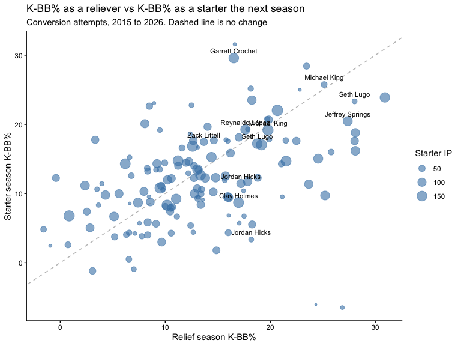
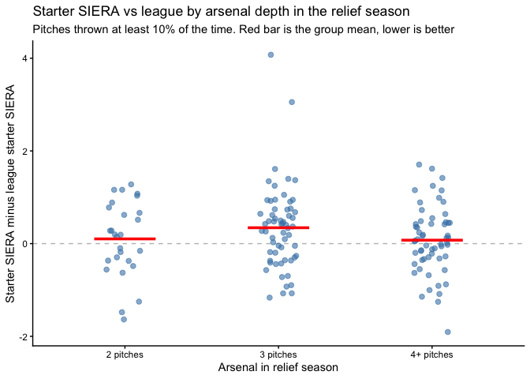
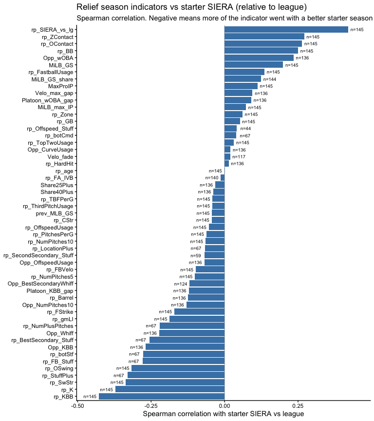
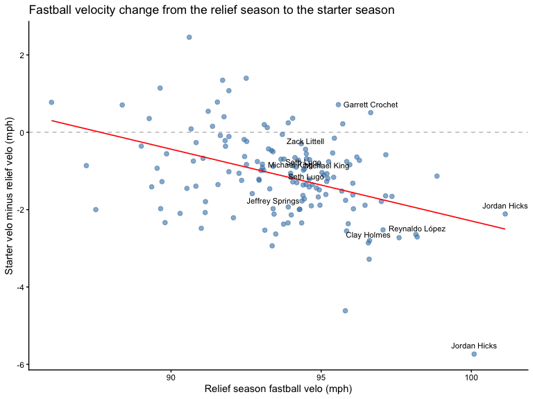
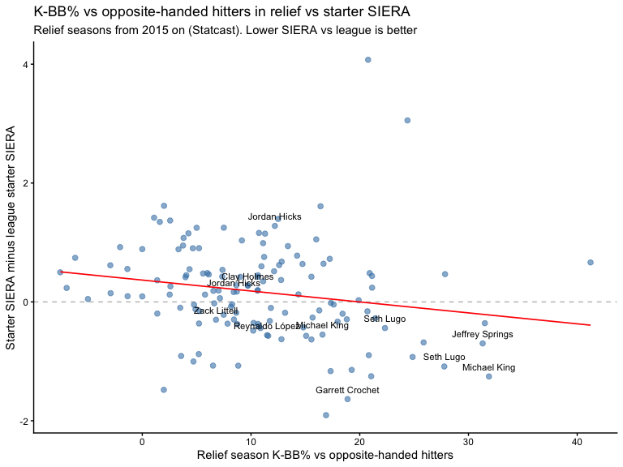
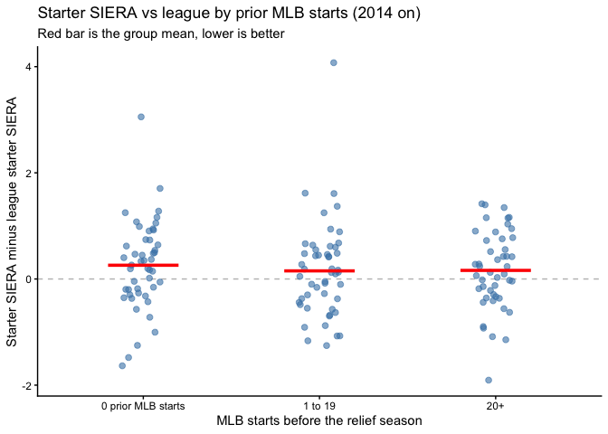
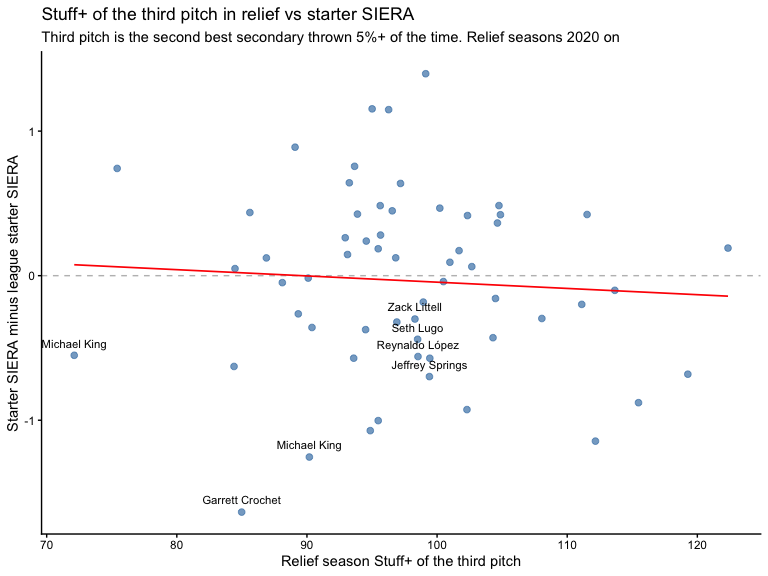
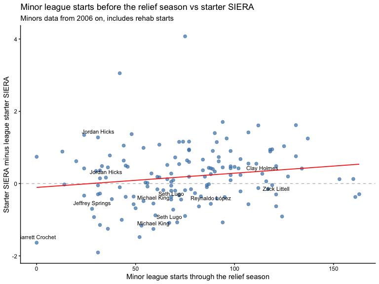
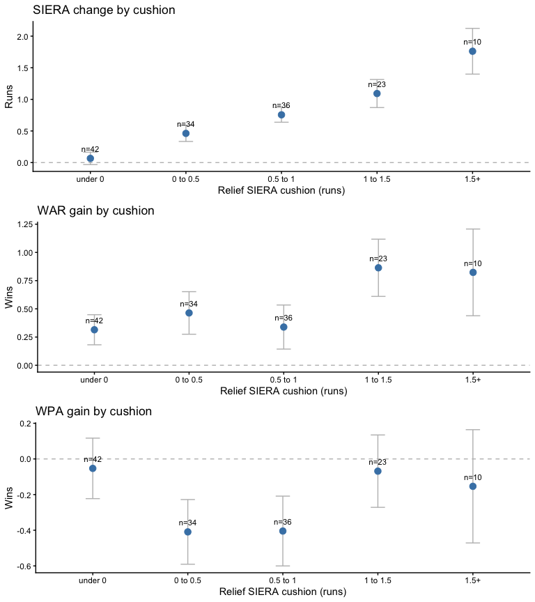
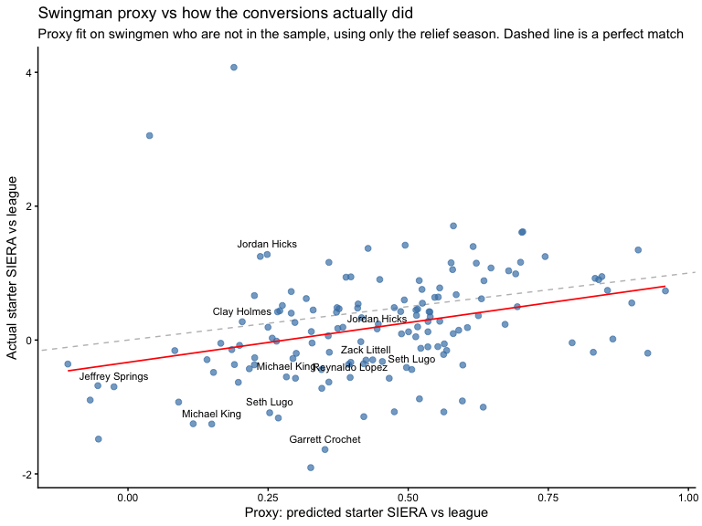

Step 4: What Predicts Success
================

``` r
library(dplyr)
library(readr)
library(ggplot2)
library(gridExtra)
```

## Relief season indicators

Each relief season trait compared to how the starter season went.

``` r
conversions <- read_csv("data/conversions.csv", show_col_types = FALSE)
savant_features <- read_csv("data/savant_features.csv", show_col_types = FALSE)

conversions <- conversions |>
  left_join(savant_features, by = c("xMLBAMID", "rp_season"))

indicators <- c("rp_SIERA_vs_lg", "rp_KBB", "rp_K", "rp_BB",
                "rp_Zone", "rp_FStrike", "rp_LocationPlus", "rp_botCmd",
                "rp_StuffPlus", "rp_botStf", "rp_FB_Stuff", "rp_BestSecondary_Stuff",
                "rp_SecondSecondary_Stuff", "rp_Offspeed_Stuff", "rp_NumPlusPitches", "rp_FBVelo", "rp_FA_IVB",
                  "Velo_max_gap", "Velo_fade",
                "rp_SwStr", "rp_ZContact", "rp_OSwing", "rp_OContact", "rp_CStr",
                "rp_GB", "rp_HardHit", "rp_Barrel",
                "rp_NumPitches10", "rp_NumPitches5", "rp_ThirdPitchUsage", "rp_TopTwoUsage",
                "rp_OffspeedUsage", "rp_FastballUsage",
                "Opp_NumPitches10", "Opp_OffspeedUsage", "Opp_CurveUsage", "Opp_BestSecondaryWhiff",
                "Opp_KBB", "Opp_Whiff", "Opp_wOBA", "Platoon_KBB_gap", "Platoon_wOBA_gap",
                "rp_PitchesPerG", "rp_TBFPerG", "Share25Plus", "Share40Plus", "rp_gmLI",
                "rp_age", "prev_MLB_GS", "MiLB_GS", "MiLB_GS_share", "MiLB_max_IP", "MaxProIP")
```

``` r
# Spearman correlation of each indicator with each outcome
# SIERA vs league is the starter SIERA minus the league starter SIERA that year, so negative is better
correlations <- data.frame(indicator = indicators, n = NA, SIERA_vs_lg = NA, SIERA_vs_lg_60IP = NA,
                           KBB_change = NA, sp_IP = NA, sp_WAR_per_150 = NA,
                           beta_after_rp_SIERA = NA, p_after_rp_SIERA = NA)
long_enough <- conversions$sp_IP >= 60
for (i in 1:length(indicators)) {
  x <- conversions[[indicators[i]]]
  correlations$n[i] <- sum(!is.na(x))
  correlations$SIERA_vs_lg[i] <- cor(x, conversions$sp_SIERA_vs_lg, method = "spearman", use = "complete.obs")
  correlations$SIERA_vs_lg_60IP[i] <- cor(x[long_enough], conversions$sp_SIERA_vs_lg[long_enough],
                                          method = "spearman", use = "complete.obs")
  correlations$KBB_change[i] <- cor(x, conversions$KBB_change, method = "spearman", use = "complete.obs")
  correlations$sp_IP[i] <- cor(x, conversions$sp_IP, method = "spearman", use = "complete.obs")
  correlations$sp_WAR_per_150[i] <- cor(x, conversions$sp_WAR_per_150, method = "spearman", use = "complete.obs")

  # Does the indicator add anything once relief SIERA is known (indicator in SD units)
  if (indicators[i] != "rp_SIERA_vs_lg") {
    fit <- lm(sp_SIERA_vs_lg ~ rp_SIERA_vs_lg + scale(x), data = conversions)
    correlations$beta_after_rp_SIERA[i] <- coef(summary(fit))[3, 1]
    correlations$p_after_rp_SIERA[i] <- coef(summary(fit))[3, 4]
  }
}
correlations[, 3:9] <- round(correlations[, 3:9], 3)
write_csv(correlations, "results/04_indicator_correlations.csv")
print(correlations)
```

    ##                   indicator   n SIERA_vs_lg SIERA_vs_lg_60IP KBB_change  sp_IP
    ## 1            rp_SIERA_vs_lg 145       0.421            0.453      0.529 -0.144
    ## 2                    rp_KBB 145      -0.428           -0.462     -0.526  0.108
    ## 3                      rp_K 145      -0.372           -0.442     -0.447  0.103
    ## 4                     rp_BB 145       0.250            0.122      0.261 -0.018
    ## 5                   rp_Zone 145       0.061            0.133     -0.096  0.030
    ## 6                rp_FStrike 145      -0.171           -0.084     -0.210  0.145
    ## 7           rp_LocationPlus  67      -0.067           -0.014     -0.317  0.129
    ## 8                 rp_botCmd  67       0.040            0.107     -0.384  0.051
    ## 9              rp_StuffPlus  67      -0.330           -0.302     -0.193  0.373
    ## 10                rp_botStf  67      -0.277           -0.365     -0.216  0.423
    ## 11              rp_FB_Stuff  67      -0.279           -0.295     -0.264  0.370
    ## 12   rp_BestSecondary_Stuff  67      -0.255           -0.095     -0.019  0.275
    ## 13 rp_SecondSecondary_Stuff  59      -0.068            0.148     -0.050  0.224
    ## 14        rp_Offspeed_Stuff  44       0.042           -0.138     -0.283  0.224
    ## 15        rp_NumPlusPitches  67      -0.220           -0.174     -0.215  0.401
    ## 16                rp_FBVelo 145      -0.098            0.013     -0.135  0.143
    ## 17                rp_FA_IVB 140      -0.013           -0.030     -0.021  0.019
    ## 18             Velo_max_gap 136       0.095            0.072     -0.036  0.065
    ## 19                Velo_fade 117       0.019           -0.045     -0.002 -0.144
    ## 20                 rp_SwStr 145      -0.336           -0.345     -0.255  0.140
    ## 21              rp_ZContact 145       0.271            0.308      0.172 -0.030
    ## 22                rp_OSwing 145      -0.316           -0.180     -0.122  0.197
    ## 23              rp_OContact 145       0.264            0.295      0.186 -0.097
    ## 24                  rp_CStr 145      -0.044           -0.132     -0.325 -0.038
    ## 25                    rp_GB 145       0.052            0.034      0.004  0.116
    ## 26               rp_HardHit 136       0.014            0.076     -0.021 -0.060
    ## 27                rp_Barrel 136      -0.124           -0.132      0.013 -0.044
    ## 28          rp_NumPitches10 145      -0.065           -0.094      0.022  0.071
    ## 29           rp_NumPitches5 145      -0.101            0.028      0.089 -0.001
    ## 30       rp_ThirdPitchUsage 145      -0.042           -0.156     -0.055 -0.016
    ## 31           rp_TopTwoUsage 145       0.032           -0.035     -0.126  0.084
    ## 32         rp_OffspeedUsage 145      -0.054           -0.010      0.172 -0.026
    ## 33         rp_FastballUsage 145       0.136            0.153      0.017  0.058
    ## 34         Opp_NumPitches10 136      -0.130           -0.087      0.189 -0.030
    ## 35        Opp_OffspeedUsage 136      -0.069            0.001      0.174 -0.043
    ## 36           Opp_CurveUsage 136       0.020            0.026      0.018 -0.073
    ## 37   Opp_BestSecondaryWhiff 124      -0.119           -0.195     -0.116  0.039
    ## 38                  Opp_KBB 136      -0.269           -0.430     -0.483  0.072
    ## 39                Opp_Whiff 136      -0.223           -0.377     -0.261  0.069
    ## 40                 Opp_wOBA 136       0.235            0.305      0.267 -0.248
    ## 41          Platoon_KBB_gap 136      -0.122            0.044      0.141  0.036
    ## 42         Platoon_wOBA_gap 136       0.091            0.200      0.113 -0.149
    ## 43           rp_PitchesPerG 145      -0.062            0.055      0.204 -0.061
    ## 44               rp_TBFPerG 145      -0.041            0.079      0.224 -0.060
    ## 45              Share25Plus 136      -0.032            0.036      0.220 -0.089
    ## 46              Share40Plus 136      -0.038            0.036      0.232 -0.057
    ## 47                  rp_gmLI 145      -0.187           -0.234     -0.204  0.201
    ## 48                   rp_age 145      -0.001            0.056     -0.089 -0.064
    ## 49              prev_MLB_GS 145      -0.043           -0.065     -0.045 -0.047
    ## 50                  MiLB_GS 145       0.199            0.147     -0.088 -0.114
    ## 51            MiLB_GS_share 144       0.124           -0.039     -0.090  0.095
    ## 52              MiLB_max_IP 145       0.073            0.143      0.036 -0.188
    ## 53                 MaxProIP 145       0.112            0.182     -0.023 -0.151
    ##    sp_WAR_per_150 beta_after_rp_SIERA p_after_rp_SIERA
    ## 1          -0.273                  NA               NA
    ## 2           0.265              -0.154            0.400
    ## 3           0.268               0.028            0.798
    ## 4          -0.074               0.087            0.246
    ## 5          -0.138               0.081            0.215
    ## 6           0.099              -0.024            0.733
    ## 7           0.028               0.021            0.834
    ## 8          -0.041               0.134            0.171
    ## 9           0.376              -0.074            0.483
    ## 10          0.399              -0.058            0.573
    ## 11          0.265              -0.058            0.580
    ## 12          0.362              -0.094            0.308
    ## 13          0.125              -0.023            0.769
    ## 14          0.045               0.066            0.482
    ## 15          0.267              -0.033            0.736
    ## 16          0.163               0.036            0.606
    ## 17          0.099               0.003            0.968
    ## 18         -0.100               0.070            0.307
    ## 19         -0.030               0.078            0.255
    ## 20          0.215              -0.086            0.290
    ## 21         -0.184               0.011            0.886
    ## 22          0.225              -0.128            0.076
    ## 23         -0.142               0.016            0.825
    ## 24         -0.005               0.099            0.159
    ## 25         -0.035               0.055            0.404
    ## 26          0.021               0.020            0.772
    ## 27          0.044              -0.079            0.243
    ## 28          0.060              -0.036            0.579
    ## 29          0.086              -0.091            0.166
    ## 30          0.020               0.065            0.325
    ## 31         -0.011               0.086            0.195
    ## 32          0.096              -0.070            0.285
    ## 33         -0.136               0.094            0.151
    ## 34          0.081              -0.121            0.075
    ## 35          0.117              -0.101            0.139
    ## 36         -0.070              -0.021            0.755
    ## 37          0.108               0.040            0.602
    ## 38          0.207               0.073            0.469
    ## 39          0.194               0.010            0.898
    ## 40         -0.137               0.025            0.748
    ## 41         -0.010              -0.100            0.141
    ## 42         -0.068               0.033            0.632
    ## 43          0.038              -0.109            0.100
    ## 44          0.009              -0.124            0.063
    ## 45          0.024              -0.111            0.109
    ## 46          0.009              -0.084            0.223
    ## 47          0.176              -0.016            0.820
    ## 48          0.014               0.032            0.631
    ## 49          0.043               0.001            0.983
    ## 50         -0.147               0.104            0.113
    ## 51         -0.029               0.063            0.331
    ## 52         -0.111               0.068            0.302
    ## 53         -0.127               0.088            0.179

``` r
# Simple group splits
conversions <- conversions |>
  mutate(ArsenalGroup = case_when(rp_NumPitches10 <= 2 ~ "2 pitches",
                                  rp_NumPitches10 == 3 ~ "3 pitches",
                                  TRUE ~ "4+ pitches"),
         StarterHistory = case_when(prev_MLB_GS == 0 ~ "0 prior MLB starts",
                                    prev_MLB_GS < 20 ~ "1 to 19",
                                    TRUE ~ "20+"),
         VeloGroup = case_when(rp_FBVelo < 93 ~ "under 93",
                               rp_FBVelo < 95 ~ "93 to 95",
                               TRUE ~ "95+"),
         AgeGroup = case_when(rp_age <= 25 ~ "25 and under",
                              rp_age <= 28 ~ "26 to 28",
                              TRUE ~ "29+"),
         PlatoonGroup = case_when(is.na(Platoon_KBB_gap) ~ NA,
                                  Platoon_KBB_gap > 0.10 ~ "big gap (10+ pts)",
                                  Platoon_KBB_gap > 0 ~ "small gap",
                                  TRUE ~ "reverse or none"),
         MinorsGroup = case_when(MiLB_GS < 20 ~ "under 20 MiLB starts",
                                 MiLB_GS < 60 ~ "20 to 59",
                                 TRUE ~ "60+"),
         WorkloadGroup = case_when(MaxProIP < 100 ~ "max season under 100 IP",
                                   MaxProIP < 140 ~ "100 to 139",
                                   TRUE ~ "140+"),
         PlusPitchGroup = case_when(is.na(rp_NumPlusPitches) ~ NA,
                                    rp_NumPlusPitches <= 1 ~ "0 or 1 pitches Stuff+ 100+",
                                    rp_NumPlusPitches == 2 ~ "2",
                                    TRUE ~ "3+"),
         LengthGroup = case_when(rp_TBFPerG < 4.5 ~ "under 4.5 TBF per G",
                                 rp_TBFPerG < 6 ~ "4.5 to 6",
                                 TRUE ~ "6+"))

cat("Overall\n")
```

    ## Overall

``` r
conversions |>
  summarize(n = n(), rp_SIERA = mean(rp_SIERA), sp_SIERA = mean(sp_SIERA),
            sp_SIERA_vs_lg = mean(sp_SIERA_vs_lg), rp_KBB = mean(rp_KBB), sp_KBB = mean(sp_KBB),
            KBB_change = mean(KBB_change), Velo_change = mean(Velo_change, na.rm = TRUE),
            sp_IP = mean(sp_IP), stuck = mean(stuck, na.rm = TRUE)) |>
  as.data.frame() |> print()
```

    ##     n rp_SIERA sp_SIERA sp_SIERA_vs_lg    rp_KBB    sp_KBB   KBB_change
    ## 1 145  3.89071 4.500589      0.1908103 0.1322742 0.1225668 -0.009707407
    ##   Velo_change    sp_IP     stuck
    ## 1   -1.116358 70.09195 0.3333333

``` r
for (group_name in c("ArsenalGroup", "StarterHistory", "MinorsGroup", "WorkloadGroup", "PlusPitchGroup",
                     "VeloGroup", "AgeGroup", "PlatoonGroup", "LengthGroup")) {
  cat("\n", group_name, "\n")
  conversions |>
    filter(!is.na(.data[[group_name]])) |>
    group_by(.data[[group_name]]) |>
    summarize(n = n(), rp_SIERA_vs_lg = mean(rp_SIERA_vs_lg), sp_SIERA_vs_lg = mean(sp_SIERA_vs_lg),
              KBB_change = mean(KBB_change), Velo_change = mean(Velo_change, na.rm = TRUE),
              sp_IP = mean(sp_IP), sp_WAR_per_150 = mean(sp_WAR_per_150),
              stuck = mean(stuck, na.rm = TRUE)) |>
    as.data.frame() |> print(digits = 3)
}
```

    ## 
    ##  ArsenalGroup 
    ##   ArsenalGroup  n rp_SIERA_vs_lg sp_SIERA_vs_lg KBB_change Velo_change sp_IP
    ## 1    2 pitches 27        -0.0434         0.1023  -0.007343      -1.266  69.2
    ## 2    3 pitches 60         0.0297         0.3429  -0.020379      -1.173  70.4
    ## 3   4+ pitches 58         0.0110         0.0746   0.000231      -0.988  70.2
    ##   sp_WAR_per_150 stuck
    ## 1           1.10 0.259
    ## 2           1.20 0.345
    ## 3           1.38 0.360
    ## 
    ##  StarterHistory 
    ##       StarterHistory  n rp_SIERA_vs_lg sp_SIERA_vs_lg KBB_change Velo_change
    ## 1 0 prior MLB starts 48        0.11633          0.259   -0.00984       -1.11
    ## 2            1 to 19 50       -0.09090          0.153   -0.01007       -1.16
    ## 3                20+ 47        0.00442          0.162   -0.00919       -1.07
    ##   sp_IP sp_WAR_per_150 stuck
    ## 1  73.8          0.891 0.319
    ## 2  70.4          1.362 0.422
    ## 3  66.0          1.507 0.256
    ## 
    ##  MinorsGroup 
    ##            MinorsGroup  n rp_SIERA_vs_lg sp_SIERA_vs_lg KBB_change Velo_change
    ## 1             20 to 59 43         -0.236       -0.01413    -0.0104       -1.38
    ## 2                  60+ 98          0.102        0.28885    -0.0111       -1.00
    ## 3 under 20 MiLB starts  4          0.350       -0.00802     0.0318       -1.04
    ##   sp_IP sp_WAR_per_150 stuck
    ## 1  79.6           1.64 0.375
    ## 2  65.2           1.08 0.308
    ## 3  87.8           1.31 0.500
    ## 
    ##  WorkloadGroup 
    ##             WorkloadGroup  n rp_SIERA_vs_lg sp_SIERA_vs_lg KBB_change
    ## 1              100 to 139 52         -0.115          0.214   -0.01826
    ## 2                    140+ 86          0.059          0.218   -0.00924
    ## 3 max season under 100 IP  7          0.307         -0.316    0.04809
    ##   Velo_change sp_IP sp_WAR_per_150 stuck
    ## 1       -1.28  71.5           1.28 0.333
    ## 2       -1.01  67.5           1.15 0.312
    ## 3       -1.21  91.9           2.30 0.571
    ## 
    ##  PlusPitchGroup 
    ##               PlusPitchGroup  n rp_SIERA_vs_lg sp_SIERA_vs_lg KBB_change
    ## 1 0 or 1 pitches Stuff+ 100+ 26          0.105         0.1068    0.00323
    ## 2                          2 25         -0.250        -0.0833   -0.00563
    ## 3                         3+ 16         -0.652        -0.0174   -0.05134
    ##   Velo_change sp_IP sp_WAR_per_150 stuck
    ## 1      -0.806  54.2           1.35 0.208
    ## 2      -1.152  91.5           2.25 0.571
    ## 3      -1.555  95.8           2.15 0.667
    ## 
    ##  VeloGroup 
    ##   VeloGroup  n rp_SIERA_vs_lg sp_SIERA_vs_lg KBB_change Velo_change sp_IP
    ## 1  93 to 95 56         0.0274          0.111   -0.00371      -1.212  68.1
    ## 2       95+ 40        -0.3559          0.195   -0.03420      -1.631  81.1
    ## 3  under 93 49         0.2847          0.278    0.00343      -0.587  63.4
    ##   sp_WAR_per_150 stuck
    ## 1           1.29 0.308
    ## 2           1.63 0.500
    ## 3           0.90 0.245
    ## 
    ##  AgeGroup 
    ##       AgeGroup  n rp_SIERA_vs_lg sp_SIERA_vs_lg KBB_change Velo_change sp_IP
    ## 1 25 and under 46       -0.00627          0.145   -0.00393      -0.893  72.4
    ## 2     26 to 28 61        0.04257          0.215   -0.00935      -1.215  72.7
    ## 3          29+ 38       -0.02793          0.208   -0.01728      -1.228  63.1
    ##   sp_WAR_per_150 stuck
    ## 1           1.05 0.500
    ## 2           1.35 0.281
    ## 3           1.34 0.222
    ## 
    ##  PlatoonGroup 
    ##        PlatoonGroup  n rp_SIERA_vs_lg sp_SIERA_vs_lg KBB_change Velo_change
    ## 1 big gap (10+ pts) 35        -0.0316        -0.0209    0.00134       -1.26
    ## 2   reverse or none 44        -0.0866         0.1413   -0.01241       -1.06
    ## 3         small gap 57         0.0429         0.3098   -0.01414       -1.04
    ##   sp_IP sp_WAR_per_150 stuck
    ## 1  65.0          1.461 0.235
    ## 2  71.5          1.663 0.300
    ## 3  70.4          0.907 0.423
    ## 
    ##  LengthGroup 
    ##           LengthGroup  n rp_SIERA_vs_lg sp_SIERA_vs_lg KBB_change Velo_change
    ## 1            4.5 to 6 53         -0.119          0.164   -0.01368      -1.175
    ## 2                  6+ 63          0.212          0.160    0.00821      -0.832
    ## 3 under 4.5 TBF per G 29         -0.200          0.307   -0.04137      -1.627
    ##   sp_IP sp_WAR_per_150 stuck
    ## 1  68.5           1.14 0.408
    ## 2  68.2           1.28 0.339
    ## 3  77.3           1.41 0.185

``` r
known <- c("Garrett Crochet", "Reynaldo López", "Jordan Hicks", "Michael King", "Seth Lugo",
           "Clay Holmes", "Zack Littell", "Jeffrey Springs")
labeled <- conversions |> filter(PlayerName %in% known)
```

``` r
# relief K-BB% vs starter K-BB%
ggplot(conversions, aes(rp_KBB * 100, sp_KBB * 100)) +
  geom_abline(slope = 1, intercept = 0, color = "gray", linetype = "dashed") +
  geom_point(aes(size = sp_IP), color = "steelblue", alpha = 0.6) +
  geom_text(data = labeled, aes(label = PlayerName), size = 3, vjust = -1) +
  labs(title = "K-BB% as a reliever vs K-BB% as a starter the next season",
       subtitle = "Conversion attempts, 2015 to 2026. Dashed line is no change",
       x = "Relief season K-BB%", y = "Starter season K-BB%", size = "Starter IP") +
  theme_classic()
```

<!-- -->

``` r
ggsave("charts/04_kbb_relief_vs_starter.png", width = 8, height = 6, dpi = 150)
```

``` r
# arsenal depth
ggplot(conversions, aes(ArsenalGroup, sp_SIERA_vs_lg)) +
  geom_hline(yintercept = 0, color = "gray", linetype = "dashed") +
  geom_jitter(width = 0.12, color = "steelblue", alpha = 0.6, size = 2) +
  stat_summary(fun = mean, geom = "crossbar", width = 0.4, color = "red") +
  labs(title = "Starter SIERA vs league by arsenal depth in the relief season",
       subtitle = "Pitches thrown at least 10% of the time. Red bar is the group mean, lower is better",
       x = "Arsenal in relief season", y = "Starter SIERA minus league starter SIERA") +
  theme_classic()
```

<!-- -->

``` r
ggsave("charts/04_arsenal_depth.png", width = 7, height = 5, dpi = 150)
```

``` r
# correlation of every indicator with starter SIERA vs league
plot_correlations <- correlations |>
  filter(n >= 30) |>
  arrange(SIERA_vs_lg)
plot_correlations$indicator <- factor(plot_correlations$indicator, levels = plot_correlations$indicator)
ggplot(plot_correlations, aes(SIERA_vs_lg, indicator)) +
  geom_vline(xintercept = 0, color = "gray") +
  geom_col(fill = "steelblue") +
  geom_text(aes(label = paste0("n=", n), x = ifelse(SIERA_vs_lg > 0, SIERA_vs_lg + 0.03, SIERA_vs_lg - 0.03)),
      size = 2.5) +
  labs(title = "Relief season indicators vs starter SIERA (relative to league)",
       subtitle = "Spearman correlation. Negative means more of the indicator went with a better starter season",
       x = "Spearman correlation with starter SIERA vs league", y = NULL) +
  theme_classic()
```

<!-- -->

``` r
ggsave("charts/04_indicator_correlations.png", width = 8, height = 9, dpi = 150)
```

``` r
# velocity lost when stretched out
ggplot(conversions, aes(rp_FBVelo, Velo_change)) +
  geom_hline(yintercept = 0, color = "gray", linetype = "dashed") +
  geom_point(color = "steelblue", alpha = 0.6, size = 2) +
  geom_smooth(method = "lm", se = FALSE, color = "red", linewidth = 0.6) +
  geom_text(data = labeled, aes(label = PlayerName), size = 3, vjust = -1) +
  labs(title = "Fastball velocity change from the relief season to the starter season",
       x = "Relief season fastball velo (mph)", y = "Starter velo minus relief velo (mph)") +
  theme_classic()
```

    ## `geom_smooth()` using formula = 'y ~ x'

<!-- -->

``` r
ggsave("charts/04_velo_change.png", width = 8, height = 6, dpi = 150)
```

    ## `geom_smooth()` using formula = 'y ~ x'

``` r
# results vs opposite-handed hitters
ggplot(conversions, aes(Opp_KBB * 100, sp_SIERA_vs_lg)) +
  geom_hline(yintercept = 0, color = "gray", linetype = "dashed") +
  geom_point(color = "steelblue", alpha = 0.6, size = 2) +
  geom_smooth(method = "lm", se = FALSE, color = "red", linewidth = 0.6) +
  geom_text(data = labeled, aes(label = PlayerName), size = 3, vjust = -1) +
  labs(title = "K-BB% vs opposite-handed hitters in relief vs starter SIERA",
       subtitle = "Relief seasons from 2015 on (Statcast). Lower SIERA vs league is better",
       x = "Relief season K-BB% vs opposite-handed hitters", y = "Starter SIERA minus league starter SIERA") +
  theme_classic()
```

    ## `geom_smooth()` using formula = 'y ~ x'

    ## Warning: Removed 9 rows containing non-finite outside the scale range
    ## (`stat_smooth()`).

    ## Warning: Removed 9 rows containing missing values or values outside the scale range
    ## (`geom_point()`).

<!-- -->

``` r
ggsave("charts/04_opposite_hand_kbb.png", width = 8, height = 6, dpi = 150)
```

    ## `geom_smooth()` using formula = 'y ~ x'

    ## Warning: Removed 9 rows containing non-finite outside the scale range (`stat_smooth()`).
    ## Removed 9 rows containing missing values or values outside the scale range
    ## (`geom_point()`).

``` r
# prior MLB starting experience
ggplot(conversions, aes(StarterHistory, sp_SIERA_vs_lg)) +
  geom_hline(yintercept = 0, color = "gray", linetype = "dashed") +
  geom_jitter(width = 0.12, color = "steelblue", alpha = 0.6, size = 2) +
  stat_summary(fun = mean, geom = "crossbar", width = 0.4, color = "red") +
  labs(title = "Starter SIERA vs league by prior MLB starts (2014 on)",
       subtitle = "Red bar is the group mean, lower is better",
       x = "MLB starts before the relief season", y = "Starter SIERA minus league starter SIERA") +
  theme_classic()
```

<!-- -->

``` r
ggsave("charts/04_prior_starts.png", width = 7, height = 5, dpi = 150)
```

``` r
# quality of the third pitch (second best secondary by Stuff+), 2020 on
ggplot(conversions |> filter(!is.na(rp_SecondSecondary_Stuff)), aes(rp_SecondSecondary_Stuff, sp_SIERA_vs_lg)) +
  geom_hline(yintercept = 0, color = "gray", linetype = "dashed") +
  geom_point(color = "steelblue", alpha = 0.7, size = 2) +
  geom_smooth(method = "lm", se = FALSE, color = "red", linewidth = 0.6) +
  geom_text(data = labeled |> filter(!is.na(rp_SecondSecondary_Stuff)), aes(label = PlayerName), size = 3,
      vjust = -1) +
  labs(title = "Stuff+ of the third pitch in relief vs starter SIERA",
       subtitle = "Third pitch is the second best secondary thrown 5%+ of the time. Relief seasons 2020 on",
       x = "Relief season Stuff+ of the third pitch", y = "Starter SIERA minus league starter SIERA") +
  theme_classic()
```

    ## `geom_smooth()` using formula = 'y ~ x'

<!-- -->

``` r
ggsave("charts/04_third_pitch_stuff.png", width = 8, height = 6, dpi = 150)
```

    ## `geom_smooth()` using formula = 'y ~ x'

``` r
# minor league starts before the relief season
ggplot(conversions, aes(MiLB_GS, sp_SIERA_vs_lg)) +
  geom_hline(yintercept = 0, color = "gray", linetype = "dashed") +
  geom_point(color = "steelblue", alpha = 0.7, size = 2) +
  geom_smooth(method = "lm", se = FALSE, color = "red", linewidth = 0.6) +
  geom_text(data = labeled, aes(label = PlayerName), size = 3, vjust = -1) +
  labs(title = "Minor league starts before the relief season vs starter SIERA",
       subtitle = "Minors data from 2006 on, includes rehab starts",
       x = "Minor league starts through the relief season", y = "Starter SIERA minus league starter SIERA") +
  theme_classic()
```

    ## `geom_smooth()` using formula = 'y ~ x'

<!-- -->

``` r
ggsave("charts/04_minor_league_starts.png", width = 8, height = 6, dpi = 150)
```

    ## `geom_smooth()` using formula = 'y ~ x'

## Weighting by batters faced

The new attempts include pitchers with only a few starts, so their SIERA
is noisy. I repeated the main relationship with each attempt weighted by
its batters faced as a starter.

``` r
conversions <- read_csv("data/conversions.csv", show_col_types = FALSE)
weighted_model <- lm(sp_SIERA_vs_lg ~ rp_SIERA_vs_lg, data = conversions, weights = sp_TBF)
cat("SIERA change, mean:", round(mean(conversions$SIERA_change), 2),
    " weighted:", round(weighted.mean(conversions$SIERA_change, conversions$sp_TBF), 2),
    " share worse:", round(mean(conversions$SIERA_change > 0), 2), "\n")
```

    ## SIERA change, mean: 0.61  weighted: 0.56  share worse: 0.77

``` r
cat("Starter SIERA vs league, mean:", round(mean(conversions$sp_SIERA_vs_lg), 2),
    " weighted:", round(weighted.mean(conversions$sp_SIERA_vs_lg, conversions$sp_TBF), 2), "\n")
```

    ## Starter SIERA vs league, mean: 0.19  weighted: 0.08

``` r
cat("Spearman:", round(cor(conversions$rp_SIERA_vs_lg, conversions$sp_SIERA_vs_lg, method = "spearman"), 2),
    " weighted slope:", round(coef(weighted_model)[2], 2),
    " standard error:", round(summary(weighted_model)$coefficients[2, 2], 2), "\n")
```

    ## Spearman: 0.42  weighted slope: 0.38  standard error: 0.07

``` r
# Leave one out error, weighted by batters faced
loo_model <- rep(NA, nrow(conversions))
loo_mean <- rep(NA, nrow(conversions))
for (i in 1:nrow(conversions)) {
  others <- conversions[-i, ]
  fit <- lm(sp_SIERA_vs_lg ~ rp_SIERA_vs_lg, data = others, weights = sp_TBF)
  loo_model[i] <- predict(fit, newdata = conversions[i, ])
  loo_mean[i] <- weighted.mean(others$sp_SIERA_vs_lg, others$sp_TBF)
}
cat("Leave one out RMSE, no model:",
    round(sqrt(weighted.mean((conversions$sp_SIERA_vs_lg - loo_mean)^2, conversions$sp_TBF)), 3),
    " relief SIERA:",
    round(sqrt(weighted.mean((conversions$sp_SIERA_vs_lg - loo_model)^2, conversions$sp_TBF)), 3), "\n")
```

    ## Leave one out RMSE, no model: 0.667  relief SIERA: 0.603

``` r
# Did the relationship change after 2021
conversions <- conversions |> mutate(Later = sp_season >= 2022)
early_model <- lm(sp_SIERA_vs_lg ~ rp_SIERA_vs_lg, data = conversions |> filter(!Later), weights = sp_TBF)
late_model <- lm(sp_SIERA_vs_lg ~ rp_SIERA_vs_lg, data = conversions |> filter(Later), weights = sp_TBF)
interaction_model <- lm(sp_SIERA_vs_lg ~ rp_SIERA_vs_lg * Later, data = conversions, weights = sp_TBF)
cat("Weighted slope through 2021:", round(coef(early_model)[2], 2), " 2022 on:", round(coef(late_model)[2], 2),
    " interaction p:", round(summary(interaction_model)$coefficients[4, 4], 2), "\n")
```

    ## Weighted slope through 2021: 0.46  2022 on: 0.21  interaction p: 0.06

## Different definitions of a conversion

Whether the main results depend on the cutoffs.

``` r
role_seasons <- read_csv("data/fg_role_seasons.csv", guess_max = 20000, show_col_types = FALSE) |>
  mutate(IP = floor(IP) + (IP %% 1) * 10 / 3)

season_totals <- role_seasons |>
  group_by(playerid, Season) |>
  summarize(G_total = sum(G), GS_total = sum(GS), .groups = "drop") |>
  arrange(playerid, Season) |>
  group_by(playerid) |>
  mutate(prior_GS = cumsum(GS_total) - GS_total) |>
  ungroup()

league_sp <- role_seasons |>
  filter(role == "sta") |>
  group_by(Season) |>
  summarize(lg_sp_siera = weighted.mean(SIERA, TBF, na.rm = TRUE))
league_rp <- role_seasons |>
  filter(role == "rel") |>
  group_by(Season) |>
  summarize(lg_rp_siera = weighted.mean(SIERA, TBF, na.rm = TRUE))

relief_all <- role_seasons |>
  filter(role == "rel") |>
  left_join(season_totals, by = c("playerid", "Season")) |>
  left_join(league_rp, by = "Season") |>
  transmute(playerid, rp_season = Season, rp_TBF = TBF, rp_GS_share = GS_total / G_total, rp_SIERA = SIERA,
            rp_SIERA_vs_lg = SIERA - lg_rp_siera, prior_GS)
starter_all <- role_seasons |>
  filter(role == "sta") |>
  left_join(season_totals, by = c("playerid", "Season")) |>
  left_join(league_sp, by = "Season") |>
  transmute(playerid, PlayerName, sp_season = Season, sp_GS = GS, sp_IP = IP,
      sp_starter_share = GS_total / G_total,
            sp_SIERA = SIERA, sp_SIERA_vs_lg = SIERA - lg_sp_siera, lg_sp_siera, xMLBAMID)
game_logs <- read_csv("data/game_logs.csv", show_col_types = FALSE) |>
  filter(GS == 1)
```

``` r
# Same pairing rules as 01_data.Rmd, with the cutoffs as inputs
build_variant <- function(min_pitches, min_long_starts, max_relief_gs_share, min_relief_tbf, max_gap) {
  long_starts <- game_logs |>
    filter(Pitches >= min_pitches) |>
    count(xMLBAMID, sp_season = Season, name = "sp_LongStarts")
  starters <- starter_all |>
    inner_join(long_starts, by = c("xMLBAMID", "sp_season")) |>
    filter(sp_LongStarts >= min_long_starts, sp_season >= 2015)
  relievers <- relief_all |>
    filter(rp_TBF >= min_relief_tbf, rp_GS_share <= max_relief_gs_share)
  pairs <- starters |>
    inner_join(relievers, by = "playerid", relationship = "many-to-many") |>
    mutate(gap = sp_season - rp_season) |>
    filter(gap >= 1, gap <= max_gap) |>
    group_by(playerid, sp_season) |>
    filter(gap == min(gap)) |>
    ungroup()
  # starts made in the years between the relief season and the starter season
  pairs$GS_between <- 0
  for (i in which(pairs$gap >= 2)) {
    between <- season_totals |>
      filter(playerid == pairs$playerid[i], Season > pairs$rp_season[i], Season < pairs$sp_season[i])
    pairs$GS_between[i] <- sum(between$GS_total)
  }
  pairs |> filter(GS_between <= 3)
}
```

``` r
# Headline numbers for one version of the sample
summarize_variant <- function(label, pairs) {
  pairs <- pairs |> mutate(cushion = lg_sp_siera - rp_SIERA, success = sp_SIERA_vs_lg <= 0)
  top_third <- pairs$rp_SIERA_vs_lg <= quantile(pairs$rp_SIERA_vs_lg, 1 / 3)
  slope_fit <- lm(sp_SIERA ~ rp_SIERA, data = pairs)
  data.frame(
    version = label, attempts = nrow(pairs), pitchers = n_distinct(pairs$playerid),
    mean_starter_SIERA_vs_lg = round(mean(pairs$sp_SIERA_vs_lg), 2),
    mean_SIERA_change = round(mean(pairs$sp_SIERA - pairs$rp_SIERA), 2),
    share_SIERA_worse = round(mean(pairs$sp_SIERA > pairs$rp_SIERA), 2),
    spearman_relief_vs_starter = round(cor(pairs$rp_SIERA_vs_lg, pairs$sp_SIERA_vs_lg, method = "spearman"), 2),
    slope = round(coef(slope_fit)[2], 2),
    success_top_third = round(mean(pairs$success[top_third]), 2),
    success_rest = round(mean(pairs$success[!top_third]), 2),
    n_cushion_1plus = sum(pairs$cushion >= 1),
    success_cushion_1plus = round(mean(pairs$success[pairs$cushion >= 1]), 2),
    success_cushion_under_1 = round(mean(pairs$success[pairs$cushion < 1]), 2))
}

baseline <- build_variant(70, 2, 0.2, 100, 3)
versions <- list(
  "baseline: 2+ starts of 70+ pitches, relief TBF 100+, relief starts 20% or less, lookback 3" = baseline,
  "1+ start of 70+ pitches" = build_variant(70, 1, 0.2, 100, 3),
  "3+ starts of 70+ pitches" = build_variant(70, 3, 0.2, 100, 3),
  "5+ starts of 70+ pitches" = build_variant(70, 5, 0.2, 100, 3),
  "2+ starts of 60+ pitches" = build_variant(60, 2, 0.2, 100, 3),
  "2+ starts of 80+ pitches" = build_variant(80, 2, 0.2, 100, 3),
  "stricter relief season (150+ TBF, starts 10% or less)" = build_variant(70, 2, 0.1, 150, 3),
  "lookback 1 year only" = build_variant(70, 2, 0.2, 100, 1))
versions[["old rule (5+ starts, half of games, 3.5+ IP per start)"]] <- build_variant(1, 1, 0.2, 100, 3) |>
  filter(sp_GS >= 5, sp_starter_share >= 0.5, sp_IP / sp_GS >= 3.5)
```

``` r
# Versions that filter the baseline sample
baseline_prior <- baseline
versions[["true relievers only (under 20 prior MLB starts)"]] <- baseline_prior |> filter(prior_GS < 20)
versions[["former starters only (20+ prior MLB starts)"]] <- baseline_prior |> filter(prior_GS >= 20)
versions[["one attempt per pitcher (first one)"]] <- baseline_prior |> arrange(playerid, sp_season) |>
  group_by(playerid) |> slice(1) |> ungroup()
versions[["drop 2020 (short season) as either year"]] <- baseline_prior |> filter(sp_season != 2020,
    rp_season != 2020)
versions[["2015 to 2020 only"]] <- baseline_prior |> filter(sp_season <= 2020)
versions[["2021 to 2026 only"]] <- baseline_prior |> filter(sp_season >= 2021)

results <- NULL
for (label in names(versions)) {
  results <- bind_rows(results, summarize_variant(label, versions[[label]]))
}
write_csv(results, "results/04_definition_sensitivity.csv")

cat("1. Headline results under different definitions of a conversion\n")
```

    ## 1. Headline results under different definitions of a conversion

``` r
cat("success = starter SIERA at or below the league average starter. top_third = best third of relievers by relief SIERA vs league in that version.\n\n")
```

    ## success = starter SIERA at or below the league average starter. top_third = best third of relievers by relief SIERA vs league in that version.

``` r
print(as.data.frame(results |> select(version, attempts, pitchers, mean_SIERA_change, spearman_relief_vs_starter,
    slope,
                                      success_top_third, success_rest, success_cushion_1plus,
                                        success_cushion_under_1)), row.names = FALSE)
```

    ##                                                                                     version
    ##  baseline: 2+ starts of 70+ pitches, relief TBF 100+, relief starts 20% or less, lookback 3
    ##                                                                     1+ start of 70+ pitches
    ##                                                                    3+ starts of 70+ pitches
    ##                                                                    5+ starts of 70+ pitches
    ##                                                                    2+ starts of 60+ pitches
    ##                                                                    2+ starts of 80+ pitches
    ##                                       stricter relief season (150+ TBF, starts 10% or less)
    ##                                                                        lookback 1 year only
    ##                                      old rule (5+ starts, half of games, 3.5+ IP per start)
    ##                                             true relievers only (under 20 prior MLB starts)
    ##                                                 former starters only (20+ prior MLB starts)
    ##                                                         one attempt per pitcher (first one)
    ##                                                     drop 2020 (short season) as either year
    ##                                                                           2015 to 2020 only
    ##                                                                           2021 to 2026 only
    ##  attempts pitchers mean_SIERA_change spearman_relief_vs_starter slope
    ##       145      129              0.61                       0.42  0.37
    ##       167      142              0.65                       0.40  0.38
    ##       132      120              0.59                       0.44  0.37
    ##       110      105              0.55                       0.51  0.45
    ##       155      136              0.65                       0.41  0.39
    ##       131      120              0.59                       0.44  0.36
    ##        85       81              0.68                       0.43  0.35
    ##       126      113              0.65                       0.43  0.38
    ##        79       77              0.54                       0.48  0.44
    ##        98       91              0.63                       0.34  0.30
    ##        47       42              0.57                       0.59  0.49
    ##       129      129              0.65                       0.41  0.35
    ##       132      122              0.58                       0.43  0.35
    ##        71       64              0.71                       0.42  0.34
    ##        74       70              0.51                       0.36  0.33
    ##  success_top_third success_rest success_cushion_1plus success_cushion_under_1
    ##               0.65         0.29                  0.70                    0.33
    ##               0.62         0.25                  0.68                    0.30
    ##               0.64         0.30                  0.72                    0.32
    ##               0.68         0.29                  0.72                    0.33
    ##               0.63         0.26                  0.70                    0.30
    ##               0.66         0.29                  0.70                    0.33
    ##               0.62         0.30                  0.71                    0.31
    ##               0.64         0.32                  0.72                    0.33
    ##               0.67         0.33                  0.75                    0.37
    ##               0.58         0.32                  0.59                    0.36
    ##               0.75         0.26                  0.91                    0.28
    ##               0.65         0.27                  0.66                    0.32
    ##               0.66         0.30                  0.69                    0.34
    ##               0.58         0.26                  0.61                    0.28
    ##               0.64         0.37                  0.80                    0.37

``` r
cat("\nOther columns\n")
```

    ## 
    ## Other columns

``` r
print(as.data.frame(results |> select(version, mean_starter_SIERA_vs_lg, share_SIERA_worse, n_cushion_1plus)),
    row.names = FALSE)
```

    ##                                                                                     version
    ##  baseline: 2+ starts of 70+ pitches, relief TBF 100+, relief starts 20% or less, lookback 3
    ##                                                                     1+ start of 70+ pitches
    ##                                                                    3+ starts of 70+ pitches
    ##                                                                    5+ starts of 70+ pitches
    ##                                                                    2+ starts of 60+ pitches
    ##                                                                    2+ starts of 80+ pitches
    ##                                       stricter relief season (150+ TBF, starts 10% or less)
    ##                                                                        lookback 1 year only
    ##                                      old rule (5+ starts, half of games, 3.5+ IP per start)
    ##                                             true relievers only (under 20 prior MLB starts)
    ##                                                 former starters only (20+ prior MLB starts)
    ##                                                         one attempt per pitcher (first one)
    ##                                                     drop 2020 (short season) as either year
    ##                                                                           2015 to 2020 only
    ##                                                                           2021 to 2026 only
    ##  mean_starter_SIERA_vs_lg share_SIERA_worse n_cushion_1plus
    ##                      0.19              0.77              33
    ##                      0.28              0.77              34
    ##                      0.18              0.78              29
    ##                      0.15              0.78              25
    ##                      0.25              0.78              33
    ##                      0.17              0.77              30
    ##                      0.15              0.79              21
    ##                      0.15              0.79              32
    ##                      0.11              0.78              16
    ##                      0.20              0.79              22
    ##                      0.16              0.72              11
    ##                      0.22              0.79              29
    ##                      0.18              0.77              29
    ##                      0.32              0.79              18
    ##                      0.06              0.74              15

``` r
# Duplicate pitchers: how many appear more than once
cat("\n2. Pitchers who appear more than once in the baseline sample:\n")
```

    ## 
    ## 2. Pitchers who appear more than once in the baseline sample:

``` r
repeat_pitchers <- baseline |> count(playerid, PlayerName) |> filter(n > 1)
print(as.data.frame(repeat_pitchers), row.names = FALSE)
```

    ##  playerid       PlayerName n
    ##      2859    Ross Detwiler 2
    ##      5448     Jesse Chavez 2
    ##      7593     Jordan Lyles 2
    ##     11479   Bryan Mitchell 2
    ##     11682  Carlos Martinez 2
    ##     12447        Seth Lugo 2
    ##     13424    Drew VerHagen 2
    ##     13799      Matt Strahm 2
    ##     14843 Michael Lorenzen 2
    ##     15451      Mike Mayers 2
    ##     16502   Ryan Yarbrough 2
    ##     16943     Sean Newcomb 2
    ##     17735  Tyler Alexander 2
    ##     19361    Corbin Burnes 2
    ##     19618     Jordan Hicks 2
    ##     19853     Michael King 2

``` r
# How noisy is a reliever's SIERA? The year to year relationship for relievers who stayed relievers shows how much
# of the slope from relief SIERA to starter SIERA is regression to the mean instead of a role effect
cat("\n4. Year to year reliability of SIERA (SIERA vs league, this season to next season)\n")
```

    ## 
    ## 4. Year to year reliability of SIERA (SIERA vs league, this season to next season)

``` r
relief_next <- relief_all |> filter(rp_TBF >= 100, rp_GS_share <= 0.2) |>
  mutate(next_season = rp_season + 1) |>
  inner_join(relief_all |> filter(rp_TBF >= 100, rp_GS_share <= 0.2) |>
               select(playerid, next_season = rp_season, next_SIERA_vs_lg = rp_SIERA_vs_lg, next_SIERA = rp_SIERA),
             by = c("playerid", "next_season"))
cat("Relievers to relievers, both seasons 100+ TBF:", nrow(relief_next), " correlation",
    round(cor(relief_next$rp_SIERA_vs_lg, relief_next$next_SIERA_vs_lg), 2),
    " slope of next SIERA on this SIERA", round(coef(lm(next_SIERA ~ rp_SIERA, data = relief_next))[2], 2), "\n")
```

    ## Relievers to relievers, both seasons 100+ TBF: 1688  correlation 0.39  slope of next SIERA on this SIERA 0.41

``` r
starter_pairs <- starter_all |> filter(sp_GS >= 10) |>
  mutate(next_season = sp_season + 1) |>
  inner_join(starter_all |> filter(sp_GS >= 10) |> select(playerid, next_season = sp_season, next_SIERA = sp_SIERA,
      next_SIERA_vs_lg = sp_SIERA_vs_lg),
             by = c("playerid", "next_season"))
cat("Starters to starters, both seasons 10+ starts:", nrow(starter_pairs), " correlation",
    round(cor(starter_pairs$sp_SIERA_vs_lg, starter_pairs$next_SIERA_vs_lg), 2),
    " slope", round(coef(lm(next_SIERA ~ sp_SIERA, data = starter_pairs))[2], 2), "\n")
```

    ## Starters to starters, both seasons 10+ starts: 1374  correlation 0.63  slope 0.61

``` r
cat("The conversion slope (relief SIERA to starter SIERA) is", round(coef(lm(sp_SIERA ~ rp_SIERA,
    data = baseline))[2], 2),
    "so most of the shrinkage toward the mean is what a one year reliever sample would show anyway\n")
```

    ## The conversion slope (relief SIERA to starter SIERA) is 0.37 so most of the shrinkage toward the mean is what a one year reliever sample would show anyway

``` r
# Other outcomes: the same relationship measured with K-BB%, xFIP, FIP, and WAR per 150 IP instead of SIERA
cat("\n5. Does the relief to starter relationship hold for other outcomes? Spearman correlations in the baseline sample\n")
```

    ## 
    ## 5. Does the relief to starter relationship hold for other outcomes? Spearman correlations in the baseline sample

``` r
alternate <- baseline |>
  left_join(role_seasons |> filter(role == "sta") |>
              transmute(playerid, sp_season = Season, sp_KBB = `K-BB%`, sp_xFIP = xFIP, sp_FIP = FIP,
                sp_WAR_per_150 = WAR / IP * 150),
            by = c("playerid", "sp_season")) |>
  left_join(role_seasons |> filter(role == "rel") |>
              transmute(playerid, rp_season = Season, rp_KBB = `K-BB%`, rp_xFIP = xFIP, rp_FIP = FIP),
            by = c("playerid", "rp_season"))
cat("relief K-BB% with starter K-BB%:", round(cor(alternate$rp_KBB, alternate$sp_KBB, method = "spearman"), 2),
    "\n")
```

    ## relief K-BB% with starter K-BB%: 0.45

``` r
cat("relief xFIP with starter xFIP:", round(cor(alternate$rp_xFIP, alternate$sp_xFIP, method = "spearman"), 2),
    "\n")
```

    ## relief xFIP with starter xFIP: 0.44

``` r
cat("relief FIP with starter FIP:", round(cor(alternate$rp_FIP, alternate$sp_FIP, method = "spearman"), 2), "\n")
```

    ## relief FIP with starter FIP: 0.15

``` r
cat("relief SIERA vs league with starter WAR per 150 IP:", round(cor(alternate$rp_SIERA_vs_lg,
    alternate$sp_WAR_per_150, method = "spearman"), 2), "\n")
```

    ## relief SIERA vs league with starter WAR per 150 IP: -0.27

``` r
cat("relief K-BB% with starter WAR per 150 IP:", round(cor(alternate$rp_KBB, alternate$sp_WAR_per_150,
    method = "spearman"), 2), "\n")
```

    ## relief K-BB% with starter WAR per 150 IP: 0.27

``` r
# Testing many indicators: adjust the Spearman p-values (Benjamini-Hochberg)
cat("\n3. Indicator correlations with starter SIERA vs league, adjusted for testing", "many indicators at once\n")
```

    ## 
    ## 3. Indicator correlations with starter SIERA vs league, adjusted for testing many indicators at once

``` r
correlations <- read_csv("results/04_indicator_correlations.csv", show_col_types = FALSE) |>
  filter(!is.na(SIERA_vs_lg)) |>
  mutate(t_stat = SIERA_vs_lg * sqrt((n - 2) / (1 - SIERA_vs_lg^2)),
         p_raw = 2 * pt(-abs(t_stat), df = n - 2),
         q_BH = p.adjust(p_raw, method = "BH"))
cat("Indicators tested:", nrow(correlations), " raw p under 0.05:", sum(correlations$p_raw < 0.05),
    " expected by chance alone:", round(nrow(correlations) * 0.05, 1), " BH q under 0.10:",
      sum(correlations$q_BH < 0.10), "\n")
```

    ## Indicators tested: 53  raw p under 0.05: 18  expected by chance alone: 2.7  BH q under 0.10: 16

``` r
print(as.data.frame(correlations |> arrange(p_raw) |> head(12) |>
                      transmute(indicator, n, spearman = SIERA_vs_lg, p_raw = round(p_raw, 4), q_BH = round(q_BH,
                        3))),
      row.names = FALSE)
```

    ##       indicator   n spearman  p_raw  q_BH
    ##          rp_KBB 145   -0.428 0.0000 0.000
    ##  rp_SIERA_vs_lg 145    0.421 0.0000 0.000
    ##            rp_K 145   -0.372 0.0000 0.000
    ##        rp_SwStr 145   -0.336 0.0000 0.000
    ##       rp_OSwing 145   -0.316 0.0001 0.001
    ##     rp_ZContact 145    0.271 0.0010 0.009
    ##     rp_OContact 145    0.264 0.0013 0.010
    ##         Opp_KBB 136   -0.269 0.0015 0.010
    ##           rp_BB 145    0.250 0.0024 0.014
    ##        Opp_wOBA 136    0.235 0.0059 0.031
    ##    rp_StuffPlus  67   -0.330 0.0064 0.031
    ##       Opp_Whiff 136   -0.223 0.0091 0.040

## SIERA cushion

Cushion is the league average starter SIERA minus the pitcher’s relief
SIERA, so positive means room to spare.

``` r
role_seasons <- read_csv("data/fg_role_seasons.csv", guess_max = 20000, show_col_types = FALSE)

# League average starter SIERA each season, same as 01_data.Rmd
league_sp <- role_seasons |>
  filter(role == "sta") |>
  group_by(Season) |>
  summarize(lg_sp_siera = weighted.mean(SIERA, TBF, na.rm = TRUE))

# value_attempts.csv from 02_value.Rmd already has the relief SIERA and the cushion for each attempt
attempts <- read_csv("data/value_attempts.csv", show_col_types = FALSE)

conversions <- read_csv("data/conversions.csv", show_col_types = FALSE) |>
  left_join(league_sp, by = c("sp_season" = "Season")) |>
  mutate(Cushion = lg_sp_siera - rp_SIERA,
         SIERA_vs_lg_change = sp_SIERA_vs_lg - (rp_SIERA - lg_sp_siera))

thresholds <- c(-0.5, 0, 0.25, 0.5, 0.75, 1, 1.25, 1.5, 1.75, 2)

cat("Average league starter SIERA in these starter seasons:", round(mean(conversions$lg_sp_siera), 2), "\n")
```

    ## Average league starter SIERA in these starter seasons: 4.31

``` r
cat("Cushion range:", round(min(conversions$Cushion), 2), "to",
    round(max(conversions$Cushion), 2), "\n\n")
```

    ## Cushion range: -1.37 to 2.17

``` r
cat("Pitchers AT OR ABOVE each cushion\n")
```

    ## Pitchers AT OR ABOVE each cushion

``` r
threshold_table <- NULL
for (cutoff in thresholds) {
  conv_above <- conversions |> filter(Cushion >= cutoff)
  att_above <- attempts |> filter(Cushion >= cutoff)
  threshold_table <- bind_rows(threshold_table, data.frame(
    cushion_at_least = cutoff,
    n_conv = nrow(conv_above),
    rp_SIERA = mean(conv_above$rp_SIERA),
    sp_SIERA = mean(conv_above$sp_SIERA),
    SIERA_change = mean(conv_above$SIERA_change),
    sp_SIERA_vs_lg = mean(conv_above$sp_SIERA_vs_lg),
    share_avg_or_better = mean(conv_above$sp_SIERA_vs_lg <= 0),
    stuck = mean(conv_above$stuck, na.rm = TRUE),
    n_att = nrow(att_above),
    share_5plus_GS = mean(att_above$attempt == "5+ starts"),
    next_WAR = mean(att_above$next_WAR),
    WAR_gain = mean(att_above$WAR_gain),
    WAR_gain_se = sd(att_above$WAR_gain) / sqrt(nrow(att_above)),
    next_WPA = mean(att_above$next_WPA, na.rm = TRUE),
    WPA_gain = mean(att_above$WPA_gain, na.rm = TRUE),
    WPA_gain_se = sd(att_above$WPA_gain, na.rm = TRUE) / sqrt(nrow(att_above))))
}
print(threshold_table, digits = 3)
```

    ##    cushion_at_least n_conv rp_SIERA sp_SIERA SIERA_change sp_SIERA_vs_lg
    ## 1             -0.50    131     3.76     4.48        0.722         0.1677
    ## 2              0.00    103     3.54     4.37        0.831         0.0527
    ## 3              0.25     88     3.42     4.29        0.872        -0.0233
    ## 4              0.50     69     3.27     4.28        1.014        -0.0269
    ## 5              0.75     50     3.11     4.27        1.157        -0.0372
    ## 6              1.00     33     2.95     4.25        1.295        -0.0803
    ## 7              1.25     17     2.67     4.10        1.429        -0.2136
    ## 8              1.50     10     2.47     4.23        1.761        -0.0874
    ## 9              1.75      7     2.39     3.81        1.424        -0.5407
    ## 10             2.00      2     2.24     4.06        1.821        -0.3257
    ##    share_avg_or_better stuck n_att share_5plus_GS next_WAR WAR_gain WAR_gain_se
    ## 1                0.427 0.352   131          0.855    0.911    0.454      0.0969
    ## 2                0.515 0.400   103          0.825    1.067    0.544      0.1149
    ## 3                0.568 0.427    88          0.807    1.173    0.609      0.1305
    ## 4                0.594 0.431    69          0.812    1.200    0.584      0.1448
    ## 5                0.620 0.413    50          0.800    1.261    0.604      0.1789
    ## 6                0.697 0.433    33          0.848    1.562    0.852      0.2083
    ## 7                0.765 0.467    17          0.941    1.854    1.075      0.2842
    ## 8                0.800 0.375    10          0.900    1.716    0.823      0.3842
    ## 9                1.000 0.400     7          1.000    2.125    1.227      0.4340
    ## 10               1.000 0.000     2          1.000    2.266    1.451      1.0424
    ##    next_WPA  WPA_gain WPA_gain_se
    ## 1    0.0618 -0.311743      0.0938
    ## 2    0.1680 -0.306674      0.1057
    ## 3    0.3057 -0.231417      0.1157
    ## 4    0.3536 -0.256125      0.1305
    ## 5    0.4240 -0.235106      0.1474
    ## 6    0.6455 -0.094320      0.1685
    ## 7    0.8471 -0.000335      0.2226
    ## 8    0.8200 -0.153634      0.3177
    ## 9    1.1857  0.198670      0.3199
    ## 10   1.2500  0.300167      0.2833

``` r
# Bins so each group stands on its own
bin_breaks <- c(-Inf, 0, 0.5, 1, 1.5, Inf)
bin_labels <- c("under 0", "0 to 0.5", "0.5 to 1", "1 to 1.5", "1.5+")
conversions$CushionBin <- cut(conversions$Cushion, bin_breaks, bin_labels, right = FALSE)
attempts$CushionBin <- cut(attempts$Cushion, bin_breaks, bin_labels, right = FALSE)

cat("\nCushion bins, SIERA\n")
```

    ## 
    ## Cushion bins, SIERA

``` r
conv_bins <- conversions |>
  group_by(CushionBin) |>
  summarize(n = n(), rp_SIERA = mean(rp_SIERA), sp_SIERA = mean(sp_SIERA),
            SIERA_change_se = sd(SIERA_change) / sqrt(n()), SIERA_change = mean(SIERA_change),
            share_avg_or_better = mean(sp_SIERA_vs_lg <= 0), sp_SIERA_vs_lg = mean(sp_SIERA_vs_lg),
            stuck = mean(stuck, na.rm = TRUE), sp_IP = mean(sp_IP))
print(as.data.frame(conv_bins), digits = 3)
```

    ##   CushionBin  n rp_SIERA sp_SIERA SIERA_change_se SIERA_change
    ## 1    under 0 42     4.75     4.81          0.0984       0.0665
    ## 2   0 to 0.5 34     4.10     4.56          0.1277       0.4617
    ## 3   0.5 to 1 36     3.56     4.31          0.1173       0.7558
    ## 4   1 to 1.5 23     3.16     4.25          0.2219       1.0923
    ## 5       1.5+ 10     2.47     4.23          0.3619       1.7613
    ##   share_avg_or_better sp_SIERA_vs_lg stuck sp_IP
    ## 1               0.167         0.5295 0.175  62.9
    ## 2               0.353         0.2142 0.333  67.0
    ## 3               0.500         0.0221 0.429  70.9
    ## 4               0.652        -0.0773 0.455  84.0
    ## 5               0.800        -0.0874 0.375  75.8

``` r
cat("\nCushion bins, value\n")
```

    ## 
    ## Cushion bins, value

``` r
att_bins <- attempts |>
  group_by(CushionBin) |>
  summarize(n = n(), share_WAR_gain = mean(WAR_gain > 0), share_WPA_gain = mean(WPA_gain > 0, na.rm = TRUE),
            share_5plus_GS = mean(attempt == "5+ starts"), N_WAR = mean(N_WAR),
            next_WAR = mean(next_WAR), pen_WAR = mean(pen_WAR),
            WAR_gain_se = sd(WAR_gain) / sqrt(n()), WAR_gain = mean(WAR_gain),
            N_WPA = mean(N_WPA, na.rm = TRUE), next_WPA = mean(next_WPA, na.rm = TRUE),
            pen_WPA = mean(pen_WPA, na.rm = TRUE),
            WPA_gain_se = sd(WPA_gain, na.rm = TRUE) / sqrt(n()), WPA_gain = mean(WPA_gain, na.rm = TRUE))
print(as.data.frame(att_bins), digits = 3)
```

    ##   CushionBin  n share_WAR_gain share_WPA_gain share_5plus_GS  N_WAR next_WAR
    ## 1    under 0 42          0.643          0.476          0.881 -0.108    0.472
    ## 2   0 to 0.5 34          0.529          0.353          0.853  0.217    0.797
    ## 3   0.5 to 1 36          0.528          0.306          0.778  0.489    0.868
    ## 4   1 to 1.5 23          0.783          0.478          0.826  0.751    1.495
    ## 5       1.5+ 10          0.700          0.500          0.900  1.230    1.716
    ##   pen_WAR WAR_gain_se WAR_gain   N_WPA next_WPA pen_WPA WPA_gain_se WPA_gain
    ## 1   0.157       0.133    0.315 -0.2333  -0.1595  -0.107       0.170  -0.0530
    ## 2   0.334       0.189    0.464  0.0941  -0.2088   0.200       0.181  -0.4093
    ## 3   0.529       0.195    0.339  0.1167   0.0861   0.491       0.196  -0.4044
    ## 4   0.631       0.253    0.864  0.3652   0.5696   0.638       0.203  -0.0685
    ## 5   0.893       0.384    0.823  0.5300   0.8200   0.974       0.318  -0.1536

``` r
# Does the cushion still matter once you know the relief season value
cat("\nCushion as a predictor of the gain\n")
```

    ## 
    ## Cushion as a predictor of the gain

``` r
cat("WAR gain on cushion: slope", round(coef(lm(WAR_gain ~ Cushion, data = attempts))[2], 3),
    " p =", round(summary(lm(WAR_gain ~ Cushion, data = attempts))$coefficients[2, 4], 3), "\n")
```

    ## WAR gain on cushion: slope 0.198  p = 0.11

``` r
cat("WPA gain on cushion: slope", round(coef(lm(WPA_gain ~ Cushion, data = attempts))[2], 3),
    " p =", round(summary(lm(WPA_gain ~ Cushion, data = attempts))$coefficients[2, 4], 3), "\n")
```

    ## WPA gain on cushion: slope -0.084  p = 0.497

``` r
# Bars are 1 standard error
siera_plot <- ggplot(conv_bins, aes(CushionBin, SIERA_change)) +
  geom_hline(yintercept = 0, color = "gray", linetype = "dashed") +
  geom_errorbar(aes(ymin = SIERA_change - SIERA_change_se, ymax = SIERA_change + SIERA_change_se), width = 0.15,
      color = "gray") +
  geom_point(color = "steelblue", size = 3) +
  geom_text(aes(label = paste0("n=", n)), vjust = -1.2, size = 3) +
  labs(title = "SIERA change by cushion", x = "Relief SIERA cushion (runs)", y = "Runs") +
  theme_classic()
war_plot <- ggplot(att_bins, aes(CushionBin, WAR_gain)) +
  geom_hline(yintercept = 0, color = "gray", linetype = "dashed") +
  geom_errorbar(aes(ymin = WAR_gain - WAR_gain_se, ymax = WAR_gain + WAR_gain_se), width = 0.15, color = "gray") +
  geom_point(color = "steelblue", size = 3) +
  geom_text(aes(label = paste0("n=", n)), vjust = -1.2, size = 3) +
  labs(title = "WAR gain by cushion", x = "Relief SIERA cushion (runs)", y = "Wins") +
  theme_classic()
wpa_plot <- ggplot(att_bins, aes(CushionBin, WPA_gain)) +
  geom_hline(yintercept = 0, color = "gray", linetype = "dashed") +
  geom_errorbar(aes(ymin = WPA_gain - WPA_gain_se, ymax = WPA_gain + WPA_gain_se), width = 0.15, color = "gray") +
  geom_point(color = "steelblue", size = 3) +
  geom_text(aes(label = paste0("n=", n)), vjust = -1.2, size = 3) +
  labs(title = "WPA gain by cushion", x = "Relief SIERA cushion (runs)", y = "Wins") +
  theme_classic()
ggsave("charts/04_cushion_bins.png", grid.arrange(siera_plot, war_plot, wpa_plot, ncol = 1),
       width = 8, height = 9, dpi = 150)
```

<!-- -->

## Comparing predictors

Whether any predictor beats picking the best relievers by relief SIERA.

``` r
conversions <- read_csv("data/conversions.csv", show_col_types = FALSE)
statcast <- read_csv("data/statcast_changes.csv", show_col_types = FALSE) |>
  select(xMLBAMID, sp_season, rp_Opp_KBB, rp_Platoon_KBB_gap)
expected <- read_csv("data/value_attempts.csv", show_col_types = FALSE) |>
  select(playerid, sp_season, WPA_gain, WAR_gain, Cushion)
conversions <- conversions |>
  left_join(statcast, by = c("xMLBAMID", "sp_season")) |>
  left_join(expected, by = c("playerid", "sp_season")) |>
  mutate(Success = as.numeric(sp_SIERA_vs_lg <= 0),
         Screen = (Cushion >= 1) + (rp_StuffPlus >= 100) + (rp_NumPlusPitches >= 2) + (rp_FB_Stuff >= 100))
```

``` r
# AUC: chance that a random success had a higher score than a random non-success
auc <- function(score, outcome) {
  keep <- !is.na(score) & !is.na(outcome)
  score <- score[keep]
  outcome <- outcome[keep]
  wins <- 0
  for (s in score[outcome == 1]) {
    wins <- wins + sum(s > score[outcome == 0]) + 0.5 * sum(s == score[outcome == 0])
  }
  wins / (sum(outcome == 1) * sum(outcome == 0))
}
```

``` r
# Leave one out RMSE for a linear model
loo_rmse <- function(formula, data, outcome) {
  errors <- rep(NA, nrow(data))
  for (i in 1:nrow(data)) {
    fit <- lm(formula, data = data[-i, ])
    errors[i] <- data[[outcome]][i] - predict(fit, newdata = data[i, ])
  }
  sqrt(mean(errors^2))
}


cat("PART 1. All conversion attempts. Outcome: starter SIERA vs league (lower is better)\n")
```

    ## PART 1. All conversion attempts. Outcome: starter SIERA vs league (lower is better)

``` r
cat("Higher AUC is better. No model means guessing the average.\n\n")
```

    ## Higher AUC is better. No model means guessing the average.

``` r
full <- conversions |> filter(!is.na(rp_Opp_KBB), !is.na(rp_SIERA_vs_lg))
cat("n =", nrow(full), " no model RMSE =", round(sd(full$sp_SIERA_vs_lg) * sqrt((nrow(full) - 1) / nrow(full)), 3),
    "\n")
```

    ## n = 136  no model RMSE = 0.821

``` r
formulas_full <- c("sp_SIERA_vs_lg ~ rp_SIERA_vs_lg",
                   "sp_SIERA_vs_lg ~ rp_KBB",
                   "sp_SIERA_vs_lg ~ rp_SIERA_vs_lg + rp_age",
                   "sp_SIERA_vs_lg ~ rp_SIERA_vs_lg + rp_Opp_KBB",
                   "sp_SIERA_vs_lg ~ rp_SIERA_vs_lg + rp_SwStr + rp_age + rp_FBVelo",
                   "sp_SIERA_vs_lg ~ rp_SIERA_vs_lg + rp_age + rp_Opp_KBB + rp_gmLI + MiLB_GS")
table_full <- NULL
for (f in formulas_full) {
  fit <- lm(as.formula(f), data = full)
  table_full <- bind_rows(table_full, data.frame(
    model = sub("sp_SIERA_vs_lg ~ ", "", f), R2 = round(summary(fit)$r.squared, 3),
    LOO_RMSE = round(loo_rmse(as.formula(f), full, "sp_SIERA_vs_lg"), 3),
    AUC_success = round(auc(-predict(fit), full$Success), 3)))
}
print(table_full)
```

    ##                                                      model    R2 LOO_RMSE
    ## 1                                           rp_SIERA_vs_lg 0.094    0.796
    ## 2                                                   rp_KBB 0.097    0.796
    ## 3                                  rp_SIERA_vs_lg + rp_age 0.096    0.799
    ## 4                              rp_SIERA_vs_lg + rp_Opp_KBB 0.097    0.799
    ## 5           rp_SIERA_vs_lg + rp_SwStr + rp_age + rp_FBVelo 0.108    0.808
    ## 6 rp_SIERA_vs_lg + rp_age + rp_Opp_KBB + rp_gmLI + MiLB_GS 0.112    0.807
    ##   AUC_success
    ## 1       0.741
    ## 2       0.731
    ## 3       0.741
    ## 4       0.738
    ## 5       0.726
    ## 6       0.746

``` r
cat("\nBest relievers rule (top third by relief SIERA vs league) vs the rest\n")
```

    ## 
    ## Best relievers rule (top third by relief SIERA vs league) vs the rest

``` r
cut_value <- quantile(full$rp_SIERA_vs_lg, 1 / 3)
full |>
  group_by(top_third_by_relief_SIERA = rp_SIERA_vs_lg <= cut_value) |>
  summarize(n = n(), share_avg_or_better = mean(Success), sp_SIERA_vs_lg = mean(sp_SIERA_vs_lg),
            stuck = mean(stuck, na.rm = TRUE), WAR_gain = mean(WAR_gain, na.rm = TRUE),
            WPA_gain = mean(WPA_gain, na.rm = TRUE)) |>
  as.data.frame() |> print(digits = 3)
```

    ##   top_third_by_relief_SIERA  n share_avg_or_better sp_SIERA_vs_lg stuck
    ## 1                     FALSE 90               0.300          0.304 0.214
    ## 2                      TRUE 46               0.674         -0.091 0.571
    ##   WAR_gain WPA_gain
    ## 1    0.341  -0.3040
    ## 2    0.760  -0.0434

``` r
cat("\nSame, using the stacked model (relief SIERA, age, Opp K-BB%, gmLI, MiLB starts) top third by prediction\n")
```

    ## 
    ## Same, using the stacked model (relief SIERA, age, Opp K-BB%, gmLI, MiLB starts) top third by prediction

``` r
stack_fit <- lm(sp_SIERA_vs_lg ~ rp_SIERA_vs_lg + rp_age + rp_Opp_KBB + rp_gmLI + MiLB_GS, data = full)
# leave one out predictions so the ranking is not fit on its own answers
loo_pred <- rep(NA, nrow(full))
for (i in 1:nrow(full)) {
  loo_fit <- lm(formula(stack_fit), data = full[-i, ])
  loo_pred[i] <- predict(loo_fit, newdata = full[i, ])
}
full$stack_pred <- loo_pred
full |>
  group_by(top_third_by_model = stack_pred <= quantile(stack_pred, 1 / 3)) |>
  summarize(n = n(), share_avg_or_better = mean(Success), sp_SIERA_vs_lg = mean(sp_SIERA_vs_lg),
            stuck = mean(stuck, na.rm = TRUE), WAR_gain = mean(WAR_gain, na.rm = TRUE)) |>
  as.data.frame() |> print(digits = 3)
```

    ##   top_third_by_model  n share_avg_or_better sp_SIERA_vs_lg stuck WAR_gain
    ## 1              FALSE 90               0.333         0.2927  0.25    0.378
    ## 2               TRUE 46               0.609        -0.0694  0.50    0.687

``` r
cat("\n\nPART 2. Attempts with a relief season from 2020 on (Stuff+ exists). Outcome: starter SIERA vs league\n")
```

    ## 
    ## 
    ## PART 2. Attempts with a relief season from 2020 on (Stuff+ exists). Outcome: starter SIERA vs league

``` r
stuff <- conversions |>
  filter(!is.na(rp_StuffPlus), !is.na(rp_NumPlusPitches), !is.na(rp_FB_Stuff), !is.na(Screen))
cat("n =", nrow(stuff), " no model RMSE =", round(sd(stuff$sp_SIERA_vs_lg) * sqrt((nrow(stuff) - 1) / nrow(stuff)),
    3), "\n")
```

    ## n = 67  no model RMSE = 0.725

``` r
formulas_stuff <- c("sp_SIERA_vs_lg ~ rp_SIERA_vs_lg",
                    "sp_SIERA_vs_lg ~ rp_KBB",
                    "sp_SIERA_vs_lg ~ rp_StuffPlus",
                    "sp_SIERA_vs_lg ~ rp_NumPlusPitches",
                    "sp_SIERA_vs_lg ~ Screen",
                    "sp_SIERA_vs_lg ~ rp_SIERA_vs_lg + rp_StuffPlus",
                    "sp_SIERA_vs_lg ~ rp_SIERA_vs_lg + Screen")
table_stuff <- NULL
for (f in formulas_stuff) {
  fit <- lm(as.formula(f), data = stuff)
  table_stuff <- bind_rows(table_stuff, data.frame(
    model = sub("sp_SIERA_vs_lg ~ ", "", f), R2 = round(summary(fit)$r.squared, 3),
    LOO_RMSE = round(loo_rmse(as.formula(f), stuff, "sp_SIERA_vs_lg"), 3),
    AUC_success = round(auc(-predict(fit), stuff$Success), 3)))
}
print(table_stuff)
```

    ##                           model    R2 LOO_RMSE AUC_success
    ## 1                rp_SIERA_vs_lg 0.050    0.734       0.700
    ## 2                        rp_KBB 0.052    0.736       0.689
    ## 3                  rp_StuffPlus 0.037    0.737       0.648
    ## 4             rp_NumPlusPitches 0.016    0.743       0.627
    ## 5                        Screen 0.053    0.732       0.711
    ## 6 rp_SIERA_vs_lg + rp_StuffPlus 0.058    0.739       0.701
    ## 7       rp_SIERA_vs_lg + Screen 0.064    0.738       0.733

``` r
cat("\nThe screen (count of cushion 1+, Stuff+ 100+, 2+ plus pitches, FB Stuff+ 100+) vs best relievers by SIERA\n")
```

    ## 
    ## The screen (count of cushion 1+, Stuff+ 100+, 2+ plus pitches, FB Stuff+ 100+) vs best relievers by SIERA

``` r
cat("Screen of 3 or 4 vs the rest, and top third by relief SIERA (same attempts)\n")
```

    ## Screen of 3 or 4 vs the rest, and top third by relief SIERA (same attempts)

``` r
stuff |>
  group_by(Screen_3plus = Screen >= 3) |>
  summarize(n = n(), rp_SIERA_vs_lg = mean(rp_SIERA_vs_lg), share_avg_or_better = mean(Success),
            sp_SIERA_vs_lg = mean(sp_SIERA_vs_lg), stuck = mean(stuck, na.rm = TRUE),
            WAR_gain = mean(WAR_gain, na.rm = TRUE), WPA_gain = mean(WPA_gain, na.rm = TRUE)) |>
  as.data.frame() |> print(digits = 3)
```

    ##   Screen_3plus  n rp_SIERA_vs_lg share_avg_or_better sp_SIERA_vs_lg stuck
    ## 1        FALSE 41         0.0817               0.341          0.102 0.265
    ## 2         TRUE 26        -0.6649               0.692         -0.145 0.696
    ##   WAR_gain WPA_gain
    ## 1    0.391   -0.301
    ## 2    1.346    0.370

``` r
stuff |>
  group_by(top_third_by_relief_SIERA = rp_SIERA_vs_lg <= quantile(rp_SIERA_vs_lg, 1 / 3)) |>
  summarize(n = n(), share_avg_or_better = mean(Success), sp_SIERA_vs_lg = mean(sp_SIERA_vs_lg),
            stuck = mean(stuck, na.rm = TRUE), WAR_gain = mean(WAR_gain, na.rm = TRUE),
            WPA_gain = mean(WPA_gain, na.rm = TRUE)) |>
  as.data.frame() |> print(digits = 3)
```

    ##   top_third_by_relief_SIERA  n share_avg_or_better sp_SIERA_vs_lg stuck
    ## 1                     FALSE 44               0.386         0.0874 0.368
    ## 2                      TRUE 23               0.652        -0.1492 0.579
    ##   WAR_gain WPA_gain
    ## 1    0.685  -0.0914
    ## 2    0.908   0.0574

``` r
cat("Screen of 3+ is the best-SIERA group too: correlation of Screen with relief SIERA vs league =",
    round(cor(stuff$Screen, stuff$rp_SIERA_vs_lg, method = "spearman"), 2), "\n")
```

    ## Screen of 3+ is the best-SIERA group too: correlation of Screen with relief SIERA vs league = -0.62

``` r
cat("\n\nPART 3. Same comparison for value gained (all attempts with a gain, WAR and WPA)\n")
```

    ## 
    ## 
    ## PART 3. Same comparison for value gained (all attempts with a gain, WAR and WPA)

``` r
attempts <- read_csv("data/value_attempts.csv", show_col_types = FALSE) |>
  select(playerid, sp_season, rp_StuffPlus, Cushion, WPA_gain, WAR_gain, sp_IP, rp_SIERA_vs_lg, rp_age)
for (outcome in c("WAR_gain", "WPA_gain")) {
  data_one <- attempts |> filter(!is.na(.data[[outcome]]), !is.na(rp_SIERA_vs_lg))
  cat("\nOutcome:", outcome, " n =", nrow(data_one), " no model RMSE =",
      round(sd(data_one[[outcome]]) * sqrt((nrow(data_one) - 1) / nrow(data_one)), 3), "\n")
  for (predictors in c("rp_SIERA_vs_lg", "rp_SIERA_vs_lg + rp_age")) {
    f <- as.formula(paste(outcome, "~", predictors))
    cat("  ", predictors, ": LOO RMSE", round(loo_rmse(f, data_one, outcome), 3), "\n")
  }
  stuff_one <- data_one |> filter(!is.na(rp_StuffPlus))
  cat("   (2020 on, n =", nrow(stuff_one), ") no model",
      round(sd(stuff_one[[outcome]]) * sqrt((nrow(stuff_one) - 1) / nrow(stuff_one)), 3),
      " SIERA", round(loo_rmse(as.formula(paste(outcome, "~ rp_SIERA_vs_lg")), stuff_one, outcome), 3),
      " Stuff+", round(loo_rmse(as.formula(paste(outcome, "~ rp_StuffPlus")), stuff_one, outcome), 3),
      " both", round(loo_rmse(as.formula(paste(outcome, "~ rp_SIERA_vs_lg + rp_StuffPlus")), stuff_one, outcome),
        3), "\n")
}
```

    ## 
    ## Outcome: WAR_gain  n = 145  no model RMSE = 1.085 
    ##    rp_SIERA_vs_lg : LOO RMSE 1.084 
    ##    rp_SIERA_vs_lg + rp_age : LOO RMSE 1.09 
    ##    (2020 on, n = 67 ) no model 1.186  SIERA 1.195  Stuff+ 1.153  both 1.179 
    ## 
    ## Outcome: WPA_gain  n = 145  no model RMSE = 1.079 
    ##    rp_SIERA_vs_lg : LOO RMSE 1.094 
    ##    rp_SIERA_vs_lg + rp_age : LOO RMSE 1.098 
    ##    (2020 on, n = 67 ) no model 1.042  SIERA 1.073  Stuff+ 1.044  both 1.053

## Swingman proxy

Pitchers who did both roles in one season, and are not in the conversion
sample, give a projection for relievers who never converted.

``` r
role_seasons <- read_csv("data/fg_role_seasons.csv", guess_max = 20000, show_col_types = FALSE) |>
  mutate(IP = floor(IP) + (IP %% 1) * 10 / 3)
conversions <- read_csv("data/conversions.csv", show_col_types = FALSE)

# Pitch groups, same as 03_changes.Rmd
for (column in c("pfxFA%", "pfxSI%", "pfxFC%", "pfxSL%", "pfxCU%", "pfxKC%", "pfxCV%", "pfxCH%", "pfxFS%",
                 "pfxFO%", "pfxSC%", "pfxST%")) {
  role_seasons[[column]][is.na(role_seasons[[column]])] <- 0
}
role_seasons <- role_seasons |>
  mutate(FourSeam = `pfxFA%`, Sinker = `pfxSI%`, Cutter = `pfxFC%`, Slider = `pfxSL%` + `pfxST%`,
         Curve = `pfxCU%` + `pfxKC%` + `pfxCV%`, Changeup = `pfxCH%` + `pfxFS%` + `pfxFO%` + `pfxSC%`,
         NumPitches10 = (FourSeam >= 0.1) + (Sinker >= 0.1) + (Cutter >= 0.1) + (Slider >= 0.1) +
           (Curve >= 0.1) + (Changeup >= 0.1),
         FBVelo = ifelse(Sinker > FourSeam, pfxvSI, pfxvFA),
         FB_Stuff = ifelse(Sinker > FourSeam, sp_s_SI, sp_s_FF))

league_sp <- role_seasons |>
  filter(role == "sta") |>
  group_by(Season) |>
  summarize(lg_sp_siera = weighted.mean(SIERA, TBF, na.rm = TRUE))
league_rp <- role_seasons |>
  filter(role == "rel") |>
  group_by(Season) |>
  summarize(lg_rp_siera = weighted.mean(SIERA, TBF, na.rm = TRUE))

rows <- role_seasons |>
  left_join(league_sp, by = "Season") |>
  left_join(league_rp, by = "Season") |>
  transmute(playerid, PlayerName, Season, role, Age, ThrowsL = Throws == "L", G, GS, IP, TBF, SIERA,
            SIERA_vs_lg = ifelse(role == "rel", SIERA - lg_rp_siera, SIERA - lg_sp_siera),
            KBB = `K-BB%`, SwStr = `SwStr%`, FStrike = `F-Strike%`, GB = `GB%`, gmLI,
            FBVelo, FB_Stuff, StuffPlus = sp_stuff, LocPlus = sp_location, NumPitches10)
```

``` r
# Relief rows get the prefix rp_ and starter rows get sp_
relief_rows <- rows |> filter(role == "rel") |> select(-role)
names(relief_rows)[-(1:3)] <- paste0("rp_", names(relief_rows)[-(1:3)])
starter_rows <- rows |> filter(role == "sta") |> select(-role)
names(starter_rows)[-(1:3)] <- paste0("sp_", names(starter_rows)[-(1:3)])

# Swingmen: both roles in the same season, real starts (not openers) and real relief work
swingmen <- inner_join(relief_rows |> select(-PlayerName), starter_rows, by = c("playerid", "Season")) |>
  filter(rp_TBF >= 50, sp_TBF >= 50, sp_GS >= 3, sp_IP / sp_GS >= 3)
```

``` r
# Conversions: relief season row and starter season row, from the same files
converts <- conversions |>
  select(playerid, rp_season, sp_season) |>
  inner_join(relief_rows |> select(-PlayerName) |> rename(rp_season = Season), by = c("playerid", "rp_season")) |>
  inner_join(starter_rows |> rename(sp_season = Season), by = c("playerid", "sp_season"))
convert_ids <- unique(conversions$playerid)

# Keep every pitcher who is in the conversion sample out of the fit so the test is clean
swing_fit <- swingmen |> filter(!playerid %in% convert_ids)

change_measures <- c("SIERA", "KBB", "SwStr", "FStrike", "GB", "FBVelo", "StuffPlus", "LocPlus")

auc <- function(score, outcome) {
  wins <- 0
  for (s in score[outcome == 1]) {
    wins <- wins + sum(s > score[outcome == 0]) + 0.5 * sum(s == score[outcome == 0])
  }
  wins / (sum(outcome == 1) * sum(outcome == 0))
}

cat("Swingmen (both roles in one season, 3+ starts at 3+ IP per start, 50+ batters faced each way):",
    nrow(swingmen), "pitcher seasons\n")
```

    ## Swingmen (both roles in one season, 3+ starts at 3+ IP per start, 50+ batters faced each way): 656 pitcher seasons

``` r
cat("Pitchers:", n_distinct(swingmen$playerid),
    " Seasons 2014 to 2026.  Used for fitting (not in the conversion sample):",
    nrow(swing_fit), "pitcher seasons from", n_distinct(swing_fit$playerid), "pitchers\n")
```

    ## Pitchers: 453  Seasons 2014 to 2026.  Used for fitting (not in the conversion sample): 458 pitcher seasons from 350 pitchers

``` r
cat("Average swingman: starter IP", round(mean(swingmen$sp_IP), 1), " relief IP", round(mean(swingmen$rp_IP), 1),
    "\n\n")
```

    ## Average swingman: starter IP 57.6  relief IP 28.3

``` r
cat("1. Role effect (starter line minus relief line), swingmen vs conversions\n")
```

    ## 1. Role effect (starter line minus relief line), swingmen vs conversions

``` r
effect_table <- NULL
for (m in change_measures) {
  swing_change <- swingmen[[paste0("sp_", m)]] - swingmen[[paste0("rp_", m)]]
  convert_change <- converts[[paste0("sp_", m)]] - converts[[paste0("rp_", m)]]
  effect_table <- bind_rows(effect_table, data.frame(
    measure = m, swingmen_n = sum(!is.na(swing_change)), swingmen_change = mean(swing_change, na.rm = TRUE),
    converts_n = sum(!is.na(convert_change)), converts_change = mean(convert_change, na.rm = TRUE)))
}
print(effect_table, digits = 3)
```

    ##     measure swingmen_n swingmen_change converts_n converts_change
    ## 1     SIERA        656        0.668757        145         0.60988
    ## 2       KBB        656       -0.023618        145        -0.00971
    ## 3     SwStr        656       -0.009755        145        -0.00845
    ## 4   FStrike        656        0.000882        145         0.01481
    ## 5        GB        656       -0.017844        145        -0.02828
    ## 6    FBVelo        654       -0.589931        145        -1.11636
    ## 7 StuffPlus        338       -3.048464         67        -5.12821
    ## 8   LocPlus        338        0.571650         67         2.08512

``` r
# Role effect on SIERA by relief traits, swingmen only
cat("\nSwingman SIERA change (starter minus relief) by relief traits\n")
```

    ## 
    ## Swingman SIERA change (starter minus relief) by relief traits

``` r
swingmen |>
  mutate(Velo = ifelse(rp_FBVelo >= 95, "95+ mph", "under 95"),
         Relief = ifelse(rp_SIERA_vs_lg < 0, "better than avg reliever", "worse than avg reliever"),
         Hand = ifelse(rp_ThrowsL, "lefty", "righty")) |>
  tidyr::pivot_longer(c(Velo, Relief, Hand), names_to = "trait", values_to = "group") |>
  filter(!is.na(group)) |>
  group_by(trait, group) |>
  summarize(n = n(), SIERA_change = mean(sp_SIERA - rp_SIERA), FBVelo_change = mean(sp_FBVelo - rp_FBVelo,
      na.rm = TRUE),
            sp_vs_lg = mean(sp_SIERA_vs_lg), .groups = "drop") |>
  as.data.frame() |> print(digits = 3)
```

    ##    trait                    group   n SIERA_change FBVelo_change sp_vs_lg
    ## 1   Hand                    lefty 178        0.624        -0.566    0.420
    ## 2   Hand                   righty 478        0.685        -0.599    0.460
    ## 3 Relief better than avg reliever 297        1.193        -0.741    0.263
    ## 4 Relief  worse than avg reliever 359        0.235        -0.464    0.604
    ## 5   Velo                  95+ mph 123        0.866        -0.812    0.362
    ## 6   Velo                 under 95 531        0.626        -0.538    0.470

``` r
# Fit the proxy on swingmen: starter SIERA vs league from the relief line
fit_simple <- lm(sp_SIERA_vs_lg ~ rp_SIERA_vs_lg, data = swing_fit)
fit_full <- lm(sp_SIERA_vs_lg ~ rp_SIERA_vs_lg + rp_KBB + rp_SwStr + rp_FBVelo + rp_Age + rp_NumPitches10 + rp_ThrowsL,
               data = swing_fit)
swing_stuff <- swing_fit |> filter(!is.na(rp_StuffPlus), !is.na(rp_FB_Stuff))
fit_stuff <- lm(sp_SIERA_vs_lg ~ rp_SIERA_vs_lg + rp_StuffPlus + rp_FB_Stuff + rp_FBVelo + rp_Age + rp_ThrowsL,
                data = swing_stuff)
cat("\n2. Proxy models fit on swingmen. Starter SIERA vs league =\n")
```

    ## 
    ## 2. Proxy models fit on swingmen. Starter SIERA vs league =

``` r
cat("simple: ", round(coef(fit_simple)[1], 2), " + ", round(coef(fit_simple)[2], 2),
    " x relief SIERA vs league  (n ",
    nrow(swing_fit), ", R2 ", round(summary(fit_simple)$r.squared, 3), ")\n", sep = "")
```

    ## simple: 0.45 + 0.26 x relief SIERA vs league  (n 458, R2 0.098)

``` r
cat("full model R2:", round(summary(fit_full)$r.squared, 3), " n =", nrow(swing_fit), "\n")
```

    ## full model R2: 0.122  n = 458

``` r
print(round(summary(fit_full)$coefficients, 3))
```

    ##                 Estimate Std. Error t value Pr(>|t|)
    ## (Intercept)       -1.331      1.566  -0.850    0.396
    ## rp_SIERA_vs_lg     0.408      0.130   3.149    0.002
    ## rp_KBB             2.724      1.632   1.670    0.096
    ## rp_SwStr          -4.473      1.456  -3.073    0.002
    ## rp_FBVelo          0.019      0.015   1.238    0.216
    ## rp_Age             0.006      0.010   0.612    0.541
    ## rp_NumPitches10   -0.006      0.036  -0.174    0.862
    ## rp_ThrowsLTRUE    -0.082      0.075  -1.094    0.275

``` r
cat("Stuff+ model R2:", round(summary(fit_stuff)$r.squared, 3), " n =", nrow(swing_stuff), "\n")
```

    ## Stuff+ model R2: 0.084  n = 245

``` r
print(round(summary(fit_stuff)$coefficients, 3))
```

    ##                Estimate Std. Error t value Pr(>|t|)
    ## (Intercept)       1.315      2.426   0.542    0.588
    ## rp_SIERA_vs_lg    0.147      0.059   2.497    0.013
    ## rp_StuffPlus     -0.015      0.009  -1.609    0.109
    ## rp_FB_Stuff       0.000      0.005  -0.071    0.943
    ## rp_FBVelo         0.008      0.027   0.298    0.766
    ## rp_Age           -0.002      0.013  -0.137    0.891
    ## rp_ThrowsLTRUE   -0.134      0.108  -1.239    0.217

``` r
# Test on the conversions using only the relief season
test <- converts |>
  filter(!is.na(rp_FBVelo), !is.na(rp_KBB), !is.na(rp_SwStr), !is.na(rp_NumPitches10), !is.na(sp_SIERA_vs_lg))
test$pred_simple <- predict(fit_simple, newdata = test)
test$pred_full <- predict(fit_full, newdata = test)
test$Success <- as.numeric(test$sp_SIERA_vs_lg <= 0)

cat("\n3. Test on the", nrow(test), "conversions (relief season data only, swingmen fit)\n")
```

    ## 
    ## 3. Test on the 145 conversions (relief season data only, swingmen fit)

``` r
scores <- function(label, pred, actual, success) {
  data.frame(model = label, n = length(pred), RMSE = sqrt(mean((actual - pred)^2)),
             bias_actual_minus_pred = mean(actual - pred), spearman = cor(pred, actual, method = "spearman"),
             AUC_success = auc(-pred, success))
}
score_table <- bind_rows(
  scores("no model: average swingman starter", rep(mean(swing_fit$sp_SIERA_vs_lg), nrow(test)),
      test$sp_SIERA_vs_lg, test$Success),
  scores("best relievers: relief SIERA only, swingman fit", test$pred_simple, test$sp_SIERA_vs_lg, test$Success),
  scores("full swingman proxy", test$pred_full, test$sp_SIERA_vs_lg, test$Success))
```

    ## Warning in cor(pred, actual, method = "spearman"): the standard deviation is
    ## zero

``` r
cat("RMSE if we had known the conversions' own mean (best possible constant):",
    round(sd(test$sp_SIERA_vs_lg) * sqrt((nrow(test) - 1) / nrow(test)), 3), "\n")
```

    ## RMSE if we had known the conversions' own mean (best possible constant): 0.817

``` r
print(score_table, digits = 3)
```

    ##                                             model   n  RMSE
    ## 1              no model: average swingman starter 145 0.868
    ## 2 best relievers: relief SIERA only, swingman fit 145 0.822
    ## 3                             full swingman proxy 145 0.818
    ##   bias_actual_minus_pred spearman AUC_success
    ## 1                 -0.291       NA       0.500
    ## 2                 -0.259    0.421       0.727
    ## 3                 -0.251    0.409       0.714

``` r
# Stuff+ version on the 2020 and later conversions
test_stuff <- converts |>
  filter(!is.na(rp_StuffPlus), !is.na(rp_FB_Stuff), !is.na(rp_FBVelo), !is.na(sp_SIERA_vs_lg))
test_stuff$pred_simple <- predict(fit_simple, newdata = test_stuff)
test_stuff$pred_stuff <- predict(fit_stuff, newdata = test_stuff)
test_stuff$Success <- as.numeric(test_stuff$sp_SIERA_vs_lg <= 0)
cat("\nStuff+ version, conversions from 2020 on (n =", nrow(test_stuff), ")\n")
```

    ## 
    ## Stuff+ version, conversions from 2020 on (n = 67 )

``` r
print(bind_rows(
  scores("no model: average swingman starter", rep(mean(swing_stuff$sp_SIERA_vs_lg), nrow(test_stuff)),
      test_stuff$sp_SIERA_vs_lg, test_stuff$Success),
  scores("best relievers: relief SIERA only", test_stuff$pred_simple, test_stuff$sp_SIERA_vs_lg,
      test_stuff$Success),
  scores("swingman proxy with Stuff+", test_stuff$pred_stuff, test_stuff$sp_SIERA_vs_lg, test_stuff$Success)),
      digits = 3)
```

    ## Warning in cor(pred, actual, method = "spearman"): the standard deviation is
    ## zero

    ##                                model  n  RMSE bias_actual_minus_pred spearman
    ## 1 no model: average swingman starter 67 0.876                 -0.493       NA
    ## 2  best relievers: relief SIERA only 67 0.806                 -0.387    0.329
    ## 3         swingman proxy with Stuff+ 67 0.797                 -0.377    0.390
    ##   AUC_success
    ## 1       0.500
    ## 2       0.700
    ## 3       0.681

``` r
# Top third by each prediction among the conversions
cat("\nTop third of the conversions by predicted starter SIERA, actual results\n")
```

    ## 
    ## Top third of the conversions by predicted starter SIERA, actual results

``` r
for (name in c("pred_simple", "pred_full")) {
  test |>
    group_by(top_third = .data[[name]] <= quantile(.data[[name]], 1 / 3)) |>
    summarize(n = n(), share_avg_or_better = mean(Success), sp_SIERA_vs_lg = mean(sp_SIERA_vs_lg)) |>
    mutate(model = name) |>
    as.data.frame() |> print(digits = 3)
}
```

    ##   top_third  n share_avg_or_better sp_SIERA_vs_lg       model
    ## 1     FALSE 96               0.292         0.3376 pred_simple
    ## 2      TRUE 49               0.653        -0.0969 pred_simple
    ##   top_third  n share_avg_or_better sp_SIERA_vs_lg     model
    ## 1     FALSE 96               0.302         0.3360 pred_full
    ## 2      TRUE 49               0.633        -0.0937 pred_full

``` r
# Project 2026 relievers
season_totals <- rows |>
  group_by(playerid, Season) |>
  summarize(G_total = sum(G), GS_total = sum(GS), .groups = "drop")
current <- relief_rows |>
  filter(Season == 2026, rp_TBF >= 100) |>
  left_join(season_totals, by = c("playerid", "Season")) |>
  filter(GS_total / G_total <= 0.2)
current$pred_simple <- predict(fit_simple, newdata = current)
current$pred_full <- predict(fit_full, newdata = current)
current$pred_stuff <- predict(fit_stuff, newdata = current)
lg_sp_2026 <- league_sp$lg_sp_siera[league_sp$Season == 2026]
projection <- current |>
  transmute(PlayerName, Age = rp_Age, IP = round(rp_IP, 1), relief_SIERA = round(rp_SIERA, 2),
            relief_SIERA_vs_lg = round(rp_SIERA_vs_lg, 2), StuffPlus = round(rp_StuffPlus),
            proj_starter_SIERA_simple = round(pred_simple + lg_sp_2026, 2),
            proj_starter_SIERA_full = round(pred_full + lg_sp_2026, 2),
            proj_starter_SIERA_stuff = round(pred_stuff + lg_sp_2026, 2),
            proj_vs_league_stuff = round(pred_stuff, 2)) |>
  arrange(proj_starter_SIERA_stuff)
write_csv(projection, "results/04_swingman_projection_2026.csv")
cat("\n4. 2026 relievers projected as starters. League starter SIERA in 2026:", round(lg_sp_2026, 2), "\n")
```

    ## 
    ## 4. 2026 relievers projected as starters. League starter SIERA in 2026: 4.21

``` r
cat("Qualifying relievers:", nrow(projection), " projected better than a league average starter (Stuff+ model):",
    sum(projection$proj_vs_league_stuff <= 0, na.rm = TRUE), "\n")
```

    ## Qualifying relievers: 276  projected better than a league average starter (Stuff+ model): 17

``` r
print(as.data.frame(head(projection, 15)), digits = 3)
```

    ##          PlayerName Age   IP relief_SIERA relief_SIERA_vs_lg StuffPlus
    ## 1    Adrian Morejon  27 86.0         2.57              -1.41       129
    ## 2      Tanner Scott  31 63.7         2.41              -1.57       121
    ## 3      Tyler Rogers  35 71.0         3.92              -0.06       136
    ## 4      Drew Sommers  25 39.7         2.06              -1.91       116
    ## 5          Tim Hill  36 58.7         3.66              -0.31       127
    ## 6       Jhoan Duran  28 59.3         1.67              -2.30       124
    ## 7        Josh Hader  32 44.7         2.74              -1.23       118
    ## 8      Mason Miller  27 70.0         1.56              -2.42       118
    ## 9    Brandyn Garcia  26 51.3         2.28              -1.69       114
    ## 10   José A. Ferrer  26 64.7         3.67              -0.31       125
    ## 11 Mason Montgomery  26 63.7         2.20              -1.78       111
    ## 12  Aroldis Chapman  38 51.7         2.89              -1.09       115
    ## 13      Aaron Ashby  28 87.0         3.08              -0.90       118
    ## 14       Jacob Latz  30 68.0         2.89              -1.09       114
    ## 15        Dylan Lee  31 67.0         2.90              -1.08       113
    ##    proj_starter_SIERA_simple proj_starter_SIERA_full proj_starter_SIERA_stuff
    ## 1                       4.29                    4.10                     3.96
    ## 2                       4.25                    4.08                     4.03
    ## 3                       4.65                    4.51                     4.03
    ## 4                       4.16                    4.11                     4.04
    ## 5                       4.58                    4.44                     4.05
    ## 6                       4.06                    4.07                     4.06
    ## 7                       4.34                    4.16                     4.11
    ## 8                       4.03                    4.09                     4.13
    ## 9                       4.22                    4.30                     4.13
    ## 10                      4.58                    4.57                     4.16
    ## 11                      4.19                    4.20                     4.18
    ## 12                      4.38                    4.38                     4.18
    ## 13                      4.42                    4.39                     4.18
    ## 14                      4.38                    4.25                     4.19
    ## 15                      4.38                    4.15                     4.20
    ##    proj_vs_league_stuff
    ## 1                 -0.26
    ## 2                 -0.18
    ## 3                 -0.18
    ## 4                 -0.17
    ## 5                 -0.17
    ## 6                 -0.16
    ## 7                 -0.10
    ## 8                 -0.09
    ## 9                 -0.08
    ## 10                -0.05
    ## 11                -0.03
    ## 12                -0.03
    ## 13                -0.03
    ## 14                -0.03
    ## 15                -0.02

``` r
cat("\nFree agent names from the earlier check\n")
```

    ## 
    ## Free agent names from the earlier check

``` r
print(as.data.frame(projection |> filter(PlayerName %in% c("Adrian Morejon", "David Bednar", "Jonathan Loáisiga",
    "Gregory Soto",
                                                         "Alex Vesia", "JoJo Romero", "Pete Fairbanks",
                                                           "Evan Phillips"))), digits = 3)
```

    ##          PlayerName Age   IP relief_SIERA relief_SIERA_vs_lg StuffPlus
    ## 1    Adrian Morejon  27 86.0         2.57              -1.41       129
    ## 2        Alex Vesia  30 58.0         3.57              -0.40       115
    ## 3    Pete Fairbanks  32 40.3         3.29              -0.68       123
    ## 4     Evan Phillips  31 26.0         2.66              -1.32       116
    ## 5      Gregory Soto  31 67.0         3.39              -0.59       112
    ## 6       JoJo Romero  29 56.3         3.46              -0.52       108
    ## 7      David Bednar  31 69.3         2.96              -1.02       103
    ## 8 Jonathan Loáisiga  31 67.0         3.43              -0.54       106
    ##   proj_starter_SIERA_simple proj_starter_SIERA_full proj_starter_SIERA_stuff
    ## 1                      4.29                    4.10                     3.96
    ## 2                      4.56                    4.35                     4.25
    ## 3                      4.48                    4.58                     4.26
    ## 4                      4.32                    4.54                     4.27
    ## 5                      4.51                    4.52                     4.31
    ## 6                      4.53                    4.57                     4.36
    ## 7                      4.39                    4.32                     4.51
    ## 8                      4.52                    4.56                     4.54
    ##   proj_vs_league_stuff
    ## 1                -0.26
    ## 2                 0.03
    ## 3                 0.05
    ## 4                 0.06
    ## 5                 0.10
    ## 6                 0.14
    ## 7                 0.30
    ## 8                 0.33

``` r
# proxy prediction vs actual starter SIERA vs league for the conversions
labels <- c("Garrett Crochet", "Reynaldo López", "Jordan Hicks", "Michael King", "Seth Lugo", "Clay Holmes",
            "Zack Littell", "Jeffrey Springs")
plot_data <- test
ggplot(plot_data, aes(pred_full, sp_SIERA_vs_lg)) +
  geom_abline(slope = 1, intercept = 0, color = "gray", linetype = "dashed") +
  geom_point(color = "steelblue", alpha = 0.7, size = 2) +
  geom_smooth(method = "lm", se = FALSE, color = "red", linewidth = 0.6) +
  geom_text(data = plot_data |> filter(PlayerName %in% labels), aes(label = PlayerName), size = 3, vjust = -1) +
  labs(title = "Swingman proxy vs how the conversions actually did",
       subtitle = "Proxy fit on swingmen who are not in the sample, using only the relief season. Dashed line is a perfect match",
       x = "Proxy: predicted starter SIERA vs league", y = "Actual starter SIERA vs league") +
  theme_classic()
```

    ## `geom_smooth()` using formula = 'y ~ x'

<!-- -->

``` r
ggsave("charts/04_proxy_vs_actual.png", width = 8, height = 6, dpi = 150)
```

    ## `geom_smooth()` using formula = 'y ~ x'

## Out of time tests

Fit on conversions through 2021 and tested on 2022 to 2026.

``` r
role_seasons <- read_csv("data/fg_role_seasons.csv", guess_max = 20000, show_col_types = FALSE) |>
  mutate(IP = floor(IP) + (IP %% 1) * 10 / 3)
conversions <- read_csv("data/conversions.csv", show_col_types = FALSE) |>
  mutate(lg_sp_siera = sp_SIERA - sp_SIERA_vs_lg, Cushion = lg_sp_siera - rp_SIERA,
      Success = as.numeric(sp_SIERA_vs_lg <= 0))

# Swingmen features, same as 04_success.Rmd
for (column in c("pfxFA%", "pfxSI%", "pfxFC%", "pfxSL%", "pfxCU%", "pfxKC%", "pfxCV%", "pfxCH%", "pfxFS%",
    "pfxFO%", "pfxSC%", "pfxST%")) {
  role_seasons[[column]][is.na(role_seasons[[column]])] <- 0
}
role_seasons <- role_seasons |>
  mutate(FourSeam = `pfxFA%`, Sinker = `pfxSI%`, Cutter = `pfxFC%`, Slider = `pfxSL%` + `pfxST%`,
      Curve = `pfxCU%` + `pfxKC%` + `pfxCV%`,
         Changeup = `pfxCH%` + `pfxFS%` + `pfxFO%` + `pfxSC%`,
         NumPitches10 = (FourSeam >= 0.1) + (Sinker >= 0.1) + (Cutter >= 0.1) + (Slider >= 0.1) + (Curve >= 0.1) + (Changeup >= 0.1),
         FBVelo = ifelse(Sinker > FourSeam, pfxvSI, pfxvFA))
league_sp <- role_seasons |> filter(role == "sta") |> group_by(Season) |>
    summarize(lg_sp_siera = weighted.mean(SIERA, TBF, na.rm = TRUE))
league_rp <- role_seasons |> filter(role == "rel") |> group_by(Season) |>
    summarize(lg_rp_siera = weighted.mean(SIERA, TBF, na.rm = TRUE))
rows <- role_seasons |>
  left_join(league_sp, by = "Season") |> left_join(league_rp, by = "Season") |>
  transmute(playerid, Season, role, Age, ThrowsL = as.numeric(Throws == "L"), IP, TBF, GS,
            SIERA_vs_lg = ifelse(role == "rel", SIERA - lg_rp_siera, SIERA - lg_sp_siera), KBB = `K-BB%`,
              SwStr = `SwStr%`, FBVelo, NumPitches10)
relief_rows <- rows |> filter(role == "rel") |> select(-role)
names(relief_rows)[-(1:2)] <- paste0("rp_", names(relief_rows)[-(1:2)])
starter_rows <- rows |> filter(role == "sta") |> select(-role)
names(starter_rows)[-(1:2)] <- paste0("sp_", names(starter_rows)[-(1:2)])
swingmen <- inner_join(relief_rows, starter_rows, by = c("playerid", "Season")) |>
  filter(rp_TBF >= 50, sp_TBF >= 50, sp_GS >= 3, sp_IP / sp_GS >= 3, !playerid %in% conversions$playerid)

auc_rank <- function(x, y) {
  ranks <- rank(x)
  n1 <- sum(y == 1)
  n0 <- sum(y == 0)
  (sum(ranks[y == 1]) - n1 * (n1 + 1) / 2) / (n1 * n0)
}
score_pred <- function(label, pred, actual, success) {
  data.frame(model = label, n = length(actual), RMSE = round(sqrt(mean((actual - pred)^2)), 3),
      bias_actual_minus_pred = round(mean(actual - pred), 3),
             spearman = round(ifelse(sd(pred) > 0, cor(pred, actual, method = "spearman"), NA), 2),
             AUC_success = round(ifelse(sd(pred) > 0, auc_rank(-pred, success), 0.5), 3))
}

train <- conversions |> filter(sp_season <= 2021)
test <- conversions |> filter(sp_season >= 2022)
cat("Train on conversions with a starter season through 2021 (n =", nrow(train), "), test on 2022 to 2026 (n =",
    nrow(test), ")\n\n")
```

    ## Train on conversions with a starter season through 2021 (n = 80 ), test on 2022 to 2026 (n = 65 )

``` r
# 1. Temporal validation
cat("1. Out of time test of relief SIERA vs league predicting starter SIERA vs league\n")
```

    ## 1. Out of time test of relief SIERA vs league predicting starter SIERA vs league

``` r
fit_train <- lm(sp_SIERA_vs_lg ~ rp_SIERA_vs_lg, data = train)
swing_train <- swingmen |> filter(Season <= 2021)
proxy_simple <- lm(sp_SIERA_vs_lg ~ rp_SIERA_vs_lg, data = swing_train)
proxy_full <- lm(sp_SIERA_vs_lg ~ rp_SIERA_vs_lg + rp_KBB + rp_SwStr + rp_FBVelo + rp_Age + rp_NumPitches10 + rp_ThrowsL, data = swing_train)
test_proxy <- test |> inner_join(relief_rows |> rename(rp_season = Season), by = c("playerid", "rp_season"),
    suffix = c("", ".r")) |>
  filter(!is.na(rp_FBVelo), !is.na(rp_KBB), !is.na(rp_SwStr))
cat("Test conversions with the features the proxy needs:", nrow(test_proxy), "\n")
```

    ## Test conversions with the features the proxy needs: 65

``` r
pred_const <- rep(mean(train$sp_SIERA_vs_lg), nrow(test_proxy))
pred_linear <- predict(fit_train, newdata = test_proxy)
pred_proxy <- predict(proxy_simple, newdata = test_proxy)
shift <- mean(train$sp_SIERA_vs_lg - predict(proxy_simple, newdata = train))
pred_proxy_shift <- pred_proxy + shift
pred_proxy_full <- predict(proxy_full, newdata = test_proxy)
shift_full <- mean(train$sp_SIERA_vs_lg - predict(proxy_full, newdata = train |> inner_join(relief_rows |>
    rename(rp_season = Season), by = c("playerid", "rp_season"), suffix = c("", ".r")) |> filter(!is.na(rp_FBVelo),
      !is.na(rp_KBB), !is.na(rp_SwStr))), na.rm = TRUE)
results <- bind_rows(
  score_pred("train mean of the conversions (no model)", pred_const, test_proxy$sp_SIERA_vs_lg,
      test_proxy$Success),
  score_pred("linear on relief SIERA, fit on earlier conversions", pred_linear, test_proxy$sp_SIERA_vs_lg,
      test_proxy$Success),
  score_pred("swingman proxy (relief SIERA only)", pred_proxy, test_proxy$sp_SIERA_vs_lg, test_proxy$Success),
  score_pred("swingman proxy plus intercept shift from earlier conversions", pred_proxy_shift,
      test_proxy$sp_SIERA_vs_lg, test_proxy$Success),
  score_pred("swingman full proxy", pred_proxy_full, test_proxy$sp_SIERA_vs_lg, test_proxy$Success),
  score_pred("swingman full proxy plus intercept shift", pred_proxy_full + shift_full, test_proxy$sp_SIERA_vs_lg,
      test_proxy$Success))
print(results, row.names = FALSE)
```

    ##                                                         model  n  RMSE
    ##                      train mean of the conversions (no model) 65 0.792
    ##            linear on relief SIERA, fit on earlier conversions 65 0.756
    ##                            swingman proxy (relief SIERA only) 65 0.806
    ##  swingman proxy plus intercept shift from earlier conversions 65 0.753
    ##                                           swingman full proxy 65 0.817
    ##                      swingman full proxy plus intercept shift 65 0.758
    ##  bias_actual_minus_pred spearman AUC_success
    ##                  -0.324       NA       0.500
    ##                  -0.176     0.26       0.680
    ##                  -0.360     0.26       0.680
    ##                  -0.218     0.26       0.680
    ##                  -0.379     0.24       0.651
    ##                  -0.226     0.24       0.651

``` r
cat("Intercept shift estimated on the earlier conversions (the swingman proxy runs this much too pessimistic):",
    round(shift, 3), "\n")
```

    ## Intercept shift estimated on the earlier conversions (the swingman proxy runs this much too pessimistic): -0.142

``` r
cat("Slope of starter SIERA on relief SIERA: earlier conversions", round(coef(fit_train)[2], 2),
    " later conversions", round(coef(lm(sp_SIERA_vs_lg ~ rp_SIERA_vs_lg, data = test))[2], 2),
    " swingmen through 2021", round(coef(proxy_simple)[2], 2), "\n")
```

    ## Slope of starter SIERA on relief SIERA: earlier conversions 0.4  later conversions 0.15  swingmen through 2021 0.28

``` r
cat("Mean starter SIERA vs league: conversions through 2021", round(mean(train$sp_SIERA_vs_lg), 2),
    " 2022 to 2026", round(mean(test$sp_SIERA_vs_lg), 2), "\n\n")
```

    ## Mean starter SIERA vs league: conversions through 2021 0.34  2022 to 2026 0.01

``` r
# Leave one out
loo_linear <- rep(NA, nrow(conversions))
for (i in 1:nrow(conversions)) {
  loo_model <- lm(sp_SIERA_vs_lg ~ rp_SIERA_vs_lg, data = conversions[-i, ])
  loo_linear[i] <- predict(loo_model, newdata = conversions[i, ])
}
cat("Leave one out over all", nrow(conversions), "conversions: no model RMSE",
    round(sqrt(mean((conversions$sp_SIERA_vs_lg - mean(conversions$sp_SIERA_vs_lg))^2)), 3),
    "  linear on relief SIERA RMSE", round(sqrt(mean((conversions$sp_SIERA_vs_lg - loo_linear)^2)), 3), "\n\n")
```

    ## Leave one out over all 145 conversions: no model RMSE 0.817   linear on relief SIERA RMSE 0.791

``` r
# 2. Calibration of the probability of success
cat("2. Calibration of the predicted probability of success (starter SIERA at or below league average)\n")
```

    ## 2. Calibration of the predicted probability of success (starter SIERA at or below league average)

``` r
loo_p <- rep(NA, nrow(conversions))
for (i in 1:nrow(conversions)) {
  loo_model <- glm(Success ~ rp_SIERA_vs_lg, data = conversions[-i, ], family = binomial)
  loo_p[i] <- predict(loo_model, newdata = conversions[i, ], type = "response")
}
conversions$loo_p <- loo_p
base_rate <- mean(conversions$Success)
cat("Leave one out: AUC", round(auc_rank(loo_p, conversions$Success), 3), " Brier",
    round(mean((loo_p - conversions$Success)^2), 4),
    " Brier of the base rate", round(mean((base_rate - conversions$Success)^2), 4),
    " log loss", round(-mean(conversions$Success * log(loo_p) + (1 - conversions$Success) * log(1 - loo_p)), 4),
    " base rate log loss", round(-mean(conversions$Success * log(base_rate) + (1 - conversions$Success) * log(1 - base_rate)), 4), "\n")
```

    ## Leave one out: AUC 0.71  Brier 0.2114  Brier of the base rate 0.2426  log loss 0.6146  base rate log loss 0.6782

``` r
cal_fit <- glm(Success ~ I(log(loo_p / (1 - loo_p))), data = conversions, family = binomial)
cat("Calibration slope of the leave one out probabilities:", round(coef(cal_fit)[2], 2), " (95% interval",
    round(coef(cal_fit)[2] - 1.96 * summary(cal_fit)$coefficients[2, 2], 2), "to",
    round(coef(cal_fit)[2] + 1.96 * summary(cal_fit)$coefficients[2, 2], 2), ")\n")
```

    ## Calibration slope of the leave one out probabilities: 0.89  (95% interval 0.45 to 1.33 )

``` r
print(as.data.frame(conversions |> mutate(bin = ntile(loo_p, 4)) |> group_by(quarter = bin) |>
                      summarize(n = n(), predicted_pct = round(mean(loo_p) * 100),
                        observed_pct = round(mean(Success) * 100), .groups = "drop")), row.names = FALSE)
```

    ##  quarter  n predicted_pct observed_pct
    ##        1 37            19           16
    ##        2 36            32           36
    ##        3 36            48           53
    ##        4 36            67           61

``` r
train_p <- glm(Success ~ rp_SIERA_vs_lg, data = train, family = binomial)
test$p_out <- predict(train_p, newdata = test, type = "response")
cat("Out of time (fit through 2021, test 2022 to 2026): AUC", round(auc_rank(test$p_out, test$Success), 3),
    " Brier", round(mean((test$p_out - test$Success)^2), 4),
    " Brier of the earlier base rate", round(mean((mean(train$Success) - test$Success)^2), 4),
      " expected successes", round(sum(test$p_out), 1), "vs actual", sum(test$Success), "\n\n")
```

    ## Out of time (fit through 2021, test 2022 to 2026): AUC 0.68  Brier 0.2267  Brier of the earlier base rate 0.2626  expected successes 30.1 vs actual 31

``` r
# 3. Thresholds chosen after looking
cat("3. Were the cushion and Stuff+ thresholds chosen after looking at all the data? Pick the cutoff on the earlier conversions, test on the later ones\n")
```

    ## 3. Were the cushion and Stuff+ thresholds chosen after looking at all the data? Pick the cutoff on the earlier conversions, test on the later ones

``` r
grid <- c(0.25, 0.5, 0.75, 1, 1.25, 1.5)
train_diffs <- rep(NA, length(grid))
for (k in 1:length(grid)) {
  above <- train$Cushion >= grid[k]
  if (sum(above) >= 5) train_diffs[k] <- mean(train$Success[above]) - mean(train$Success[!above])
}
cat("Success rate gap (at or above the cutoff minus below), earlier conversions:", paste(grid, round(train_diffs,
    2), sep = "=", collapse = "  "), "\n")
```

    ## Success rate gap (at or above the cutoff minus below), earlier conversions: 0.25=0.39  0.5=0.35  0.75=0.32  1=0.35  1.25=0.47  1.5=0.47

``` r
best <- grid[which.max(train_diffs)]
cat("Cutoff that looks best on the earlier conversions:", best, "\n")
```

    ## Cutoff that looks best on the earlier conversions: 1.25

``` r
cat("Test on 2022 to 2026: success rate at or above", best, ":", round(mean(test$Success[test$Cushion >= best]),
    2), "(n", sum(test$Cushion >= best), ") vs below",
    round(mean(test$Success[test$Cushion < best]), 2), "(n", sum(test$Cushion < best), ")\n")
```

    ## Test on 2022 to 2026: success rate at or above 1.25 : 0.75 (n 8 ) vs below 0.44 (n 57 )

``` r
cat("Cutoff of 1: earlier conversions", round(mean(train$Success[train$Cushion >= 1]), 2), "(n",
    sum(train$Cushion >= 1), ") vs", round(mean(train$Success[train$Cushion < 1]), 2),
    " later conversions", round(mean(test$Success[test$Cushion >= 1]), 2), "(n", sum(test$Cushion >= 1), ") vs",
      round(mean(test$Success[test$Cushion < 1]), 2), "\n")
```

    ## Cutoff of 1: earlier conversions 0.63 (n 19 ) vs 0.28  later conversions 0.79 (n 14 ) vs 0.39

``` r
with_stuff <- conversions |> filter(!is.na(rp_StuffPlus))
cat("Stuff+ 100 or more (relief seasons 2020 on): through 2021 starter seasons n =",
    sum(with_stuff$sp_season <= 2021),
    "(too few to evaluate), 2022 to 2026:", round(mean(with_stuff$Success[with_stuff$sp_season >= 2022 & with_stuff$rp_StuffPlus >= 100]), 2), "(n",
    sum(with_stuff$sp_season >= 2022 & with_stuff$rp_StuffPlus >= 100), ") vs",
      round(mean(with_stuff$Success[with_stuff$sp_season >= 2022 & with_stuff$rp_StuffPlus < 100]), 2), "(n",
    sum(with_stuff$sp_season >= 2022 & with_stuff$rp_StuffPlus < 100), ")\n")
```

    ## Stuff+ 100 or more (relief seasons 2020 on): through 2021 starter seasons n = 3 (too few to evaluate), 2022 to 2026: 0.61 (n 36 ) vs 0.32 (n 28 )

``` r
# Bootstrap interval on the gap in the later period
set.seed(0)
boot_gap <- rep(NA, 2000)
for (b in 1:2000) {
  boot_test <- test[sample(nrow(test), replace = TRUE), ]
  boot_gap[b] <- mean(boot_test$Success[boot_test$Cushion >= 1]) - mean(boot_test$Success[boot_test$Cushion < 1])
}
cat("Success rate gap for cushion 1 or more vs less in 2022 to 2026:",
    round(mean(test$Success[test$Cushion >= 1]) - mean(test$Success[test$Cushion < 1]), 2),
    " bootstrap 95% interval", round(quantile(boot_gap, 0.025, na.rm = TRUE), 2), "to", round(quantile(boot_gap,
      0.975, na.rm = TRUE), 2), "\n")
```

    ## Success rate gap for cushion 1 or more vs less in 2022 to 2026: 0.39  bootstrap 95% interval 0.12 to 0.63

## Mid-season moves

Pitchers who moved into the rotation during a season are not in the main
sample. Relief is every relief appearance before the first 70+ pitch
start, and starting is every start from that one on. K-BB% is compared
to the league average for the role.

``` r
midseason <- read_csv("data/midseason_attempts.csv", show_col_types = FALSE)
league_kbb <- read_csv("data/fg_role_seasons.csv", guess_max = 20000, show_col_types = FALSE) |>
  group_by(Season, role) |>
  summarize(lg_KBB = weighted.mean(`K-BB%`, TBF, na.rm = TRUE), .groups = "drop")
league_rp <- league_kbb |> filter(role == "rel") |> select(Season, lg_rp_KBB = lg_KBB)
league_sp <- league_kbb |> filter(role == "sta") |> select(Season, lg_sp_KBB = lg_KBB)
midseason <- midseason |>
  left_join(league_rp, by = "Season") |>
  left_join(league_sp, by = "Season") |>
  mutate(before_vs_lg = (before_KBB - lg_rp_KBB) * 100, after_vs_lg = (after_KBB - lg_sp_KBB) * 100,
         Group = ifelse(GS_last_year >= 10, "10+ starts last year", "under 10 starts last year"))
cat("K-BB% vs league, percentage points\n")
```

    ## K-BB% vs league, percentage points

``` r
midseason |>
  group_by(Group) |>
  summarize(n = n(), starts = median(after_GS), share_avg_or_better = mean(after_vs_lg >= 0),
            spearman = cor(before_vs_lg, after_vs_lg, method = "spearman"),
            before_vs_lg = mean(before_vs_lg), after_vs_lg = mean(after_vs_lg)) |>
  as.data.frame() |> print(digits = 3)
```

    ##                       Group  n starts share_avg_or_better spearman before_vs_lg
    ## 1      10+ starts last year 40     11               0.350    0.287        -2.14
    ## 2 under 10 starts last year 93      8               0.258    0.156        -2.46
    ##   after_vs_lg
    ## 1       -1.71
    ## 2       -2.27

``` r
cat("All mid-season moves, Spearman:", round(cor(midseason$before_vs_lg, midseason$after_vs_lg, method = "spearman"), 2),
    " n =", nrow(midseason), "\n")
```

    ## All mid-season moves, Spearman: 0.2  n = 133
