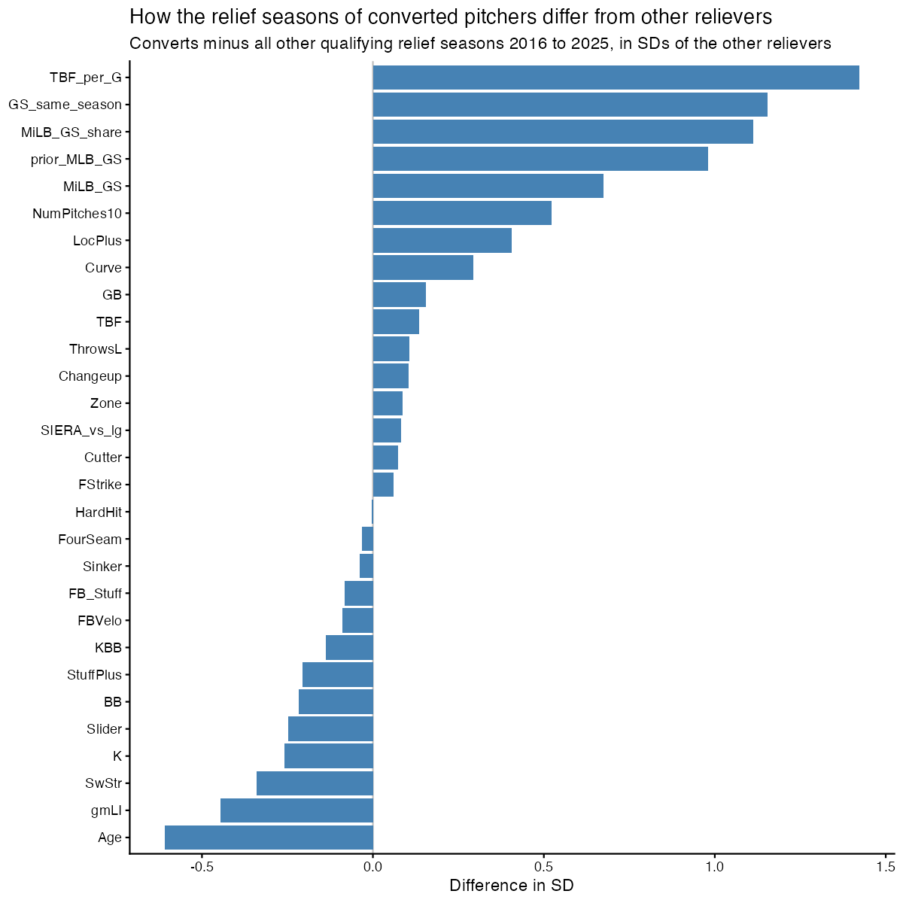

```{r, message=FALSE}
library(dplyr)
library(readr)
library(ggplot2)
library(glmnet)

options(width = 200)
```

## How converts differ from other relievers

The relief season of each conversion compared to every other qualifying relief season from 2016 to 2025.

```{r}
pitcher_seasons <- read_csv("../data/processed/pitcher_seasons.csv", guess_max = 20000, show_col_types = FALSE)
conversions <- read_csv("../data/processed/conversions.csv", show_col_types = FALSE)

# I only pulled prior MLB starts starting in 2014, so earlier starts are missing and the measure is more complete from 2016 on
relievers <- pitcher_seasons |>
  filter(QualifyingRelief, Season >= 2016) |>
  transmute(playerid, PlayerName, Season, Team = TeamNameAbb, Age, ThrowsL = as.numeric(Throws == "L"), TBF,
            TBF_per_G, GS_same_season = GS_total, SIERA_vs_lg, KBB = `K-BB%` * 100, SwStr = `SwStr%` * 100,
            Zone = `Zone%` * 100, FStrike = `F-Strike%` * 100, GB = `GB%` * 100, gmLI,
            FBVelo, NumPitches10, FourSeam = FourSeam * 100, Sinker = Sinker * 100, Cutter = Cutter * 100,
            Slider = Slider * 100, Curve = Curve * 100, Changeup = Changeup * 100, StuffPlus = sp_stuff,
            LocPlus = sp_location, prior_MLB_GS, MiLB_G, MiLB_GS) |>
  left_join(conversions |> select(playerid, Season = rp_season, sp_season), by = c("playerid", "Season")) |>
  mutate(Converted = as.numeric(!is.na(sp_season)),
         MiLB_GS_share = ifelse(MiLB_G > 0, MiLB_GS / MiLB_G * 100, NA),
         log_prior_MLB_GS = log1p(prior_MLB_GS), log_MiLB_GS = log1p(MiLB_GS))

# A relief season counts as converted if the pitcher becomes a starter within the next three years, which isn't known for 2026 yet
# Teams did not choose the other relief seasons of pitchers who converted, so those are left out
population <- relievers |>
  filter(Season <= 2025, Converted == 1 | !playerid %in% conversions$playerid)
```

```{r}
features <- c("Age", "ThrowsL", "TBF", "TBF_per_G", "GS_same_season", "gmLI", "SIERA_vs_lg", "KBB", "SwStr", "Zone",
              "FStrike", "GB", "FBVelo", "NumPitches10", "FourSeam", "Sinker", "Cutter", "Slider", "Curve",
              "Changeup", "StuffPlus", "LocPlus", "prior_MLB_GS", "MiLB_GS", "MiLB_GS_share")

cat("Qualifying relief seasons 2016 to 2025 (100+ TBF, starts in 20% or less of games):", nrow(population), "\n")
cat("Converted within three years: ", sum(population$Converted), " (", round(mean(population$Converted) * 100, 1), "%)\n\n", sep = "")

cat("Converts vs. every other reliever season, one trait at a time\n")
cat("diff_in_SD = (convert mean - other mean) / SD of other relievers\n")
cat("AUC: chance a random convert is predicted higher than a random non-convert (0.5 = no difference)\n")
univariate <- NULL
for (f in features) {
  x <- population[[f]]
  convert_x <- x[population$Converted == 1]
  other_x <- x[population$Converted == 0]
  # The p value tests whether the AUC differs from 0.5
  trait_roc <- pROC::roc(population$Converted, x, levels = c(0, 1), direction = "<", quiet = TRUE)
  trait_auc <- as.numeric(pROC::auc(trait_roc))
  univariate <- bind_rows(univariate, data.frame(
    trait = f, n_converts = sum(!is.na(convert_x)), convert_mean = mean(convert_x, na.rm = TRUE),
    other_mean = mean(other_x, na.rm = TRUE),
    diff_in_SD = (mean(convert_x, na.rm = TRUE) - mean(other_x, na.rm = TRUE)) / sd(other_x, na.rm = TRUE),
    AUC = trait_auc, p_value = 2 * pnorm(-abs(trait_auc - 0.5) / sqrt(pROC::var(trait_roc)))))
}

# Adjust for testing many traits (Benjamini-Hochberg)
univariate$q <- round(p.adjust(univariate$p_value, method = "BH"), 3)
univariate$p_value <- round(univariate$p_value, 3)
univariate <- univariate |> arrange(desc(abs(AUC - 0.5)))
write_csv(univariate, "results/convert_vs_population.csv")
print(univariate, digits = 3)
```

Converts are not better pitchers on average. Their relief SIERA relative to the league (-0.05) is about the same as other relievers (-0.11), and the skill traits barely separate the two groups. What separates them is role and starting history. Converts face 6.3 batters per game vs. 4.6, have more prior MLB starts (23 vs. 6), and are younger (27.0 vs. 29.1).

```{r, fig.show="hide", fig.width=8, fig.height=8}
# How the converts differ from other relievers, in SD units
plot_data <- univariate |>
  mutate(trait = factor(trait, levels = trait[order(diff_in_SD)]))
ggplot(plot_data, aes(diff_in_SD, trait)) +
  geom_vline(xintercept = 0, color = "gray") +
  geom_col(fill = "steelblue") +
  labs(title = "How the relief seasons of converted pitchers differ from other relievers",
       subtitle = "Converts minus all other qualifying relief seasons 2016 to 2025 (in SDs)",
       x = "Difference in SD", y = NULL) +
  theme_classic()
ggsave("charts/convert_profile.png", width = 8, height = 8, dpi = 150)
```



```{r}
# Logistic regression with every trait held at once
# The same 19 traits are used in every model below
all_traits <- c("SIERA_vs_lg", "KBB", "SwStr", "FBVelo", "GB", "NumPitches10", "FourSeam", "Sinker", "Cutter", "Slider",
                "Curve", "Changeup", "gmLI", "TBF_per_G", "Age", "ThrowsL", "GS_same_season", "log_prior_MLB_GS",
                "log_MiLB_GS")
cat("\nLogistic regression of being converted\n")
model_data <- population |>
  filter(!is.na(FBVelo)) |>
  mutate(across(all_of(setdiff(all_traits, "ThrowsL")), ~ as.numeric(scale(.x))))
fit_all <- glm(as.formula(paste("Converted ~", paste(all_traits, collapse = " + "))), data = model_data,
               family = binomial)
coefs <- summary(fit_all)$coefficients
print(data.frame(trait = rownames(coefs), odds_ratio_per_SD = round(exp(coefs[, 1]), 2), p = round(coefs[, 4], 3)),
      row.names = FALSE)
cat("\nRelief seasons in the model:", nrow(model_data), "\n")
cat("Converts:", sum(model_data$Converted), "\n")
```

With the traits held together, starting history and role matter most. Each standard deviation of prior MLB starts multiplies the odds of being converted by 2.0 (1.7 for minor league starts and 1.3 for starts in the relief season) and each standard deviation of batters per game by 1.4, while each standard deviation of age cuts the odds to 0.38. Relief SIERA has no clear effect, either on its own (AUC of 0.53) or once the other traits are included (odds ratio of 0.58, p = 0.38).

```{r}
# Cross validated AUC by type of trait
cat("\nHow well each group of traits picks out the converts (5-fold cross validated AUC)\n")
# All of a pitcher's seasons go in the same fold since pitchers repeat across seasons
set.seed(0)
pitcher_ids <- unique(model_data$playerid)
pitcher_folds <- sample(rep(1:5, length.out = length(pitcher_ids)))
fold <- pitcher_folds[match(model_data$playerid, pitcher_ids)]

formulas <- c(
  "skills only (SIERA, K-BB%, SwStr%, velo, GB%)" = "Converted ~ SIERA_vs_lg + KBB + SwStr + FBVelo + GB",
  "arsenal (pitches and usage of each pitch)" = "Converted ~ NumPitches10 + FourSeam + Sinker + Cutter + Slider + Curve + Changeup",
  "role and context (leverage, batters per game, age, handedness)" = "Converted ~ gmLI + TBF_per_G + Age + ThrowsL",
  "starting history (starts this season, MLB, and minor league)" = "Converted ~ GS_same_season + log_prior_MLB_GS + log_MiLB_GS",
  "skills + arsenal" = "Converted ~ SIERA_vs_lg + KBB + SwStr + FBVelo + GB + NumPitches10 + FourSeam + Sinker + Cutter + Slider + Curve + Changeup",
  "skills + role + history" = "Converted ~ SIERA_vs_lg + KBB + SwStr + FBVelo + GB + gmLI + TBF_per_G + Age + ThrowsL + GS_same_season + log_prior_MLB_GS + log_MiLB_GS",
  "role + history" = "Converted ~ gmLI + TBF_per_G + Age + ThrowsL + GS_same_season + log_prior_MLB_GS + log_MiLB_GS",
  "arsenal + role + history" = "Converted ~ NumPitches10 + FourSeam + Sinker + Cutter + Slider + Curve + Changeup + gmLI + TBF_per_G + Age + ThrowsL + GS_same_season + log_prior_MLB_GS + log_MiLB_GS",
  "everything" = paste("Converted ~", paste(all_traits, collapse = " + ")))
cv_table <- NULL
for (name in names(formulas)) {
  predictions <- rep(NA, nrow(model_data))
  for (k in 1:5) {
    fit <- glm(as.formula(formulas[[name]]), data = model_data[fold != k, ], family = binomial)
    predictions[fold == k] <- predict(fit, newdata = model_data[fold == k, ])
  }
  auc <- as.numeric(pROC::auc(model_data$Converted, predictions, levels = c(0, 1), direction = "<", quiet = TRUE))
  cv_table <- bind_rows(cv_table, data.frame(traits = name, cv_AUC = round(auc, 3)))
}
print(cv_table, row.names = FALSE)
```

Role and starting history pick out the converts much better than skill does. Skills alone give a cross validated AUC of 0.58, close to chance, vs. 0.79 for role and context and 0.82 for starting history. Role and starting history together reach 0.879, and adding skills (0.878), arsenal (0.875), or both (0.871) does not help.

```{r}
# Stuff+ starts in 2020, and with only 67 converts the model is smaller
# The model keeps the role and history traits and swaps the skill and arsenal traits for Stuff+ measures
cat("\n2020 and later, with Stuff+\n")
stuff_traits <- c("SIERA_vs_lg", "StuffPlus", "LocPlus", "FBVelo", "Age", "gmLI", "TBF_per_G",
                  "GS_same_season", "log_prior_MLB_GS", "log_MiLB_GS")
stuff_data <- population |>
  filter(Season >= 2020, !is.na(StuffPlus), !is.na(FBVelo)) |>
  mutate(across(all_of(stuff_traits), ~ as.numeric(scale(.x))))
fit_stuff <- glm(as.formula(paste("Converted ~", paste(stuff_traits, collapse = " + "))), data = stuff_data,
                 family = binomial)
coefs_stuff <- summary(fit_stuff)$coefficients
print(data.frame(trait = rownames(coefs_stuff), odds_ratio_per_SD = round(exp(coefs_stuff[, 1]), 2),
                 p = round(coefs_stuff[, 4], 3)), row.names = FALSE)
cat("\nRelief seasons in the model:", nrow(stuff_data), "\n")
cat("Converts:", sum(stuff_data$Converted), "\n")
```

In the 2020 and later model, Stuff+ has no effect (p = 0.59) and Location+ comes closest (odds ratio of 1.36, p = 0.053). Role and starting history stay about as strong as before.

```{r}
cat("\nBy relief season year\n")
population |>
  group_by(Season) |>
  summarize(seasons = n(), converts = sum(Converted), per_100 = round(sum(Converted) / n() * 100, 1)) |>
  as.data.frame() |> print()

cat("\nShares, converts vs. other relievers (percent)\n")
converts <- population |> filter(Converted == 1)
others <- population |> filter(Converted == 0)
shares <- data.frame(
  trait = c("Prior MLB start", "Minor league start", "Start in the relief season"),
  converts = round(c(mean(converts$prior_MLB_GS > 0), mean(converts$MiLB_GS > 0),
                     mean(converts$GS_same_season > 0)) * 100),
  others = round(c(mean(others$prior_MLB_GS > 0), mean(others$MiLB_GS > 0),
                   mean(others$GS_same_season > 0)) * 100))
print(shares, row.names = FALSE)
```

By year, the conversion rate stays between 3.4 and 6.5 per 100 and is lowest in 2024 and 2025. Nearly all converts (98%) had made a minor league start (vs. 89% of other relievers), 72% had a prior MLB start (vs. 34%), and 53% made a start in the relief season itself (vs. 17%).

## Predicting which relievers get converted

Three models tested by rolling origin, then the 2026 relievers scored with ridge.

```{r}
# Pitchers without a fastball velocity are left out
relievers <- relievers |> filter(!is.na(FBVelo))
labeled <- relievers |> filter(Season <= 2025)
current <- relievers |> filter(Season == 2026)

formula_logistic <- as.formula(paste("Known ~", paste(all_traits, collapse = " + ")))
formula_four <- Known ~ Age + TBF_per_G + log_prior_MLB_GS + log_MiLB_GS
```

```{r}
# Each test year only sees earlier relief seasons and conversions that had happened by then
# 2021 is the first test year since it leaves five seasons (2016 to 2020) to train on
set.seed(0)
test_rows <- NULL
for (year in 2021:2025) {
  train <- labeled |>
    filter(Season < year) |>
    mutate(Known = as.numeric(Converted == 1 & sp_season <= year))
  test <- labeled |> filter(Season == year)

  # Keep all of a pitcher's seasons in the same fold when choosing the penalty
  pitcher_ids <- unique(train$playerid)
  pitcher_folds <- sample(rep(1:5, length.out = length(pitcher_ids)))
  folds <- pitcher_folds[match(train$playerid, pitcher_ids)]
  x_train <- as.matrix(train[, all_traits])
  x_test <- as.matrix(test[, all_traits])

  logistic_model <- glm(formula_logistic, data = train, family = binomial)
  four_model <- glm(formula_four, data = train, family = binomial)
  ridge_model <- cv.glmnet(x_train, train$Known, family = "binomial", alpha = 0, foldid = folds)

  test$logistic <- predict(logistic_model, newdata = test, type = "response")
  test$four_traits <- predict(four_model, newdata = test, type = "response")
  test$ridge <- as.numeric(predict(ridge_model, newx = x_test, s = "lambda.min", type = "response"))
  test$base_rate <- mean(train$Known)
  test_rows <- bind_rows(test_rows, test)
}
cat("Test relief seasons 2021 to 2025:", nrow(test_rows), "\n")
cat("Converts among them:", sum(test_rows$Converted), "\n\n")
```

```{r}
calibration <- NULL
for (model in c("base_rate", "logistic", "ridge", "four_traits")) {
  test_rows$prob <- pmin(pmax(test_rows[[model]], 1e-6), 1 - 1e-6)
  test_rows$log_odds <- log(test_rows$prob / (1 - test_rows$prob))
  slope <- NA
  if (model != "base_rate") {
    slope <- coef(glm(Converted ~ log_odds, data = test_rows, family = binomial))[2]
  }
  calibration <- bind_rows(calibration, data.frame(
    model = model, expected = round(sum(test_rows$prob), 1), actual = sum(test_rows$Converted),
    slope = round(slope, 2),
    log_loss = round(-mean(ifelse(test_rows$Converted == 1, log(test_rows$prob), log(1 - test_rows$prob))), 4),
    brier = round(mean((test_rows$prob - test_rows$Converted)^2), 5)))
}
cat("Calibration\n")
print(calibration, row.names = FALSE)
```

All three models expect more converts than occurred (71 to 75 vs. 64), and calibration slopes of 0.82 to 0.96 show they are somewhat overconfident, but all of them beat the base rate (giving every reliever the average conversion rate of the earlier seasons) on log loss (0.150 to 0.153 vs. 0.186).

```{r}
# For each test year, the AUC and how many converts are among the top scored relievers (as many relievers as that year had converts), then the AUC averaged and the converts found added up over the years
scores <- c("logistic", "ridge", "four_traits", "TBF_per_G")
ranking <- NULL
for (score in scores) {
  auc_by_year <- rep(NA, 5)
  found <- 0
  for (i in 1:5) {
    one_year <- test_rows |> filter(Season == 2020 + i)
    k <- sum(one_year$Converted)
    auc_by_year[i] <- as.numeric(pROC::auc(one_year$Converted, one_year[[score]], levels = c(0, 1), direction = "<", quiet = TRUE))
    found <- found + sum(one_year$Converted[rank(-one_year[[score]]) <= k])
  }
  ranking <- bind_rows(ranking, data.frame(score = score, mean_AUC = round(mean(auc_by_year), 3),
                                           worst_year_AUC = round(min(auc_by_year), 3), converts_found = found))
}

# Picking at random, a year's top k holds k * k / (relievers that year) converts
year_totals <- test_rows |> group_by(Season) |> summarize(k = sum(Converted), n = n())
random_found <- sum(year_totals$k^2 / year_totals$n)
```

```{r}
# Resample pitchers instead of rows since pitchers repeat across seasons
set.seed(0)
pitcher_ids <- unique(test_rows$playerid)
rows_by_pitcher <- split(1:nrow(test_rows), test_rows$playerid)
boot_auc <- matrix(NA, 1000, length(scores), dimnames = list(NULL, scores))
for (b in 1:1000) {
  sampled <- sample(as.character(pitcher_ids), replace = TRUE)
  boot_rows <- test_rows[unlist(rows_by_pitcher[sampled]), ]
  for (score in scores) {
    auc_by_year <- rep(NA, 5)
    for (i in 1:5) {
      in_year <- boot_rows$Season == 2020 + i
      converted <- boot_rows$Converted[in_year]
      auc_by_year[i] <- as.numeric(pROC::auc(converted, boot_rows[[score]][in_year], levels = c(0, 1), direction = "<", quiet = TRUE))
    }
    boot_auc[b, score] <- mean(auc_by_year, na.rm = TRUE)
  }
}
ranking$lower <- round(apply(boot_auc, 2, quantile, 0.025), 3)
ranking$upper <- round(apply(boot_auc, 2, quantile, 0.975), 3)
cat("Ranking, with 95% pitcher bootstrap intervals on AUC\n")
cat("converts_found: converts among the top scored relievers each year (as many relievers as that year had converts), out of",
    sum(test_rows$Converted), "in total\n")
print(ranking, row.names = FALSE)
cat("\nPicking relievers at random would find about", round(random_found, 1), "of the", sum(test_rows$Converted), "converts\n")
auc_gap <- quantile(boot_auc[, "ridge"] - boot_auc[, "four_traits"], c(0.025, 0.975))
cat("Ridge minus the four trait model in AUC = ", round(ranking$mean_AUC[2] - ranking$mean_AUC[3], 3),
    " (95% interval ", round(auc_gap[1], 3), " to ", round(auc_gap[2], 3), ")\n", sep = "")
```

A logistic regression on just four traits (batters per game, prior MLB starts, minor league starts, and age) ranks relievers as well as the models with all 19, with an AUC of 0.844 vs. 0.847 for ridge, so the extra traits add nothing measurable. Batters per game alone gets an AUC of 0.79. Picking as many top scored relievers each year as there were converts, the models found 17 to 20 of the 64 converts, compared to about 3 from random picks.

```{r}
# Final ridge model on every relief season through 2025
set.seed(0)
pitcher_ids <- unique(labeled$playerid)
pitcher_folds <- sample(rep(1:5, length.out = length(pitcher_ids)))
folds <- pitcher_folds[match(labeled$playerid, pitcher_ids)]
ridge_model <- cv.glmnet(as.matrix(labeled[, all_traits]), labeled$Converted, family = "binomial", alpha = 0,
                         foldid = folds)
current$Prob <- as.numeric(predict(ridge_model, newx = as.matrix(current[, all_traits]), s = "lambda.min",
                                   type = "response"))
likelihood <- current |>
  arrange(desc(Prob)) |>
  transmute(PlayerName, Age, TBF_per_G = round(TBF_per_G, 1), SIERA_vs_lg = round(SIERA_vs_lg, 2),
            GS_same_season, prior_MLB_GS, MiLB_GS, ProbPct = round(Prob * 100, 1))
write_csv(likelihood, "results/conversion_likelihood_2026.csv")
cat("2026 relievers scored:", nrow(current), "\n")
cat("Expected conversions:", round(sum(current$Prob), 1), "\n\n")
cat("Top 20 by probability of being converted\n")
print(as.data.frame(head(likelihood, 20)), row.names = FALSE)
```

The 2026 list is dominated by relievers who already face many batters per game and/or have starting history. Only 14 conversions are expected among the 274 scored relievers, and even the top candidate has only about a 47% chance.
