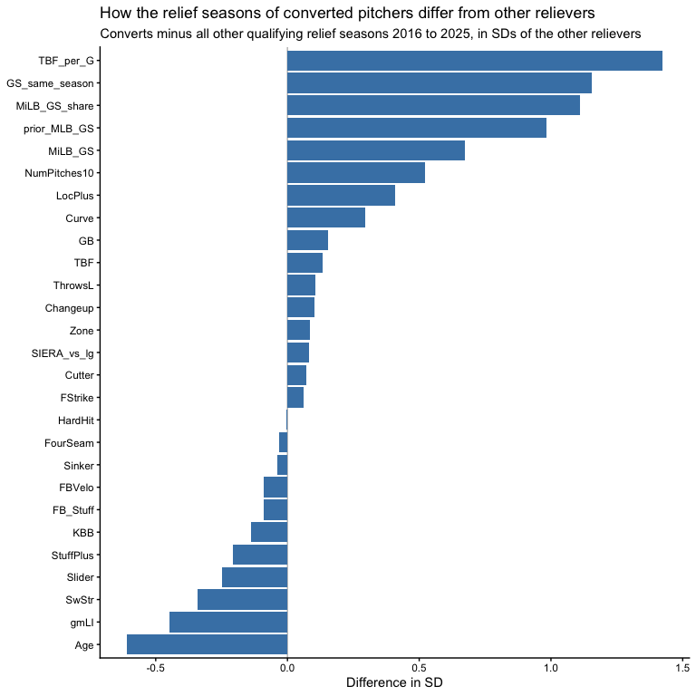

Step 5: Who Gets Converted
================

``` r
library(dplyr)
library(readr)
library(ggplot2)
library(glmnet)

options(width = 200)
```

## Traits of converts

The relief season of each conversion compared to every other qualifying
relief season from 2016 to 2025.

``` r
pitcher_seasons <- read_csv("../data/pitcher_seasons.csv", guess_max = 20000, show_col_types = FALSE)
conversions <- read_csv("../data/conversions.csv", show_col_types = FALSE)

# MLB starts are only counted from 2014, so starting history is measured better from 2016 on
relievers <- pitcher_seasons |>
  filter(QualifyingRelief, Season >= 2016) |>
  transmute(playerid, PlayerName, Season, Team = TeamNameAbb, Age, ThrowsL = as.numeric(Throws == "L"), TBF,
            TBF_per_G, GS_same_season = GS_total, SIERA_vs_lg, KBB = `K-BB%` * 100, SwStr = `SwStr%` * 100,
            Zone = `Zone%` * 100, FStrike = `F-Strike%` * 100, GB = `GB%` * 100, HardHit = `HardHit%` * 100, gmLI,
            FBVelo, NumPitches10, FourSeam = FourSeam * 100, Sinker = Sinker * 100, Cutter = Cutter * 100,
            Slider = Slider * 100, Curve = Curve * 100, Changeup = Changeup * 100, StuffPlus = sp_stuff, FB_Stuff,
            LocPlus = sp_location, prior_MLB_GS, MiLB_G, MiLB_GS) |>
  left_join(conversions |> select(playerid, Season = rp_season, sp_season), by = c("playerid", "Season")) |>
  mutate(Converted = as.numeric(!is.na(sp_season)),
         MiLB_GS_share = ifelse(MiLB_G > 0, MiLB_GS / MiLB_G * 100, NA),
         log_prior_MLB_GS = log1p(prior_MLB_GS), log_MiLB_GS = log1p(MiLB_GS))

# The 2026 relief seasons cannot be labeled yet, so the comparison stops at 2025
# Teams did not choose the other relief seasons of pitchers who converted, so those are left out
population <- relievers |>
  filter(Season <= 2025, Converted == 1 | !playerid %in% conversions$playerid)

# Chance that a random convert scores higher than a random non-convert
auc_rank <- function(score, outcome) {
  keep <- !is.na(score)
  score <- score[keep]
  outcome <- outcome[keep]
  n1 <- sum(outcome == 1)
  n0 <- sum(outcome == 0)
  (sum(rank(score)[outcome == 1]) - n1 * (n1 + 1) / 2) / (n1 * n0)
}

# The same 15 traits are used in every model below
all_traits <- c("SIERA_vs_lg", "KBB", "SwStr", "FBVelo", "GB", "NumPitches10", "Changeup", "Sinker", "FourSeam",
                "gmLI", "TBF_per_G", "Age", "ThrowsL", "log_prior_MLB_GS", "log_MiLB_GS")
```

``` r
features <- c("Age", "ThrowsL", "TBF", "TBF_per_G", "GS_same_season", "gmLI", "SIERA_vs_lg", "KBB", "SwStr", "Zone",
              "FStrike", "GB", "HardHit", "FBVelo", "NumPitches10", "FourSeam", "Sinker", "Cutter", "Slider", "Curve",
              "Changeup", "StuffPlus", "FB_Stuff", "LocPlus", "prior_MLB_GS", "MiLB_GS", "MiLB_GS_share")

cat("Qualifying relief seasons 2016 to 2025 (100+ TBF, starts in 20% or less of games):", nrow(population), "\n")
```

    ## Qualifying relief seasons 2016 to 2025 (100+ TBF, starts in 20% or less of games): 2415

``` r
cat("Converted the next season:", sum(population$Converted), " (", round(mean(population$Converted) * 100, 1), "%)\n\n")
```

    ## Converted the next season: 125  ( 5.2 %)

``` r
cat("1. Converts vs every other reliever season, one trait at a time\n")
```

    ## 1. Converts vs every other reliever season, one trait at a time

``` r
cat("diff_in_SD = (convert mean - other mean) / SD of others. AUC is the chance a random convert is higher than a random non-convert (0.5 = no difference)\n")
```

    ## diff_in_SD = (convert mean - other mean) / SD of others. AUC is the chance a random convert is higher than a random non-convert (0.5 = no difference)

``` r
univariate <- NULL
for (f in features) {
  x <- population[[f]]
  convert_x <- x[population$Converted == 1]
  other_x <- x[population$Converted == 0]
  univariate <- bind_rows(univariate, data.frame(
    trait = f, n_converts = sum(!is.na(convert_x)), convert_mean = mean(convert_x, na.rm = TRUE),
    other_mean = mean(other_x, na.rm = TRUE),
    diff_in_SD = (mean(convert_x, na.rm = TRUE) - mean(other_x, na.rm = TRUE)) / sd(other_x, na.rm = TRUE),
    AUC = auc_rank(x, population$Converted),
    p_value = wilcox.test(convert_x, other_x)$p.value))
}
# Adjust for testing many traits (Benjamini-Hochberg)
univariate$q <- p.adjust(univariate$p_value, method = "BH")
univariate <- univariate |> arrange(desc(abs(AUC - 0.5)))
write_csv(univariate, "results/convert_vs_population.csv")
print(univariate, digits = 3)
```

    ##             trait n_converts convert_mean other_mean diff_in_SD   AUC  p_value        q
    ## 1       TBF_per_G        125       6.2933      4.556    1.42369 0.809 0.00e+00 0.00e+00
    ## 2   MiLB_GS_share        124      75.4898     37.453    1.11159 0.807 0.00e+00 0.00e+00
    ## 3    prior_MLB_GS        125      22.7200      5.714    0.98128 0.736 0.00e+00 0.00e+00
    ## 4         MiLB_GS        125      75.3120     45.970    0.67459 0.704 1.35e-14 7.31e-14
    ## 5  GS_same_season        125       1.5600      0.352    1.15401 0.690 0.00e+00 0.00e+00
    ## 6             Age        125      26.9920     29.100   -0.60955 0.318 5.61e-12 2.52e-11
    ## 7           Curve        125      11.0676      7.459    0.29464 0.641 8.38e-09 3.23e-08
    ## 8    NumPitches10        125       3.2240      2.815    0.52208 0.639 1.71e-08 5.79e-08
    ## 9            gmLI        125       0.9715      1.134   -0.44617 0.380 5.68e-06 1.70e-05
    ## 10        LocPlus         67     100.8774     98.310    0.40702 0.611 2.12e-03 4.40e-03
    ## 11          SwStr        125      10.9463     11.868   -0.33991 0.402 2.04e-04 5.51e-04
    ## 12       Changeup        125      11.3200     10.035    0.10337 0.597 2.42e-04 5.94e-04
    ## 13         Cutter        125       7.5440      6.481    0.07311 0.570 1.23e-03 2.77e-03
    ## 14         Slider        125      18.9723     23.287   -0.24678 0.432 1.05e-02 2.03e-02
    ## 15      StuffPlus         67     102.0204    103.934   -0.20668 0.439 9.04e-02 1.49e-01
    ## 16            KBB        125      13.9136     14.818   -0.13721 0.455 8.73e-02 1.49e-01
    ## 17             GB        125      44.8563     43.408    0.15476 0.544 9.41e-02 1.49e-01
    ## 18         FBVelo        125      93.7708     94.008   -0.08849 0.464 1.76e-01 2.65e-01
    ## 19    SIERA_vs_lg        125      -0.0454     -0.106    0.08235 0.528 2.89e-01 3.83e-01
    ## 20           Zone        125      43.0464     42.720    0.08619 0.527 3.11e-01 3.83e-01
    ## 21            TBF        125     215.7120    207.159    0.13415 0.527 3.12e-01 3.83e-01
    ## 22        ThrowsL        125       0.3040      0.257    0.10704 0.523 2.45e-01 3.49e-01
    ## 23       FB_Stuff         67      98.6234     99.739   -0.09175 0.481 5.94e-01 6.68e-01
    ## 24         Sinker        125      17.1307     17.991   -0.03965 0.518 4.86e-01 5.71e-01
    ## 25        FStrike        125      60.5001     60.199    0.05994 0.513 6.26e-01 6.76e-01
    ## 26       FourSeam        125      34.0644     34.792   -0.03242 0.491 7.20e-01 7.27e-01
    ## 27        HardHit        125      36.2541     36.281   -0.00452 0.491 7.27e-01 7.27e-01

Converts are not better pitchers. Their relief SIERA relative to the
league (-0.05) is about the same as other relievers (-0.11), and the
skill traits barely separate the two groups. What separates them is role
and starting history. Converts face 6.3 batters per game versus 4.6,
have more prior MLB starts (23 versus 6), and are younger (27.0 versus
29.1).

``` r
# Logistic regression with every trait held at once
cat("\n2. Logistic regression of being converted (traits in SD units, odds ratio per SD)\n")
```

    ## 
    ## 2. Logistic regression of being converted (traits in SD units, odds ratio per SD)

``` r
model_data <- population |>
  filter(!is.na(FBVelo)) |>
  mutate(across(all_of(setdiff(all_traits, "ThrowsL")), ~ as.numeric(scale(.x))))
fit_all <- glm(as.formula(paste("Converted ~", paste(all_traits, collapse = " + "))), data = model_data,
               family = binomial)
coefs <- summary(fit_all)$coefficients
print(data.frame(trait = rownames(coefs), odds_ratio_per_SD = round(exp(coefs[, 1]), 2), p = round(coefs[, 4], 3)),
      row.names = FALSE)
```

    ##             trait odds_ratio_per_SD     p
    ##       (Intercept)              0.02 0.000
    ##       SIERA_vs_lg              0.62 0.423
    ##               KBB              0.82 0.758
    ##             SwStr              0.86 0.378
    ##            FBVelo              0.85 0.268
    ##                GB              1.16 0.487
    ##      NumPitches10              1.26 0.036
    ##          Changeup              0.86 0.260
    ##            Sinker              0.79 0.283
    ##          FourSeam              0.96 0.861
    ##              gmLI              0.92 0.539
    ##         TBF_per_G              1.46 0.000
    ##               Age              0.36 0.000
    ##           ThrowsL              0.86 0.554
    ##  log_prior_MLB_GS              2.15 0.000
    ##       log_MiLB_GS              1.63 0.010

``` r
cat("n =", nrow(model_data), " converts =", sum(model_data$Converted), "\n")
```

    ## n = 2409  converts = 125

With the traits held together, starting history and role matter most.
Each standard deviation of prior MLB starts multiplies the odds of being
converted by 2.2 (1.6 for minor league starts) and each standard
deviation of batters per game by 1.5, while each standard deviation of
age cuts the odds to 0.36. Relief SIERA has no clear effect once the
other traits are included (an odds ratio of 0.62, p = 0.42), since it
overlaps with K-BB% and SwStr%.

``` r
# Cross validated AUC by type of trait
cat("\n3. How well each group of traits picks out the converts (5 fold cross validated AUC)\n")
```

    ## 
    ## 3. How well each group of traits picks out the converts (5 fold cross validated AUC)

``` r
# All of a pitcher's seasons go in the same fold since pitchers repeat across seasons
set.seed(0)
pitcher_ids <- unique(model_data$playerid)
pitcher_folds <- sample(rep(1:5, length.out = length(pitcher_ids)))
fold <- pitcher_folds[match(model_data$playerid, pitcher_ids)]

formulas <- c(
  "skills only (SIERA, K-BB%, SwStr%, velo, GB%)" = "Converted ~ SIERA_vs_lg + KBB + SwStr + FBVelo + GB",
  "arsenal (pitches, changeup, sinker, four-seam usage)" = "Converted ~ NumPitches10 + Changeup + Sinker + FourSeam",
  "role and context (leverage, batters per game, age, handedness)" = "Converted ~ gmLI + TBF_per_G + Age + ThrowsL",
  "starting history (MLB and minor league starts)" = "Converted ~ log_prior_MLB_GS + log_MiLB_GS",
  "skills + arsenal" = "Converted ~ SIERA_vs_lg + KBB + SwStr + FBVelo + GB + NumPitches10 + Changeup + Sinker + FourSeam",
  "skills + role + history" = "Converted ~ SIERA_vs_lg + KBB + SwStr + FBVelo + GB + gmLI + TBF_per_G + Age + ThrowsL + log_prior_MLB_GS + log_MiLB_GS",
  "everything" = paste("Converted ~", paste(all_traits, collapse = " + ")))
cv_table <- NULL
for (name in names(formulas)) {
  predictions <- rep(NA, nrow(model_data))
  for (k in 1:5) {
    fit <- glm(as.formula(formulas[[name]]), data = model_data[fold != k, ], family = binomial)
    predictions[fold == k] <- predict(fit, newdata = model_data[fold == k, ])
  }
  cv_table <- bind_rows(cv_table, data.frame(traits = name, cv_AUC = round(auc_rank(predictions, model_data$Converted), 3)))
}
print(cv_table, row.names = FALSE)
```

    ##                                                          traits cv_AUC
    ##                   skills only (SIERA, K-BB%, SwStr%, velo, GB%)  0.582
    ##            arsenal (pitches, changeup, sinker, four-seam usage)  0.626
    ##  role and context (leverage, batters per game, age, handedness)  0.791
    ##                  starting history (MLB and minor league starts)  0.783
    ##                                                skills + arsenal  0.648
    ##                                         skills + role + history  0.872
    ##                                                      everything  0.866

Role and starting history pick out the converts much better than skill
does. Skills alone give a cross validated AUC of 0.58, close to chance,
versus 0.79 for role and context and 0.78 for starting history. Adding
arsenal to skills, role, and history does not help (0.872 versus 0.866
with everything).

``` r
# Stuff+ starts in 2020, and with only 67 converts the model is smaller. It keeps the role and history traits and
# swaps the skill and arsenal traits for the Stuff+ measures
cat("\n4. 2020 and later, with Stuff+ (relief seasons 2020 to 2025)\n")
```

    ## 
    ## 4. 2020 and later, with Stuff+ (relief seasons 2020 to 2025)

``` r
stuff_traits <- c("SIERA_vs_lg", "StuffPlus", "FB_Stuff", "LocPlus", "FBVelo", "Age", "gmLI", "TBF_per_G",
                  "log_prior_MLB_GS", "log_MiLB_GS")
stuff_data <- population |>
  filter(Season >= 2020, !is.na(StuffPlus), !is.na(FB_Stuff), !is.na(FBVelo)) |>
  mutate(across(all_of(stuff_traits), ~ as.numeric(scale(.x))))
fit_stuff <- glm(as.formula(paste("Converted ~", paste(stuff_traits, collapse = " + "))), data = stuff_data,
                 family = binomial)
coefs_stuff <- summary(fit_stuff)$coefficients
print(data.frame(trait = rownames(coefs_stuff), odds_ratio_per_SD = round(exp(coefs_stuff[, 1]), 2),
                 p = round(coefs_stuff[, 4], 3)), row.names = FALSE)
```

    ##             trait odds_ratio_per_SD     p
    ##       (Intercept)              0.02 0.000
    ##       SIERA_vs_lg              0.74 0.119
    ##         StuffPlus              0.98 0.953
    ##          FB_Stuff              1.17 0.497
    ##           LocPlus              1.36 0.052
    ##            FBVelo              0.83 0.326
    ##               Age              0.31 0.000
    ##              gmLI              0.87 0.451
    ##         TBF_per_G              1.37 0.002
    ##  log_prior_MLB_GS              2.11 0.000
    ##       log_MiLB_GS              1.72 0.034

``` r
cat("n =", nrow(stuff_data), " converts =", sum(stuff_data$Converted), "\n")
```

    ## n = 1362  converts = 67

In the 2020 and later model Stuff+ has no effect (p = 0.95) and
Location+ comes closest (an odds ratio of 1.36, p = 0.05). Role and
starting history stay about as strong as before.

``` r
# Teams and years
cat("\n5. Do conversion rates differ by team (relief season team) more than chance? Chi-square test with a simulated p value\n")
```

    ## 
    ## 5. Do conversion rates differ by team (relief season team) more than chance? Chi-square test with a simulated p value

``` r
by_team <- population |> filter(!Team %in% c("2 Tms", "3 Tms"))
set.seed(0)
print(chisq.test(table(by_team$Team, by_team$Converted), simulate.p.value = TRUE, B = 10000))
```

    ## 
    ##  Pearson's Chi-squared test with simulated p-value (based on 10000 replicates)
    ## 
    ## data:  table(by_team$Team, by_team$Converted)
    ## X-squared = 37.464, df = NA, p-value = 0.2347

``` r
cat("\nBy relief season year\n")
```

    ## 
    ## By relief season year

``` r
population |>
  group_by(Season) |>
  summarize(seasons = n(), converts = sum(Converted), per_100 = round(sum(Converted) / n() * 100, 1)) |>
  as.data.frame() |> print()
```

    ##    Season seasons converts per_100
    ## 1    2016     249       16     6.4
    ## 2    2017     252       11     4.4
    ## 3    2018     267       14     5.2
    ## 4    2019     262       17     6.5
    ## 5    2020      60        3     5.0
    ## 6    2021     281       15     5.3
    ## 7    2022     267       16     6.0
    ## 8    2023     259       14     5.4
    ## 9    2024     254       10     3.9
    ## 10   2025     264        9     3.4

``` r
cat("\nShares, converts vs other relievers (percent)\n")
```

    ## 
    ## Shares, converts vs other relievers (percent)

``` r
converts <- population |> filter(Converted == 1)
others <- population |> filter(Converted == 0)
shares <- data.frame(
  trait = c("Lefty", "Prior MLB start", "Minor league start", "Start in the relief season"),
  converts = round(c(mean(converts$ThrowsL), mean(converts$prior_MLB_GS > 0), mean(converts$MiLB_GS > 0),
                     mean(converts$GS_same_season > 0)) * 100),
  others = round(c(mean(others$ThrowsL), mean(others$prior_MLB_GS > 0), mean(others$MiLB_GS > 0),
                   mean(others$GS_same_season > 0)) * 100))
print(shares, row.names = FALSE)
```

    ##                       trait converts others
    ##                       Lefty       30     26
    ##             Prior MLB start       72     34
    ##          Minor league start       98     89
    ##  Start in the relief season       53     17

Conversion rates by team do not differ from chance (a chi-square test
gives p = 0.23), so I would not read anything into them. By year the
rate stays between 3.4 and 6.5 per 100 and is lowest in 2024 and 2025.
Nearly all converts (98%) had made a minor league start (versus 89% of
other relievers), 72% had a prior MLB start (versus 34%), and 53% made a
start in the relief season itself (versus 17%).

``` r
# How the converts differ from other relievers, in SD units
plot_data <- univariate |>
  mutate(trait = factor(trait, levels = trait[order(diff_in_SD)]))
ggplot(plot_data, aes(diff_in_SD, trait)) +
  geom_vline(xintercept = 0, color = "gray") +
  geom_col(fill = "steelblue") +
  labs(title = "How the relief seasons of converted pitchers differ from other relievers",
       subtitle = "Converts minus all other qualifying relief seasons 2016 to 2025, in SDs of the other relievers",
       x = "Difference in SD", y = NULL) +
  theme_classic()
```

<!-- -->

``` r
ggsave("charts/convert_profile.png", width = 8, height = 8, dpi = 150)
```

## Predicting conversions

Three models tested by rolling origin, then the 2026 relievers scored
with ridge.

``` r
# Pitchers without a fastball velocity are left out
relievers <- relievers |> filter(!is.na(FBVelo))
labeled <- relievers |> filter(Season <= 2025)
current <- relievers |> filter(Season == 2026)

formula_logistic <- as.formula(paste("Known ~", paste(all_traits, collapse = " + ")))
formula_four <- Known ~ Age + TBF_per_G + log_prior_MLB_GS + log_MiLB_GS
```

``` r
# Each test year only sees earlier relief seasons and conversions that had happened by then
# 2021 is the first test year since it leaves five seasons (2016 to 2020) to train on
set.seed(0)
test_rows <- NULL
for (year in 2021:2025) {
  train <- labeled |>
    filter(Season < year) |>
    mutate(Known = as.numeric(Converted == 1 & sp_season <= year))
  test <- labeled |> filter(Season == year)

  # Keep all of a pitcher's seasons in the same fold when choosing the penalty
  pitcher_ids <- unique(train$playerid)
  pitcher_folds <- sample(rep(1:5, length.out = length(pitcher_ids)))
  folds <- pitcher_folds[match(train$playerid, pitcher_ids)]
  x_train <- as.matrix(train[, all_traits])
  x_test <- as.matrix(test[, all_traits])

  logistic_model <- glm(formula_logistic, data = train, family = binomial)
  four_model <- glm(formula_four, data = train, family = binomial)
  ridge_model <- cv.glmnet(x_train, train$Known, family = "binomial", alpha = 0, foldid = folds)

  test$logistic <- predict(logistic_model, newdata = test, type = "response")
  test$four_traits <- predict(four_model, newdata = test, type = "response")
  test$ridge <- as.numeric(predict(ridge_model, newx = x_test, s = "lambda.min", type = "response"))
  test$base_rate <- mean(train$Known)

  # Unfitted score with equal weight on each standardized trait
  test$simple_score <- as.numeric(scale(test$TBF_per_G)) + as.numeric(scale(test$log_prior_MLB_GS)) +
    as.numeric(scale(test$log_MiLB_GS)) - as.numeric(scale(test$Age))
  test_rows <- bind_rows(test_rows, test)
}
cat("Test seasons 2021 to 2025:", nrow(test_rows), " converts:", sum(test_rows$Converted), "\n\n")
```

    ## Test seasons 2021 to 2025: 1398  converts: 64

``` r
# Calibration slope is the coefficient on the predicted log odds (1 is perfect, below 1 is overconfident)
calibration <- NULL
for (model in c("base_rate", "logistic", "ridge", "four_traits")) {
  test_rows$prob <- pmin(pmax(test_rows[[model]], 1e-6), 1 - 1e-6)
  test_rows$log_odds <- log(test_rows$prob / (1 - test_rows$prob))
  slope <- NA
  if (model != "base_rate") {
    slope <- coef(glm(Converted ~ log_odds, data = test_rows, family = binomial))[2]
  }
  calibration <- bind_rows(calibration, data.frame(
    model = model, expected = round(sum(test_rows$prob), 1), actual = sum(test_rows$Converted),
    slope = round(slope, 2),
    log_loss = round(-mean(ifelse(test_rows$Converted == 1, log(test_rows$prob), log(1 - test_rows$prob))), 4),
    brier = round(mean((test_rows$prob - test_rows$Converted)^2), 5)))
}
cat("Calibration\n")
```

    ## Calibration

``` r
print(calibration, row.names = FALSE)
```

    ##        model expected actual slope log_loss   brier
    ##    base_rate     72.3     64    NA   0.1862 0.04372
    ##     logistic     72.1     64  0.82   0.1520 0.04047
    ##        ridge     75.5     64  0.93   0.1530 0.04067
    ##  four_traits     73.5     64  0.83   0.1532 0.04153

All three models expect more converts than occurred (72 to 76 versus
64), and calibration slopes of 0.82 to 0.93 show they are somewhat
overconfident, but all of them beat the base rate on log loss (0.152 to
0.153 versus 0.186).

``` r
# AUC averaged over the test years, and the converts found in each year's top k (k = that year's number of converts)
scores <- c("logistic", "ridge", "four_traits", "simple_score", "TBF_per_G")
ranking <- NULL
for (score in scores) {
  auc_by_year <- rep(NA, 5)
  found <- 0
  for (i in 1:5) {
    one_year <- test_rows |> filter(Season == 2020 + i)
    k <- sum(one_year$Converted)
    auc_by_year[i] <- auc_rank(one_year[[score]], one_year$Converted)
    found <- found + sum(one_year$Converted[rank(-one_year[[score]]) <= k])
  }
  ranking <- bind_rows(ranking, data.frame(score = score, mean_AUC = round(mean(auc_by_year), 3),
                                           worst_year_AUC = round(min(auc_by_year), 3), found_in_top_k = found))
}
# Picking at random, a year's top k holds k * k / (relievers that year) converts
year_totals <- test_rows |> group_by(Season) |> summarize(k = sum(Converted), n = n())
random_found <- sum(year_totals$k^2 / year_totals$n)
```

``` r
# Resample pitchers instead of rows since pitchers repeat across seasons
set.seed(0)
pitcher_ids <- unique(test_rows$playerid)
rows_by_pitcher <- split(1:nrow(test_rows), test_rows$playerid)
boot_auc <- matrix(NA, 1000, length(scores), dimnames = list(NULL, scores))
for (b in 1:1000) {
  sampled <- sample(as.character(pitcher_ids), replace = TRUE)
  boot_rows <- test_rows[unlist(rows_by_pitcher[sampled]), ]
  for (score in scores) {
    auc_by_year <- rep(NA, 5)
    for (i in 1:5) {
      in_year <- boot_rows$Season == 2020 + i
      auc_by_year[i] <- auc_rank(boot_rows[[score]][in_year], boot_rows$Converted[in_year])
    }
    boot_auc[b, score] <- mean(auc_by_year, na.rm = TRUE)
  }
}
ranking$lower <- round(apply(boot_auc, 2, quantile, 0.025), 3)
ranking$upper <- round(apply(boot_auc, 2, quantile, 0.975), 3)
cat("Ranking, with 95% pitcher bootstrap intervals on AUC\n")
```

    ## Ranking, with 95% pitcher bootstrap intervals on AUC

``` r
print(ranking, row.names = FALSE)
```

    ##         score mean_AUC worst_year_AUC found_in_top_k lower upper
    ##      logistic    0.841          0.727             17 0.794 0.886
    ##         ridge    0.840          0.726             16 0.795 0.884
    ##   four_traits    0.844          0.740             17 0.801 0.883
    ##  simple_score    0.850          0.760             15 0.809 0.887
    ##     TBF_per_G    0.790          0.753             14 0.739 0.845

``` r
cat("Picking at random would find about", round(random_found, 1), "converts in the top k\n")
```

    ## Picking at random would find about 3 converts in the top k

``` r
cat("Ridge minus the simple score in AUC:", round(ranking$mean_AUC[2] - ranking$mean_AUC[4], 3),
    " 95% interval", round(quantile(boot_auc[, "ridge"] - boot_auc[, "simple_score"], c(0.025, 0.975)), 3), "\n")
```

    ## Ridge minus the simple score in AUC: -0.01  95% interval -0.029 0.007

The simple unfitted score (an equal weight sum of batters per game,
prior MLB starts, minor league starts, and negative age) ranks relievers
as well as any fitted model, with an AUC of 0.85 versus 0.84, so the
fitted models add nothing measurable (the ridge minus simple difference
is -0.01, with an interval of -0.029 to 0.007). Batters per game alone
gets an AUC of 0.79. In each year’s top k, where k is that year’s number
of converts, the models found 15 to 17 of the 64 converts, compared to
about 3 from random picks.

``` r
# Final ridge model on every relief season through 2025
set.seed(0)
pitcher_ids <- unique(labeled$playerid)
pitcher_folds <- sample(rep(1:5, length.out = length(pitcher_ids)))
folds <- pitcher_folds[match(labeled$playerid, pitcher_ids)]
ridge_model <- cv.glmnet(as.matrix(labeled[, all_traits]), labeled$Converted, family = "binomial", alpha = 0,
                         foldid = folds)
current$Prob <- as.numeric(predict(ridge_model, newx = as.matrix(current[, all_traits]), s = "lambda.min",
                                   type = "response"))
likelihood <- current |>
  arrange(desc(Prob)) |>
  transmute(PlayerName, Team, Age, TBF_per_G = round(TBF_per_G, 1), SIERA_vs_lg = round(SIERA_vs_lg, 2),
            prior_MLB_GS, MiLB_GS, ProbPct = round(Prob * 100, 1))
write_csv(likelihood, "results/conversion_likelihood_2026.csv")
cat("2026 relievers scored:", nrow(current), " expected conversions:", round(sum(current$Prob), 1), "\n")
```

    ## 2026 relievers scored: 274  expected conversions: 14

``` r
print(as.data.frame(head(likelihood, 20)), row.names = FALSE)
```

    ##         PlayerName  Team Age TBF_per_G SIERA_vs_lg prior_MLB_GS MiLB_GS ProbPct
    ##       José Urquidy 3 Tms  31      11.9       -0.52           70      94    52.8
    ##       Bryse Wilson 3 Tms  28       9.4       -0.68           57     111    51.5
    ##    Jesse Scholtens   TBR  32      16.2        0.34           11     140    47.1
    ##  Jordan Montgomery   TEX  33       8.0       -0.52          161      70    38.4
    ##          Brad Lord   WSN  26       8.7       -0.37           19      42    38.1
    ##    Mitchell Parker   WSN  26       8.1        0.12           59      75    37.3
    ##    Trevor Williams 2 Tms  34       8.4       -0.81          178      95    32.7
    ##          Ty Madden   DET  26       9.2       -0.55            1      84    28.2
    ##       Tobias Myers   NYM  27       7.1        0.09           31     140    28.1
    ##       Mitch Farris   LAA  25       7.8       -0.09            5      46    26.1
    ##      Jake Woodford 3 Tms  29       7.1       -0.12           25     163    25.2
    ##       Beau Brieske   DET  28       5.7       -0.54           29      33    23.1
    ##       Chad Patrick   MIL  27       6.3        0.05           23      68    20.3
    ##        Luis Medina   ATH  27       5.3       -0.45           25      93    19.4
    ##       Wilber Dotel   PIT  23       8.1       -0.27            0      86    19.3
    ##         Dax Fulton   MIA  24       7.6       -0.20            0      81    18.6
    ##     Didier Fuentes   ATL  21       4.9       -1.21            4      51    18.5
    ##        José Suarez 3 Tms  28       5.9        0.11           62      95    18.3
    ##        Mason Black   KCR  26       8.4        1.85            8     102    17.7
    ##        Brad Keller   PHI  30       4.2       -0.25          117     116    15.8

The 2026 list is dominated by relievers who already throw many batters
per game or have starting history. Only 14 conversions are expected
among the 274 scored relievers, and even the top candidate has about a
53% chance.
