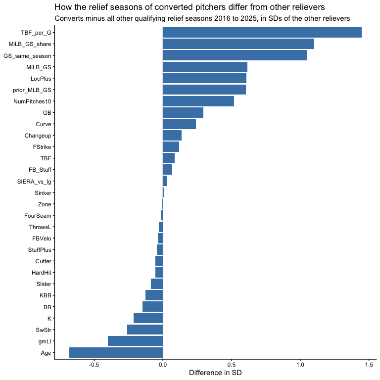

Step 5: Who Gets Converted
================

``` r
library(dplyr)
library(readr)
library(ggplot2)
library(glmnet)
```

## Traits of converts

The relief season of each conversion compared to every other qualifying
relief season from 2016 to 2025.

``` r
role_seasons <- read_csv("data/fg_role_seasons.csv", guess_max = 20000, show_col_types = FALSE) |>
  mutate(IP = floor(IP) + (IP %% 1) * 10 / 3)
conversions <- read_csv("data/conversions.csv", show_col_types = FALSE)

for (column in c("pfxFA%", "pfxSI%", "pfxFC%", "pfxSL%", "pfxCU%", "pfxKC%", "pfxCV%", "pfxCH%", "pfxFS%",
                 "pfxFO%", "pfxSC%", "pfxST%")) {
  role_seasons[[column]][is.na(role_seasons[[column]])] <- 0
}
role_seasons <- role_seasons |>
  mutate(FourSeam = `pfxFA%`, Sinker = `pfxSI%`, Cutter = `pfxFC%`, Slider = `pfxSL%` + `pfxST%`,
         Curve = `pfxCU%` + `pfxKC%` + `pfxCV%`, Changeup = `pfxCH%` + `pfxFS%` + `pfxFO%` + `pfxSC%`,
         NumPitches10 = (FourSeam >= 0.1) + (Sinker >= 0.1) + (Cutter >= 0.1) + (Slider >= 0.1) +
           (Curve >= 0.1) + (Changeup >= 0.1),
         FBVelo = ifelse(Sinker > FourSeam, pfxvSI, pfxvFA),
         FB_Stuff = ifelse(Sinker > FourSeam, sp_s_SI, sp_s_FF))

league_rp <- role_seasons |>
  filter(role == "rel") |>
  group_by(Season) |>
  summarize(lg_rp_siera = weighted.mean(SIERA, TBF, na.rm = TRUE))
season_totals <- role_seasons |>
  group_by(playerid, Season) |>
  summarize(G_total = sum(G), GS_total = sum(GS), .groups = "drop")

population <- role_seasons |>
  filter(role == "rel", Season >= 2016, Season <= 2025, TBF >= 100) |>
  left_join(season_totals, by = c("playerid", "Season")) |>
  filter(GS_total / G_total <= 0.2) |>
  left_join(league_rp, by = "Season") |>
  transmute(playerid, PlayerName, Season, Team = TeamNameAbb, Age, ThrowsL = as.numeric(Throws == "L"), G, IP, TBF,
            TBF_per_G = TBF / G, GS_same_season = GS_total,
            SIERA_vs_lg = SIERA - lg_rp_siera, KBB = `K-BB%` * 100, K = `K%` * 100, BB = `BB%` * 100,
            SwStr = `SwStr%` * 100, Zone = `Zone%` * 100, FStrike = `F-Strike%` * 100, GB = `GB%` * 100,
            HardHit = `HardHit%` * 100, gmLI, FBVelo, NumPitches10, FourSeam = FourSeam * 100,
              Sinker = Sinker * 100,
            Cutter = Cutter * 100, Slider = Slider * 100, Curve = Curve * 100, Changeup = Changeup * 100,
            StuffPlus = sp_stuff, FB_Stuff, LocPlus = sp_location)
```

``` r
# Label: this relief season is the one right before a conversion
convert_keys <- conversions |> select(playerid, Season = rp_season) |> mutate(converted = 1)
population <- population |>
  left_join(convert_keys, by = c("playerid", "Season")) |>
  mutate(converted = coalesce(converted, 0))
# Other relief seasons of pitchers who did convert are dropped, since teams did not choose them then
other_convert_seasons <- population$converted == 0 & population$playerid %in% conversions$playerid
population <- population[!other_convert_seasons, ]
```

``` r
# Starting history before the season
prior_mlb <- population |>
  select(playerid, Season) |>
  inner_join(season_totals |> select(playerid, mSeason = Season, GS_total), by = "playerid",
      relationship = "many-to-many") |>
  filter(mSeason < Season) |>
  group_by(playerid, Season) |>
  summarize(prior_MLB_GS = sum(GS_total), .groups = "drop")
minors <- read_csv("data/fg_minors.csv", show_col_types = FALSE) |>
  mutate(playerid = suppressWarnings(as.numeric(playerid))) |>
  filter(!is.na(playerid)) |>
  group_by(playerid, mSeason = Season) |>
  summarize(GS = sum(GS), G = sum(G), .groups = "drop")
prior_milb <- population |>
  select(playerid, Season) |>
  inner_join(minors, by = "playerid", relationship = "many-to-many") |>
  filter(mSeason <= Season) |>
  group_by(playerid, Season) |>
  summarize(MiLB_GS = sum(GS), MiLB_G = sum(G), .groups = "drop")
population <- population |>
  left_join(prior_mlb, by = c("playerid", "Season")) |>
  left_join(prior_milb, by = c("playerid", "Season")) |>
  mutate(prior_MLB_GS = coalesce(prior_MLB_GS, 0), MiLB_GS = coalesce(MiLB_GS, 0), MiLB_G = coalesce(MiLB_G, 0),
         MiLB_GS_share = ifelse(MiLB_G > 0, MiLB_GS / MiLB_G * 100, NA),
         log_prior_MLB_GS = log1p(prior_MLB_GS), log_MiLB_GS = log1p(MiLB_GS))

features <- c("Age", "ThrowsL", "TBF", "TBF_per_G", "GS_same_season", "gmLI", "SIERA_vs_lg", "KBB", "K", "BB",
    "SwStr",
              "Zone", "FStrike", "GB", "HardHit", "FBVelo", "NumPitches10", "FourSeam", "Sinker", "Cutter",
                "Slider",
              "Curve", "Changeup", "StuffPlus", "FB_Stuff", "LocPlus", "prior_MLB_GS", "MiLB_GS", "MiLB_GS_share")
```

``` r
# AUC from ranks: chance a random convert has a higher value than a random non-convert
auc_rank <- function(x, y) {
  keep <- !is.na(x)
  x <- x[keep]
  y <- y[keep]
  ranks <- rank(x)
  n1 <- sum(y == 1)
  n0 <- sum(y == 0)
  (sum(ranks[y == 1]) - n1 * (n1 + 1) / 2) / (n1 * n0)
}

cat("Qualifying relief seasons 2016 to 2025 (100+ TBF, starts in 20% or less of games):", nrow(population), "\n")
```

    ## Qualifying relief seasons 2016 to 2025 (100+ TBF, starts in 20% or less of games): 2475

``` r
cat("Converted the next season:", sum(population$converted), " (", round(mean(population$converted) * 100, 1),
    "%), pitchers dropped as other seasons of converts excluded:", sum(other_convert_seasons), "\n\n")
```

    ## Converted the next season: 68  ( 2.7 %), pitchers dropped as other seasons of converts excluded: 61

``` r
cat("1. Converts vs every other reliever season, one trait at a time\n")
```

    ## 1. Converts vs every other reliever season, one trait at a time

``` r
cat("diff_in_SD = (convert mean - other mean) / SD of others. AUC is the chance a random convert is higher than a random non-convert (0.5 = no difference)\n")
```

    ## diff_in_SD = (convert mean - other mean) / SD of others. AUC is the chance a random convert is higher than a random non-convert (0.5 = no difference)

``` r
univariate <- NULL
for (f in features) {
  x <- population[[f]]
  convert_x <- x[population$converted == 1]
  other_x <- x[population$converted == 0]
  univariate <- bind_rows(univariate, data.frame(
    trait = f, n_converts = sum(!is.na(convert_x)), convert_mean = mean(convert_x, na.rm = TRUE),
    other_mean = mean(other_x, na.rm = TRUE),
    diff_in_SD = (mean(convert_x, na.rm = TRUE) - mean(other_x, na.rm = TRUE)) / sd(other_x, na.rm = TRUE),
    convert_percentile_of_others = mean(other_x <= median(convert_x, na.rm = TRUE), na.rm = TRUE) * 100,
    AUC = auc_rank(x, population$converted),
    p_value = ifelse(sum(!is.na(convert_x)) > 5, wilcox.test(convert_x, other_x)$p.value, NA)))
}
univariate <- univariate |> arrange(desc(abs(AUC - 0.5)))
write_csv(univariate, "results/05_convert_vs_population.csv")
print(univariate, digits = 3)
```

    ##             trait n_converts convert_mean other_mean diff_in_SD
    ## 1       TBF_per_G         68       6.5128      4.619    1.44753
    ## 2   MiLB_GS_share         67      77.5327     39.263    1.10129
    ## 3  GS_same_season         68       1.6618      0.417    1.05242
    ## 4             Age         68      26.7353     29.079   -0.68167
    ## 5    prior_MLB_GS         68      18.5000      6.883    0.60342
    ## 6         MiLB_GS         68      74.9559     47.890    0.61636
    ## 7         LocPlus         38     102.2385     98.385    0.60682
    ## 8    NumPitches10         68       3.2500      2.838    0.51886
    ## 9           Curve         68      10.5144      7.561    0.24195
    ## 10       Changeup         68      11.7983     10.116    0.13614
    ## 11           gmLI         68       0.9808      1.126   -0.39973
    ## 12             GB         68      46.0679     43.341    0.29405
    ## 13          SwStr         68      11.1190     11.826   -0.26172
    ## 14              K         68      22.8340     24.118   -0.21375
    ## 15            KBB         68      13.9547     14.784   -0.12617
    ## 16             BB         68       8.8793      9.334   -0.15021
    ## 17        FStrike         68      60.8187     60.222    0.11883
    ## 18         Sinker         68      17.8346     17.729    0.00489
    ## 19         Cutter         68       5.8132      6.589   -0.05366
    ## 20         Slider         68      24.6795     26.699   -0.08907
    ## 21       FB_Stuff         38     100.3078     99.486    0.06618
    ## 22      StuffPlus         38     103.3494    103.745   -0.04271
    ## 23    SIERA_vs_lg         68      -0.0793     -0.102    0.02996
    ## 24        HardHit         68      35.9656     36.285   -0.05374
    ## 25            TBF         68     212.6618    207.228    0.08487
    ## 26           Zone         68      42.7156     42.729   -0.00344
    ## 27         FBVelo         68      93.8736     93.972   -0.03700
    ## 28        ThrowsL         68       0.2500      0.263   -0.02948
    ## 29       FourSeam         68      34.4075     34.767   -0.01613
    ##    convert_percentile_of_others   AUC  p_value
    ## 1                          90.2 0.816 0.00e+00
    ## 2                          85.4 0.806 0.00e+00
    ## 3                          90.9 0.717 0.00e+00
    ## 4                          24.6 0.293 5.00e-09
    ## 5                          82.7 0.699 9.56e-11
    ## 6                          66.8 0.687 1.30e-07
    ## 7                          71.7 0.664 5.52e-04
    ## 8                          81.4 0.642 1.54e-05
    ## 9                          67.1 0.629 9.02e-05
    ## 10                         64.3 0.599 4.90e-03
    ## 11                         37.8 0.401 5.34e-03
    ## 12                         58.6 0.586 1.49e-02
    ## 13                         40.2 0.422 2.81e-02
    ## 14                         42.0 0.437 7.76e-02
    ## 15                         40.8 0.454 1.94e-01
    ## 16                         41.2 0.458 2.32e-01
    ## 17                         57.8 0.536 3.10e-01
    ## 18                         55.3 0.533 3.49e-01
    ## 19                         68.6 0.528 3.42e-01
    ## 20                         51.0 0.474 4.65e-01
    ## 21                         56.1 0.523 6.24e-01
    ## 22                         47.0 0.480 6.74e-01
    ## 23                         55.7 0.520 5.76e-01
    ## 24                         48.4 0.484 6.47e-01
    ## 25                         45.9 0.513 7.13e-01
    ## 26                         52.0 0.507 8.47e-01
    ## 27                         53.8 0.493 8.55e-01
    ## 28                         73.7 0.494 8.11e-01
    ## 29                         45.0 0.494 8.60e-01

``` r
# Multivariate: which traits matter once the others are held fixed
cat("\n2. Logistic regression of being converted (traits in SD units, odds ratio per SD)\n")
```

    ## 
    ## 2. Logistic regression of being converted (traits in SD units, odds ratio per SD)

``` r
model_data <- population |>
  filter(!is.na(FBVelo), !is.na(HardHit), !is.na(GB)) |>
  mutate(across(c(Age, TBF_per_G, gmLI, SIERA_vs_lg, KBB, SwStr, FBVelo, GB, NumPitches10, log_prior_MLB_GS,
      log_MiLB_GS,
                  Changeup, Sinker, FourSeam), ~ as.numeric(scale(.x))))
fit_all <- glm(converted ~ SIERA_vs_lg + Age + ThrowsL + gmLI + TBF_per_G + FBVelo + GB + NumPitches10 + Changeup +
                 log_prior_MLB_GS + log_MiLB_GS, data = model_data, family = binomial)
coefs <- summary(fit_all)$coefficients
print(data.frame(trait = rownames(coefs), odds_ratio_per_SD = round(exp(coefs[, 1]), 2), p = round(coefs[, 4], 3)),
    row.names = FALSE)
```

    ##             trait odds_ratio_per_SD     p
    ##       (Intercept)              0.01 0.000
    ##       SIERA_vs_lg              0.76 0.078
    ##               Age              0.34 0.000
    ##           ThrowsL              0.57 0.084
    ##              gmLI              0.94 0.714
    ##         TBF_per_G              1.45 0.000
    ##            FBVelo              0.83 0.298
    ##                GB              1.37 0.032
    ##      NumPitches10              1.28 0.075
    ##          Changeup              0.93 0.664
    ##  log_prior_MLB_GS              1.88 0.000
    ##       log_MiLB_GS              1.71 0.037

``` r
cat("n =", nrow(model_data), " converts =", sum(model_data$converted), "\n")
```

    ## n = 2469  converts = 68

``` r
# Cross validated AUC by type of trait
cat("\n3. How well each group of traits picks out the converts (5 fold cross validated AUC)\n")
```

    ## 
    ## 3. How well each group of traits picks out the converts (5 fold cross validated AUC)

``` r
set.seed(0)
fold <- rep(NA, nrow(model_data))
for (outcome in c(0, 1)) {
  rows <- which(model_data$converted == outcome)
  fold[rows] <- sample(rep(1:5, length.out = length(rows)))
}
formulas <- c(
  "skills only (SIERA, K-BB%, SwStr%, velo, GB%)" = "converted ~ SIERA_vs_lg + KBB + SwStr + FBVelo + GB",
  "arsenal (pitches, changeup, sinker, four-seam usage)" = "converted ~ NumPitches10 + Changeup + Sinker + FourSeam",
  "role and context (leverage, batters per game, age, handedness)" = "converted ~ gmLI + TBF_per_G + Age + ThrowsL",
  "starting history (MLB and minor league starts)" = "converted ~ log_prior_MLB_GS + log_MiLB_GS",
  "skills + arsenal" = "converted ~ SIERA_vs_lg + KBB + SwStr + FBVelo + GB + NumPitches10 + Changeup + Sinker + FourSeam",
  "skills + role + history" = "converted ~ SIERA_vs_lg + KBB + SwStr + FBVelo + GB + gmLI + TBF_per_G + Age + ThrowsL + log_prior_MLB_GS + log_MiLB_GS",
  "everything" = "converted ~ SIERA_vs_lg + KBB + SwStr + FBVelo + GB + NumPitches10 + Changeup + Sinker + FourSeam + gmLI + TBF_per_G + Age + ThrowsL + log_prior_MLB_GS + log_MiLB_GS")
cv_table <- NULL
for (name in names(formulas)) {
  predictions <- rep(NA, nrow(model_data))
  for (k in 1:5) {
    fit <- glm(as.formula(formulas[[name]]), data = model_data[fold != k, ], family = binomial)
    predictions[fold == k] <- predict(fit, newdata = model_data[fold == k, ])
  }
  cv_table <- bind_rows(cv_table, data.frame(traits = name, cv_AUC = round(auc_rank(predictions,
      model_data$converted), 3)))
}
print(cv_table, row.names = FALSE)
```

    ##                                                          traits cv_AUC
    ##                   skills only (SIERA, K-BB%, SwStr%, velo, GB%)  0.562
    ##            arsenal (pitches, changeup, sinker, four-seam usage)  0.639
    ##  role and context (leverage, batters per game, age, handedness)  0.794
    ##                  starting history (MLB and minor league starts)  0.755
    ##                                                skills + arsenal  0.644
    ##                                         skills + role + history  0.867
    ##                                                      everything  0.864

``` r
# The 2020 and later seasons add Stuff+
cat("\n4. 2020 and later, with Stuff+ (relief seasons 2020 to 2025)\n")
```

    ## 
    ## 4. 2020 and later, with Stuff+ (relief seasons 2020 to 2025)

``` r
stuff_data <- population |>
  filter(Season >= 2020, !is.na(StuffPlus), !is.na(FB_Stuff), !is.na(FBVelo)) |>
  mutate(across(c(Age, gmLI, TBF_per_G, SIERA_vs_lg, StuffPlus, FB_Stuff, FBVelo, LocPlus, log_MiLB_GS,
      log_prior_MLB_GS),
                ~ as.numeric(scale(.x))))
fit_stuff <- glm(converted ~ SIERA_vs_lg + StuffPlus + FB_Stuff + LocPlus + FBVelo + Age + gmLI + TBF_per_G +
                   log_prior_MLB_GS + log_MiLB_GS, data = stuff_data, family = binomial)
coefs_stuff <- summary(fit_stuff)$coefficients
print(data.frame(trait = rownames(coefs_stuff), odds_ratio_per_SD = round(exp(coefs_stuff[, 1]), 2),
    p = round(coefs_stuff[, 4], 3)), row.names = FALSE)
```

    ##             trait odds_ratio_per_SD     p
    ##       (Intercept)              0.01 0.000
    ##       SIERA_vs_lg              0.84 0.477
    ##         StuffPlus              1.09 0.808
    ##          FB_Stuff              1.24 0.431
    ##           LocPlus              1.81 0.005
    ##            FBVelo              0.96 0.876
    ##               Age              0.25 0.000
    ##              gmLI              0.90 0.659
    ##         TBF_per_G              1.40 0.007
    ##  log_prior_MLB_GS              1.70 0.006
    ##       log_MiLB_GS              1.88 0.061

``` r
cat("n =", nrow(stuff_data), " converts =", sum(stuff_data$converted), "\n")
```

    ## n = 1416  converts = 38

``` r
# Teams and years
cat("\n5. By team (relief season team), conversions per 100 qualifying relief seasons, teams with 8+ converts or 40+ seasons\n")
```

    ## 
    ## 5. By team (relief season team), conversions per 100 qualifying relief seasons, teams with 8+ converts or 40+ seasons

``` r
population |>
  group_by(Team) |>
  summarize(seasons = n(), converts = sum(converted), per_100 = round(sum(converted) / n() * 100, 1)) |>
  filter(Team != "2 Tms", Team != "3 Tms") |>
  arrange(desc(per_100)) |>
  head(10) |>
  as.data.frame() |> print()
```

    ##    Team seasons converts per_100
    ## 1   STL      69        7    10.1
    ## 2   NYY      60        5     8.3
    ## 3   CHC      60        4     6.7
    ## 4   TBR      71        4     5.6
    ## 5   KCR      76        4     5.3
    ## 6   COL      82        4     4.9
    ## 7   SDP      66        3     4.5
    ## 8   LAD      71        3     4.2
    ## 9   PHI      72        3     4.2
    ## 10  OAK      60        2     3.3

``` r
cat("\nBy relief season year\n")
```

    ## 
    ## By relief season year

``` r
population |>
  group_by(Season) |>
  summarize(seasons = n(), converts = sum(converted), per_100 = round(sum(converted) / n() * 100, 1)) |>
  as.data.frame() |> print()
```

    ##    Season seasons converts per_100
    ## 1    2016     252        9     3.6
    ## 2    2017     257        6     2.3
    ## 3    2018     269        6     2.2
    ## 4    2019     273        9     3.3
    ## 5    2020      62        1     1.6
    ## 6    2021     288        9     3.1
    ## 7    2022     275        9     3.3
    ## 8    2023     268        7     2.6
    ## 9    2024     259        6     2.3
    ## 10   2025     272        6     2.2

``` r
cat("\nShares\n")
```

    ## 
    ## Shares

``` r
cat("Lefty: converts", round(mean(population$ThrowsL[population$converted == 1]) * 100), "% vs others",
    round(mean(population$ThrowsL[population$converted == 0]) * 100), "%\n")
```

    ## Lefty: converts 25 % vs others 26 %

``` r
cat("Prior MLB start (any): converts", round(mean(population$prior_MLB_GS[population$converted == 1] > 0) * 100),
    "% vs others",
    round(mean(population$prior_MLB_GS[population$converted == 0] > 0) * 100), "%\n")
```

    ## Prior MLB start (any): converts 69 % vs others 36 %

``` r
cat("20+ minor league starts: converts", round(mean(population$MiLB_GS[population$converted == 1] >= 20) * 100),
    "% vs others",
    round(mean(population$MiLB_GS[population$converted == 0] >= 20) * 100), "%\n")
```

    ## 20+ minor league starts: converts 97 % vs others 61 %

``` r
cat("Made a start in the relief season: converts",
    round(mean(population$GS_same_season[population$converted == 1] > 0) * 100), "% vs others",
    round(mean(population$GS_same_season[population$converted == 0] > 0) * 100), "%\n")
```

    ## Made a start in the relief season: converts 60 % vs others 18 %

``` r
# how the converts differ from other relievers, in SD units
plot_data <- univariate |>
  filter(n_converts >= 30) |>
  mutate(trait = factor(trait, levels = trait[order(diff_in_SD)]))
ggplot(plot_data, aes(diff_in_SD, trait)) +
  geom_vline(xintercept = 0, color = "gray") +
  geom_col(fill = "steelblue") +
  labs(title = "How the relief seasons of converted pitchers differ from other relievers",
       subtitle = "Converts minus all other qualifying relief seasons 2016 to 2025, in SDs of the other relievers",
       x = "Difference in SD", y = NULL) +
  theme_classic()
```

<!-- -->

``` r
ggsave("charts/05_convert_profile.png", width = 8, height = 8, dpi = 150)
```

## Predicting conversions

Four models tested by rolling origin, then the 2026 relievers scored
with ridge.

``` r
role_seasons <- read_csv("data/fg_role_seasons.csv", guess_max = 20000, show_col_types = FALSE)
conversions <- read_csv("data/conversions.csv", show_col_types = FALSE)

# Usage columns are NA when a pitch is not thrown
for (column in c("pfxFA%", "pfxSI%", "pfxFC%", "pfxSL%", "pfxCU%", "pfxKC%", "pfxCV%", "pfxCH%", "pfxFS%",
                 "pfxFO%", "pfxSC%", "pfxST%")) {
  role_seasons[[column]][is.na(role_seasons[[column]])] <- 0
}
role_seasons <- role_seasons |>
  mutate(FourSeam = `pfxFA%`, Sinker = `pfxSI%`, Cutter = `pfxFC%`, Slider = `pfxSL%` + `pfxST%`,
         Curve = `pfxCU%` + `pfxKC%` + `pfxCV%`, Changeup = `pfxCH%` + `pfxFS%` + `pfxFO%` + `pfxSC%`,
         NumPitches10 = (FourSeam >= 0.1) + (Sinker >= 0.1) + (Cutter >= 0.1) + (Slider >= 0.1) +
           (Curve >= 0.1) + (Changeup >= 0.1),
         FBVelo = ifelse(Sinker > FourSeam, pfxvSI, pfxvFA))

league_rp <- role_seasons |>
  filter(role == "rel") |>
  group_by(Season) |>
  summarize(lg_rp_siera = weighted.mean(SIERA, TBF, na.rm = TRUE))
season_totals <- role_seasons |>
  group_by(playerid, Season) |>
  summarize(G_total = sum(G), GS_total = sum(GS), .groups = "drop")
```

``` r
# Every qualifying relief season from 2016 on
relievers <- role_seasons |>
  filter(role == "rel", Season >= 2016, TBF >= 100) |>
  left_join(season_totals, by = c("playerid", "Season")) |>
  filter(GS_total / G_total <= 0.2) |>
  left_join(league_rp, by = "Season") |>
  transmute(playerid, PlayerName, Team = TeamNameAbb, Season, Age, ThrowsL = as.numeric(Throws == "L"),
            TBF_per_G = TBF / G, SIERA_vs_lg = SIERA - lg_rp_siera, KBB = `K-BB%` * 100,
            SwStr = `SwStr%` * 100, GB = `GB%` * 100, gmLI, FBVelo, NumPitches10,
            FourSeam = FourSeam * 100, Sinker = Sinker * 100, Changeup = Changeup * 100)
```

``` r
# Starts before the season (MLB starts only count from 2014, minor league starts from 2006)
prior_mlb <- relievers |>
  select(playerid, Season) |>
  inner_join(season_totals |> rename(StartSeason = Season), by = "playerid",
             relationship = "many-to-many") |>
  filter(StartSeason < Season) |>
  group_by(playerid, Season) |>
  summarize(prior_MLB_GS = sum(GS_total), .groups = "drop")
minors <- read_csv("data/fg_minors.csv", show_col_types = FALSE) |>
  mutate(playerid = suppressWarnings(as.numeric(playerid))) |>  # IDs with letters never reached MLB
  filter(!is.na(playerid))
prior_minors <- relievers |>
  select(playerid, Season) |>
  inner_join(minors |> select(playerid, StartSeason = Season, GS), by = "playerid",
             relationship = "many-to-many") |>
  filter(StartSeason <= Season) |>
  group_by(playerid, Season) |>
  summarize(MiLB_GS = sum(GS), .groups = "drop")

relievers <- relievers |>
  left_join(prior_mlb, by = c("playerid", "Season")) |>
  left_join(prior_minors, by = c("playerid", "Season")) |>
  left_join(conversions |> select(playerid, Season = rp_season, sp_season), by = c("playerid", "Season")) |>
  mutate(prior_MLB_GS = coalesce(prior_MLB_GS, 0), MiLB_GS = coalesce(MiLB_GS, 0),
         log_prior_MLB_GS = log1p(prior_MLB_GS), log_MiLB_GS = log1p(MiLB_GS),
         Converted = as.numeric(!is.na(sp_season))) |>
  filter(!is.na(FBVelo))
labeled <- relievers |> filter(Season <= 2025)
current <- relievers |> filter(Season == 2026)

all_traits <- c("SIERA_vs_lg", "KBB", "SwStr", "FBVelo", "GB", "NumPitches10", "Changeup", "Sinker", "FourSeam",
                "gmLI", "TBF_per_G", "Age", "ThrowsL", "log_prior_MLB_GS", "log_MiLB_GS")
formula_logistic <- as.formula(paste("Known ~", paste(all_traits, collapse = " + ")))
formula_four <- Known ~ Age + TBF_per_G + log_prior_MLB_GS + log_MiLB_GS
```

``` r
# Each test year only sees earlier relief seasons and conversions that had happened by then
set.seed(0)
test_rows <- NULL
for (year in 2021:2025) {
  train <- labeled |>
    filter(Season < year) |>
    mutate(Known = as.numeric(Converted == 1 & sp_season <= year))
  test <- labeled |> filter(Season == year)

  # Keep all of a pitcher's seasons in the same fold when choosing the penalty
  pitcher_ids <- unique(train$playerid)
  pitcher_folds <- sample(rep(1:5, length.out = length(pitcher_ids)))
  folds <- pitcher_folds[match(train$playerid, pitcher_ids)]
  x_train <- as.matrix(train[, all_traits])
  x_test <- as.matrix(test[, all_traits])

  logistic_model <- glm(formula_logistic, data = train, family = binomial)
  four_model <- glm(formula_four, data = train, family = binomial)
  ridge_model <- cv.glmnet(x_train, train$Known, family = "binomial", alpha = 0, foldid = folds)
  lasso_model <- cv.glmnet(x_train, train$Known, family = "binomial", alpha = 1, foldid = folds)

  test$logistic <- predict(logistic_model, newdata = test, type = "response")
  test$four_traits <- predict(four_model, newdata = test, type = "response")
  test$ridge <- as.numeric(predict(ridge_model, newx = x_test, s = "lambda.min", type = "response"))
  test$lasso <- as.numeric(predict(lasso_model, newx = x_test, s = "lambda.min", type = "response"))
  test$base_rate <- mean(train$Known)

  # Unfitted score with equal weight on each standardized trait
  test$simple_score <- as.numeric(scale(test$TBF_per_G)) + as.numeric(scale(test$log_prior_MLB_GS)) +
    as.numeric(scale(test$log_MiLB_GS)) - as.numeric(scale(test$Age))
  test_rows <- bind_rows(test_rows, test)
}
```

``` r
# Chance that a random convert scored higher than a random non-convert
auc_rank <- function(score, outcome) {
  n1 <- sum(outcome == 1)
  n0 <- sum(outcome == 0)
  (sum(rank(score)[outcome == 1]) - n1 * (n1 + 1) / 2) / (n1 * n0)
}

cat("Test seasons 2021 to 2025:", nrow(test_rows), " converts:", sum(test_rows$Converted), "\n\n")
```

    ## Test seasons 2021 to 2025: 1398  converts: 37

``` r
# Calibration slope is the coefficient on the predicted log odds (1 is perfect, below 1 is overconfident)
calibration <- NULL
for (model in c("base_rate", "logistic", "ridge", "lasso", "four_traits")) {
  test_rows$prob <- pmin(pmax(test_rows[[model]], 1e-6), 1 - 1e-6)
  test_rows$log_odds <- log(test_rows$prob / (1 - test_rows$prob))
  slope <- NA
  if (model != "base_rate") {
    slope <- coef(glm(Converted ~ log_odds, data = test_rows, family = binomial))[2]
  }
  calibration <- bind_rows(calibration, data.frame(
    model = model, expected = round(sum(test_rows$prob), 1), actual = sum(test_rows$Converted),
    slope = round(slope, 2),
    log_loss = round(-mean(ifelse(test_rows$Converted == 1, log(test_rows$prob), log(1 - test_rows$prob))), 4),
    brier = round(mean((test_rows$prob - test_rows$Converted)^2), 5)))
}
cat("Calibration\n")
```

    ## Calibration

``` r
print(calibration, row.names = FALSE)
```

    ##        model expected actual slope log_loss   brier
    ##    base_rate     37.9     37    NA   0.1223 0.02577
    ##     logistic     32.8     37  0.79   0.1042 0.02487
    ##        ridge     38.8     37  0.97   0.1033 0.02471
    ##        lasso     40.6     37  0.95   0.1029 0.02481
    ##  four_traits     39.0     37  0.83   0.1029 0.02525

``` r
# AUC averaged over the test years, and converts found in each year's top 20
scores <- c("logistic", "ridge", "lasso", "four_traits", "simple_score", "TBF_per_G")
ranking <- NULL
for (score in scores) {
  auc_by_year <- rep(NA, 5)
  top_20 <- 0
  for (i in 1:5) {
    one_year <- test_rows |> filter(Season == 2020 + i)
    auc_by_year[i] <- auc_rank(one_year[[score]], one_year$Converted)
    top_20 <- top_20 + sum(one_year$Converted[rank(-one_year[[score]]) <= 20])
  }
  ranking <- bind_rows(ranking, data.frame(score = score, mean_AUC = round(mean(auc_by_year), 3),
                                           worst_year_AUC = round(min(auc_by_year), 3), top_20 = top_20))
}
```

``` r
# Resample pitchers instead of rows since pitchers repeat across seasons
set.seed(0)
pitcher_ids <- unique(test_rows$playerid)
rows_by_pitcher <- split(1:nrow(test_rows), test_rows$playerid)
boot_auc <- matrix(NA, 1000, length(scores), dimnames = list(NULL, scores))
for (b in 1:1000) {
  sampled <- sample(as.character(pitcher_ids), replace = TRUE)
  boot_rows <- test_rows[unlist(rows_by_pitcher[sampled]), ]
  for (score in scores) {
    auc_by_year <- rep(NA, 5)
    for (i in 1:5) {
      in_year <- boot_rows$Season == 2020 + i
      auc_by_year[i] <- auc_rank(boot_rows[[score]][in_year], boot_rows$Converted[in_year])
    }
    boot_auc[b, score] <- mean(auc_by_year, na.rm = TRUE)
  }
}
ranking$lower <- round(apply(boot_auc, 2, quantile, 0.025), 3)
ranking$upper <- round(apply(boot_auc, 2, quantile, 0.975), 3)
cat("\nRanking, with 95% pitcher bootstrap intervals on AUC\n")
```

    ## 
    ## Ranking, with 95% pitcher bootstrap intervals on AUC

``` r
print(ranking, row.names = FALSE)
```

    ##         score mean_AUC worst_year_AUC top_20 lower upper
    ##      logistic    0.841          0.654     16 0.789 0.887
    ##         ridge    0.845          0.687     15 0.795 0.890
    ##         lasso    0.848          0.717     15 0.801 0.890
    ##   four_traits    0.845          0.715     14 0.793 0.889
    ##  simple_score    0.855          0.765     14 0.804 0.899
    ##     TBF_per_G    0.778          0.725     13 0.697 0.854

``` r
cat("Random picks would find about", round(20 * 5 * mean(test_rows$Converted), 1), "converts in the top 20s\n")
```

    ## Random picks would find about 2.6 converts in the top 20s

``` r
cat("Ridge minus the simple score in AUC:", round(ranking$mean_AUC[2] - ranking$mean_AUC[5], 3),
    " 95% interval", round(quantile(boot_auc[, "ridge"] - boot_auc[, "simple_score"], c(0.025, 0.975)), 3), "\n")
```

    ## Ridge minus the simple score in AUC: -0.01  95% interval -0.032 0.013

``` r
# Final ridge model on every relief season through 2025
set.seed(0)
pitcher_ids <- unique(labeled$playerid)
pitcher_folds <- sample(rep(1:5, length.out = length(pitcher_ids)))
folds <- pitcher_folds[match(labeled$playerid, pitcher_ids)]
ridge_model <- cv.glmnet(as.matrix(labeled[, all_traits]), labeled$Converted, family = "binomial", alpha = 0,
                         foldid = folds)
current$Prob <- as.numeric(predict(ridge_model, newx = as.matrix(current[, all_traits]), s = "lambda.min",
                                   type = "response"))
likelihood <- current |>
  arrange(desc(Prob)) |>
  transmute(PlayerName, Team, Age, TBF_per_G = round(TBF_per_G, 1), SIERA_vs_lg = round(SIERA_vs_lg, 2),
            prior_MLB_GS, MiLB_GS, ProbPct = round(Prob * 100, 1))
write_csv(likelihood, "results/05_conversion_likelihood_2026.csv")
cat("\n2026 relievers scored:", nrow(current), " expected conversions:", round(sum(current$Prob), 1), "\n")
```

    ## 
    ## 2026 relievers scored: 274  expected conversions: 7.5

``` r
print(as.data.frame(head(likelihood, 20)), row.names = FALSE)
```

    ##         PlayerName  Team Age TBF_per_G SIERA_vs_lg prior_MLB_GS MiLB_GS ProbPct
    ##    Jesse Scholtens   TBR  32      16.2        0.34           11     140    36.1
    ##       José Urquidy 3 Tms  31      11.9       -0.52           70      94    35.9
    ##       Bryse Wilson 3 Tms  28       9.4       -0.68           57     111    25.7
    ##          Brad Lord   WSN  26       8.7       -0.37           19      42    23.7
    ##    Trevor Williams 2 Tms  34       8.4       -0.81          178      95    18.7
    ##  Jordan Montgomery   TEX  33       8.0       -0.52          161      70    17.9
    ##          Ty Madden   DET  26       9.2       -0.55            1      84    17.5
    ##    Mitchell Parker   WSN  26       8.1        0.12           59      75    14.3
    ##       Tobias Myers   NYM  27       7.1        0.09           31     140    12.9
    ##       Wilber Dotel   PIT  23       8.1       -0.27            0      86    12.0
    ##       Beau Brieske   DET  28       5.7       -0.54           29      33    12.0
    ##       Mitch Farris   LAA  25       7.8       -0.09            5      46    11.8
    ##      Jake Woodford 3 Tms  29       7.1       -0.12           25     163    10.6
    ##         Dax Fulton   MIA  24       7.6       -0.20            0      81     9.9
    ##        Luis Medina   ATH  27       5.3       -0.45           25      93     9.9
    ##     Didier Fuentes   ATL  21       4.9       -1.21            4      51     9.5
    ##       Chad Patrick   MIL  27       6.3        0.05           23      68     9.4
    ##     Paul Blackburn   NYY  32       5.4       -0.09           86     158     8.8
    ##       Grant Taylor   CHW  24       5.7       -1.13            2      11     8.4
    ##       Blas Castaño   COL  27       7.4        0.12            0     107     7.4
