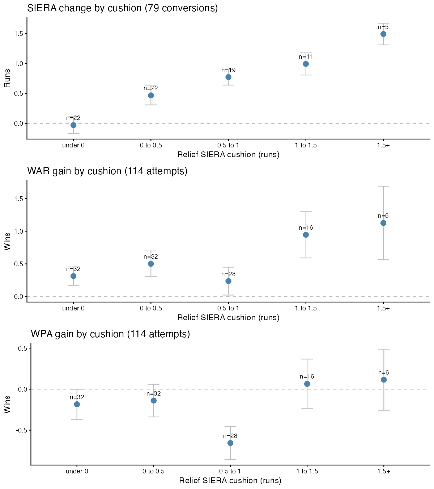
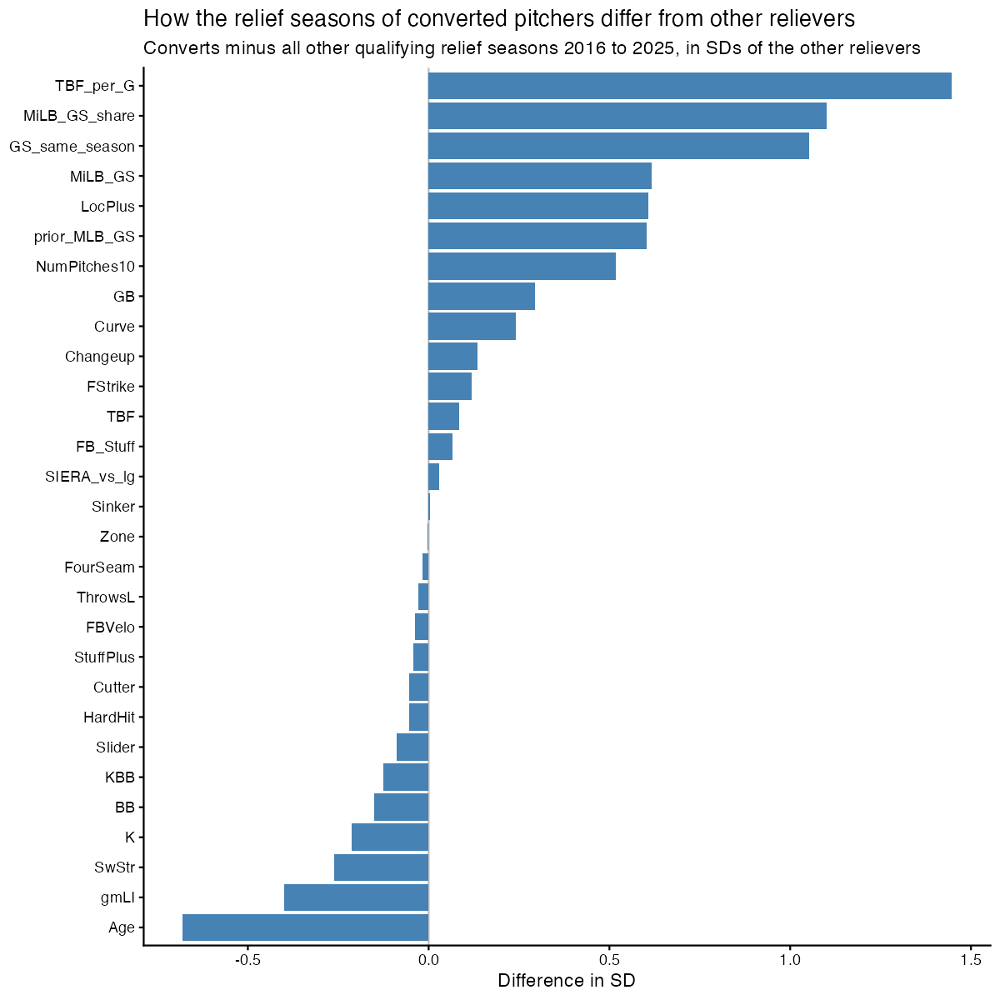

# Reliever to Starter Conversions

Across 79 MLB reliever to starter conversions from 2015 to 2026, SIERA rose by 0.54 on average and 78% of pitchers got worse. Counting 35 shorter attempts as well, converting gained about 0.48 WAR over staying in the bullpen, but lost 0.24 WPA and 0.20 wins above average. This is a Bruin Sports Analytics (BSA) project.

---

## Overview

1. Build a sample of conversions
2. Measure how they went compared to staying in the bullpen
3. Look at what changed after the move
4. Test which relief season traits predict a good starter
5. Predict which 2026 relievers look most like past conversions

Each step is one R Markdown notebook.

## 1. Building the Sample (`01_data.Rmd`)

A conversion is a season with 5+ starts, at least half of games as starts, and 3.5+ innings per start, within three years of a season with 100+ batters faced in relief and starts in 20% or less of games. Shorter attempts had 1 to 4 starts of the same length the year after. SIERA is compared to the league average for that role and season.

## 2. How Conversions Went (`02_value.Rmd`)

Each attempt is compared to the expected next season of a similar reliever who stayed in the bullpen. WAR went up because starters throw more innings. Measures compared to an average pitcher (WPA and WAA) went down.

| Measure | Average gain (114 attempts) | Standard error |
|---|---|---|
| WAR | +0.48 | 0.10 |
| WPA | -0.24 | 0.10 |
| WAA (role adjusted) | -0.20 | 0.07 |

A flexible baseline and matched controls gave similar WAR gains (0.45 and 0.52).

## 3. What Changed (`03_changes.Rmd`)

Fastball velocity fell 1.2 mph. For the 38 conversions with Stuff+ (2020 on), Stuff+ fell 5.7 points while Location+ rose 1.1 points. Pitchers also threw more sinkers, changeups, and cutters and fewer four-seamers.

## 4. What Predicts Success (`04_success.Rmd`)

- Relief SIERA was the strongest single predictor of starter SIERA, both relative to the league (Spearman correlation of 0.48). No model I tested clearly improved on it, and it held in all 14 versions of the sample I tried.
- Pitchers with a cushion of at least 1 run (league starter SIERA minus relief SIERA) were league average or better as starters 75% of the time, compared to 37% for the rest.

## 5. Who Gets Converted (`05_selection.Rmd`)

Teams mostly chose relievers by role and starting history. Those traits separated converts much better than skill did (cross-validated AUC of 0.79 and 0.76, compared to 0.56).

To predict conversions, I tested each model on 1,398 relief seasons from 2021 to 2025 (37 conversions). Each test year only uses earlier relief seasons and conversions that had already happened.

| Model | Expected conversions | Calibration slope | Log loss | AUC |
|---|---|---|---|---|
| Base rate | 37.9 | | 0.1223 | |
| Logistic regression (15 traits) | 32.8 | 0.79 | 0.1042 | 0.841 |
| Ridge | 38.8 | 0.97 | 0.1033 | 0.845 |
| Lasso | 40.6 | 0.95 | 0.1029 | 0.848 |
| Logistic regression (4 traits) | 39.0 | 0.83 | 0.1029 | 0.845 |
| Simple unfitted score | | | | 0.855 |

AUC is averaged over the five test years. A calibration slope of 1 is perfect, and below 1 is overconfident. I used ridge for the final probabilities because of its calibration. It did not beat the simple score at ranking pitchers (the 95% interval on the AUC difference is -0.032 to 0.013).

## Limitations

- The traits and cutoffs were chosen after seeing all of the data, and ridge was chosen on the same test years it is reported on, so the test results are slightly optimistic.
- The relief SIERA slope fell from 0.48 for conversions through 2021 to 0.17 after, which could be noise (p = 0.11).
- The success gap for a 1 run cushion from 2022 to 2026 has a 95% interval of -0.05 to 0.63.
- Recent relief seasons could still become conversions, since the sample allows a three-year gap.
- Only pitchers teams chose to convert and who reached the majors as starters are in the sample.

## Data

FanGraphs (role splits and minor league lines), Baseball Savant (Statcast pitches), Baseball-Reference (WPA and WAA), and the Chadwick Bureau register (player IDs). FanGraphs gave permission to scrape their data for this project. The data is not included since it belongs to those sites.

## Running the Code

Create the `data/savant` folder, then run the notebooks in number order. The pull chunks in `01_data.Rmd` are set to `eval=FALSE` so knitting does not download everything again. Run those by hand the first time (the FanGraphs pull opens a Chrome window). Files in `results/` and `charts/` start with the number of the notebook that made them.

## Technologies Used

R and R Markdown (dplyr, readr, tidyr, ggplot2, gridExtra, glmnet, splines, rvest, chromote, processx, and jsonlite)
