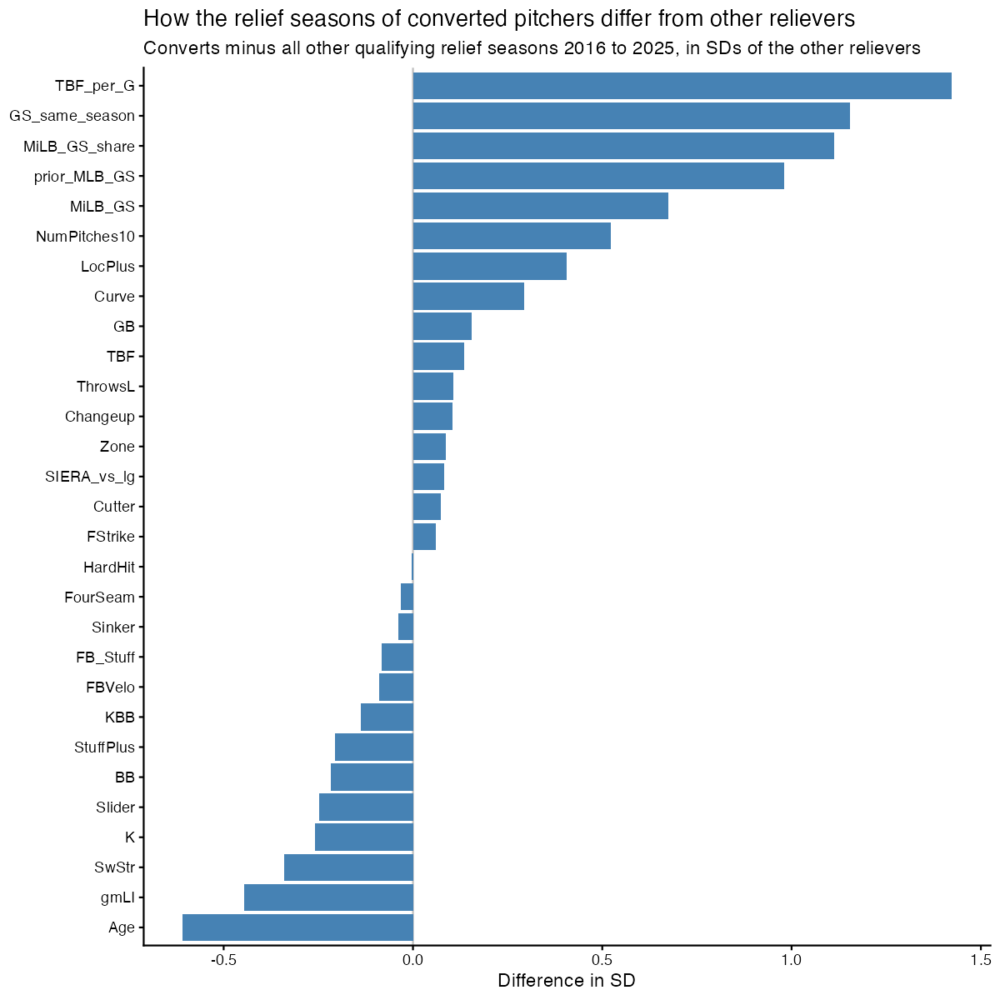

# Reliever to Starter Conversions

Across 145 MLB reliever to starter conversion attempts from 2015 to 2026, SIERA rose by 0.61 on average (0.56 weighted by batters faced) and 77% of pitchers got worse. Converting gained about 0.48 WAR over staying in the bullpen, but lost 0.23 WPA and 0.22 wins above average. This is a Bruin Sports Analytics (BSA) project.

---

## Overview

1. Build a sample of conversions
2. Measure how they went compared to staying in the bullpen
3. Look at what changed after the move
4. Test which relief season traits predict a good starter
5. Predict which 2026 relievers look most like past conversions

Each step is one R Markdown notebook, and the links below open the knitted version.

## 1. Building the Sample ([01_data_and_sample](01_data_and_sample/01_data_and_sample.md))

A conversion attempt is a season with at least 2 starts of 70+ pitches, within three years of a season with 100+ batters faced in relief and starts in 20% or less of games. There is no minimum number of innings or share of games started, since those rules drop attempts that went badly. All of a pitcher's starts that season count toward his results. Pitchers who moved to the rotation during a season are a separate group (133 moves).

## 2. How Conversions Went ([02_conversion_value](02_conversion_value/02_conversion_value.md))

Each attempt is compared to the expected next season of a similar reliever who stayed in the bullpen. WAR went up because starters throw more innings. Measures compared to an average pitcher (WPA and WAA) went down.

| Measure | Average gain (145 attempts) | Standard error |
|---|---|---|
| WAR | +0.48 | 0.09 |
| WPA | -0.23 | 0.09 |
| WAA (role adjusted) | -0.22 | 0.07 |

A flexible baseline and matched controls gave similar WAR gains (0.45 and 0.51). Attempts with 5+ starts gained 0.65 WAR, and the 23 attempts with 2 to 4 starts lost 0.46.

## 3. What Changed ([03_changes_after_conversion](03_changes_after_conversion/03_changes_after_conversion.md))

Fastball velocity fell 1.1 mph. For the 67 attempts with Stuff+ (2020 on), Stuff+ fell 5.1 points while Location+ rose 2.1 points. Pitchers also threw more changeups, sinkers, and cutters and fewer four-seamers.

## 4. What Predicts Success ([04_predicting_success](04_predicting_success/04_predicting_success.md))

- Relief K-BB% and relief SIERA were the strongest predictors of starter SIERA, relative to the league (Spearman correlations of -0.43 and 0.42). No model I tested clearly improved on them, and the relief SIERA relationship held in all 15 versions of the sample I tried (0.34 to 0.59).
- Pitchers with a cushion of at least 1 run (league starter SIERA minus relief SIERA) were league average or better as starters 70% of the time, compared to 33% for the rest.
- For mid-season moves, K-BB% before and after the move had a correlation of 0.20.

## 5. Who Gets Converted ([05_predicting_conversions](05_predicting_conversions/05_predicting_conversions.md))

Teams mostly chose relievers by role and starting history. Those traits separated converts much better than skill did (cross-validated AUC of 0.79 for both, compared to 0.59).

To predict conversions, I tested each model on 1,398 relief seasons from 2021 to 2025 (64 conversions). Each test year only uses earlier relief seasons and conversions that had already happened.

| Model | Expected conversions | Calibration slope | Log loss | AUC |
|---|---|---|---|---|
| Base rate | 72.3 | | 0.1862 | |
| Logistic regression (15 traits) | 72.1 | 0.82 | 0.1520 | 0.841 |
| Ridge | 75.5 | 0.93 | 0.1530 | 0.840 |
| Lasso | 77.0 | 0.93 | 0.1536 | 0.845 |
| Logistic regression (4 traits) | 73.5 | 0.83 | 0.1532 | 0.844 |
| Simple unfitted score | | | | 0.850 |

AUC is averaged over the five test years. A calibration slope of 1 is perfect, and below 1 is overconfident. I used ridge for the final probabilities because its calibration slope was close to 1, but every model expected too many conversions. Ridge did not beat the simple score at ranking pitchers (the 95% interval on the AUC difference is -0.029 to 0.007).

## Limitations

- The traits and cutoffs were chosen after seeing all of the data, and ridge was chosen on the same test years it is reported on, so the test results are slightly optimistic.
- The weighted relief SIERA slope fell from 0.46 for attempts through 2021 to 0.21 after, which could be noise (p = 0.06).
- The 70 pitch cutoff, the 2 start rule, and the cushion and Stuff+ cutoffs were my choices. Some attempts only have a few starts, so their results are noisy.
- A pitcher who was pulled before 70 pitches in every start is not in the sample.
- Recent relief seasons could still become conversions, since the sample allows a three-year gap.
- Only pitchers teams chose to convert and who made starts in the majors are in the sample.

## Data

FanGraphs (role splits and minor league lines), Baseball Savant (Statcast pitches), Baseball-Reference (WPA and WAA), the MLB Stats API (game logs), and the Chadwick Bureau register (player IDs). FanGraphs gave permission to scrape their data for this project. The data is not included since it belongs to those sites.

## Running the Code

Create the `data/savant` folder in the main project folder, then run the notebooks in number order. The pull chunks in `01_data_and_sample.Rmd` are set to `eval=FALSE` so knitting does not download everything again. Run those by hand the first time (the FanGraphs pull opens a Chrome window). Each step has its own folder with the notebook, the knitted page, and its `results` and `charts`.

## Technologies Used

R and R Markdown (dplyr, readr, tidyr, ggplot2, gridExtra, glmnet, splines, rvest, chromote, processx, and jsonlite)
