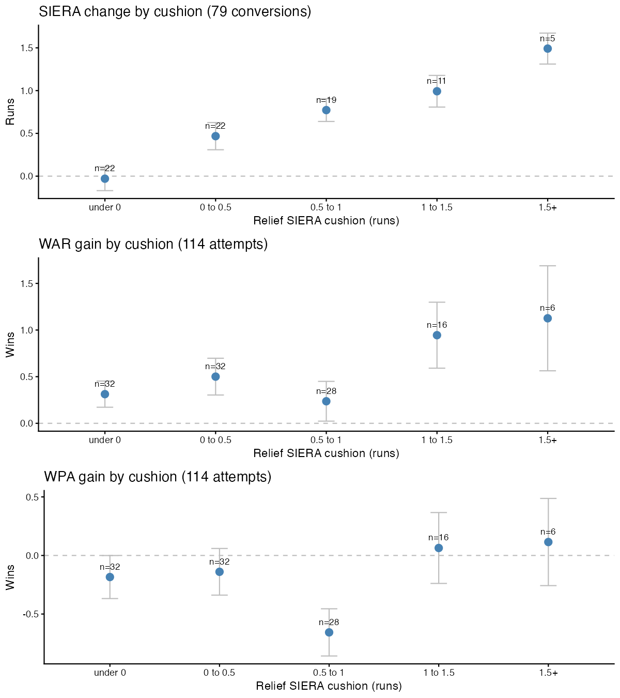
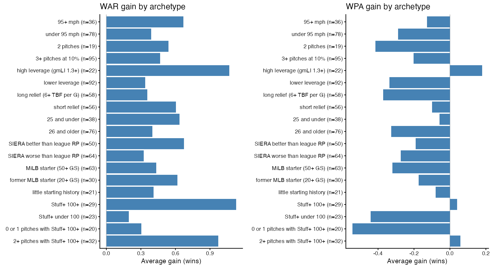
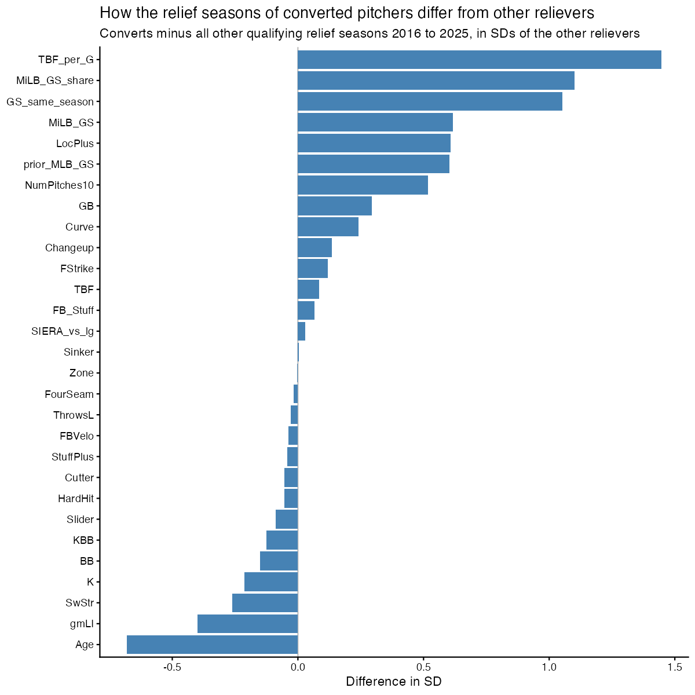

# Reliever to Starter Conversions

Across 79 MLB reliever to starter conversions from 2015 to 2026, SIERA rose by 0.54 on average and 78% of pitchers got worse. Counting 35 shorter attempts as well, converting gained about 0.48 WAR over staying in the bullpen, but lost 0.24 WPA and 0.20 wins above average. This is a Bruin Sports Analytics (BSA) project.

---

## Overview

1. Build a sample of conversions (100+ batters faced in relief, then 5+ starts within three years)
2. Test which relief season traits predict the starter season
3. Compare WAR, WAA, and WPA after the move to a similar reliever who stayed in the bullpen
4. Predict which 2026 relievers look most like past conversions

## Model Performance

Predicting which relievers were converted, tested on 1,398 relief seasons from 2021 to 2025 (37 conversions):

| Model | Expected conversions | Calibration slope | Log loss | AUC |
|---|---|---|---|---|
| Base rate | 37.9 | | 0.1223 | |
| Logistic regression (15 traits) | 32.8 | 0.79 | 0.1042 | 0.841 |
| Ridge | 38.8 | 0.97 | 0.1033 | 0.845 |
| Lasso | 40.6 | 0.95 | 0.1029 | 0.848 |
| Logistic regression (4 traits) | 39.0 | 0.83 | 0.1029 | 0.845 |
| Simple unfitted score | | | | 0.855 |

AUC is averaged over the five test years. A calibration slope of 1 is perfect, and below 1 is overconfident. I used ridge for the final probabilities because of its calibration. It did not beat the simple score at ranking pitchers (the 95% interval on the AUC difference is -0.032 to 0.013).

## Key Findings

- Relief SIERA was the strongest single predictor of starter SIERA, both relative to the league (Spearman correlation of 0.48). No model I tested clearly improved on it.
- Pitchers with a cushion of at least 1 run (league starter SIERA minus relief SIERA) were league average or better as starters 75% of the time, compared to 37% for the rest.
- Teams mostly chose relievers by role and starting history. Those traits separated converts much better than skill did (cross-validated AUC of 0.79 and 0.76, compared to 0.56).

## Methodology Highlights

- **Rolling tests:** Each test year only uses earlier relief seasons and conversions that had already happened.
- **Bullpen baseline:** Expected value comes from relievers who stayed relievers. A flexible baseline and matched controls gave similar WAR gains (0.45 and 0.52).
- **Definitions:** The relief SIERA relationship held in all 14 versions of the sample I tried.

## Limitations

- The traits and cutoffs were chosen after seeing all of the data, and ridge was chosen on the same test years it is reported on, so the test results are slightly optimistic.
- The relief SIERA slope fell from 0.48 for conversions through 2021 to 0.17 after, which could be noise (p = 0.11).
- The success gap for a 1 run cushion from 2022 to 2026 has a 95% interval of -0.05 to 0.63.
- Recent relief seasons could still become conversions, since the sample allows a three-year gap.
- Only pitchers teams chose to convert and who reached the majors as starters are in the sample.

## Technologies Used

R (dplyr, readr, tidyr, ggplot2, gridExtra, glmnet, and splines) and Python (pandas)

## Data

FanGraphs (role splits and minor league lines), Baseball Savant (Statcast pitches), Baseball-Reference (WPA and WAA), and the Chadwick Bureau register (player IDs). The data is not included since it belongs to those sites.

## Running the Code

Create the `data/raw` and `data/savant` folders first, then run in this order:

1. `pull_fangraphs.js` (browser console), `json_to_csv.py`, `pull_win_probability.py`, `pull_bref_value.py`
2. `build_sample.R`, `pull_relief_pitches.py`, `pull_starter_pitches.py`, `pitch_features.R`
3. `indicator_analysis.R`, `value_analysis.R`, `cushion_thresholds.R`, `conversion_changes.R`, `statcast_changes.R`, `predictor_comparison.R`, `definition_sensitivity.R`
4. `swingman_proxy.R`, `conversion_traits.R`, `selection_model.R`, `waa_analysis.R`
5. `baseline_validation.R`, `success_validation.R`

Tables are saved in `results/` and charts in `charts/`.

## Visuals

